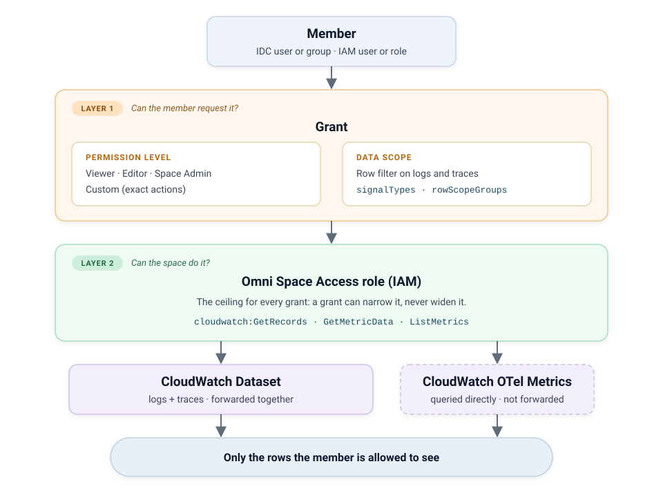

import Tabs from '@theme/Tabs';
import TabItem from '@theme/TabItem';
import OmniPillars from '@site/src/components/OmniPillars';
import RelatedEvents from '@site/src/components/RelatedEvents';

# CloudWatch Omni Access Grants

## Overview

The AWS Cloud Operations blog post
[Best practices for deploying Amazon CloudWatch Omni at enterprise scale](https://aws.amazon.com/blogs/mt/best-practices-for-deploying-amazon-cloudwatch-omni-at-enterprise-scale/)
walks through rolling out [CloudWatch Omni](https://aws.amazon.com/cloudwatch/omni/)
across a large organization, following one example company from start to finish.
AnyCompany runs applications and AI agents across hundreds of AWS accounts,
split across three business units (BUs). BU1 and BU2 run in `us-east-1`, and
BU3 serves European customers from `eu-west-2`, where its telemetry must stay.
Before rollout, the platform team agreed on six requirements and met them by
making decisions in a fixed order.

This guide picks up where *Part 5: Fine grain access controls* of that post
leaves off. The post shows what AnyCompany's grants look like. This guide goes
deeper into access grants inside one space, BU1's: how Omni evaluates a
request, how grants combine, which permission level to pick, how to design data
scopes, how to give alerts and automation an identity, and how to manage and
verify grants as code. It touches the post's other parts only where they affect
grants, namely the platform team's access in *Part 4* and the sensitive-data
controls in *Part 6*.

### A quick recap

The architecture is built from the outside in:

1. **Part 1: Create the Organization domain first.** One sign-in URL for every team, backed by
   [IAM Identity Center](https://docs.aws.amazon.com/singlesignon/latest/userguide/what-is.html) and replicated to `eu-west-2`, with a break-glass role
   for each space.
2. **Part 2: Design centralization rules around data residency.** Telemetry is routed by organizational
   unit into each BU's monitoring account, with data residency choosing the
   destination.
3. **Part 3: Create one space per BU monitoring account.** Each BU monitoring account gets its own space,
   so spaces form the hard walls between BUs and Regions.
4. **Part 4: Give the platform team one sign-in across spaces.** The platform administrators' group holds
   Space Admin in every space.
5. **Part 5: Fine grain access controls.** Inside BU1's space, each team gets a grant
   with a permission level and a data scope, shown in a BU1 access table and
   a `claims-agent` grant example.
6. **Part 6: Protect sensitive data in layers.** Prompts are protected by redaction at
   capture time, masking at ingestion, and scoped grants for reviewers.

Taken together, these parts lead to one guiding principle: *use spaces to
separate BUs and Regions, and use grants for every other access decision.*

### What this guide adds

*Part 5: Fine grain access controls* shows *what* AnyCompany's grants look like.
This guide looks at *how they behave* once real teams, groups, alerts, and
automation start using them.

That depth matters because grants are not walls the way spaces are. A grant is
a permission level plus an optional read-time filter, and grants only ever add
access. A
member who belongs to two groups gets the combined access of both. An alert
reads with its [access profile's](#give-unattended-work-the-narrowest-identity-that-does-the-job) permissions, not its author's. A pipeline
using its own IAM credentials isn't bound by grants at all. Most access
mistakes at enterprise scale come from treating a grant like a wall.

This table shows where each of AnyCompany's six requirements is met, and which
ones this guide takes further:

| Requirement | Met by | Where it is covered |
|---|---|---|
| 1. One sign-in URL backed by the existing identity provider | Organization domain with IAM Identity Center | *Part 1: Create the Organization domain first* |
| 2. Each BU sees only its own telemetry | One space per BU monitoring account | *Part 2: Design centralization rules around data residency* and *Part 3: Create one space per BU monitoring account* |
| 3. EU telemetry stays in `eu-west-2` | Centralization rules and a separate space for BU3 | *Part 2: Design centralization rules around data residency* and *Part 3: Create one space per BU monitoring account* |
| 4. The platform team can reach every BU's view | A Space Admin grant in each space | *Part 4: Give the platform team one sign-in across spaces*; this guide covers keeping that grant small and safe |
| 5. Inside a BU, teams see only the applications and agents they own | Scoped grants | This guide |
| 6. Prompts from sensitive agents stay with a small group of reviewers | Scoped grants, access profiles, and capture-time redaction | This guide, with *Part 6: Protect sensitive data in layers* |

By the end, you'll know how Omni evaluates each request, how grants combine,
where data scopes stop protecting you, how to give alerts and automation the
narrowest identity that works, and how to manage the same access model as code
across every BU space.

## When to use this

This guide is for anyone who manages access inside one or more Omni spaces.
It is most useful when any of the following is true:

- **You are turning AnyCompany's access table into real grants.** You need the
  complete grant definitions, not just the claims-agent fragment, and you want
  them in code so every BU space gets the same model.
- **More than one team shares a space.** Each team should see the services,
  agents, or accounts it owns. In the AnyCompany model that is checkout SREs,
  agent developers, and claims reviewers inside BU1.
- **A space holds content that only some members should read.** Agent spans
  carry prompts and responses, and a grant decides who reads those rows.
- **Work runs when nobody is signed in.** Alerts and Slack investigations need
  an identity with just enough access, and that identity can quietly read more
  than the person who created the alert.
- **Automation calls Omni with its own IAM credentials.** Pipelines and SDK
  clients are not constrained by space grants unless you make them so.
- **You are auditing access.** You need to prove who can read what, and why a
  given member sees a given row.

If you need to control *what telemetry is captured or stored*, rather than who
can read it, that is data protection, covered in *Part 6: Protect sensitive data in layers* and in
[Protect sensitive data](https://docs.aws.amazon.com/AmazonCloudWatch/latest/monitoring/omni-data-protection.html).
A grant filters at read time and never changes stored data.

## Guidance

The guidance follows the order you meet the decisions when you build out BU1:
how a request is evaluated, how grants combine, which level to pick, how to
design data scopes, how to handle unattended work and automation, and how to
operate grants over time. Each recommendation states what to do, why, and the
trade-off if you skip it.

<OmniPillars
  pillars={[
    {
      title: 'Permission level',
      tagline: 'Viewer, Editor, Space Admin, or Custom',
      body: 'Every grant carries one level. Viewer reads the whole space, Editor adds create, change, and delete for resources other than integrations, and Space Admin adds members, permissions, and integrations. Custom is an allowlist of exact actions.',
      why: 'Pick the lowest level that does the job; the tiers stack, so the highest grant a member holds wins.',
      tradeoff: 'Tiers are space-wide. Narrowing them needs action scopes, a Custom grant, or a data scope.',
    },
    {
      title: 'Action scope',
      tagline: 'Narrow specific actions on a grant',
      body: 'A grant can carry up to 20 scoped action groups. Each names actions and the resources they apply to, by ARN, by tag, or, for telemetry reads, by a data scope on the DataSet resource.',
      why: 'Pin an Editor to its own dashboards, alerts, or access profile without writing a full allowlist.',
      tradeoff: 'On a tiered level, a scope narrows only the actions it names. Every other action the tier allows stays.',
    },
    {
      title: 'Data scope',
      tagline: 'Which log and trace rows a member reads',
      body: 'A data scope is the action scope on the DataSet resource that you build in the web UI by choosing Add limits to data visibility. It filters log and trace rows at read time by agent, service, account, or any field.',
      why: 'Teams share one space and see only what they own, without another space.',
      tradeoff: 'Rows, not fields. Not metrics. Not dataset export, AI summaries, or playground runs.',
    },
    {
      title: 'Access profile',
      tagline: 'Identity for unattended work',
      body: 'Alerts and Slack investigations run when no one is signed in. They assume an access profile that holds its own grants, so their reach is set by the profile, not by the person who created them.',
      why: 'One explicit, auditable identity per job instead of permissions scattered across resources.',
      tradeoff: 'A broad profile lets a narrowly scoped author build an alert that reads more than they can.',
    },
  ]}
/>

Set your identifiers once so every CLI example can reuse them. In the
AnyCompany model these are the domain and the BU1 space in `bu1-monitoring`,
`us-east-1`:

```bash
DOMAIN_ID=d-abcde12345
SPACE_ID=11111111-2222-3333-4444-555555555555   # Space 1, bu1-monitoring, us-east-1
```

### Start from AnyCompany's BU1 access model

The BU1 access table (Table 2) is the target state for Space 1. It is a good model, and it
is worth reading each row as the grant Omni actually evaluates:

| IAM Identity Center group | Level (API value) | Data scope | What Omni enforces |
|---|---|---|---|
| `bu1-platform-admins` | Space Admin (`SPACE_ADMIN`) | None | Every row of every signal, plus member, permission, and integration management |
| `bu1-checkout-sre` | Editor (`READ_WRITE_DELETE`) | Logs and traces, By service: `checkout-api`, `payments-api`, `orders-db-proxy` | Log and trace rows whose `service.name` is one of the three; all metrics; create, change, and delete on non-integration resources |
| `bu1-agent-dev` | Editor (`READ_WRITE_DELETE`) | Logs and traces, By agent: `support-agent`, `returns-agent` | Log and trace rows from those two agents only; all metrics; same Editor actions |
| `bu1-claims-reviewers` | Viewer (`READ`) | Logs and traces, By agent: `claims-agent` | Log and trace rows from `claims-agent` only, including its prompts and responses; all metrics; read-only |

Three things in that last column are easy to miss, and the rest of this guide
returns to each:

- **"All metrics" appears on every row.** A data scope filters log and trace
  rows only. If a team must not see a metric, you control that with actions,
  not with a scope.
- **The Editor rows can do more than read.** Editor includes
  `cloudwatch:AssumeAccessProfile`, which means a scoped Editor can attach an
  alert to a profile whose reach is wider than their own scope. See
  [how access profiles work](#give-unattended-work-the-narrowest-identity-that-does-the-job).
- **A scope holds only if every grant the member holds is scoped.** A member
  who also belongs to a group with an unscoped grant sees everything, whatever
  this table says.

### Understand how Omni evaluates a request

Every action in a space passes
[two independent checks](https://docs.aws.amazon.com/AmazonCloudWatch/latest/monitoring/omni-identity-and-access-management-for-cloudwatch-omni.html#omni-identity-and-access-management-for-cloudwatch-omni-space-level-access-control). The first is the
grant: its permission level and any data scope decide whether a *person* may
request an operation and which rows they may see. The second is the [Omni Space
Access role](https://docs.aws.amazon.com/AmazonCloudWatch/latest/monitoring/omni-set-up-omni.html), the IAM role the space assumes to reach your AWS resources, which
decides whether the *space itself* may carry out that operation. When a read is
blocked, first work out which layer stopped it, because each layer fails
differently and has a different fix.



**Treat the Space Access role as an account-wide ceiling, not a per-space
control.** A member's operation succeeds only when their grant allows it *and*
the Omni Space Access role holds the underlying AWS permission. Raising a member
to Space Admin never adds a permission the role lacks. One space operator role
serves every space in the account, so you cannot isolate two spaces in the same
account from each other by giving them different roles. In AnyCompany's layout
each BU has its own monitoring account, so each BU also gets its own ceiling.
If you ever host spaces for two BUs in one account (in different Regions, since
only one space can exist per account and Region), they share that ceiling. The
trade-off of ignoring this is subtle: you might tighten the role for one BU's
compliance needs and silently break the other BU's evaluations or alerts.

**Know that signed-in sessions and raw IAM callers are authorized
differently.** When a member works in a space, Omni issues credentials scoped
to that space, and the member's access is limited to their grants. When a
principal calls Omni with its own IAM credentials, such as a pipeline role or an
SDK client, a missing grant does *not* deny the request; the request is
authorized by that principal's IAM policy. The managed
[`CloudWatchOmniSpaceAccessPolicy`](https://docs.aws.amazon.com/aws-managed-policy/latest/reference/CloudWatchOmniSpaceAccessPolicy.html)
gates its space actions on the condition key
[`cloudwatch:HasAccessGrant`](https://docs.aws.amazon.com/service-authorization/latest/reference/list_cloudwatch.html), and you should do the same on roles you create
(see [Constrain automation at the IAM layer](#constrain-automation-at-the-iam-layer)).
If you skip this, an automation role with broad `cloudwatch:*` permissions can
read telemetry that no grant in the space would have allowed.

**Expect interactive reads, including the Omni agent's, to run as the
member.** Omni uses
[forward access session](https://docs.aws.amazon.com/IAM/latest/UserGuide/access_forward_access_sessions.html) credentials when it runs a telemetry query, so the read
is authorized as the member rather than as the service. The Omni agent also
reads with the member's own access, which is why its answers respect the
member's data scope.

### Design for the union rule: grants only add

A member's effective access is the **union** of every grant they hold,
directly or through any group. For tiered levels the highest one wins, a Custom
grant adds exactly the actions it names, and there are no explicit denies. The
same rule applies to data scopes, and this is the single most important
property to design around:

> A grant without a data scope gives the member the full view, whatever scopes
> their other grants carry.

Consider how this plays out in BU1. *Part 4: Give the platform team one sign-in across spaces* recommends a Viewer
grant for engineers who support incidents across BUs. Suppose AnyCompany
creates a `bu1-incident-responders` group with an unscoped Viewer grant. A
claims reviewer who also joins the incident rotation is now in both groups, so
they see the whole space, not just `claims-agent`. Worse, every incident
responder now reads `claims-agent` prompts, which breaks requirement 6.

A Custom grant that adds `cloudwatch:GetRecords` with no data scope gives a
member whose Viewer grant is scoped the full view of logs and traces.

**Put a data scope on every grant a member can hold, including inherited
group grants.** To keep a member narrow, every path to them must be narrow.
The trade-off is maintenance: a scoped incident responder grant has to list
what responders may see, and that list grows with the BU.

**Design scopes as allowlists, because that is all they can be.** `IN` is the
only operator, so there is no "everything except `claims-agent`". To give
incident responders broad access that still excludes a sensitive agent, list
what they may see. One practical pattern for BU1 is two condition groups: one
By service group that lists the BU's application services, and one By agent
group that lists every agent except `claims-agent`.

```json title="bu1-incident-responders.json"
{
  "name": "bu1-incident-responders",
  "permission": "READ",
  "scopedActions": [
    {
      "actions": [
        "cloudwatch:GetRecords",
        "cloudwatch:ListMetrics",
        "cloudwatch:GetMetricData"
      ],
      "resources": [
        {
          "resourceType": "DataSet",
          "signalTypes": ["LOGS", "TRACES"],
          "rowScopeGroups": [
            [
              {
                "operator": "IN",
                "field": "resource['attributes']['service.name']",
                "values": ["checkout-api", "payments-api", "orders-db-proxy"]
              }
            ],
            [
              {
                "operator": "IN",
                "field": "resource['attributes']['service.name']",
                "values": ["support-agent", "returns-agent"]
              },
              {
                "operator": "IN",
                "field": "resource['attributes']['aws.service.type']",
                "values": ["gen_ai_agent"]
              }
            ]
          ]
        }
      ]
    }
  ],
  "tags": { "bu": "bu1", "owner": "platform" }
}
```

The web UI writes all three read actions into a data scope, so every scope
example in this guide lists `GetRecords`, `ListMetrics`, and `GetMetricData`.
The row filter applies only to log and trace rows, so metrics stay
unfiltered. To keep a member from seeing metrics, use a Custom grant that
leaves the metric actions out.

Two caveats keep this honest. First, the first group is By service, and By
service matches every instrumented service, agents included, so never put an
agent name such as `claims-agent` in a By service list. Second, rows that carry
no `service.name` at all, such as some infrastructure logs, match neither group
and are hidden. If responders need those, add a group with a By field value
condition on an attribute those rows do carry, or a By account condition for
an account that holds no sensitive agents.

:::warning[Deleting a user's grants does not remove their group access]
Each grant belongs to one principal, and a user can reach a space through more
than one: their own user principal and every group they belong to. Deleting the
grants on the user principal removes only those grants. Grants on their groups
still apply, because those belong to the group, not the user. To fully remove
someone, remove them from the groups in IAM Identity Center or your identity
provider, or delete the group's grant, which affects every member of the group. This is one more reason to grant to
groups only: the identity provider stays the single place where membership
changes.
:::

### Choose a permission level by what each tier actually includes

*Part 5: Fine grain access controls* lists the four levels in one line each. At design time you need to
know which actions each tier carries, because the escalation paths hide in the
differences. The following table shows which actions each tier includes. The
full action list, with the tier that includes each action, is in the
[Custom grant actions](https://docs.aws.amazon.com/AmazonCloudWatch/latest/monitoring/omni-custom-grant-actions.html)
reference:

| Capability | Viewer (`READ`) | Editor (`READ_WRITE_DELETE`) | Space Admin (`SPACE_ADMIN`) |
|---|---|---|---|
| Query sessions, `GetRecords`, metrics reads, application map | Yes | Yes | Yes |
| Omni agent threads | Yes | Yes, plus `SubmitFeedback` | Yes |
| Alerts, dashboards, saved views | List and Get | Create, Update, Delete | Create, Update, Delete |
| Access grants | List and Get | List and Get | Create and Delete |
| Access profiles | List and Get | Adds `AssumeAccessProfile` | All six actions |
| Integrations (Slack, AWS DevOps Agent) | List and Get | List and Get | Connect, change, remove |
| Intelligence configuration | Get | Put | Put |
| Space configuration | Get, List | Get, List | Adds `UpdateSpace` |
| Send through an integration (`InvokeIntegration`) | No | No | No (grant it to access profiles) |

Read three design consequences from that table:

- **Viewers can list grants.** Every Viewer can see who has access and how, so
  grant names, descriptions, and tags are visible to the whole space. Don't put
  anything in them you would not show every member.
- **An Editor can run alerts as any access profile, including broad ones.**
  Editor includes `cloudwatch:AssumeAccessProfile` on every profile. A scoped Editor
  who creates an alert on a broad profile builds something that reads, and can
  report, beyond their own scope. The next pattern narrows this.
- **Among the tiers, only Space Admin can change access.** A Custom grant that
  lists `cloudwatch:CreateAccessGrant` or `cloudwatch:DeleteAccessGrant` can
  too, so treat those actions as Space Admin power. A data scope on a Space
  Admin grant limits what that admin can read, but not the management actions
  the level allows. Because a Space Admin can create grants for groups, a scope
  on a Space Admin is a convenience, not containment. The advice to keep
  Space Admin to the few people who own access governance is the real control.

**Keep the break-glass role separate and out of daily use.** *Part 1: Create the Organization domain first* creates
each space with a dedicated break-glass IAM role. Omni also guarantees that a
space always keeps at least one Space Admin, and that no principal can edit or
delete its own grants. Pair that with at least two people in
`bu1-platform-admins`, so a grant change never depends on one person.

### Narrow an Editor without rewriting it as Custom

Action scopes on a tiered level narrow only the actions they name; every other
action the level allows remains available. That is exactly what AnyCompany's
data scopes do on Editor grants: they narrow `GetRecords` and leave the rest of
Editor intact. You can use the same mechanism to pin other resource-typed
actions.

For `bu1-checkout-sre`, the risk from the previous section is an alert attached
to a broad profile. Give the team its own profile, tag it, and add an action
scope that limits `cloudwatch:AssumeAccessProfile` to profiles carrying that
tag:

```json title="bu1-checkout-sre.json"
{
  "name": "bu1-checkout-sre",
  "permission": "READ_WRITE_DELETE",
  "scopedActions": [
    {
      "actions": [
        "cloudwatch:GetRecords",
        "cloudwatch:ListMetrics",
        "cloudwatch:GetMetricData"
      ],
      "resources": [
        {
          "resourceType": "DataSet",
          "signalTypes": ["LOGS", "TRACES"],
          "rowScopeGroups": [
            [
              {
                "operator": "IN",
                "field": "resource['attributes']['service.name']",
                "values": ["checkout-api", "payments-api", "orders-db-proxy"]
              }
            ]
          ]
        }
      ]
    },
    {
      "actions": ["cloudwatch:AssumeAccessProfile"],
      "resources": [
        {
          "resourceType": "AccessProfile",
          "tags": { "team": "checkout" }
        }
      ]
    }
  ],
  "tags": { "bu": "bu1", "team": "checkout" }
}
```

The permission stays `READ_WRITE_DELETE`, so the team keeps every Editor
action: running queries, using the Omni agent, and creating, changing, and
deleting dashboards, alerts, and saved views. The two scoped action groups
narrow only the actions they name:

- **The first group is the team's data scope.** `GetRecords` returns only log
  and trace rows from `checkout-api`, `payments-api`, and `orders-db-proxy`.
- **The second group pins the team to its own profiles.**
  `cloudwatch:AssumeAccessProfile` works only on access profiles tagged
  `team=checkout`. Creating an alert requires assuming its profile, so an
  alert on a profile tagged for another team is refused with "Not authorized to
  assume the access profile". The team can attach alerts to a profile such as
  `bu1-checkout-alerts` (defined in
  [Give unattended work the narrowest identity that does the job](#give-unattended-work-the-narrowest-identity-that-does-the-job)), and
  those alerts read with that profile's scope instead of a broader one. The
  scope does not limit the service-managed `Standard` profile. A member with
  this grant can create alerts on `Standard`, its grants carry no data scope,
  and an alert on it reads the whole space, not just the author's scope.

That is how the grant meets the goal of this section: two actions are
narrowed, and the rest of Editor carries on unchanged, without listing every
Editor action in a Custom grant.

The **JSON** view of the add-grants form shows the full grant definition and
can be edited directly, so check a scope like this there before you save it.

The trade-off of skipping this is that requirement 5 holds for what the team
reads interactively but not for what its alerts read on a schedule.

### Use a Custom grant when you need an exact allowlist

Reach for **Custom** when the job sits between tiers and you want nothing
added by default. Common cases at enterprise scale are a reporting role that
may edit its own team's dashboards but not alerts, an on-call rotation that may
update alerts but not dashboards or access profiles, and a claims reviewer who
must not see metrics either. Viewer already covers read-only access, so use
Custom only when you need something no tier offers.

Two rules govern Custom grants:

1. **A Custom grant can't take away access that other grants give.** It
   combines with any tier the member also holds, so it holds a member to an allowlist only when it is
   their *only* grant in the space.
2. **Only resource-typed CloudWatch actions accept scopes.** Telemetry query
   actions (through a `DataSet` data scope), alerts, dashboards, access
   profiles, and integrations can be limited to named resources, tags, or rows.
   Space-wide actions such as `cloudwatch:GetSpace` take no scope, and actions
   from other services, such as `logs:` or `bedrock-agentcore:`, take no
   resource or tag scope and apply to everything the Space Access role can
   reach. Those also need the Space Access role to allow them.

AnyCompany's claims reviewers are a good candidate if AnyCompany decides they
should see `claims-agent` rows and nothing else, not even metrics. Drop the
metric actions and keep the query, record, and Omni agent actions:

<Tabs>
  <TabItem value="json" label="Grant JSON" default>

```json title="bu1-claims-reviewers-custom.json"
{
  "name": "bu1-claims-reviewers",
  "permission": "CUSTOM",
  "scopedActions": [
    {
      "actions": [
        "cloudwatch:StartTelemetryQuerySession",
        "cloudwatch:ListTelemetryQuerySessions",
        "cloudwatch:StopTelemetryQuerySession",
        "cloudwatch:StopTelemetryQuery",
        "cloudwatch:GetTelemetryQueryResults",
        "cloudwatch:GetSpace",
        "cloudwatch:ListSpaces",
        "cloudwatch:GetPreferences",
        "cloudwatch:UpdatePreferences",
        "cloudwatch:CreateOmniThread",
        "cloudwatch:GetOmniThread",
        "cloudwatch:UpdateOmniThread",
        "cloudwatch:ListOmniThreads",
        "cloudwatch:DeleteOmniThread",
        "cloudwatch:StartOmniThreadSession"
      ]
    },
    {
      "actions": ["cloudwatch:GetRecords"],
      "resources": [
        {
          "resourceType": "DataSet",
          "signalTypes": ["LOGS", "TRACES"],
          "rowScopeGroups": [
            [
              {
                "operator": "IN",
                "field": "resource['attributes']['service.name']",
                "values": ["claims-agent"]
              },
              {
                "operator": "IN",
                "field": "resource['attributes']['aws.service.type']",
                "values": ["gen_ai_agent"]
              }
            ]
          ]
        }
      ]
    }
  ],
  "tags": { "bu": "bu1", "sensitivity": "high" }
}
```

  </TabItem>
  <TabItem value="cli" label="AWS CLI">

```bash
aws cloudwatchomni create-access-grant \
  --domain-id "$DOMAIN_ID" \
  --space-id "$SPACE_ID" \
  --name "bu1-claims-reviewers" \
  --principal 'principalType=IDC_GROUP,principalId=GROUP_ID' \
  --permission CUSTOM \
  --scoped-actions file://bu1-claims-reviewers-scoped-actions.json \
  --tags bu=bu1,sensitivity=high
```

The file holds the `scopedActions` array from the **Grant JSON** tab. See
[`create-access-grant`](https://docs.aws.amazon.com/cli/latest/reference/cloudwatchomni/create-access-grant.html)
in the AWS CLI reference.

  </TabItem>
</Tabs>

Because the permission is `CUSTOM`, these two groups are the only actions the
reviewers get:

- **The first group lets reviewers work in the space.** It covers query
  sessions, space and preference reads, and the Omni agent's thread actions.
  These actions return no telemetry on their own.
- **The second group decides what they read.** `GetRecords` carries a By agent
  data scope for `claims-agent`, so every log and trace row a reviewer sees,
  including the rows the Omni agent reads on their behalf, comes from that
  agent.

What the grant leaves out is what meets the objective. Without `GetMetricData`
and `ListMetrics`, reviewers see no metrics. Without the dashboard, alert,
application map (`GetContextGraph`), and grant actions, they have nothing
outside their claims-agent queries. This holds only while it is the reviewers'
only grant in the space.

The trade-off is maintenance: when Omni adds actions, a Custom grant does not
pick them up, so reviewers may lose a feature a Viewer would have gained. Use
Custom only where the allowlist is the point.

### Design data scopes that survive real telemetry

*Part 5: Fine grain access controls* explains the two parts of a scope. These are the details that decide
whether a scope behaves the way the access table says.

**Always set both signal types unless you mean to leave one open.** Under
**Applies to**, a signal type you do not select is *not filtered*, so a member
whose scope applies only to traces reads every log row in the space. The BU1
access table selects both **Logs** and **Traces** on every scoped row for this reason. Choose
one signal on purpose, for example an on-call engineer scoped to the traces of
one service who may read every log, and note why in the grant description.

**Combine conditions with intent.** Conditions in a group must all match
(AND). A row is visible when it matches any group (OR). A grant with no groups
applies no scope. Use one group per independent slice; never widen one
condition to cover two slices, because that exposes the cross-product.

**Prefer By agent over By service for agents.** By agent matches
`service.name` *and* `aws.service.type` of `gen_ai_agent`, so a regular service
that shares an agent's name stays out. By service matches every instrumented
service, agents included.

**Write nested attributes in bracket notation, and verify field names against live data.**
A dotted OpenTelemetry attribute name is written as one key, such as
`resource['attributes']['service.name']`. Top-level fields, such as the
CloudTrail field `eventSource`, are written by name. A condition on a field or value that
never appears matches no rows, and the member silently sees nothing. The
By agent, By service, and By account pickers suggest values found in recent
telemetry, and you can type a value not yet seen, such as an agent you are
about to deploy. For By field value, the field picker lists fields discovered
in your telemetry, and you type the values.

**Expect aggregates to follow the scope.** A count, error rate, or latency
percentile is computed over the rows the member can see, so two members with
different scopes get different numbers from the same query. Tell teams this
before the first incident, or a checkout SRE and a platform admin will argue
over two correct error rates.

**Remember that scopes protect the query path, not every path to the data.**
A data scope
[applies wherever a member reads](https://docs.aws.amazon.com/AmazonCloudWatch/latest/monitoring/omni-limit-what-members-can-see.html)
from the CloudWatch Dataset:
queries, dashboards, trace and session views, and Omni agent answers, in the
web UI, IDE extension, and API. It
[does not extend to](https://docs.aws.amazon.com/AmazonCloudWatch/latest/monitoring/omni-security-best-practices-for-cloudwatch-omni.html#omni-security-best-practices-for-cloudwatch-omni-preventative-controls):

| Path | Why a scope does not cover it | What to do |
|---|---|---|
| Metrics | Scopes filter log and trace rows only | Omit `GetMetricData` and `ListMetrics` with a Custom grant |
| Dataset creation and export | A member can build an evaluation dataset over underlying traces | Grant `bedrock-agentcore:` dataset actions only to people trusted with the whole space's content |
| AI-assisted summaries and prompt playground runs | They read content outside the scoped query path | Grant those features only where the reader may see the content |
| [AWS DevOps Agent investigations](https://docs.aws.amazon.com/AmazonCloudWatch/latest/monitoring/omni-investigate-with-the-aws-devops-agent.html) | Results can draw on CloudWatch Logs log groups outside the Dataset | Treat a connected DevOps Agent space as unscoped for every member |
| Fields inside a visible row | Scopes are row-level | [Redact at capture time](https://docs.aws.amazon.com/AmazonCloudWatch/latest/monitoring/omni-data-protection.html) (*Part 6: Protect sensitive data in layers*) |

The trade-off of skipping this review is that requirement 6 holds in the
explorer and fails in an evaluation dataset.

### Apply the same model to an audit slice: CloudTrail

The trace examples above leave nothing open. The mechanism is identical for a
logs-only reviewer, and CloudTrail in the BU1 monitoring account is the usual
case: a security reviewer must see one slice of API activity without any
traces or agent prompts. CloudTrail reaches a space as a **logs** signal, so
you filter on CloudTrail record fields such as `eventSource` and
`recipientAccountId` instead of `service.name`.

```json title="bu1-cloudtrail-audit-reviewer.json"
{
  "name": "bu1-cloudtrail-audit-reviewer",
  "permission": "CUSTOM",
  "scopedActions": [
    {
      "actions": [
        "cloudwatch:StartTelemetryQuerySession",
        "cloudwatch:ListTelemetryQuerySessions",
        "cloudwatch:StopTelemetryQuerySession",
        "cloudwatch:StopTelemetryQuery",
        "cloudwatch:GetTelemetryQueryResults",
        "cloudwatch:GetSpace",
        "cloudwatch:ListSpaces"
      ]
    },
    {
      "actions": ["cloudwatch:GetRecords"],
      "resources": [
        {
          "resourceType": "DataSet",
          "signalTypes": ["LOGS", "TRACES"],
          "rowScopeGroups": [
            [
              { "operator": "IN", "field": "@data_source_name", "values": ["aws_cloudtrail"] },
              { "operator": "IN", "field": "eventSource", "values": ["s3.amazonaws.com", "iam.amazonaws.com"] },
              { "operator": "IN", "field": "recipientAccountId", "values": ["111122223333"] }
            ]
          ]
        }
      ]
    }
  ]
}
```

This follows the same pattern as the claims reviewer grant. The first group
lets the reviewer run queries in the space, and the second scopes `GetRecords`
to one condition group. All three conditions in that group must match, so the
reviewer sees only S3 and IAM API events recorded in account `111122223333`.
The grant includes no metric, Omni agent, dashboard, or alert actions.

CloudTrail record fields are top-level fields on the row, so write them as
`eventSource` and `recipientAccountId`. Keep the `@data_source_name` condition
in the group. It limits the group to rows from the CloudTrail data source, so
the reviewer sees the matching CloudTrail logs and no traces. Values must match
exactly: `eventSource` is `s3.amazonaws.com`, not `S3`.

### Give unattended work the narrowest identity that does the job

[Alerts](https://docs.aws.amazon.com/AmazonCloudWatch/latest/monitoring/omni-alerts.html) and Slack investigations act when no one is
signed in, so there is no member for them to act as. They need an identity of
their own, and an [**access profile**](https://docs.aws.amazon.com/AmazonCloudWatch/latest/monitoring/omni-access-profiles.html) is that identity.

A profile works with grants in two ways:

- **It holds grants, like a member does.** You add a profile on the
  **Manage permissions** page and give it Viewer, Editor, or Custom grants,
  with action scopes and data scopes, exactly as you would for a group. Those
  grants decide what the alert or investigation can read and which
  integrations it can notify. A profile can never hold Space Admin, so
  unattended work can never change who has access to the space.
- **A separate grant decides who may act as it.** That grant is
  `cloudwatch:AssumeAccessProfile` on the profile. Alerts hold only this one
  grant, and every other permission an alert uses comes from its profile. The
  person creating the alert needs `AssumeAccessProfile` on the profile too,
  which Editor includes.

This is why profiles matter for requirement 5. An alert's reach is set by its
profile's grants, not by the grants of the person who created it. A narrowly
scoped author can still build an alert on a broad profile, so profiles are
where requirement 5 most often erodes. Profiles are also reusable: several
alerts can share one profile instead of each carrying its own permissions.

**Create one profile per team and job, and tag it.** For BU1, a
`bu1-checkout-alerts` profile with a Custom grant that reads only the checkout
services and invokes only the checkout Slack integration keeps the checkout
team's alerts inside the checkout scope. Tag it `team=checkout` so the action
scope from the Editor pattern above can bind the team to it.

**Give the profile an alert trust grant.** An alert can use a profile only
after a grant to the principal type `ALERT`, with the principal ID `ALL`,
allows `cloudwatch:AssumeAccessProfile` on that profile's ARN. Create this grant
for each profile you create with the AWS CLI, before you create the first alert
on it.

```json title="bu1-checkout-alerts-trust-grant.json"
[
  {
    "actions": ["cloudwatch:AssumeAccessProfile"],
    "resources": [
      {
        "resourceType": "AccessProfile",
        "resourceArns": [
          "arn:aws:cloudwatch:us-east-1:111122223333:access-profile/PROFILE_ID"
        ]
      }
    ]
  }
]
```

```bash
aws cloudwatchomni create-access-grant \
  --domain-id "$DOMAIN_ID" \
  --space-id "$SPACE_ID" \
  --name "bu1-checkout-alerts-trust" \
  --principal 'principalType=ALERT,principalId=ALL' \
  --permission CUSTOM \
  --scoped-actions file://bu1-checkout-alerts-trust-grant.json
```

**Don't accept the preselected profile.** When you create an alert, the
**Access profile** field is preselected to the profile with the most grants,
which is usually the broadest one. The alert's query preview runs with your own
access, but the alert reads with the profile's access, so results can differ.

**Scope `cloudwatch:InvokeIntegration` to named integrations and channels.** No
tier includes it, so it is granted mainly to profiles. Omni lets you limit it to
named integrations and, for Slack, to channels. A profile that can post to any
channel can send checkout data to a channel the claims reviewers watch.

**Grant `DefaultAccessProfileForAsyncWorkflows` a scoped Viewer, not an
unscoped one.** This system managed profile is the identity the Omni agent uses
for [Slack mention investigations](https://docs.aws.amazon.com/AmazonCloudWatch/latest/monitoring/omni-connect-slack.html). It starts with no permissions. The audience
of a Slack channel is rarely the audience of a space, so scope this profile to
the rows the channel's members may see, and leave `claims-agent` out.

**Watch for silent failures.** Omni checks that the profile can read the
query's data only when you create or update an alert. If the profile later
loses that access, the alert reports **no data** rather than an error. Deleting
a profile does not check whether alerts still use it. Move or delete those
alerts first.

### Manage grants as code across every BU space

The JSON behind each grant is reusable with the API, the
AWS CLI, and the AWS CDK. At enterprise scale that is the point: Space 2 and
Space 3 should get the same model as Space 1 with different values, and every
change should be reviewed. Grants are also available as the
[`AWS::CloudWatch::AccessGrant`](https://docs.aws.amazon.com/AWSCloudFormation/latest/TemplateReference/aws-resource-cloudwatch-accessgrant.html)
AWS CloudFormation resource. A data scope maps to the
[`ResourceScope`](https://docs.aws.amazon.com/AWSCloudFormation/latest/TemplateReference/aws-properties-cloudwatch-accessgrant-resourcescope.html)
property type, with `SignalTypes` and `RowScopeGroups`.

```yaml title="bu1-access-grants.yaml"
AWSTemplateFormatVersion: '2010-09-09'
Description: BU1 Space 1 access grants (BU1 access table)
Parameters:
  DomainId: { Type: String }
  SpaceId: { Type: String }
  AgentDevGroupId: { Type: String }
  ClaimsReviewersGroupId: { Type: String }
Resources:
  Bu1AgentDev:
    Type: AWS::CloudWatch::AccessGrant
    Properties:
      DomainId: !Ref DomainId
      SpaceId: !Ref SpaceId
      Name: bu1-agent-dev
      Permission: READ_WRITE_DELETE
      Principal:
        PrincipalType: IDC_GROUP
        PrincipalId: !Ref AgentDevGroupId
      ScopedActions:
        - Actions:
            - cloudwatch:GetRecords
            - cloudwatch:ListMetrics
            - cloudwatch:GetMetricData
          Resources:
            - ResourceType: DataSet
              SignalTypes: [LOGS, TRACES]
              RowScopeGroups:
                - - Operator: IN
                    Field: "resource['attributes']['service.name']"
                    Values: [support-agent, returns-agent]
                  - Operator: IN
                    Field: "resource['attributes']['aws.service.type']"
                    Values: [gen_ai_agent]
      Tags:
        - { Key: bu, Value: bu1 }
        - { Key: team, Value: agent-dev }
  Bu1ClaimsReviewers:
    Type: AWS::CloudWatch::AccessGrant
    Properties:
      DomainId: !Ref DomainId
      SpaceId: !Ref SpaceId
      Name: bu1-claims-reviewers
      Permission: READ
      Principal:
        PrincipalType: IDC_GROUP
        PrincipalId: !Ref ClaimsReviewersGroupId
      ScopedActions:
        - Actions:
            - cloudwatch:GetRecords
            - cloudwatch:ListMetrics
            - cloudwatch:GetMetricData
          Resources:
            - ResourceType: DataSet
              SignalTypes: [LOGS, TRACES]
              RowScopeGroups:
                - - Operator: IN
                    Field: "resource['attributes']['service.name']"
                    Values: [claims-agent]
                  - Operator: IN
                    Field: "resource['attributes']['aws.service.type']"
                    Values: [gen_ai_agent]
      Tags:
        - { Key: bu, Value: bu1 }
        - { Key: sensitivity, Value: high }
```

The stack creates two rows of the BU1 access table: `bu1-agent-dev` as an
Editor scoped to its two agents, and `bu1-claims-reviewers` as a Viewer scoped
to `claims-agent`. The data scopes are the same JSON the web UI writes, in
CloudFormation property names. The domain, space, and IAM Identity Center
group IDs come in as parameters, so the same template serves every BU space.
To use the Custom claims reviewer grant instead, set `Permission: CUSTOM` and
replace `ScopedActions` with its two groups.

Plan for three properties of grants as code:

- **Every property change replaces the grant.** Every
  `AWS::CloudWatch::AccessGrant` property
  [requires replacement on update](https://docs.aws.amazon.com/AWSCloudFormation/latest/TemplateReference/aws-resource-cloudwatch-accessgrant.html#aws-resource-cloudwatch-accessgrant-properties). That
  matches the Omni web UI, where saving an edit replaces a
  member's scope rather than adding to it. Re-verify the member's view after
  every deploy, and avoid manual edits in the web UI that the next deploy would
  overwrite.
- **Keep the admin path outside the stack.** [Setup](https://docs.aws.amazon.com/AmazonCloudWatch/latest/monitoring/omni-set-up-omni.html) creates a system managed
  Space Admin grant for the identity that ran it, and that grant can't be
  removed while it is the last Space Admin grant. Space Admins can also be
  added and removed from the CloudWatch console at any time. Manage the
  break-glass role and its Space Admin grant there, not in the stack, so a
  failed or rolled-back stack update can't take away your last admin path.
- **Parameterize per space, not per account.** The domain ID is shared, the
  space ID and group IDs differ per BU. Space 3 lives in `eu-west-2`, so deploy
  its stack in that Region.

### Constrain automation at the IAM layer

Grants constrain people working in a space. Automation that calls Omni with its
own credentials is constrained by IAM, so put the guardrails there.

**Require a grant on roles you create for programmatic access.** Add
`"cloudwatch:HasAccessGrant": "true"` to the role's Omni statements so they are
effective only when the caller holds a grant in the space. Keep setup and
administration actions in a separate statement without the condition, because
those operations are authorized by IAM alone.

```json title="omni-automation-role-policy.json"
{
  "Version": "2012-10-17",
  "Statement": [
    {
      "Sid": "OmniSpaceActionsRequireGrant",
      "Effect": "Allow",
      "Action": [
        "cloudwatch:StartTelemetryQuerySession",
        "cloudwatch:GetTelemetryQueryResults",
        "cloudwatch:GetRecords",
        "cloudwatch:ListOmniDashboards",
        "cloudwatch:GetOmniDashboard"
      ],
      "Resource": "*",
      "Condition": {
        "StringEquals": {
          "aws:ResourceAccount": "${aws:PrincipalAccount}",
          "cloudwatch:HasAccessGrant": "true"
        }
      }
    }
  ]
}
```

The statement lets the role run telemetry queries and read dashboards under
two conditions. `aws:ResourceAccount` limits it to resources in the role's own
account, and `cloudwatch:HasAccessGrant` makes it apply only when the caller
holds a grant in the space. A caller with no grant gets nothing from this
statement, so the role can act only in spaces where it has been given a grant.

**Use tags to control what a grant pipeline may create.** Access grants
[accept tags at creation](https://docs.aws.amazon.com/AmazonCloudWatch/latest/monitoring/omni-identity-and-access-management-for-cloudwatch-omni.html#omni-identity-and-access-management-for-cloudwatch-omni-tag-based-access-control), so `aws:RequestTag/*` and `aws:TagKeys` can require every
grant a pipeline creates to carry, for example, a `bu` tag matching the space it
deploys to. `aws:ResourceTag/*` can then restrict who can delete grants with a
given tag, such as `sensitivity=high`.

**Audit grant changes in AWS CloudTrail.** Omni management operations,
including creating and deleting access grants, are
[recorded in CloudTrail](https://docs.aws.amazon.com/AmazonCloudWatch/latest/monitoring/omni-security-best-practices-for-cloudwatch-omni.html#omni-security-best-practices-for-cloudwatch-omni-detective-controls) with
the event source `cloudwatch.amazonaws.com`. Monitor changes to sensitive
grants, such as those tagged `sensitivity=high`, and alert on anything
unexpected.

### Operate grants as the BU grows

Grants rot faster than spaces, because teams, agents, and people change weekly.
Build these into your operating rhythm:

- **Review scopes whenever an agent or service is deployed.** A data scope is
  an inclusion rule, so a new agent is invisible to every scoped member until
  you add it, and visible to every unscoped member immediately. Add the
  deployment checklist item "which grants list this service?" alongside the
  capture-time redaction decision from *Part 6: Protect sensitive data in layers*.
- **Verify after every scope change.** Saving an edit replaces the previous
  scope, so run the checks in
  [Verify a grant does what you intended](#verify-a-grant-does-what-you-intended).
  Have the member sign out and back in first.
- **Name and tag grants by BU, team, and owner.** Grant names and tags are
  visible to every member, and tags drive both tag-scoped grants and
  IAM conditions.
- **Review the full grant list on a schedule.** Export it and compare with the
  model in code:

```bash
aws cloudwatchomni list-access-grants \
  --domain-id "$DOMAIN_ID" \
  --space-id "$SPACE_ID"
```

### Verify a grant does what you intended

Creating a grant is not the same as confirming it behaves. Verify each one
before you rely on it.

:::note[Sign out and back in before you test]
A member's open session can keep returning the results of their previous
grants, and a page refresh does not pick up the change. After every grant
change, have the member you are testing as sign out and back in, then run the
checks below.
:::

1. **Confirm the grant exists and reads as expected.** In the web UI, open
   **Settings → Manage permissions**
   ([Manage space members and permissions](https://docs.aws.amazon.com/AmazonCloudWatch/latest/monitoring/omni-manage-space-members-and-permissions.html)) and check the principal shows the grant,
   level, and data scope you set. From the CLI, run
   [`list-access-grants`](https://docs.aws.amazon.com/cli/latest/reference/cloudwatchomni/list-access-grants.html).
2. **Prove a data scope is active.** Aggregates are computed over visible rows
   only, so run the same `count()` query as a scoped member and as a member of
   `bu1-platform-admins`. A smaller count for the scoped member is direct
   evidence the filter applies.
3. **Prove the sensitive slice is excluded.** As a member of every group
   except `bu1-claims-reviewers`, filter for `claims-agent` and confirm zero
   rows. Repeat for a user who sits in two groups, to test the union.
4. **Check both signals.** If you meant both to be scoped, confirm logs and
   traces each return only in-scope rows. For a logs-only scope, count the
   traces as well, because a scope written for logs can still return traces.
5. **Check unattended paths.** Create a test alert on each team profile and
   confirm it returns data, then confirm the Slack profile cannot read
   `claims-agent`.

### Common pitfalls

| Symptom | Likely cause | Fix |
|---------|-------------|-----|
| A scoped member sees everything | The member also holds an unscoped grant, often through a group such as an incident rotation. | Put a data scope on every grant the member can inherit, or remove them from the unscoped group. |
| A trace-scoped member reads every log | Only **Traces** is selected under **Applies to**, so logs are not filtered. | Select both signal types unless leaving one open is intentional. |
| Member sees no telemetry despite a Viewer grant | Layer 2: the Space Access role does not permit the read. | Update the role. See [Identity and access management for CloudWatch Omni](https://docs.aws.amazon.com/AmazonCloudWatch/latest/monitoring/omni-identity-and-access-management-for-cloudwatch-omni.html). |
| Data scope returns zero rows | A value never appears in the telemetry, or a nested attribute is not written in bracket notation. | Choose fields and values that appear in your telemetry; write nested attributes such as `resource['attributes']['service.name']`. |
| A newly deployed agent is missing for its own team | Scopes are allowlists and nobody added the agent. | Add it to the team's grant as part of the deployment. |
| A claims-agent prompt appears outside the reviewer group | Another grant lists `claims-agent` by service, an unscoped grant exists, or a dataset, AI summary, or DevOps Agent path reached it. | Search every grant for the agent; review dataset and AI-feature permissions; redact at capture time for content no one needs. |
| A scoped Editor's alert reports rows they cannot query | The alert runs as a broader access profile. | Give the team its own profile and scope `AssumeAccessProfile` to it. |
| Alert reports **no data** after a permissions change | The profile lost read access to the query's data; Omni checks this only when the alert is created or updated. | Confirm the profile still holds `GetRecords` (and the metric actions, if the query reads metrics) for that data. |
| A pipeline reads telemetry it has no grant for | It calls with its own IAM credentials, which are not bound by grants. | Add `cloudwatch:HasAccessGrant` to the role's policy. |
| Removing a user's grant did not remove their access | They inherit grants through IAM Identity Center groups. | Remove them from the groups at the identity provider. |
| A grant change has no effect after a page refresh | The member's open session still returns the results of their previous grants. | Have the member sign out and back in, then re-run the checks. |
| A CloudTrail reviewer sees no log rows, or also sees traces | The group's field names do not match the CloudTrail record fields, or the group has no `@data_source_name` condition. | Write the fields as `eventSource` and `recipientAccountId`, and keep the `@data_source_name` condition in the same group. |
| The alert form shows "Check this profile's access, or choose another" | The profile's tags do not match the member's `AssumeAccessProfile` scope, or the profile has no alert trust grant. | Compare the profile's tags with the member's grant, and create the `ALERT` trust grant for the profile. |

## Conclusion

Spaces give AnyCompany hard walls between BUs and Regions. Inside each space,
grants decide everything else, and they behave very differently from walls.
Every request passes two checks: the grant decides what a member may ask for,
and the Space Access role caps what the space can do. Grants only ever add
access, so a member's effective view is the union of every grant they inherit.
Data scopes are row-level allowlists, which means they have to be kept current
as new agents and services ship.

With those rules in mind, the BU1 access table becomes a set of grants that
holds up in practice. Teams see only the applications and agents they own.
Claims-agent prompts stay with the reviewers. Alerts and pipelines run with
the narrowest identity that does the job. The whole model lives in code, so
Space 2 and Space 3 get the same design with different values.

To put this into practice, start with one space. Define its grants as code,
run the verification steps after every change, and review the grant list on a
schedule. Once the model holds in BU1, roll it out to every other BU space.

## Related

- [Best practices for deploying Amazon CloudWatch Omni at enterprise scale](https://aws.amazon.com/blogs/mt/best-practices-for-deploying-amazon-cloudwatch-omni-at-enterprise-scale/)
- [Introducing Amazon CloudWatch Omni](../cw-omni-guide/)
- [Control access to your space](https://docs.aws.amazon.com/AmazonCloudWatch/latest/monitoring/omni-control-access-to-your-space.html)
- [Limit what members can see](https://docs.aws.amazon.com/AmazonCloudWatch/latest/monitoring/omni-limit-what-members-can-see.html)
- [Access profiles](https://docs.aws.amazon.com/AmazonCloudWatch/latest/monitoring/omni-access-profiles.html)
- [Security best practices for CloudWatch Omni](https://docs.aws.amazon.com/AmazonCloudWatch/latest/monitoring/omni-security-best-practices-for-cloudwatch-omni.html)
- [Custom grant actions](https://docs.aws.amazon.com/AmazonCloudWatch/latest/monitoring/omni-custom-grant-actions.html)
- [CreateAccessGrant API reference](https://docs.aws.amazon.com/cloudwatch-omni/latest/APIReference/API_CreateAccessGrant.html)

## Related Events

<RelatedEvents topics={["security", "cloudwatch"]} />
