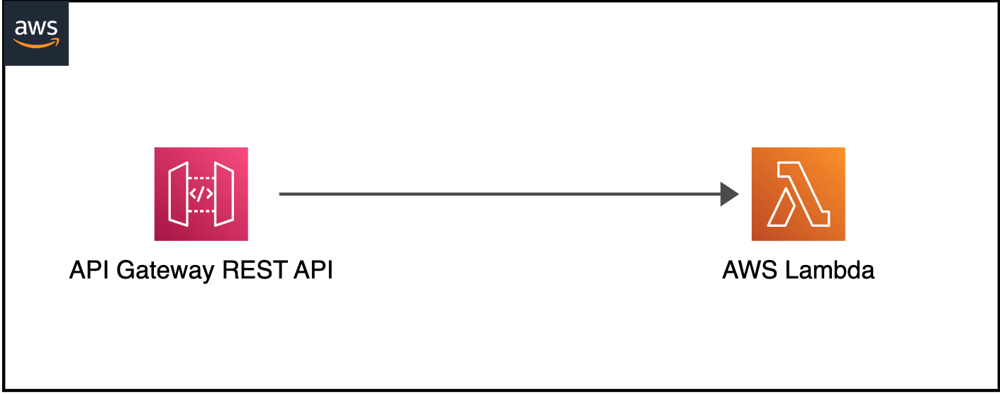
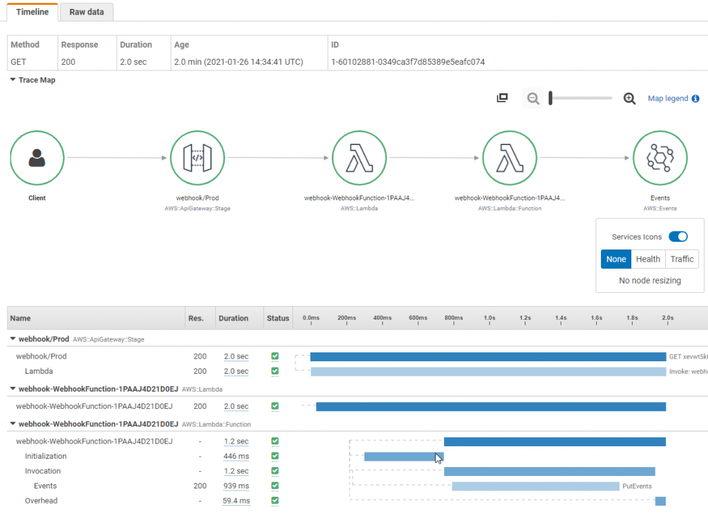

# Lambda Monitoring

## Overview

Monitor AWS Lambda functions using CloudWatch native integration, X-Ray distributed tracing, and Lambda Insights for enhanced performance visibility. This solution requires zero external agents — it leverages built-in AWS capabilities.

Key observability features:
- Invocation metrics (duration, errors, throttles, concurrency)
- X-Ray traces for downstream call visibility
- Lambda Insights for memory, CPU, and network metrics
- Structured logging with embedded metric format (EMF)
- Cost-per-invocation tracking

:::caution Needs refresh

This entry leads with Lambda Insights and native CloudWatch metrics. It predates
the current recommendation and does not cover:

- **CloudWatch Application Signals for Lambda**, which provides service-level
  latency, error rate, and dependency mapping
- The **AWS-managed OpenTelemetry Lambda layers** for OTLP export
- **Transaction Search** for trace-level analysis

The steps below still work and Lambda Insights remains useful for memory and
cold-start analysis. Prefer
[Application Signals](https://docs.aws.amazon.com/AmazonCloudWatch/latest/monitoring/CloudWatch-Application-Signals.html)
as the starting point for new functions.

:::

## Prerequisites

- AWS Lambda function(s) deployed
- IAM execution role with `AWSXRayDaemonWriteAccess` (for tracing)
- IAM execution role with `CloudWatchLambdaInsightsExecutionRolePolicy` (for Lambda Insights — grants permissions to create log streams and call `PutLogEvents`)
- Lambda Insights layer ARN for your region (account `580247275435`, layer name `LambdaInsightsExtension`)
- CloudWatch Logs enabled (default)
- **Runtime requirements:** Python 3.9+, Node.js 18+, or Java 11+ (for Powertools and ADOT layer compatibility)
- **Lambda Powertools** (optional but recommended): `aws-lambda-powertools` v2+ for Python, `@aws-lambda-powertools/logger` / `@aws-lambda-powertools/metrics` / `@aws-lambda-powertools/tracer` for TypeScript/Node.js, or `software.amazon.lambda:powertools-tracing` / `powertools-logging` / `powertools-metrics` for Java
- **ADOT Lambda layer** (optional, for OTel-based collection): ARN format `arn:aws:lambda:<region>:901920570463:layer:aws-otel-<runtime>-<arch>-ver-<version>:1` — choose the layer matching your runtime, region, and architecture from the [ADOT Lambda layer documentation](https://aws-otel.github.io/docs/getting-started/lambda)

## Architecture



```
┌───────────────────────────────────────────────────┐
│                Lambda Function                     │
│                                                   │
│  ┌────────────────┐  ┌──────────────────────────┐│
│  │ Function Code  │  │ Lambda Insights Extension ││
│  │ + X-Ray SDK    │  │ (Lambda Layer)            ││
│  └───────┬────────┘  └────────────┬─────────────┘│
└──────────┼─────────────────────────┼──────────────┘
           │                         │
     ┌─────▼─────┐            ┌─────▼──────┐
     │  X-Ray    │            │ CloudWatch │
     │  Traces   │            │ Metrics +  │
     │           │            │ Logs       │
     └───────────┘            └────────────┘
```

Lambda observability collects four signal types through parallel paths:

- **Traces:** The X-Ray daemon, built into the Lambda execution environment, captures trace segments and sends them to X-Ray. The X-Ray SDK (or Powertools `Tracer`) adds custom subsegments for downstream calls to DynamoDB, S3, SQS, or external HTTP endpoints.
- **Structured logs:** Lambda writes `stdout` to CloudWatch Logs. Lambda Powertools `Logger` emits JSON-structured logs with correlation IDs, cold-start flags, and contextual metadata that CloudWatch Logs Insights automatically indexes.
- **Metrics (vended + custom):** Lambda publishes vended metrics (invocations, duration, errors, throttles, concurrent executions) to CloudWatch under `AWS/Lambda`. For custom business metrics, Embedded Metric Format (EMF) emits metric data as structured log entries — CloudWatch extracts them asynchronously without `PutMetricData` API calls.
- **System-level metrics:** The Lambda Insights extension collects CPU time, memory utilization, disk/network I/O, and cold-start diagnostics via EMF. These appear under the `LambdaInsights` namespace.

**Alternative — ADOT Lambda layer:** Instead of the X-Ray SDK, you can attach the AWS Distro for OpenTelemetry (ADOT) Lambda layer. It bundles the OTel SDK and a trimmed ADOT Collector that auto-instruments your function and exports traces to X-Ray (default) and optionally metrics to Amazon Managed Service for Prometheus or other OTLP backends. This gives vendor-neutral instrumentation at the cost of higher cold-start latency (see Troubleshoot).

## Deploy

### Step 1: Enable X-Ray tracing

```bash
aws lambda update-function-configuration \
  --function-name my-function \
  --tracing-config Mode=Active
```

### Step 2: Add Lambda Insights layer

```bash
aws lambda update-function-configuration \
  --function-name my-function \
  --layers "arn:aws:lambda:us-west-2:580247275435:layer:LambdaInsightsExtension:52"
```

### Step 3: Add IAM permissions

```json
{
  "Version": "2012-10-17",
  "Statement": [
    {
      "Effect": "Allow",
      "Action": [
        "xray:PutTraceSegments",
        "xray:PutTelemetryRecords"
      ],
      "Resource": "*"
    }
  ]
}
```

Also attach the managed policy `CloudWatchLambdaInsightsExecutionRolePolicy` to your function's execution role so Lambda Insights can write to its log group.

### Step 4: Add structured logging with Powertools

Lambda Powertools provides a `Logger` that outputs JSON-structured logs with built-in correlation ID extraction. Install the library for your runtime and decorate your handler:

```python
from aws_lambda_powertools import Logger, Metrics, Tracer

logger = Logger()
metrics = Metrics(namespace="MyApp")
tracer = Tracer()

@logger.inject_lambda_context(correlation_id_path="requestContext.requestId")
@metrics.log_metrics
@tracer.capture_lambda_handler
def handler(event, context):
    logger.info("Processing order", extra={"order_id": event.get("order_id")})
    metrics.add_metric(name="OrderProcessed", unit="Count", value=1)
    # your logic here
```

The `@logger.inject_lambda_context` decorator automatically adds the Lambda request ID, function name, memory size, and cold-start flag to every log line. The `correlation_id_path` parameter extracts a correlation ID from the event for end-to-end request tracing. Structured JSON logs are indexed by CloudWatch Logs Insights, enabling queries like:

```
filter @message like /ERROR/
| fields correlation_id, order_id, @timestamp
| sort @timestamp desc
```

### Step 5: Emit custom metrics via Embedded Metric Format (EMF)

The `@metrics.log_metrics` decorator in Step 4 uses EMF under the hood — Powertools writes a JSON log entry conforming to the [EMF specification](https://docs.aws.amazon.com/AmazonCloudWatch/latest/monitoring/CloudWatch_Embedded_Metric_Format_Specification.html), and CloudWatch extracts the metric without a synchronous API call. This is more performant and cheaper than calling `PutMetricData`.

For finer control over dimensions, namespaces, or high-resolution (1-second) metrics, use the lower-level EMF client libraries (`aws-embedded-metrics` for [Node.js](https://github.com/awslabs/aws-embedded-metrics-node), [Python](https://github.com/awslabs/aws-embedded-metrics-python), [Java](https://github.com/awslabs/aws-embedded-metrics-java), or [C#](https://github.com/awslabs/aws-embedded-metrics-dotnet)).

### Step 6 (Alternative): ADOT Lambda layer for OTel-based collection

If you prefer vendor-neutral OpenTelemetry instrumentation, attach the ADOT Lambda layer instead of (or alongside) the X-Ray SDK:

1. Choose the layer ARN for your runtime and architecture from the [ADOT Lambda layer documentation](https://aws-otel.github.io/docs/getting-started/lambda). For example, Java on x86_64:
   ```
   arn:aws:lambda:us-east-1:901920570463:layer:aws-otel-java-agent-x86_64-ver-1-28-1:1
   ```

2. Set the wrapper environment variable so the layer instruments your handler:
   ```bash
   aws lambda update-function-configuration \
     --function-name my-function \
     --environment "Variables={AWS_LAMBDA_EXEC_WRAPPER=/opt/otel-handler}"
   ```
   Use `/opt/otel-handler` for Java and Node.js, or `/opt/otel-instrument` for Python.

3. By default the layer exports traces to X-Ray. To send metrics to Amazon Managed Service for Prometheus or another backend, add a custom `collector.yaml` to your function's root directory and set `OPENTELEMETRY_COLLECTOR_CONFIG_FILE=/var/task/collector.yaml`. See the [ADOT collector configuration documentation](https://aws-otel.github.io/docs/getting-started/lambda) for exporter options.

4. To reduce cold-start overhead, disable instrumentations you do not need:
   ```bash
   OTEL_INSTRUMENTATION_COMMON_DEFAULT_ENABLED=false
   OTEL_INSTRUMENTATION_AWS_LAMBDA_ENABLED=true
   OTEL_INSTRUMENTATION_AWS_SDK_ENABLED=true
   ```

### Step 7: Set CloudWatch Logs retention

By default, CloudWatch Logs retains Lambda log data indefinitely. Set a retention policy for your environment:

```yaml
# CloudFormation / SAM example
Resources:
  MyFunctionLogGroup:
    Type: AWS::Logs::LogGroup
    Properties:
      LogGroupName: !Sub "/aws/lambda/${MyFunction}"
      RetentionInDays: 14
```

## Validate





1. **Invoke your function:**
   ```bash
   aws lambda invoke --function-name my-function output.json
   ```

2. **Check CloudWatch metrics:** Navigate to CloudWatch > Metrics > AWS/Lambda.

3. **Check X-Ray traces:** Navigate to CloudWatch > X-Ray traces > Trace map.

4. **Check Lambda Insights:** Navigate to CloudWatch > Insights > Lambda Insights.

## Troubleshoot

| Symptom | Likely Cause | Fix |
|---------|-------------|-----|
| No traces in X-Ray | Tracing not set to Active | Check function config: `aws lambda get-function-configuration` and verify `TracingConfig.Mode` is `Active` |
| Lambda Insights no data | Layer not attached or wrong IAM policy | Verify the `LambdaInsightsExtension` layer ARN matches your region, and `CloudWatchLambdaInsightsExecutionRolePolicy` is attached to the execution role |
| High duration reported | Cold starts | Enable provisioned concurrency or SnapStart (Java 11+) |
| Missing custom metrics | EMF format error | Validate the JSON structure in CloudWatch Logs — check the `EMFValidationErrors` and `EMFParsingErrors` metrics under the `AWS/Logs` namespace for format issues |
| ADOT layer adds 5–15 s to cold start | Java agent instruments all supported libraries by default | Set `OTEL_INSTRUMENTATION_COMMON_DEFAULT_ENABLED=false` and selectively enable only the instrumentations you need |
| ADOT layer not instrumenting function | OTel layer version incompatible with runtime | Ensure the ADOT layer ARN matches your runtime version and architecture (x86_64 vs arm64). Check [ADOT Lambda releases](https://aws-otel.github.io/docs/getting-started/lambda) for the latest compatible version |
| CloudWatch Logs costs unexpectedly high | Log retention set to indefinite (default) | Set `RetentionInDays` on each Lambda log group — 7–30 days is typical for non-production, 90 days for production. Use CloudWatch Logs subscription filters to archive older logs to S3 if needed |

## Related Solutions

- [EKS Application Signals](../eks-application-signals/) — Application Signals across compute types including Lambda
- [ADOT at Scale](../adot-at-scale/) — ADOT collector architecture for multi-function deployments
- [Rust Custom Metrics](../rust-custom-metrics/) — Custom metrics on Lambda with Rust
- [.NET Application Monitoring](../dotnet-application-monitoring/) — .NET Lambda monitoring patterns
