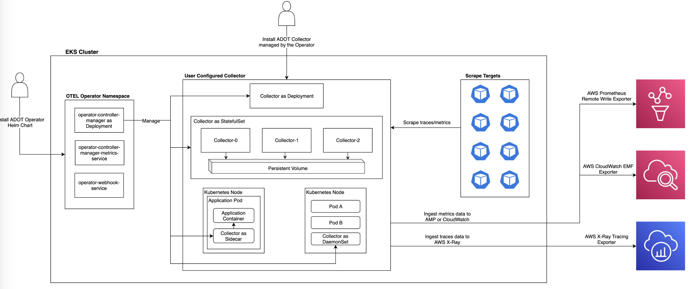
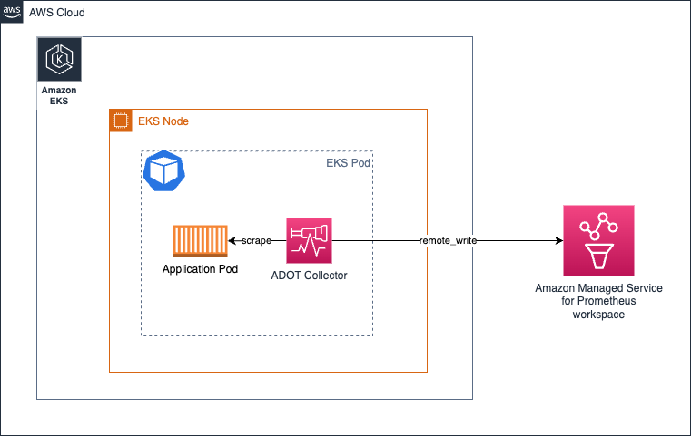
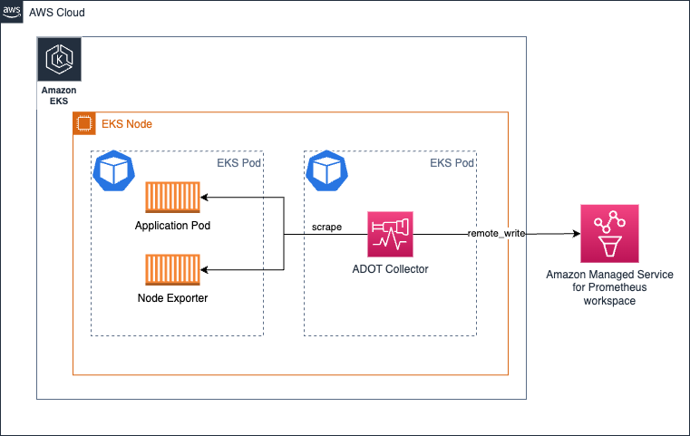
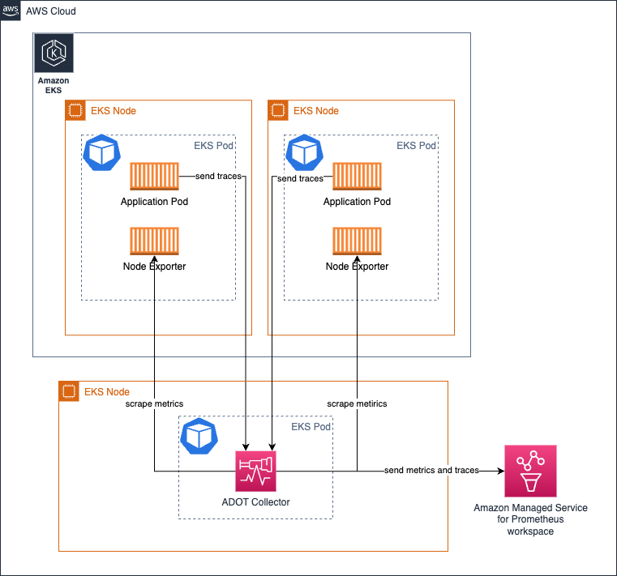
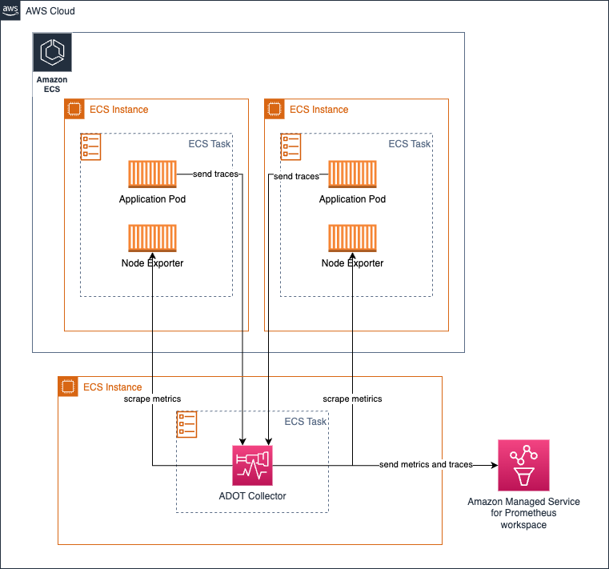
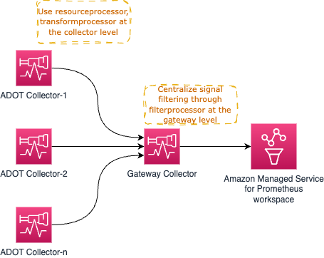
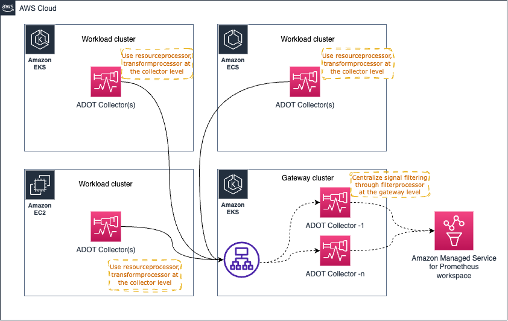

# ADOT Collector の大規模運用

## 概要

[AWS Distro for OpenTelemetry（ADOT）Collector](https://aws-otel.github.io/) は、AWS がメンテナンスするオープンソース [OpenTelemetry Collector](https://opentelemetry.io/docs/collector/) のダウンストリームディストリビューションです。Amazon EKS、Amazon ECS、Amazon EC2 上で稼働するワークロードからメトリクス、トレース、ログを収集し、Amazon CloudWatch、Amazon Managed Service for Prometheus（AMP）、AWS X-Ray などのバックエンドにエクスポートします。

ADOT Collector を本番環境で運用するには、デプロイトポロジー、リソース割り当て、パイプライン設計、ヘルスモニタリングに関する意図的な選択が必要です。このソリューションでは以下をカバーします：

- **デプロイモード** — サイドカー、DaemonSet、Deployment（ゲートウェイ）、ECS セントラルタスク
- **スケーリング** — ステートレスおよびステートフルコンポーネントの水平スケーリング戦略
- **リソースサイジング** — メモリ制限、バックプレッシャー管理、リミット設定
- **パイプライン設計** — エージェントとゲートウェイティア間での処理の分散
- **Java Spring 計装** — Spring Integration アプリケーションでの手動 OpenTelemetry トレーシング

ADOT Collector の完全な設定リファレンスについては、[ADOT Getting Started ドキュメント](https://aws-otel.github.io/docs/getting-started/collector)を参照してください。

## 前提条件

- EKS、ECS、または EC2 にデプロイする権限を持つ AWS アカウント
- AWS CLI のインストールと設定
- EKS クラスター用に設定された `kubectl`（Kubernetes を使用する場合）
- ADOT Collector イメージ：`public.ecr.aws/aws-observability/aws-otel-collector`
- AMP ワークスペース（Prometheus メトリクス用）
- リージョンで AWS X-Ray が有効化されていること（トレース用）
- Java 11 以上および Maven（Spring Integration サンプル用）

## アーキテクチャ

ADOT Collector は複数のデプロイトポロジーをサポートしています。最も一般的な本番パターンは、ノードごとのエージェントと集中型ゲートウェイティアを組み合わせたものです：


*OpenTelemetry パイプライン：サイドカーおよび Deployment としてデプロイされたコレクターが AMP、CloudWatch、X-Ray にエクスポート*

### シグナルフロー

```
┌──────────────────────────────────────────────────────────────┐
│                     EKS / ECS / EC2                           │
│                                                              │
│  ┌─────────────┐    OTLP     ┌─────────────────────────┐    │
│  │ Application │ ──────────► │  ADOT Collector (Agent)  │    │
│  │  (SDK/Auto) │             │  - receivers: otlp       │    │
│  └─────────────┘             │  - processors: batch,    │    │
│                              │    resource, memorylimiter│    │
│                              └───────────┬──────────────┘    │
└──────────────────────────────────────────┼───────────────────┘
                                           │ OTLP
                                           ▼
                              ┌─────────────────────────┐
                              │  ADOT Gateway Collector  │
                              │  - processors: filter,   │
                              │    redaction, transform  │
                              │  - exporters:            │
                              │    awsprometheusremote,   │
                              │    awsxray, awsemf       │
                              └──────────┬──────────────┘
                                         │
                        ┌────────────────┼────────────────┐
                        ▼                ▼                ▼
                 ┌───────────┐   ┌────────────┐   ┌──────────┐
                 │    AMP    │   │ CloudWatch │   │  X-Ray   │
                 └───────────┘   └────────────┘   └──────────┘
```

## デプロイ

### デプロイモード：サイドカー（EKS）

アプリケーションと同じ Pod でコレクターを実行します。リソースプロファイルが明確に把握されている独立したワークロードに最適です。


*サイドカーデプロイ：アプリケーション Pod ごとに 1 つのコレクター*

サイドカーは `localhost` ターゲットのみをスクレイプするため、サービスディスカバリーの設定は不要です：

```yaml
receivers:
  otlp:
    protocols:
      grpc:
        endpoint: 0.0.0.0:4317
      http:
        endpoint: 0.0.0.0:4318
processors:
  batch/traces:
    timeout: 1s
    send_batch_size: 50
  batch/metrics:
    timeout: 60s
exporters:
  awsxray:
    region: us-west-2
  awsemf:
    region: us-west-2
service:
  pipelines:
    traces:
      receivers: [otlp]
      processors: [batch/traces]
      exporters: [awsxray]
    metrics:
      receivers: [otlp]
      processors: [batch/metrics]
      exporters: [awsemf]
```

**メリット：** シンプルなリソース割り当て、サービスディスカバリーのオーバーヘッドなし。
**デメリット：** 構成管理が個別ワークロードの数に応じてスケールします。

### デプロイモード：DaemonSet（EKS）

ノードごとに 1 つのコレクターをデプロイして、クラスター全体のスクレイピング負荷を分散します。


*DaemonSet デプロイ：ノードごとに 1 つのコレクター*

`relabel_configs` を使用して、各コレクターを自身のノード上のターゲットに制限します：

```yaml
scrape_configs:
  - job_name: kubernetes-pods
    bearer_token_file: /var/run/secrets/kubernetes.io/serviceaccount/token
    kubernetes_sd_configs:
      - role: endpoints
    relabel_configs:
      - action: keep
        regex: $K8S_NODE_NAME
        source_labels: [__meta_kubernetes_endpoint_node_name]
    scheme: https
    tls_config:
      ca_file: /var/run/secrets/kubernetes.io/serviceaccount/ca.crt
      insecure_skip_verify: true
```

**メリット：** スケーリングの懸念が最小限、ログ収集に適しています。
**デメリット：** 異種ノード間でリソース割り当てが不均衡になる可能性があります。

### デプロイモード：Deployment / ゲートウェイ（EKS）

集中処理と高可用性のために、Kubernetes Deployment としてコレクターを実行します。


*Deployment モード：コレクターはワークロードとは別の専用ノードで実行*

Prometheus メトリクスを使用した高可用性については、[HA Prometheus collection](https://docs.aws.amazon.com/prometheus/latest/userguide/Send-high-availability-prom-community.html) を参照してください。

### デプロイモード：ECS セントラルタスク

[ECS Observer 拡張機能](https://github.com/open-telemetry/opentelemetry-collector-contrib/tree/main/extension/observer/ecsobserver)を使用して、ECS タスク全体で Prometheus ターゲットを検出しスクレイプします：


*ECS セントラルタスク：1 つのコレクターがサービス全体のターゲットを検出*

```yaml
extensions:
  ecs_observer:
    refresh_interval: 60s
    cluster_name: 'my-cluster'
    cluster_region: 'us-west-2'
    result_file: '/etc/ecs_sd_targets.yaml'
    services:
      - name_pattern: '^app-.*$'
    docker_labels:
      - port_label: 'ECS_PROMETHEUS_EXPORTER_PORT'
    task_definitions:
      - job_name: 'task_def_1'
        metrics_path: '/metrics'
        metrics_ports:
          - 9113
          - 9090
        arn_pattern: '.*:task-definition/nginx:[0-9]+'
```

### デプロイモード：EC2 エージェント

EC2 では、静的なスクレイプ設定を使用してコレクターをシステムサービスとして実行します：

```yaml
global:
  scrape_interval: 15s

scrape_configs:
  - job_name: 'app-metrics'
    static_configs:
      - targets: ['localhost:9090', 'localhost:8081']
```

### リソースサイジングと制限

#### メモリリミッタープロセッサー

OOM キルを防ぐために、パイプラインには常に `memorylimiterprocessor` を含めてください。コレクター自体のテレメトリーおよびレシーバー/エクスポーター操作用のバッファを確保します：

```yaml
processors:
  memory_limiter:
    check_interval: 1s
    limit_mib: 9216      # Pod limit is 10Gi; leave 1Gi buffer
    spike_limit_mib: 512
```

#### スクレイプ制限

Prometheus レシーバーワークロードでは、スクレイプジョブごとに上限を設定します：

- `body_size_limit` — スクレイプレスポンスボディの最大サイズ
- `label_limit` — このラベル数を超えるスクレイプを破棄
- `sample_limit` — スクレイプごとのサンプル上限

利用可能なすべてのオプションについては、[Prometheus 設定ドキュメント](https://prometheus.io/docs/prometheus/latest/configuration/configuration/#relabel_config)を参照してください。

### ゲートウェイパターン：処理の分散

CPU/メモリ集約型のプロセッサーをエージェントとゲートウェイティア間で分散します：


*エージェントコレクターがリソースおよび変換プロセッサーを処理し、ゲートウェイがフィルターおよびリダクションを処理*

**エージェントティア：** `resourceprocessor`、`transformprocessor`、`batch`
**ゲートウェイティア：** `filterprocessor`、`redactionprocessor`

単一障害点を回避するために、複数のゲートウェイレプリカの前に Application Load Balancer を配置します：


*ALB が OTLP トラフィックをゲートウェイレプリカ全体に分散*

:::warning
Prometheus メトリクスで複数のゲートウェイコレクターを使用する場合、AMP での順序外サンプルエラーを防ぐために、ALB でスティッキーセッション（ソース IP アフィニティ）を使用してください。あるいは、ゲートウェイごとに一意の `external_label` を追加できますが、アクティブシリーズが増加します。
:::

### 水平スケーリングの考慮事項

| コンポーネントタイプ | 例 | スケーリングアプローチ |
|---|---|---|
| ステートレス | ほとんどのレシーバー、エクスポーター、基本的なプロセッサー | ロードバランサーの背後にレプリカを追加 |
| ステートフル | Tail Sampling Processor、EMF Exporter、Cumulative-to-Delta Processor | 関連データ（例：同じトレース ID）を同じレプリカにルーティング |
| スクレイパー | Prometheus レシーバー | レプリカ間でスクレイプジョブを分割し、同じターゲットを 2 つのコレクターからスクレイプしない |

詳細なスケーリングガイダンスについては、[OpenTelemetry Collector Scaling](https://opentelemetry.io/docs/collector/scaling/) を参照してください。

### Java Spring Integration アプリケーションの計装

Spring Integration アプリケーションは、HTTP リクエスト/レスポンスパターンではなく、イベント駆動型のメッセージチャネルを使用します。標準の OpenTelemetry 自動計装では、完全なメッセージフローをキャプチャできない場合があります。チャネル間でメッセージをトレースするには、コンテキスト伝搬を使用した手動計装を使用してください。

**アプローチ：** 以下を実行する `GlobalChannelInterceptor` を実装します：

1. `preSend`：上流メッセージからコンテキストを抽出し（または新しいトレースを開始し）、チャネル名にちなんだスパンを作成し、送信メッセージにコンテキストを注入します
2. `afterSendCompletion`：コンテキストを復元し、例外を記録し、スパンを終了します

動作するサンプルアプリケーションは [spring-integration-samples](https://github.com/rapphil/spring-integration-samples/tree/rapphil-5.5.x-otel/applications/file-split-ftp) で利用できます。

サンプルのビルドと実行：

```bash
mvn spring-boot:run
# Trigger the processing flow
echo 'testcontent\nline2content\nlastline' > /tmp/in/testfile.txt
```

Spring アプリケーション用のコレクター設定：

```yaml
receivers:
  otlp:
    protocols:
      grpc:
        endpoint: 0.0.0.0:4317
      http:
        endpoint: 0.0.0.0:4318
processors:
  batch/traces:
    timeout: 1s
    send_batch_size: 50
  batch/metrics:
    timeout: 60s
exporters:
  awsxray:
    region: us-west-2
  awsemf:
    region: us-west-2
service:
  pipelines:
    traces:
      receivers: [otlp]
      processors: [batch/traces]
      exporters: [awsxray]
    metrics:
      receivers: [otlp]
      processors: [batch/metrics]
      exporters: [awsemf]
```

### コレクターのヘルスモニタリング

テレメトリーエンドポイントとヘルスチェック拡張機能を有効にします：

```yaml
extensions:
  health_check:
    endpoint: 0.0.0.0:13133

service:
  extensions: [health_check]
  telemetry:
    logs:
      level: info
    metrics:
      level: detailed
      address: 0.0.0.0:8888
```

`http://localhost:8888/metrics` でモニタリングすべき主要メトリクス：

| メトリクス | 示す内容 |
|---|---|
| `otelcol_exporter_enqueue_failed_spans` | 送信キューへの登録に失敗したスパン — パイプラインが飽和状態 |
| `otelcol_exporter_enqueue_failed_metric_points` | キューへの登録に失敗したメトリクスポイント — エクスポーターのバックプレッシャー |
| `otelcol_process_runtime_total_sys_memory_bytes` | Go ランタイムが割り当てた合計メモリ |
| `otelcol_process_memory_rss` | Resident Set Size — sys が rss に近づいたらメモリをスケールアップ |

ヘルスチェックエンドポイント（`GET http://localhost:13133`）を Kubernetes の liveness probe として使用してください。

## 検証

1. **コレクターのヘルスを確認：**
   ```bash
   curl -s http://localhost:13133 | head -1
   # Expect: HTTP 200
   ```

2. **AMP へのメトリクスエクスポートを確認：**
   ```bash
   awscurl --service aps --region us-west-2 \
     "https://aps-workspaces.us-west-2.amazonaws.com/workspaces/WS_ID/api/v1/query?query=up"
   ```

3. **X-Ray でトレースを確認：**
   - [AWS X-Ray コンソール](https://console.aws.amazon.com/xray/home)を開きます
   - **Traces** に移動し、サービス名でフィルタリングします
   - 正しい親子関係のスパンが表示されることを確認します

4. **コレクターの内部メトリクスを確認：**
   ```bash
   curl -s http://localhost:8888/metrics | grep otelcol_exporter_enqueue_failed
   # All counters should be 0
   ```

## トラブルシューティング

| 症状 | 考えられる原因 | 修正方法 |
|---------|-------------|-----|
| AMP からの `out of order sample` エラー | 複数のコレクターが同じターゲットをスクレイプしているか、ゲートウェイロードバランサーが同じシリーズを異なるレプリカにルーティングしている | ALB でスティッキーセッション（ソース IP）を使用するか、`relabel_configs` で `keep` アクションを使用してターゲットを 1 つのコレクターに固定する |
| コレクターが OOM キルされる | `memorylimiterprocessor` が設定されていないか、制限が Pod のメモリ制限に近すぎる | `memorylimiterprocessor` を Pod メモリの 80〜90% の制限で追加し、レシーバー/エクスポーター/テレメトリー用のバッファを確保する |
| X-Ray でスパンが欠落 | バッチプロセッサーのタイムアウトが長すぎるか、`send_batch_size` が大きすぎてドロップが発生している | `batch/traces` のタイムアウトを 1 秒に、`send_batch_size` を 50 に削減し、`otelcol_exporter_enqueue_failed_spans` を確認する |
| Prometheus のスクレイプターゲットが検出されない | DaemonSet コレクターがノード名でフィルタリングしていない | `relabel_configs` で `action: keep` を追加し、`__meta_kubernetes_endpoint_node_name` で `$K8S_NODE_NAME` にマッチさせる |
| ECS ターゲットが表示されない | ECS Observer 拡張機能の設定ミスまたは IAM 権限の不足 | `ecs_observer` のクラスター名/リージョンを確認し、タスクロールに `ecs:ListTasks`、`ecs:DescribeTaskDefinition`、`ecs:DescribeTasks`、`ec2:DescribeInstances` があることを確認する |

## 関連ソリューション

- [EKS インフラストラクチャモニタリング](../eks-infrastructure/)
- [EKS Application Signals](../eks-application-signals/)
- [ECS モニタリング](../ecs-monitoring/)
