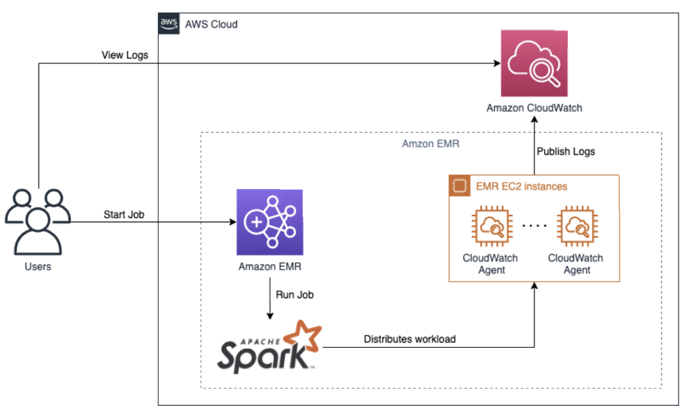

# ビッグデータと Spark のオブザーバビリティ

## 概要

Amazon EMR 上の Apache Spark ワークロードは、分散クラスターノード全体でログとメトリクスを生成します。このエントリでは、集中ログ管理のためにそのテレメトリーを CloudWatch に収集する方法と、オプションとして Amazon Managed Service for Prometheus（AMP）および Amazon Managed Grafana（AMG）に収集してより豊富なメトリクスの可視化とアラートを実現する方法を説明します。

EMR EC2 インスタンス上の CloudWatch エージェントがシステムと Spark のメトリクスをキャプチャし、CloudWatch Logs がドライバーとエグゼキューターの出力をトラブルシューティング用に一元化します。

## 前提条件

- EMR、CloudWatch、（オプションで）AMP/AMG の権限を持つ AWS アカウント
- Amazon EMR クラスター（バージョン 5.x または 6.x）
- `CloudWatchAgentServerPolicy` がアタッチされた EC2 インスタンス用 IAM ロール
- EMR ブートストラップアクション経由でインストールされた CloudWatch エージェント

**EMR クラスターの要件：**

- EMR リリース 5.33 以降または 6.x（以前のリリースは Amazon Linux 2 での完全な CloudWatch エージェントサポートがありません）。
- クラスターインスタンスは Amazon Linux 2 で実行する必要があります — CloudWatch エージェント RPM は Amazon Linux 1 AMI では利用できません。
- CloudWatch エージェントが SSM Parameter Store から設定を取得できるように、すべてのノードで SSM Agent が実行されている必要があります。EMR 5.33 以降およびすべての 6.x リリースにはデフォルトで SSM Agent が含まれています。カスタム AMI を使用する場合は手動でインストールしてください。

**IAM ロールとポリシー：**

- EMR で使用される EC2 インスタンスプロファイル（通常は `EMR_EC2_DefaultRole`）には、`CloudWatchAgentServerPolicy` マネージドポリシーがアタッチされている必要があり、`cloudwatch:PutMetricData`、`logs:CreateLogGroup`、`logs:CreateLogStream`、`logs:PutLogEvents`、`ssm:GetParameter` の権限が付与されます。
- メトリクスを AMP に転送する場合、インスタンスプロファイルには AMP ワークスペースに対する `aps:RemoteWrite` 権限も必要です。

**ブートストラップアクション用 S3 バケット：**

- クラスターと同じリージョンにブートストラップスクリプトをホストする S3 バケットを作成（または再利用）します。EMR ノードは起動時に S3 からブートストラップアクションをダウンロードするため、バケットはインスタンスプロファイルからアクセス可能である必要があります。SSE-S3 または SSE-KMS 暗号化を有効にし、パブリックアクセスをブロックしてください。

## アーキテクチャ


*AWS における Spark ビッグデータオブザーバビリティ：EMR ノードがメトリクスとログを CloudWatch に送信*

シグナルフローは以下のとおりです：

1. **ユーザー**が Amazon EMR クラスターに Spark ジョブを送信します。
2. **EMR EC2 インスタンス**（プライマリ、コア、タスクノード）が Spark ドライバーとエグゼキューターを実行します。各ノードはローカルパスにアプリケーションログを書き込みます：Spark ドライバー/エグゼキューターログは `/var/log/spark/`、YARN ResourceManager と NodeManager ログは `/var/log/hadoop-yarn/`、追加コンテナ出力は `/mnt/var/log/` です。
3. 各ノードの **CloudWatch エージェント**が 2 種類のシグナルを収集します：
   - **メトリクス** — システムレベル（CPU、メモリ、ディスク I/O）と Spark 固有のメトリクス（JVM ヒープ使用量、GC 時間、シャッフル読み書きバイト数）をカスタム CloudWatch 名前空間に発行します。
   - **ログ** — Spark と YARN のログファイルをテールし、ログパスごとに 1 つの CloudWatch Logs ロググループにストリーミングします。
4. **CloudWatch** がメトリクスとログイベントを保存します。CloudWatch ダッシュボードの構築、クラスターヘルスのメトリクスアラームの設定、Spark 出力に対する Logs Insights クエリの実行が可能です。
5. *（オプション）* CloudWatch エージェントの Prometheus `remote_write` 設定により、メトリクスを **Amazon Managed Service for Prometheus（AMP）** ワークスペースに転送し、長期保存と PromQL ベースのクエリを実現します。
6. **Amazon Managed Grafana（AMG）** が CloudWatch または AMP をデータソースとして接続し、EMR クラスターヘルス、Spark ジョブパフォーマンス、YARN リソース使用率のプリビルトダッシュボードを提供します。

```
Users → Amazon EMR (Spark) → EMR EC2 Instances
                                    │
                            CloudWatch Agent
                                    │
                    ┌───────────────┴───────────────┐
                    ▼                               ▼
          CloudWatch Metrics              CloudWatch Logs
                    │                               │
                    ├── (remote_write) ──► AMP       │
                    │                               │
                    └──────────┬────────────────────┘
                               ▼
                    Amazon Managed Grafana (optional)
```

## デプロイ

### ステップ 1 — SSM Parameter Store に CloudWatch エージェント設定を保存

エージェント設定を含む `AmazonCloudWatch-EMR-Config` という名前の SSM パラメータを作成します。以下の JSON はシステムメトリクスを収集し、主要な Spark と YARN のログパスをテールします：

```json
{
  "agent": {
    "metrics_collection_interval": 60,
    "run_as_user": "root"
  },
  "metrics": {
    "namespace": "EMR/Spark",
    "append_dimensions": {
      "InstanceId": "${aws:InstanceId}"
    },
    "metrics_collected": {
      "cpu": { "measurement": ["cpu_usage_idle", "cpu_usage_user", "cpu_usage_system"], "totalcpu": true },
      "mem": { "measurement": ["mem_used_percent", "mem_available_percent"] },
      "disk": { "measurement": ["disk_used_percent"], "resources": ["*"] },
      "diskio": { "measurement": ["reads", "writes", "read_bytes", "write_bytes"] }
    }
  },
  "logs": {
    "logs_collected": {
      "files": {
        "collect_list": [
          {
            "file_path": "/var/log/spark/spark-*.out",
            "log_group_name": "/emr/spark/driver",
            "log_stream_name": "{instance_id}",
            "retention_in_days": 30
          },
          {
            "file_path": "/var/log/hadoop-yarn/yarn-*.log",
            "log_group_name": "/emr/yarn/resourcemanager",
            "log_stream_name": "{instance_id}",
            "retention_in_days": 30
          },
          {
            "file_path": "/mnt/var/log/hadoop-yarn/containers/**",
            "log_group_name": "/emr/yarn/containers",
            "log_stream_name": "{instance_id}",
            "retention_in_days": 14
          }
        ]
      }
    }
  }
}
```

パラメータを保存します：

```bash
aws ssm put-parameter \
  --name "AmazonCloudWatch-EMR-Config" \
  --type String \
  --value file://cwagent-emr-config.json
```

### ステップ 2 — ブートストラップアクションスクリプトの作成

以下のスクリプトを S3 バケットにアップロードします。CloudWatch エージェントをインストールし、SSM 管理の設定を取得します：

```bash
#!/bin/bash
set -euo pipefail
sudo yum install -y amazon-cloudwatch-agent
sudo /opt/aws/amazon-cloudwatch-agent/bin/amazon-cloudwatch-agent-ctl \
  -a fetch-config -m ec2 -s \
  -c ssm:AmazonCloudWatch-EMR-Config
```

```bash
aws s3 cp install-cwagent.sh s3://<your-bucket>/emr-bootstrap/install-cwagent.sh
```

### ステップ 3 — EMR クラスターの起動

```bash
aws emr create-cluster \
  --name "spark-observability" \
  --release-label emr-6.10.0 \
  --applications Name=Spark \
  --ec2-attributes InstanceProfile=EMR_EC2_DefaultRole \
  --instance-groups InstanceGroupType=MASTER,InstanceCount=1,InstanceType=m5.xlarge \
                    InstanceGroupType=CORE,InstanceCount=2,InstanceType=m5.xlarge \
  --bootstrap-actions Path=s3://<your-bucket>/emr-bootstrap/install-cwagent.sh,Name=InstallCWAgent \
  --log-uri s3://<log-bucket>/emr-logs/
```

### ステップ 4 — （オプション）AMP へのメトリクス転送

Amazon Managed Service for Prometheus を使用する場合、2 つのオプションがあります：

**オプション A — CloudWatch エージェントの Prometheus スクレイピング（EMF パス）。** CloudWatch エージェントは、ローカルエンドポイントから Prometheus 形式のメトリクスをスクレイプし、EMF メトリクスとして CloudWatch に発行できます。SSM のエージェント設定に `prometheus` セクションを追加します：

```json
{
  "prometheus": {
    "cluster_name": "emr-spark",
    "log_group_name": "/emr/prometheus",
    "prometheus_config_path": "/opt/aws/amazon-cloudwatch-agent/etc/prometheus.yaml",
    "emf_processor": {
      "metric_namespace": "EMR/Spark",
      "metric_declaration": [
        {
          "source_labels": ["job"],
          "label_matcher": ".*",
          "dimensions": [["ClusterName", "InstanceId"]],
          "metric_selectors": ["^jvm_.*", "^spark_.*"]
        }
      ]
    }
  }
}
```

このパスではメトリクスが CloudWatch に保持されます（AMP ではありません）。AMP ワークスペースを追加せずに Prometheus スタイルのスクレイピングを行いたい場合に使用します。

**オプション B — スタンドアロン Prometheus の AMP への `remote_write`。** AMG でのネイティブ PromQL クエリには、ブートストラップアクション経由でスタンドアロン Prometheus サーバーをインストールし、AMP ワークスペースへの `remote_write` を設定します：

```yaml
global:
  scrape_interval: 60s
remote_write:
  - url: https://aps-workspaces.<region>.amazonaws.com/workspaces/<workspace-id>/api/v1/remote_write
    sigv4:
      region: <region>
    queue_config:
      max_samples_per_send: 1000
      max_shards: 200
```

### ステップ 5 — Spark ジョブの送信

テレメトリーの生成を開始するためにワークロードを送信します：

```bash
aws emr add-steps --cluster-id <cluster-id> --steps \
  Type=Spark,Name="TestJob",ActionOnFailure=CONTINUE,\
  Args=[--class,org.apache.spark.examples.SparkPi,\
  /usr/lib/spark/examples/jars/spark-examples.jar,100]
```

## 検証

1. **CloudWatch メトリクスを確認** — カスタム名前空間が表示されることを確認します：

```bash
aws cloudwatch list-metrics --namespace "EMR/Spark" --query 'Metrics[0:5]'
```

`InstanceId` ディメンション付きの `cpu_usage_user`、`mem_used_percent`、`disk_used_percent` などのメトリクス名が表示されるはずです。

2. **ロググループを確認** — Spark と YARN のログが流れていることを確認します：

```bash
aws logs describe-log-groups --log-group-name-prefix "/emr/"
```

3. **Spark ジョブの失敗をクエリ** — `/emr/spark/driver` に対して CloudWatch Logs Insights を使用します：

```
fields @timestamp, @message
| filter @message like /(?i)(ERROR|Exception|FATAL)/
| sort @timestamp desc
| limit 25
```

4. **遅いステージを特定** — YARN コンテナログでタスク実行時間の外れ値をクエリします：

```
fields @timestamp, @message
| filter @message like /completed in/
| parse @message "completed in * ms" as duration_ms
| stats avg(duration_ms) as avg_ms, max(duration_ms) as max_ms by bin(30m)
```

5. **AMP の取り込みを検証**（設定済みの場合）— Amazon Managed Grafana で PromQL クエリを実行します：

```
up{job="emr-spark"}
```

インスタンスごとに値 `1` が表示されれば、スクレイプターゲットが正常であることが確認できます。

## トラブルシューティング

| 症状 | 考えられる原因 | 修正方法 |
|---------|-------------|-----|
| EMR ノードからメトリクスが取得されない | CloudWatch エージェントがインストールされていない、ブートストラップアクションが失敗した | S3 の `s3://<log-bucket>/<cluster-id>/node/<instance-id>/bootstrap-actions/` でブートストラップアクションログを確認する |
| Spark ログが欠落 | エージェント設定に Spark ログパスが含まれていない | SSM パラメータを更新して `/var/log/spark/` と `/mnt/var/log/hadoop-yarn/` を含める |
| 冗長なロギングによる CloudWatch コストの増加 | DEBUG レベルの Spark ロギングが過剰なログイベントを生成している | `spark.driver.extraJavaOptions=-Dlog4j.logger.org.apache.spark=WARN` で Spark のログレベルを WARN に設定する |
| ブートストラップアクションがエラーコード 1 で失敗 | スクリプトの改行コードが正しくない（CRLF）か、実行権限がない | Unix の改行コード（`dos2unix`）でスクリプトを再保存し、S3 オブジェクトがインスタンスプロファイルから読み取り可能であることを確認する |
| ブートストラップアクションが「Unable to fetch SSM parameter」を返す | インスタンスプロファイルに `ssm:GetParameter` 権限がないか、パラメータ名が一致しない | インスタンスプロファイルに `AmazonSSMReadOnlyAccess` をアタッチし、大文字小文字を含めてパラメータ名が正確に一致することを確認する |
| エージェントが実行中にもかかわらずログが CloudWatch に表示されない | インスタンスプロファイルの IAM ロールに `logs:CreateLogGroup` または `logs:PutLogEvents` 権限がない | IAM ロールに `logs:CreateLogGroup`、`logs:CreateLogStream`、`logs:PutLogEvents` が含まれていることを確認し、権限エラーについて `/opt/aws/amazon-cloudwatch-agent/logs/amazon-cloudwatch-agent.log` のエージェントログを確認する |
| AMP の remote_write が 403 を返す | インスタンスプロファイルに `aps:RemoteWrite` がないか、ワークスペース ID が間違っている | `aps:RemoteWrite` 権限を追加し、`prometheus.yaml` URL のワークスペース ID を再確認する |
| メトリクスが CloudWatch に表示されるが Grafana に表示されない | AMG データソースが設定されていないか、Grafana ワークスペースの IAM ロールに `cloudwatch:GetMetricData` がない | AMG で CloudWatch または AMP をデータソースとして追加し、[サービス管理 IAM ロール](https://docs.aws.amazon.com/grafana/latest/userguide/AMG-manage-permissions.html)に必要なポリシーがあることを確認する |

## 関連ソリューション

- [Databricks モニタリング](../databricks-monitoring/) — EC2 上の Databricks 向けの類似ビッグデータオブザーバビリティパターン
- [MSK モニタリング](../msk-monitoring/) — 同じ AMP/AMG パターンでのデータストリーミング層のオブザーバビリティ
- [EKS インフラストラクチャモニタリング](../eks-infrastructure/) — EMR-on-EKS 移行パスに関連
- [オブザーバビリティコスト管理](../observability-cost-management/) — CloudWatch と AMP のコスト管理を大規模に実施
