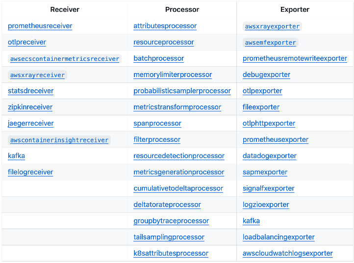

import RelatedEvents from '@site/src/components/RelatedEvents';

# CloudWatch Agent の設定

## 概要

Amazon CloudWatch Agent は、EC2 インスタンス、オンプレミスサーバー、その他の仮想マシンからメトリクス、ログ、トレースを CloudWatch に送信する統合テレメトリコレクターです。Windows と Linux をサポートし、AWS 内外で動作し、自動化ツールや AWS Systems Manager を使用してデプロイできます。

このガイドでは、設定ファイルの構造、収集するテレメトリ、Systems Manager を使用したデプロイ戦略、ハイブリッド環境向けの接続オプション、および CloudWatch Agent と AWS Distro for OpenTelemetry（ADOT）コレクターの使い分けについて説明します。

## 使用するタイミング

- EC2 インスタンスまたはオンプレミスサーバーに CloudWatch Agent をデプロイする場合
- ワークロードに対して CloudWatch Agent と ADOT コレクターのどちらを使用するか決定する必要がある場合
- Systems Manager Parameter Store を使用してエージェント設定のデプロイを自動化したい場合
- ハイブリッド（オンプレミスまたは他のクラウド）環境向けにエージェントを設定する場合
- エージェントトラフィックの接続オプション（パブリックエンドポイント、VPC エンドポイント、Direct Connect）を理解する必要がある場合

## ガイダンス

### 設定ファイルの構造

CloudWatch Agent は、メトリクス、ログ、トレース収集のセクションで構成された JSON 設定ファイルを使用します。主要なディレクティブは以下のとおりです：

- **`force_flush_interval`** — エージェントがバッファされたデータを送信する頻度を制御します。バッファが先に満杯にならない限り、エージェントはこの間隔でデータを送信します。許容可能なデータ損失ウィンドウに基づいて調整してください：
  - 標準的なワークロード：通常はデフォルト値で適切です
  - 低帯域幅接続のエッジ/IoT デバイス：15 分以上の間隔が必要な場合があります
  - ステートレス/コンテナ化されたワークロード：突然の終了でバッファされたログが失われる可能性があるため、より短い間隔を検討してください

- **`retention_in_days`** — ロググループの作成時に保持期間を設定し、データ保持要件を事前に調整します。

- **`log_group_class`** — ロググループクラス（`STANDARD` または `INFREQUENT_ACCESS`）を指定します。省略した場合のデフォルトは `STANDARD` です。

- **`filters`** — パターンに基づいてログイベントを含めたり除外したりします。必要なログレベルには `include` を、除外したいパターン（例：クレジットカード番号、社会保障番号）には `exclude` を使用します。

- **`multi_line_start_pattern`** — 複数行のログイベント（例：Java スタックトレース）を単一のイベントにグループ化します。

### 収集対象

ワークロードのニーズに基づいてテレメトリ収集を計画してください：

**メトリクス** — エージェントは、EC2 がデフォルトで提供するものを超えるシステムレベルのメトリクス（CPU、メモリ、ディスク、ネットワーク）を収集します。アプリケーション固有のデータポイントにはカスタムメトリクスを設定してください。

**ログ** — アプリケーションログ、システムログ、カスタムログファイルを収集します。各論理アプリケーションはそれぞれのロググループにマッピングする必要があります。例えば、LAMP スタックでは、Apache、MySQL、PHP アプリケーション、Linux OS はそれぞれ別のロググループに属します。

**トレース** — エージェントは OpenTelemetry または X-Ray クライアント SDK からトレースを収集し、AWS X-Ray に転送できます。

### Systems Manager を使用したデプロイ

CloudWatch Agent の設定をコードとして扱い、[Systems Manager Parameter Store](https://docs.aws.amazon.com/AmazonCloudWatch/latest/monitoring/install-CloudWatch-Agent-on-EC2-Instance-fleet.html) を通じてデプロイすることがベストプラクティスです。このアプローチには以下のメリットがあります：

- フリート全体で一元的な設定管理が可能
- 設定のバージョン管理とロールバックが可能
- Windows と Linux の両方のホストへのデプロイをサポート
- 個々のマシンにログインせずにフリート全体の更新が可能

あるいは、任意の自動化ツール（Ansible、Puppet、Chef など）を使用して設定ファイルをデプロイすることもできます。Systems Manager Parameter Store は必須ではありませんが、管理を大幅に簡素化します。

**自動検出**：EC2 の場合、Workload Detection は検出されたワークロードに基づいて適切な設定でエージェントをデプロイする自動化された方法を提供します。

### AWS 外でのデプロイ

CloudWatch Agent はオンプレミスおよび他のクラウド環境でも動作します。以下の 2 つの追加事項を考慮する必要があります：

1. **IAM 認証情報** — エージェントが必要な API コールを行えるように IAM 認証情報を設定します。EC2 内であっても、CloudWatch API への未認証アクセスはできません。EC2 の場合は[インスタンスプロファイル](https://docs.aws.amazon.com/IAM/latest/UserGuide/id_roles_use_switch-role-ec2_instance-profiles.html)を使用してください。オンプレミスの場合は、AWS Systems Manager エージェントから取得した[一時的な AWS アクセストークン](https://aws.amazon.com/premiumsupport/knowledge-center/cloudwatch-on-premises-temp-credentials/)を使用してください。

2. **ネットワーク接続** — エージェントがセキュリティ要件を満たすルートで CloudWatch および CloudWatch Logs エンドポイントに到達できることを確認してください。

### 接続オプション

エージェントは CloudWatch および CloudWatch Logs エンドポイントへの接続が必要です。実行場所に応じてオプションが異なります：

**VPC から：**
- **VPC エンドポイント（プライベート接続に推奨）** — 完全にプライベートで安全であり、エージェントトラフィックはインターネットを経由しません。
- **NAT Gateway** — プライベートサブネットがパブリック NAT ゲートウェイを経由して接続します。トラフィックは論理的にインターネット経由でルーティングされます。
- **Internet Gateway** — TLS と SigV4 を超えるプライベート接続が不要な場合、最もシンプルなオプションです。

**オンプレミスまたは他のクラウドから：**
- **パブリックエンドポイント** — エージェントがインターネット経由で接続します（Direct Connect Public VIF または既存のネットワークパス経由）。
- **PrivateLink を介した VPC インターフェースエンドポイント** — Direct Connect Private VIF または VPN を使用してオンプレミスへのプライベート接続を拡張します。トラフィックはインターネットに公開されません。

お客様の環境と CloudWatch 間のトランスポートは、ガバナンスおよびセキュリティ要件に一致する必要があります。プライベートエンドポイントの使用は、厳格に規制された業界のニーズも満たしますが、ほとんどのお客様はパブリックエンドポイントで十分です。

### CloudWatch Agent と ADOT コレクターの比較

要件に基づいて適切なコレクターを選択してください：

| 基準 | CloudWatch Agent | ADOT コレクター |
|------|-----------------|----------------|
| **主要なバックエンド** | CloudWatch、CloudWatch Logs、X-Ray | 複数（CloudWatch、Prometheus、Jaeger、Zipkin など） |
| **設定** | 単一の JSON 設定ファイル、ウィザードあり | OpenTelemetry Collector の YAML 設定 |
| **デプロイ** | SSM Parameter Store、自動化ツール、手動 | Helm チャート、サイドカー、DaemonSet、手動 |
| **ベンダー中立性** | AWS 固有 | ベンダー中立、複数のバックエンドに同時送信可能 |
| **組み込み機能** | ログフィルタリング、複数行サポート、StatsD/collectd、Container Insights | パイプライン処理、エクスポーター、多数のプロトコル用レシーバー |
| **最適な用途** | シンプルさを求める AWS ネイティブワークロード | マルチクラウド、マルチバックエンド、または OpenTelemetry ネイティブ環境 |

**CloudWatch Agent を使用する場合：**
- オブザーバビリティバックエンドが主に CloudWatch の場合
- シンプルでウィザード支援の設定が必要な場合
- 組み込みのログフィルタリングと複数行サポートが必要な場合
- SSM を使用して EC2 またはオンプレミスにデプロイする場合

**ADOT コレクターを使用する場合：**
- テレメトリを複数のバックエンドに同時に送信する必要がある場合
- ベンダー中立の OpenTelemetry 計装を好む場合
- EKS/ECS で動作し、Kubernetes ネイティブなデプロイが必要な場合
- トレースとログ用の OTLP エンドポイントが必要な場合

EKS ワークロードの場合、Amazon CloudWatch Observability EKS アドオンは CloudWatch Agent を DaemonSet としてインストールし、インフラストラクチャメトリクス（Container Insights）、コンテナログ（Fluent Bit）、アプリケーションパフォーマンステレメトリ（Application Signals）を 1 つのデプロイで処理します。

## 関連リソース

- [EC2 NGINX モニタリング](../ec2-nginx/) — Web サーバーモニタリングのための CloudWatch Agent デプロイの実践例
- [ハイブリッドモニタリング](../hybrid-monitoring/) — CloudWatch を使用したオンプレミスおよびマルチクラウドワークロードのモニタリング
- [ADOT のスケーリング](../adot-at-scale/) — 大規模環境での OpenTelemetry コレクションのスケーリング
- [AWS ドキュメント：CloudWatch Agent のインストール](https://docs.aws.amazon.com/AmazonCloudWatch/latest/monitoring/Install-CloudWatch-Agent.html)
- [AWS ドキュメント：CloudWatch Agent 設定ファイルリファレンス](https://docs.aws.amazon.com/AmazonCloudWatch/latest/monitoring/CloudWatch-Agent-Configuration-File-Details.html)

## Related Events

<RelatedEvents topics={["cloudwatch", "metrics"]} />
