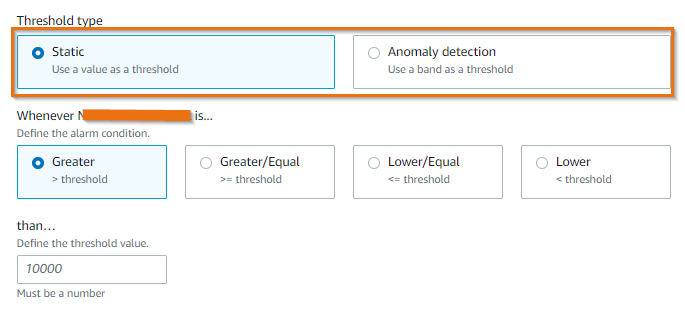
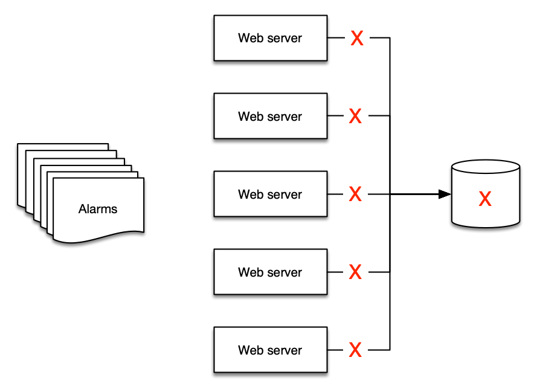
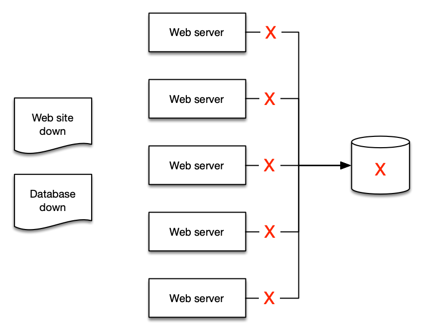

import RelatedEvents from '@site/src/components/RelatedEvents';

# アラームとアラート

## 関連イベント

<RelatedEvents topics={["cloudwatch", "metrics"]} />

## 概要

アラームはメトリクスの現在の*状態*を反映します — `OK`、`ALARM`、または `INSUFFICIENT_DATA`。しきい値を超えると、アラームは通知、オートスケーリングアクション、または自動修復をトリガーできます。課題はアラームを作成することではなく、オペレーターを圧倒することなくアクションにつながる*適切な*アラームを作成することです。

このガイドでは、CloudWatch ネイティブアラームと Amazon Managed Service for Prometheus（AMP）上の Prometheus Alertmanager の両方のアラーム設計原則について説明します。しきい値の選択、複合アラーム、アラーム疲れへの対処、PromQL を使用した OpenTelemetry メトリクスのアラーム、SLO バーンレートアラーム、および適切な送信先へのアラートルーティングについて取り上げます。横断的な手法はここで説明しますが、特定のサービスでアラームを設定すべきメトリクスは、そのサービスのモニタリングソリューションおよび AWS 推奨アラームのドキュメントに記載されています。

## 使用するタイミング

- 新しいワークロードのモニタリングを設定中で、どのメトリクスにアラームを設定すべきか決定する必要がある場合
- チームがアラーム疲れに悩んでいる場合 — 通知が多すぎてシグナルが少なすぎる場合
- 特定のメトリクスに対して静的しきい値と異常検出のどちらを選ぶか決める必要がある場合
- 関連するアラームを複合アラームで集約してノイズを削減したい場合
- AMP で Prometheus ワークロードを実行しており、Alertmanager ルールとルーティングを設定する必要がある場合
- CloudWatch で PromQL を使用して OpenTelemetry メトリクスにアラームを設定したい場合、または Application Signals で SLO バーンレートにアラームを設定したい場合
- サービスごとのアラームベースラインが必要で、各 AWS サービスの具体的なメトリクスがどこにあるか知りたい場合

## ガイダンス

### アクション可能なものにアラートを設定する

アラーム疲れは、チームが非常に多くのアラートを受信し、それらを無視するようになった場合に発生します。これは徹底的なモニタリングの証ではなく、アンチパターンです。

:::info
アクション可能なものにアラームを作成し、[ビジネス目標](https://docs.aws.amazon.com/AmazonCloudWatch/latest/monitoring/CloudWatch_Dashboards.html)から逆算してください。アラームが人間の注意や自動プロセスのトリガーを必要としない場合は、通知を削除し、代わりにダッシュボードで可視化してください。
:::

例えば、レスポンスタイムの低下が SLO を脅かし、高い CPU 使用率がレスポンスタイムの低下を引き起こす場合、顧客に影響が出る前に CPU に*プロアクティブに*アラートを設定してください。ただし、結果に影響を与えない場合は、すべての場所で CPU 使用率にアラートを設定しないでください。

### 「すべてが OK」のアラームに注意する

オペレーターが常時アラートに慣れすぎて、*静かになった*ときだけ気づくという危険なパターンが生まれます。これはアラーム状態が人間の解釈を必要とするため、自己修復アーキテクチャを不可能にします。

:::warning
チームがアラートの*不在*をシグナルとして頼っている場合、アラーム戦略を再設計する必要があります。
:::

### しきい値タイプの選択

CloudWatch はメトリクスアラームに対して 2 つのアプローチをサポートしています：

#### 静的しきい値

メトリクスが超えてはならないハードリミットを定義します。意味のある上限と下限を設定するには、通常の動作範囲を理解する必要があります。

:::tip
静的しきい値は、特定のパフォーマンスブレークポイント、インフラストラクチャの制限、または SLO 境界など、しっかりと理解しているメトリクスに最適です。
:::

#### 異常検出

CloudWatch は過去のメトリクスデータを分析し、時間単位、日単位、週単位のパターンを考慮した予測値のモデルを構築します。メトリクスが予測範囲外に出た場合にアラームが発火します。

:::info
メトリクスのパフォーマンスの経時的な可視性がない場合、または負荷テストや異常なトラフィックの下でメトリクスが観察されていない場合に異常検出を使用してください。
:::



### アラーム疲れに対抗する複合アラーム

5 台の Web サーバーが 1 台のデータベースに接続されている場合を考えてください。データベースがダウンすると、少なくとも 6 つのアラートが発生します — Web サーバーから 5 つ、データベースから 1 つ。しかし、意味があるアラートは 2 つだけです：

1. Web サイトがダウンしている。
2. データベースが原因である。





[複合アラーム](https://docs.aws.amazon.com/AmazonCloudWatch/latest/monitoring/Create_Composite_Alarm.html)は、他のアラームの状態を評価するルール式を含みます。複合アラームは、すべての条件が満たされた場合にのみ `ALARM` 状態に入ります。これにより、複数のシグナルが 1 つのアクション可能な通知に集約されます。

:::info
アラートを集約して要約することで、人間が理解しやすくなり、ランブックや自動化の作成も容易になります。
:::

### メトリクス数式ベースのアラーム

[メトリクス数式](https://docs.aws.amazon.com/AmazonCloudWatch/latest/monitoring/using-metric-math.html)を使用すると、複数のメトリクスをより意味のある KPI に組み合わせ、導出された値にアラームを設定できます。例えば、トラフィック量に応じて変動する生のエラー数ではなく、エラー*率*（エラー / リクエスト）にアラームを設定します。

### CloudWatch Logs からのアラーム

[メトリクスフィルター](https://docs.aws.amazon.com/AmazonCloudWatch/latest/logs/MonitoringLogData.html)を使用して、ログデータに基づいたアラームを作成できます。メトリクスフィルターはログパターンを数値の CloudWatch メトリクスに変換し、静的または異常ベースのアラームを使用できます。

これは、ネイティブメトリクスを持たないアプリケーションレベルのイベント（エラーメッセージ、特定のステータスコード、ビジネスロジック例外）でのアラートに役立ちます。

### アラーム抑制のスケジューリング

コスト最適化のために営業時間外にリソースを意図的にシャットダウンしている場合、アラームは発火し続け、不要なノイズを生み出します。EventBridge Schedules と Lambda を使用して、タグに基づいてプログラムでアラームを有効化・無効化し、アラーム状態をリソーススケジュールに合わせてください。

抑制キー（例：`suppress: true`）でアラームにタグ付けし、有効化/無効化サイクルの cron スケジュールを設定してください。抑制中もメトリクスの収集は中断されません — 通知のみが一時停止されます。

### AMP での Prometheus Alertmanager

[Amazon Managed Service for Prometheus](https://aws.amazon.com/prometheus/) を使用するワークロードでは、アラートルールは PromQL 式を使用し、マネージド Alertmanager を通じてルーティングされます。

#### アラートルールのフォーマット

ルールは YAML で定義され、スタンドアロンの Prometheus と同じフォーマットに従います：

```yaml
groups:
  - name: alert-test
    rules:
    - alert: HostHighCpuLoad
      expr: 100 - (avg(rate(node_cpu_seconds_total{mode="idle"}[2m])) * 100) > 60
      for: 5m
      labels:
        severity: warning
      annotations:
        summary: "Host high CPU load (instance {{ $labels.instance }})"
        description: "CPU load is > 60%\n  VALUE = {{ $value }}"
```

#### Alertmanager の主要概念

- **グルーピング** — 類似のアラートを 1 つの通知にまとめます。`route` ブロックで設定します。障害が多くのシステムに同時に影響する場合に有用です。
- **インヒビション** — 既に発火しているアラートの結果であるアラートの通知を抑制します。`inhibit_rules` で設定します。
- **サイレンシング** — 指定した期間アラートをミュートします（メンテナンスウィンドウ、計画停止）。`PutAlertManagerSilences` API を使用します。

#### アラートのルーティング

AMP Alertmanager は[レシーバーとして Amazon SNS](https://docs.aws.amazon.com/prometheus/latest/userguide/AMP-alertmanager-receiver-config.html) をサポートしています。SNS から以下にルーティングできます：

- **メール** — 直接 SNS サブスクリプション
- **Slack** — メール to チャンネルまたは Lambda 書き換え経由
- **PagerDuty** — `template_files` ブロックのカスタマイズされたテンプレート
- **Webhook** — SIEM またはインシデント管理ツール用の HTTP エンドポイント
- **Lambda** — カスタムルーティングロジックのために JSON フォーマットでアラートを処理

#### Managed Grafana での AMP アラートの可視化

Amazon Managed Grafana ワークスペースの設定で Grafana アラートを有効にすると、AMP ワークスペースで設定したすべてのアラートルールおよびレコーディングルールを Grafana のアラートページで直接可視化できます。

### `TreatMissingData` を意図的に設定する

すべてのアラームは、データがない期間の扱い方を決定します。欠損データ自体がシグナルかどうかに基づいて、メトリクスごとに選択してください：

- **`notBreaching`** — 欠損データは良性です。非ゼロの場合のみ出力されるエラーカウントなど、スパースまたは低トラフィックのメトリクスに使用します。
- **`breaching`** — データの不在自体がインシデントです。常にトラフィックを受け取るべきリソースの場合、メトリクスが無音になる（例えば、エンドポイントの呼び出し回数がデータなしに低下する）ことは、サービスが停止したことを意味します — ページを出してください。
- **`missing` / `ignore`** — 前の状態を維持します。ギャップが予想され、良くも悪くもない場合に使用します。

デフォルト（`missing`）は、リソースが完全に出力を停止した場合の障害を隠してしまうため、デフォルトを受け入れるのではなく明示的に設定してください。

### 冗長インフラストラクチャ向けの複合アラーム

回復力のある設計では、単一コンポーネントのアラームは実際の影響ではなく通常のメンテナンスでページを出します。*すべての*冗長メンバーが異常な場合にのみ発火する[複合アラーム](https://docs.aws.amazon.com/AmazonCloudWatch/latest/monitoring/Create_Composite_Alarm.html)を構築してください：

- 2 つ以上の **Direct Connect** 接続、または Direct Connect と Site-to-Site VPN バックアップ。
- **Site-to-Site VPN** 接続の両方のトンネル。
- アベイラビリティゾーンにまたがるブローカーまたはノード（Amazon MQ、MSK、ElastiCache、OpenSearch）。

個々のメンバーには診断用のアラームを設定し、顧客への影響には複合アラームでページを出してください。

### PromQL を使用した OpenTelemetry メトリクスへのアラーム

CloudWatch は OpenTelemetry メトリクスを OTLP 経由でネイティブに取り込み、リソース、スコープ、データポイント属性をクエリ可能なラベルとして保存します。アプリケーションを OpenTelemetry SDK（例えば ADOT SDK）で計装し、CloudWatch Agent の OTLP エンドポイントに OTLP を送信すると、メトリクスは `AWS/*` 名前空間ではなく、メトリクス名とラベルでアドレス指定されます。

これらのメトリクスを CloudWatch（Query Studio）の **PromQL** でクエリし、**PromQL ベースのアラーム**を作成できます。比率や分位数の式に便利です：

```promql
# Error ratio above 5% over 5 minutes
sum(rate(http_server_request_errors_total[5m]))
  / sum(rate(http_server_requests_total[5m])) > 0.05
```

同じ PromQL は、メトリクスをスクレイプする先が Amazon Managed Service for Prometheus の場合にも機能します。

### Application Signals を使用した SLO バーンレートアラーム

アプリケーションのフロントに位置するサービス（API Gateway、ロードバランサー、ECS、EKS、Lambda）の場合、[CloudWatch Application Signals](https://docs.aws.amazon.com/AmazonCloudWatch/latest/monitoring/CloudWatch-Application-Monitoring-Sections.html) で**サービスレベル目標**を定義し、生のカウンターではなく**バーンレート**にアラームを設定してください。バーンレートアラームは顧客向けの目標（可用性またはレイテンシ）に直接結びつきます。深刻なリグレッションには素早く発火し、小さく短い逸脱は許容するため、静的なエラーカウントしきい値に比べてノイズが削減されます。

### ゴールデンシグナルアラームパターン

特定の AWS サービスに関係なく、ほとんどのワークロードは 4 つのシグナルクラスにわたるアラームで十分にカバーされます。設計チェックリストとして使用してください：

| シグナルクラス | アラーム対象 | 推奨手法 |
|---|---|---|
| エラー | サーバーエラー率（5xx）の総リクエストに対する割合 | 静的しきい値付きのメトリクス数式による比率（例：5% 超） |
| レイテンシ | SLO に対する p90/p99 レスポンスタイム | パーセンタイル統計または SLO バーンレート、変動するトラフィックには異常検出 |
| トラフィック | リクエストまたはスループット量 | 異常検出バンド、予期しないゼロへの低下には `breaching` |
| 飽和度 | CPU、メモリ、接続数、キュー深度、キャパシティユニット | リソース制限付近の静的しきい値（例：80% 超） |

### サービスごとの推奨アラーム

各 AWS サービスでアラームを設定すべき具体的なメトリクスについては、ここに長いリストを記載する代わりに 2 つのソースを使用してください：

- **AWS ドキュメント** — [AWS サービスの推奨アラーム](https://docs.aws.amazon.com/AmazonCloudWatch/latest/monitoring/Best_Practice_Recommended_Alarms_AWS_Services.html)は、サービスごとのメトリクス、統計、しきい値のガイダンスを列挙しています。
- **このカタログ** — サービスごとのモニタリングソリューションに、具体的でテスト済みのアラーム手順が含まれています：[RDS & Aurora](../rds-aurora-monitoring/)、[ECS](../ecs-monitoring/)、[EKS インフラストラクチャ](../eks-infrastructure/)、[Lambda](../lambda-monitoring/)、[MSK](../msk-monitoring/)、[OpenSearch](../opensearch-monitoring/)、[ネットワークオブザーバビリティ](../network-observability/)。

### 推奨ベースラインアラート

以下の表は Kubernetes/Prometheus の例です。サービスに依存しないチェックリストについては上記の**ゴールデンシグナルアラームパターン**を、特定の AWS サービスのメトリクスについては**サービスごとの推奨アラーム**を参照してください。

| 条件 | しきい値の例 | 重大度 |
|------|------------|--------|
| ノードメモリ使用量が上限を超過 | 割り当ての 80% 超 | warning |
| ノード CPU 使用量が上限を超過 | 割り当ての 80% 超 | warning |
| ノードディスク使用量が高い | 割り当ての 90% 超 | critical |
| Pod 内のコンテナが CPU 上限を超過 | 上限の 80% 超 | warning |
| Pod 内のコンテナがメモリ上限を超過 | 上限の 80% 超 | warning |
| コンテナの過度な再起動 | 15 分間に 3 回超 | warning |
| Persistent Volume のディスク使用量が高い | 75% 超 | warning |
| Deployment のアクティブ Pod がゼロ | == 0 | critical |
| HPA が最大容量で稼働中 | replicas == maxReplicas | warning |

ワークロードの特性に基づいて式としきい値を調整してください。これらは出発点であり、普遍的な真実ではありません。

### 既存の ITSM プロセスとの統合

アラートプラットフォームに関係なく、アラートは既存のサポートツールチェーンと統合する必要があります：

:::info
アラートからプログラムでトラブルチケットや課題を作成してください。これにより人的労力が削減され、プロセスが効率化され、DORA メトリクスなどの運用データを導出できるようになります。
:::

## 関連リソース

- [CloudWatch ダッシュボード](../cloudwatch-dashboards/) — アラーム状態とメトリクスを可視化するためのダッシュボード設計
- [CloudWatch メトリクスと EMF](../cloudwatch-metrics/) — 効果的なアラームの基盤となるメトリクス設計
- [CloudWatch アラームのドキュメント](https://docs.aws.amazon.com/AmazonCloudWatch/latest/monitoring/AlarmThatSendsEmail.html)
- [AMP Alert Manager のドキュメント](https://docs.aws.amazon.com/prometheus/latest/userguide/AMP-alert-manager.html)
- [AWS サービスの推奨アラーム](https://docs.aws.amazon.com/AmazonCloudWatch/latest/monitoring/Best_Practice_Recommended_Alarms_AWS_Services.html) — サービスごとのメトリクス、統計、しきい値のガイダンス
- [PromQL で CloudWatch メトリクスをクエリする](https://docs.aws.amazon.com/AmazonCloudWatch/latest/monitoring/CloudWatch-PromQL.html)
