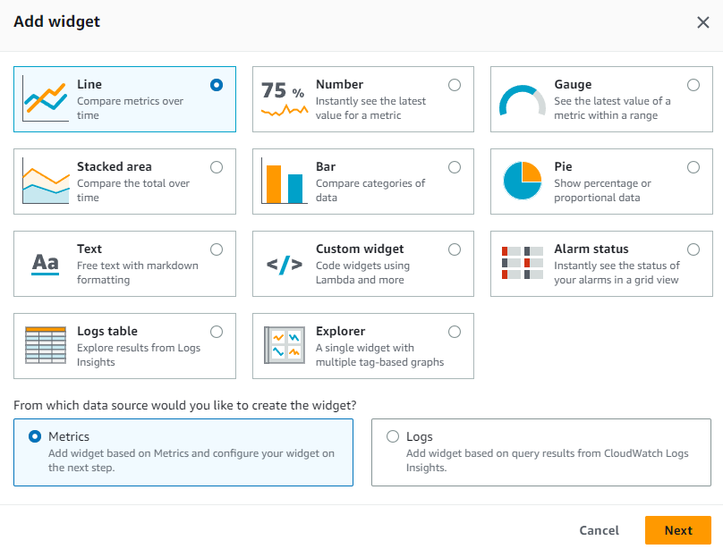
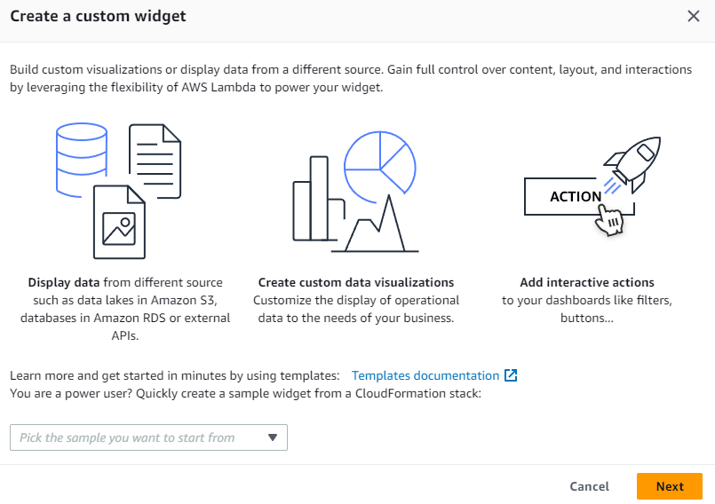
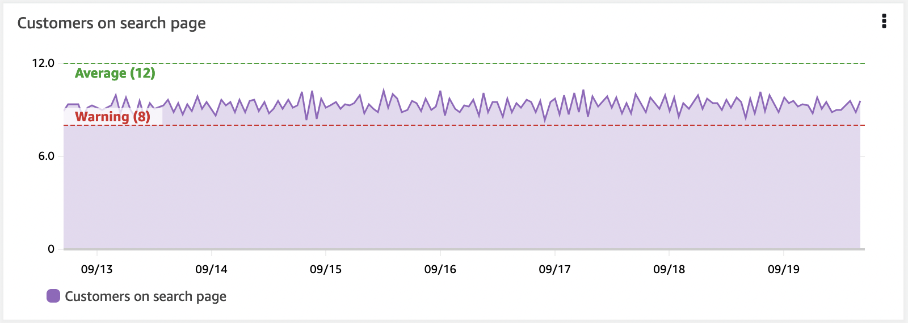
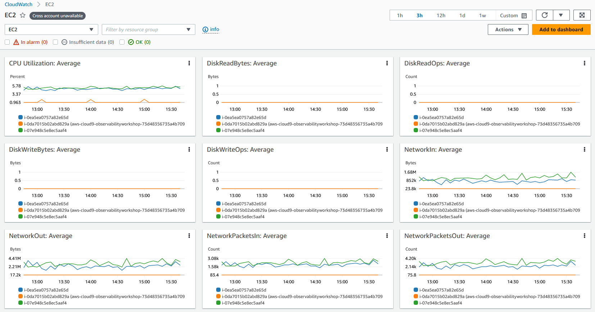
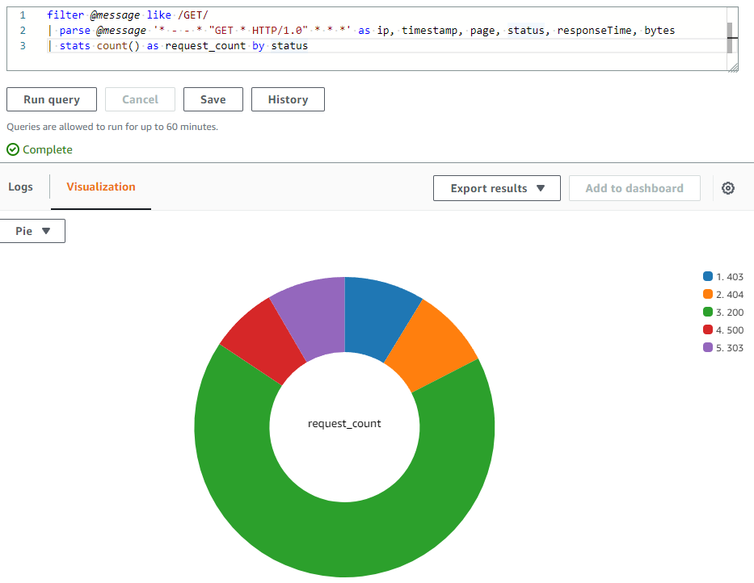

import RelatedEvents from '@site/src/components/RelatedEvents';

# CloudWatch ダッシュボード

## Related Events

<RelatedEvents topics={["cloudwatch", "metrics"]} />

## 概要

Amazon CloudWatch ダッシュボードは、CloudWatch コンソールのカスタマイズ可能なページであり、アカウントやリージョンをまたいでリソースを単一のビューでモニタリングできます。メトリクスとログの可視化を組み合わせることで、ツールを切り替えることなく症状の検出から根本原因分析まで移行できます。

このガイドでは、ダッシュボードの設計原則 — ダッシュボードに何を配置するか、どのようにレイアウトするか、どのウィジェットタイプを使用するか、そしてダッシュボードを動的で保守しやすい状態に保つ方法について説明します。完全な API リファレンスとステップバイステップのコンソール操作手順については、[CloudWatch ダッシュボードのドキュメント](https://docs.aws.amazon.com/AmazonCloudWatch/latest/monitoring/CloudWatch_Dashboards.html)を参照してください。

## 使用するタイミング

- 新しい運用またはビジネスダッシュボードを作成中で、構築前に設計ガイダンスが必要な場合
- 既存のダッシュボードが煩雑になり、再構成の原則が必要な場合
- どのウィジェットタイプがどのシグナルタイプに最適か理解したい場合
- 自動ダッシュボード、カスタムダッシュボード、またはその両方を選択する必要がある場合
- AWS コンソールアクセスを持たないチームやステークホルダーとダッシュボードを共有する必要がある場合

## ガイダンス

### ダッシュボードでストーリーを伝える

ダッシュボードはデータを表示するだけでなく、質問に答えるべきです。すべてのダッシュボードには明確な目的と対象者が必要です。ウィジェットを追加する前に、以下に答えてください：

- **誰が見るのか？** その人のバックグラウンドは何で、どの程度のコンテキストが必要か？
- **何を答えようとしているのか？** パフォーマンスへの影響？根本原因？ビジネス KPI のステータス？
- **どのようなアクションを取るのか？** エスカレーション、スケーリング、デバッグ、または単に報告？

:::info
優れたダッシュボードは*ストーリー*を伝えます — 閲覧者が何が起きているかを把握し、影響を理解し、どのようなアクションをどの程度の緊急度で取るべきかについてデータに基づいた意思決定を行えるようにします。
:::

### まず症状を考え、次に原因を考える

症状を観察するとき、ユーザーやシステムへの影響を測定しています。多くの根本原因が同じ症状を生み出すため、症状ベースのダッシュボードは未知のものを含め、より多くの問題をキャッチします。

:::tip
先週ユーザーに影響を与えた特定の JavaScript エラーを捕捉するのではなく、そのエラーが中断した*ワークフローへの影響*を捕捉し、直近の期間にわたるエラーの上位カウントを表示してください。
:::

原因をより深く理解するにつれて、より低レベルのダッシュボードを具体的にして、既知の障害モードを素早く診断・修正できるようにしてください。

### 設計アプローチ

#### KPI 駆動設計

Key Performance Indicator から逆算して作業します：

1. **KPI を理解する** — 何を測定し、どの期間で、どのしきい値が重要か。
2. **寄与するワークフローを特定する** — KPI を満たすためにどのサービスとコンポーネントが機能する必要があるか。
3. **段階的に詳細を追加する** — トップレベルの KPI を上部に、寄与するメトリクスをその下に、インフラストラクチャを最下部に。

ドリルダウンが可能で、適切な対象者に適切なコンテキストを提供するダッシュボードの階層を作成してください。

#### インシデント駆動設計

直近のインシデントを振り返ってください。最も影響が大きかったのはどれですか？繰り返し発生しているのはどれですか？

各インシデントパターンについて考えてください：
- インシデントが報告どおりであることをどのように確認しましたか？
- 影響をどのように理解し、優先度を設定しましたか？
- 根本原因を特定するために何を調べましたか？

この分析を使用して、類似の障害の将来の診断を加速するダッシュボードを構築してください。

### レイアウトの原則

最も重要な可視化を左上に配置し、自然なページナビゲーションに合わせてください。レイアウトを使用してストーリーを強化します：

- **上から下へ**：スクロールするほど詳細になる。
- **左から右へ**：高レベルのサービスを左に、依存関係を右に移動。
- **テキストウィジェットを使用**して、セクションのコンテキストを設定する区切りとし、ランブックやオンコール連絡先へのリンクを追加し、ダッシュボードの内容を説明します。

:::info
IT サポート、運用オンコール、またはビジネスオーナーへのリンクがあることで、チームはインシデント時に適切な担当者に素早く連絡できます。
:::

### ウィジェットタイプ

CloudWatch はいくつかのグラフタイプを提供しています。データが表すものに基づいて選択してください：

| ウィジェットタイプ | 最適な用途 |
|-------------------|-----------|
| **折れ線** | 時間の経過に伴うトレンド（レイテンシ、リクエストレート） |
| **積み上げ面** | 構成の表示（ステータスコード別のトラフィック） |
| **数値** | 単一 KPI の現在の値 |
| **ゲージ** | 既知のしきい値に対する相対的な値 |
| **棒グラフ / 円グラフ** | 特定時点の比較と割合 |
| **アラームステータス** | 複数のアラームの一目でわかるヘルス |
| **ログテーブル** | CloudWatch Logs Insights クエリ結果 |
| **Explorer** | タグベースの動的メトリクス検出 |
| **テキスト** | コンテキスト、リンク、セクションヘッダー |



#### カスタムウィジェット

デフォルト以外の可視化には、[カスタムウィジェット](https://docs.aws.amazon.com/AmazonCloudWatch/latest/monitoring/create-and-work-with-widgets.html)が Lambda 関数で動作します。Lambda を記述して HTML を出力できれば、任意の可視化やインタラクティブコントロールをダッシュボードに直接構築できます。



### しきい値付き KPI の表示

KPI には、ウィジェット上に水平アノテーション（ハイウォーターマーク）として警告またはエラーしきい値を表示する必要があります。これにより、ビジネス成果やインフラストラクチャが危険にさらされる前にオペレーターに視覚的な事前警告を提供します。



:::info
水平アノテーションは、よく開発されたダッシュボードの重要な要素です。
:::

### 上位/下位 N パターンの使用

すべての運用メトリクスを一度に可視化する必要はありません。大規模な EC2 インスタンスフリートでは、すべてのインスタンスの CPU を同時に表示してもメリットがありません。

ダッシュボードを使用して、任意のメトリクスの上位 10 または 20 を表示し、これが明らかにする症状に焦点を当ててください。CloudWatch メトリクスはこのための `SEARCH` 関数をサポートしています：

```
SORT(SEARCH('{AWS/EC2,InstanceId} MetricName="CPUUtilization"', 'Average', 300), SUM, DESC, 10)
```

このアプローチまたは [CloudWatch Metric Insights](https://docs.aws.amazon.com/AmazonCloudWatch/latest/monitoring/query_with_cloudwatch-metrics-insights.html) を使用して、最もパフォーマンスが良い、または最も悪いリソースを表面化してください。

### 自動ダッシュボード

CloudWatch はすべての AWS サービスに対して自動ダッシュボードを提供しています。これらは事前構築済みで、リソースに対応し、動的に更新されます。自動ダッシュボードの特徴：

- サービスのすべての標準 CloudWatch メトリクスを表示します。
- 各サービスメトリクスに使用されるすべてのリソースをグラフ化します。
- 使用率が異常に高いまたは低い外れ値リソースの特定に役立ちます。



自動ダッシュボードは良い出発点です。カスタムダッシュボードの代替としてではなく、カスタムダッシュボードと併用してください — カスタムダッシュボードはアプリケーション固有のストーリーを伝えます。

#### Container Insights と Lambda Insights

両方とも、クラスター、ノード、Pod、タスク、サービスレベル（Container Insights）または関数ごとのパフォーマンスデータ（Lambda Insights）で集約されたメトリクスを持つ独自の自動ダッシュボードを提供します。これらは内部的に [Embedded Metric Format](../cloudwatch-metrics/) を使用して、構造化ログから高カーディナリティメトリクスを生成します。

### 動的コンテンツの作成

ワークロードは拡大・縮小します。特定のインスタンス ID を参照するダッシュボードは、スケールアウトイベント中に追加された新しいインスタンスを見逃します。

:::info
リソースとデータにメタデータ（タグ）を追加し、タグでクエリする可視化を構築してください。これにより、手動更新なしにダッシュボードが実際の状態を反映するようになります。
:::

[Metrics Explorer](https://docs.aws.amazon.com/AmazonCloudWatch/latest/monitoring/CloudWatch-Metrics-Explorer.html) はタグベースのツールで、動的な可視化を作成します — 一致するリソースが作成されると、Explorer ウィジェットに自動的に表示されます。

### ログデータの可視化

CloudWatch Logs Insights のクエリは、棒グラフ、折れ線グラフ、積み上げ面グラフを使用してダッシュボードで直接可視化できます。集約関数を持つ `stats` 関数を使用するクエリは可視化を生成します：

```
filter @message like /GET/
| parse @message '_ - - _ "GET _ HTTP/1.0" .*.*.*' as ip, timestamp, page, status, responseTime, bytes
| stats count() as request_count by status
```



### クロスアカウントおよびクロスリージョンダッシュボード

マルチアカウント環境では、[CloudWatch クロスアカウントオブザーバビリティ](https://docs.aws.amazon.com/AmazonCloudWatch/latest/monitoring/cloudwatch_crossaccount_dashboard.html)により、中央モニタリングアカウントでリッチなダッシュボードを実現できます。アカウント境界なしにメトリクス、ログ、トレースを検索、可視化、分析できます。

[クロスアカウント・クロスリージョンダッシュボード](https://docs.aws.amazon.com/AmazonCloudWatch/latest/monitoring/cloudwatch_xaxr_dashboard.html)は、複数のアカウントとリージョンからのデータをドリルダウン機能付きの単一の概要ビューにまとめます。

### ダッシュボードの共有

ダッシュボードは、AWS コンソールアクセスを持たない人と[共有](https://docs.aws.amazon.com/AmazonCloudWatch/latest/monitoring/cloudwatch-dashboard-sharing.html)できます：

- **パブリックリンク** — URL を持つ人なら誰でも閲覧可能（機密データには非推奨）。
- **メール保護** — 特定のユーザーがパスワードを作成してアクセスします。
- **SSO 統合** — SSO プロバイダーに登録されたユーザーがアクセスできます。

:::warning
ダッシュボードが共有されると、閲覧者はアカウント内のアラーム、Contributor Insights ルール、すべてのメトリクス、および EC2 インスタンス名/タグへの読み取り専用アクセスを受けます — ダッシュボードに表示されていないものも含みます。これが適切かどうかを検討してください。
:::

### Dashboard as Code

Infrastructure as Code を使用してダッシュボード作成を自動化します：

- **CloudFormation**：[AWS::CloudWatch::Dashboard](https://docs.aws.amazon.com/AWSCloudFormation/latest/UserGuide/aws-resource-cloudwatch-dashboard.html) リソース
- **Terraform**：[aws_cloudwatch_dashboard](https://registry.terraform.io/providers/hashicorp/aws/latest/docs/resources/cloudwatch_dashboard) リソース
- **AWS CLI**：[ダッシュボードボディの JSON 構造](https://docs.aws.amazon.com/AmazonCloudWatch/latest/APIReference/CloudWatch-Dashboard-Body-Structure.html)を使用した `put-dashboard` コマンド

動的な環境では、リソースが変更された場合に [EventBridge と Lambda を使用してダッシュボードを自動的に更新する](https://aws.amazon.com/blogs/mt/update-your-amazon-cloudwatch-dashboards-automatically-using-amazon-eventbridge-and-aws-lambda/)ことを検討してください。

### 特化ビューの追加

いくつかの CloudWatch 機能をウィジェットとしてダッシュボードに追加して充実させることができます：

- **Contributor Insights** — パフォーマンスに影響を与えるトップトーカーやヘビーユーザーを特定します。
- **Application Insights** — モニタリング対象のアプリケーションの問題を自動検出します。
- **ServiceLens サービスマップ** — サービスエンドポイント間のトラフィック、レイテンシ、エラーを表示するエンドツーエンドのビューです。

## 関連リソース

- [アラームとアラート](../cloudwatch-alarms-alerting/) — アラーム設計とアラートルーティングのベストプラクティス
- [CloudWatch メトリクスと EMF](../cloudwatch-metrics/) — メトリクス設計、ディメンション、Embedded Metric Format
- [フロントエンドと SLO モニタリング](../frontend-slo-monitoring/) — RUM、Synthetics、SLO ベースのモニタリング
- [CloudWatch ダッシュボードのドキュメント](https://docs.aws.amazon.com/AmazonCloudWatch/latest/monitoring/CloudWatch_Dashboards.html)
