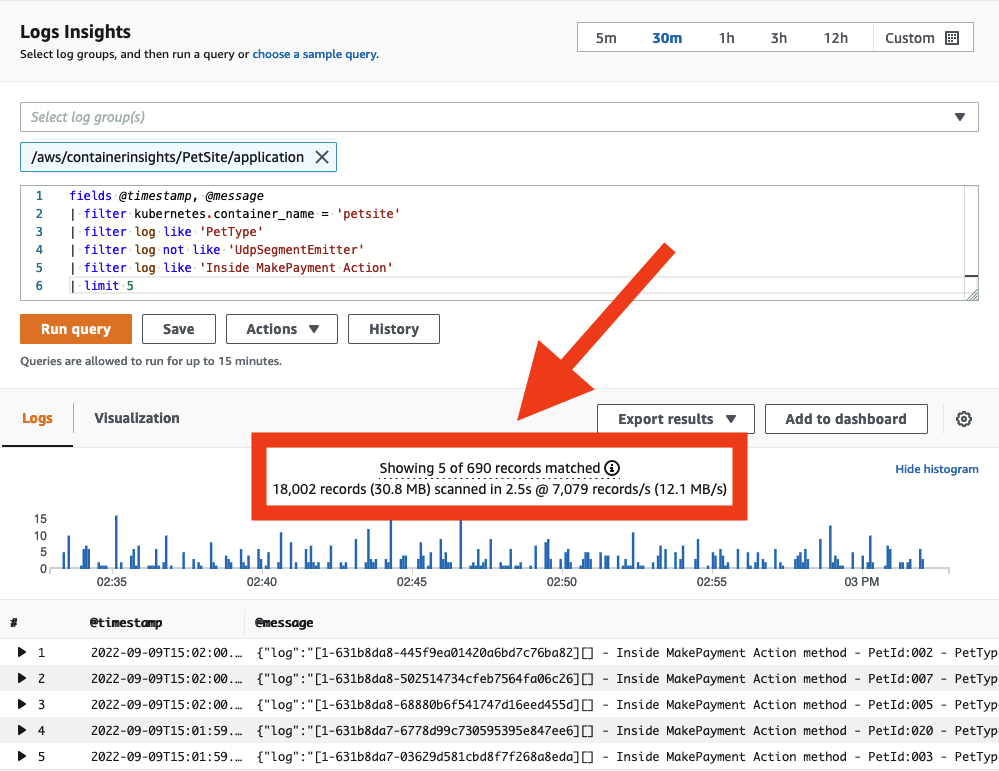
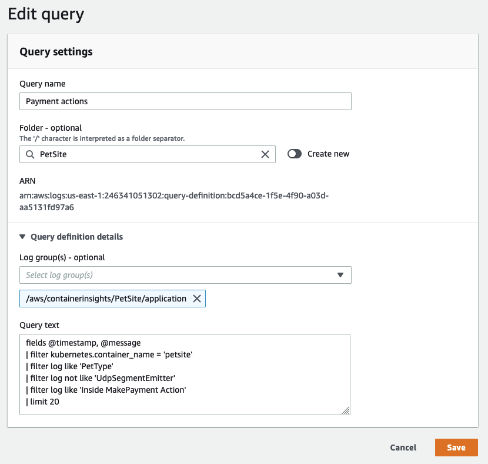
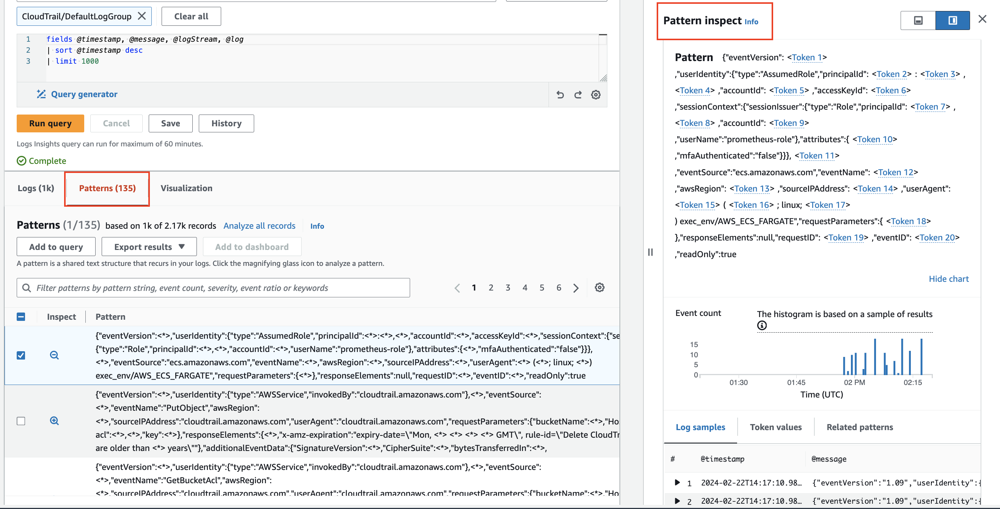
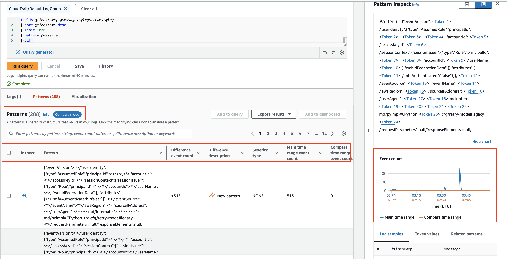
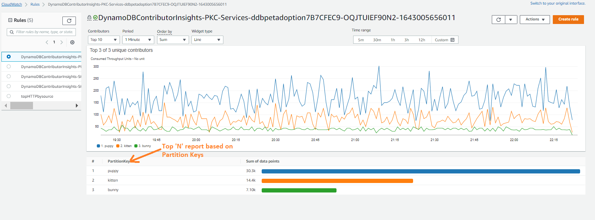
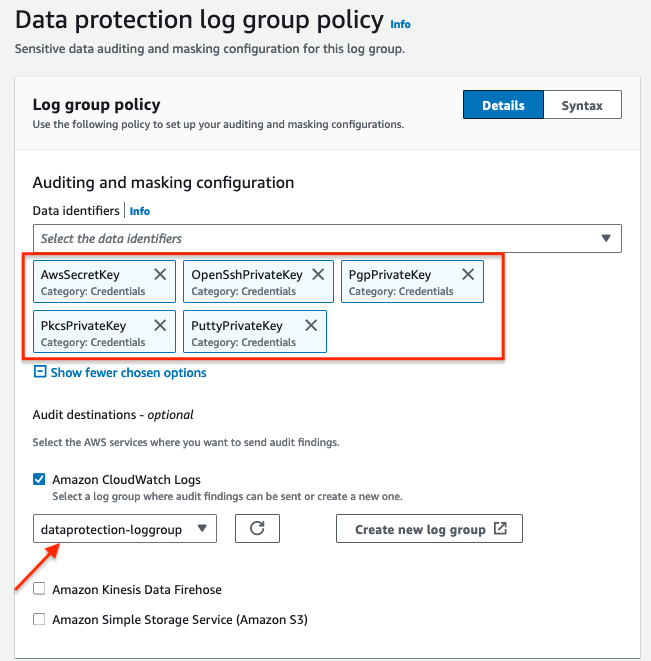
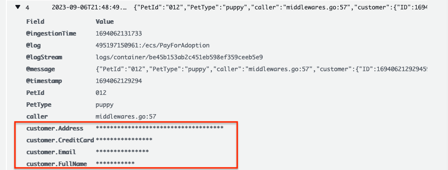

import RelatedEvents from '@site/src/components/RelatedEvents';

# CloudWatch Logs 分析

## 概要

効果的なログ分析は、アプリケーションの問題診断、システム動作の理解、コンプライアンス要件の充足に不可欠です。Amazon CloudWatch Logs は、AWS ワークロードおよびオンプレミス環境からのログデータの収集、保存、クエリのための包括的なプラットフォームを提供します。

このガイドでは、ログの構造化、適切なログレベルの選択、ソースに近い場所でのデータフィルタリング、強力なアドホッククエリのための CloudWatch Logs Insights の活用、トップコントリビューターを特定するための Contributor Insights の使用、および機密情報を自動的にマスクする Data Protection ポリシーの適用に関するベストプラクティスについて説明します。

ログは*不変*であることが意図されており、多くのログ管理システムにはログデータの変更試行を防止・検出するメカニズムが含まれています。この不変性の原則は、コンプライアンス、監査、フォレンジック分析のユースケースの基盤です。

このガイドは、分散システム全体のロギング戦略と運用の可視性を担当するアプリケーション開発者、DevOps エンジニア、プラットフォームチームを対象としています。

## 使用するタイミング

- CloudWatch Logs でアプリケーションまたはインフラストラクチャログを収集しており、効果的にクエリしたい場合
- チームや組織全体で構造化ロギングの標準を確立する必要がある場合
- 一般的な AWS サービス（API Gateway、CloudTrail、VPC Flow Logs、SNS）用のすぐに使える Logs Insights クエリの例が欲しい場合
- Contributor Insights を使用してシステムパフォーマンスに影響を与えるトップコントリビューターを特定する必要がある場合
- Data Protection ポリシーを使用してログイベント内の機密データ（PII、PHI、金融情報、認証情報）を保護する必要がある場合
- コスト最適化のためにロググループクラスオプション（Standard と Infrequent Access）を評価している場合

## ガイダンス

### 構造化ロギング

CloudWatch Logs は取り込み時に JSON フィールドを自動的に検出・インデックス化するため、手動設定なしでアドホッククエリとフィルタリングが可能です。非構造化ログも CloudWatch Logs に配信可能ですが、自動的にインデックス化されません。

最も一般的に理解されているログフォーマットは JSON であり、イベントの各コンポーネントがキー/バリューペアとして表現されます。非構造化の Python エラーを考えてみてください：

```
Traceback (most recent call last):
  File "e.py", line 7, in <module>
    raise TypeError("Again !?!")
TypeError: Again !?!
```

構造化 JSON として書き直した場合：

```json
{
  "level": "ERROR",
  "file": "e.py",
  "line": 7,
  "error": "TypeError(\"Again !?!\")"
}
```

構造化バージョンは、ログシステム間で移植可能であり、開発を簡素化し、運用診断を高速化します。JSON はログメッセージのスキーマと実際のデータを埋め込むため、CloudWatch Logs がメッセージを自動的にインデックス化できます。

ログフォーマットのベストプラクティス：

1. **構造化ログフォーマッターを使用**してください。[Log4j](https://logging.apache.org/log4j/2.x/)、[`python-json-logger`](https://pypi.org/project/python-json-logger/)、またはフレームワークのネイティブ JSON エミッターなどがあります。
2. **ログ送信先には 1 イベントにつき 1 行のログを送信**してください。JSON ログを複数行で送信すると、各行が個別のイベントとして解釈されます。

レガシーアプリケーションが複数行ログ（例：Java スタックトレース）を出力する場合は、CloudWatch Agent の [`multi_line_start_pattern`](https://docs.aws.amazon.com/AmazonCloudWatch/latest/monitoring/CloudWatch-Agent-Configuration-File-Details.html#CloudWatch-Agent-Configuration-File-Logssection) ディレクティブを使用して、複数行のイベントを正しくグループ化してください。

非構造化ログは、Logs Insights の `parse` コマンドと正規表現を使用して検索・クエリすることもできますが、インデックス化された JSON フィールドでの作業に比べて効率が大幅に低下します。

### ログレベル

自動化を容易にし、開発者が根本原因に素早く到達できるようにするため、標準化されたログレベル戦略を使用してください：

| レベル | 説明 |
| ----- | ---- |
| `DEBUG` | デバッグに有用な詳細な情報イベント。通常、非常に冗長です。 |
| `INFO` | アプリケーションの進行状況を粗い粒度で示す情報メッセージ。 |
| `WARN` | リスクを示す潜在的に有害な状況。アラームをトリガーする可能性があります。 |
| `ERROR` | アプリケーションの実行を継続可能にする可能性があるエラーイベント。注意を促す可能性が高いです。 |
| `FATAL` | アプリケーションの中断を引き起こす可能性が高い非常に深刻なエラーイベント。 |

`WARN` で過度にデータをログ出力すると、モニタリングシステムが価値の低いデータで満杯になり、重要なシグナルがノイズに埋もれます。ログレベルへの標準的なアプローチがないと、ログのフィルタリングが大きな課題になります。

### ログ転送とフラッシュ間隔

オブザーバビリティにクラウドファーストのアプローチを取る場合、マシンにログインしてログを取得する必要があるならば、それはアンチパターンです。ワークロードはほぼリアルタイムで、その環境の外部にあるログ分析システムにロギングデータを出力すべきです。送信と元のイベント間のレイテンシは、ワークロードに災害が発生した場合のポイントインタイム情報の潜在的な損失を表します。

CloudWatch Agent の [`force_flush_interval`](https://docs.aws.amazon.com/AmazonCloudWatch/latest/monitoring/CloudWatch-Agent-Configuration-File-Details.html#CloudWatch-Agent-Configuration-File-Logssection) は、バッファサイズに先に到達しない限り、エージェントに一定の間隔でロギングデータを送信するよう指示します。アーキテクトとして、許容可能な損失ウィンドウを決定し、それに応じて調整してください：

- **標準的な AWS 内ワークロード**：ほとんどの場合、デフォルトのフラッシュ間隔が適切です
- **エッジ/IoT デバイス**：低帯域幅接続では、はるかに長い間隔（例：15 分）が必要な場合があります
- **コンテナ化/ステートレスワークロード**：突然の終了によりログが失われる可能性があるため、より短い間隔を検討してください

コンテナ化またはステートレスなワークロード（例：Kubernetes Pod、EC2 フリートメンバー）は特に影響を受けやすいです — いつでもスケールインされる可能性があり、終了したリソースからログを抽出する方法がありません。

### ソースに近い場所でのフィルタリング

可能な限りソースに近い場所でログ量を削減してください：

- **コスト**：ログの取り込みには常に時間、コスト、リソースがかかります。
- **セキュリティ**：機密データ（例：PII）をダウンストリームシステムからフィルタリングすることで、リスク露出が軽減されます。
- **関連性**：ダウンストリームシステムは同じ運用上の関心を共有しない場合があります。`INFO` ログは、`CRITICAL` または `FATAL` メッセージを監視するモニタリングシステムには無関係かもしれません。
- **パフォーマンス**：ログシステムやネットワークに不必要な負荷をかける必要はありません。

CloudWatch Agent の [`filters`](https://docs.aws.amazon.com/AmazonCloudWatch/latest/monitoring/CloudWatch-Agent-Configuration-File-Details.html#CloudWatch-Agent-Configuration-File-Logssection) 機能を使用して、必要なログレベルを `include` し、望ましくないパターンを `exclude` してください。例えば、社会保障番号を含むすべてのレコードを除外する場合：

```json
"filters": [
  {
    "type": "exclude",
    "expression": "\\b(?!000|666|9\\d{2})([0-8]\\d{2}|7([0-6]\\d))([-]?|\\s{1})(?!00)\\d\\d\\2(?!0000)\\d{4}\\b"
  }
]
```

### stdout へのロギング

可能な場合、アプリケーションはファイルやソケットなどの固定場所ではなく `stdout` にログを出力すべきです。これにより、ログエージェントがオブザーバビリティソリューションに適したルールに基づいてログイベントを収集・ルーティングできます。Kubernetes や Amazon ECS などのコンテナオーケストレーションシステムは、`stdout` のログファイルへの配信を自動的に管理し、エージェントによる収集を可能にします。

重要な概念は、アプリケーションの関心事をロギングインフラストラクチャから分離することです。アプリケーションはログの最終的な行き先に依存すべきではありません — CloudWatch Agent がファイルをリアルタイムで読み取り、ロググループにデータを転送します。

アプリケーションをログ管理から分離することで、コード変更なしにソリューションを適応・進化させることができ、環境への変更による潜在的な影響範囲を最小限に抑えられます。

### 二重取り込みのアンチパターンを避ける

管理者がよく追求するパターンは、すべてのロギングデータを 1 つのシステムにコピーして、1 つの場所からすべてのログをクエリすることを目標とすることです。これには手動ワークフロー上の利点がありますが、追加のコスト、複雑さ、障害点、運用オーバーヘッドを導入します。

可能な場合、ログレベルとログフィルタリングの組み合わせを使用して、環境からのログデータの無差別な伝播を避けてください。一部の組織では規制要件を満たすため、ログを安全に保存するため、否認防止を提供するため、またはその他の目的で[ログシッピング](https://en.wikipedia.org/wiki/Log_shipping)が必要です。そのような場合でも、適切なログレベルとフィルタリングを適用することで、ログアーカイブに入る余分なデータ量を削減できます。

### ログからメトリクスを抽出する

ログには収集を待っているメトリクスが含まれています。ISV ソリューションや自分が書いていないアプリケーションでさえ、意味のあるインサイトを抽出できる貴重なデータを出力します。一般的な例としては：

- データベースからの低速クエリ時間
- Web サーバーからのアップタイム
- トランザクション処理時間
- 時間の経過に伴う `ERROR` または `WARNING` イベントのカウント
- アップグレード可能なパッケージの生の数

このデータは静的なログファイルにロックされていると有用性が低下します。ベストプラクティスは、主要なメトリクスデータを特定し、他のシグナルと相関させることができるメトリクスシステム（CloudWatch Metrics）にパブリッシュすることです。[CloudWatch メトリクスフィルター](https://docs.aws.amazon.com/AmazonCloudWatch/latest/logs/MonitoringPolicyExamples.html)を使用して、ログイベントが取り込まれる際にメトリクス値を自動的に抽出してください。

### ロググループと保持期間

CloudWatch Logs 内では、アプリケーションに論理的に適用されるログの各コレクションを単一の[ロググループ](https://docs.aws.amazon.com/AmazonCloudWatch/latest/logs/CloudWatchLogsConcepts.html)に配信する必要があります。そのロググループ内で、ログストリームを作成するソースシステム間に共通性を持たせてください。

例えば、LAMP スタックでは、Apache、MySQL、PHP アプリケーション、Linux OS はそれぞれ別のロググループに属します。このグルーピングにより、グループごとに同じ保持期間、暗号化キー、メトリクスフィルター、サブスクリプションフィルター、Contributor Insights ルールを適用できます。

ロググループのデフォルトの保持期間は*無期限*です。作成時に保持期間を設定してください — Infrastructure as Code（CloudFormation、CDK）を使用したロググループ作成と同時に、または CloudWatch Agent 設定の `retention_in_days` 設定を使用して設定します。

ロググループデータは常に保存時に暗号化されます。オプションで、ロググループレベルでカスタマーマネージドキー暗号化のために [AWS KMS](https://docs.aws.amazon.com/AmazonCloudWatch/latest/logs/encrypt-log-data-kms.html) を使用できます。

### ロググループクラスの選択

CloudWatch Logs は 2 つの[クラス](https://docs.aws.amazon.com/AmazonCloudWatch/latest/logs/CloudWatch_Logs_Log_Classes.html)を提供しています：

- **Standard** — フル機能で、リアルタイムモニタリングまたは頻繁なアクセスが必要なログ向け。リアルタイムメトリクスフィルター、サブスクリプションフィルター、Live Tail を含むすべての CloudWatch Logs 機能をサポートします。
- **Infrequent Access** — GB あたりの取り込み価格が低く、アドホッククエリやアクセス頻度の低いログに対する事後のフォレンジック分析に最適です。マネージド取り込み、ストレージ、クロスアカウントログ分析、暗号化を含む CloudWatch Logs 機能のサブセットを提供します。

CloudWatch Agent 設定の `log_group_class` ディレクティブを使用して、使用するクラスを指定してください。[log-ia-checker](https://github.com/aws-observability/log-ia-checker) CLI ツールは、指定したリージョンの既存のロググループを監査し、Infrequent Access に移行できるものを推奨できます。

#### Infrequent Access を選択する場合

- 主にコンプライアンスまたはアーカイブ目的で使用されるロググループ
- インシデント調査中にのみクエリされるログ
- リアルタイムモニタリングが不要な開発またはステージング環境のログ
- コスト削減がリアルタイム機能の必要性を上回る大容量ログ

#### Standard を維持する場合

- メトリクスフィルターやサブスクリプションフィルターに供給するログ
- リアルタイムアラートに使用されるロググループ
- 日中を通して頻繁にクエリされる運用ログ
- デバッグに Live Tail が必要なログ

### ログストリームパターン

ロググループ内のログストリーム数に制限はありません。単一の CloudWatch Logs Insights クエリで、アプリケーションのログ全体を検索できます。一般的なパターンは以下のとおりです：

- Kubernetes サービスの各 Pod に対して個別のログストリーム
- フリート内の各 EC2 インスタンスに対して個別のログストリーム
- ECS の各コンテナタスクに対して個別のログストリーム

これにより、個々のコンピューティングリソースからのデータが分離されつつ、ロググループレベルでまとめてクエリ可能な状態が維持されます。

### Logs Insights のクエリコスト管理

CloudWatch Logs Insights はスキャンされたデータ GB あたりで課金されます。コストを管理するための戦略：

- **時間範囲を絞る**：昨日のエントリのみを探している場合は、今日のログを除外してください。
- **特定のロググループを対象にする**：単一のクエリで複数のロググループを検索すると、スキャンされるデータが増加します。適切なグループを特定したらスコープを絞ってください。
- **クエリごとのスキャンデータ量を監視する**：CloudWatch コンソールは、各クエリがスキャンするデータ量を表示します。



頻繁に繰り返されるクエリを CloudWatch Logs に保存して、ユーザーが事前入力できるようにし、ログデータの分析が必要な他のメンバーの再作業を削減してください。クエリは [AWS マネジメントコンソール](https://docs.aws.amazon.com/AmazonCloudWatch/latest/logs/CWL_Insights-Saving-Queries.html)、[CloudFormation](https://docs.aws.amazon.com/AWSCloudFormation/latest/UserGuide/aws-resource-logs-querydefinition.html)、または [AWS CDK](https://docs.aws.amazon.com/cdk/api/v2/docs/aws-cdk-lib.aws_logs.CfnQueryDefinition.html) で共有できます。



### パターン分析

CloudWatch Logs Insights は機械学習アルゴリズムを使用して、ログをクエリする際にパターンを見つけます。パターンは、ログフィールド間で繰り返し出現する共有テキスト構造です。パターンは大規模なログセットをいくつかの繰り返し構造に圧縮し、大規模な分析を管理可能にします。



### 以前の時間範囲との比較（差分）

比較クエリは時間の経過に伴うログイベントの変化を明らかにし、エラー検出とトレンドの特定に役立ちます。クエリは 2 つの期間に対して分析されます：選択した期間と、その直前の同じ長さの比較期間です。



### Logs Insights クエリの例

以下のクエリ例は、組み込みの Logs Insights の例でカバーされていないサービスの一般的なパターンを示しています。

#### API Gateway

**HTTP メソッドタイプを含む最新 20 件のメッセージ：**

```
filter @message like /$METHOD/ 
| fields @timestamp, @message
| sort @timestamp desc
| limit 20
```

`$METHOD` をクエリ対象のメソッド（例：`POST`、`PUT`）に置き換えてください。

**IP でソートされたトップ 20 トーカー：**

```
fields @timestamp, @message
| stats count() by ip
| sort ip asc
| limit 20
```

**特定のメソッドでフィルタされた IP 別トップトーカー：**

```
fields @timestamp, @message
| filter @message like /PUT/
| stats count() by ip
| sort ip asc
| limit 20
```

#### CloudTrail Logs

**エラーカテゴリ別の API スロットリングエラー：**

```
stats count(errorCode) as eventCount by eventSource, eventName, awsRegion, userAgent, errorCode
| filter errorCode = 'ThrottlingException' 
| sort eventCount desc
```

**折れ線グラフでのルートアカウントアクティビティ：**

```
fields @timestamp, @message, userIdentity.type 
| filter userIdentity.type='Root' 
| stats count() as RootActivity by bin(5m)
```

#### VPC Flow Logs

**REJECT アクションの特定のソース IP でのフィルタリング：**

```
fields @timestamp, @message, @logStream, @log  | filter srcAddr like '$SOURCEIP' and action = 'REJECT'
| sort @timestamp desc
| limit 20
```

`$SOURCEIP` を対象の IP アドレス（例：`10.0.0.5`）に置き換えてください。

**アベイラビリティゾーン別のネットワークトラフィックのグルーピング：**

```
stats sum(bytes / 1048576) as Traffic_MB by azId as AZ_ID 
| sort Traffic_MB desc
```

**フロー方向別のネットワークトラフィックのグルーピング：**

```
stats sum(bytes / 1048576) as Traffic_MB by flowDirection as Flow_Direction 
| sort by Bytes_MB desc
```

**ソースおよび宛先 IP 別のデータ転送トップ 10：**

```
stats sum(bytes / 1048576) as Data_Transferred_MB by srcAddr as Source_IP, dstAddr as Destination_IP 
| sort Data_Transferred_MB desc 
| limit 10
```

#### Amazon SNS Logs

**理由別の SMS メッセージ障害のカウント：**

```
filter status = "FAILURE"
| stats count(*) by delivery.providerResponse as FailureReason
| sort delivery.providerResponse desc
```

**無効な電話番号による SMS 障害：**

```
fields notification.messageId as MessageId, delivery.destination as PhoneNumber
| filter status = "FAILURE" and delivery.providerResponse = "Invalid phone number"
| limit 100
```

**SMS タイプ別のメッセージ障害統計：**

```
fields delivery.smsType
| filter status = "FAILURE"
| stats count(notification.messageId), avg(delivery.dwellTimeMs), sum(delivery.priceInUSD) by delivery.smsType
```

**SNS 障害通知統計：**

```
fields @MessageID 
| filter status = "FAILURE"
| stats count(delivery.deliveryId) as FailedDeliveryCount, avg(delivery.dwellTimeMs) as AvgDwellTime, max(delivery.dwellTimeMs) as MaxDwellTime by notification.messageId as MessageID
| limit 100
```

### Contributor Insights

Amazon CloudWatch Contributor Insights はログデータを分析し、メトリクスに影響を与えるトップコントリビューターを特定します — システムの動作とパフォーマンスに影響を与えるエンティティのリアルタイムランキングです。

**組み込みルール**は、一般的なサービス（VPC Flow Logs、Application Load Balancer、API Gateway、Lambda）で利用可能です。

**カスタムルール**では以下を定義できます：
1. 分析対象のロググループ
2. コントリビューターフィールド（JSON キー）
3. メトリクスと集約
4. 時間ウィンドウとサンプリングレート

API Gateway リクエストパターンを分析するためのカスタムルール例：

```json
{
  "AggregateOn": "Count",
  "Contribution": {
    "Filters": [],
    "Keys": [
      "$.pettype"
    ]
  },
  "LogFormat": "JSON",
  "Schema": {
    "Name": "CloudWatchLogRule",
    "Version": 1
  },
  "LogGroupARNs": [
    "arn:aws:logs:[region]:[account]:log-group:[API Gateway Log Group Name]"
  ]
}
```



Contributor Insights のベストプラクティス：

- カスタムルールを作成する前に**組み込みルールから始めてください**
- 容易に識別できる**説明的なルール名を使用してください**
- コスト管理のために**アクティブルールを制限**し、最適なサンプリングレートを設定してください
- **未使用のルールを削除**し、サンプリングレートを定期的に見直してください
- 可視化には **CloudWatch ダッシュボードと統合**し、コントリビューターパターンへのアラートには **CloudWatch アラームと統合**してください

一般的な問題と解決策：

| 問題 | 解決策 |
|------|--------|
| ルールが期待するログに一致しない | ログフォーマットがルール設定に一致するか確認してください。フィールド名と JSON 構造を確認してください |
| コントリビューターデータにギャップがある | サンプリングレートの設定を確認してください。ログ配信を確認してください。時間ウィンドウの設定を見直してください |
| ルール処理が遅い | アクティブルールの数を減らしてください。サンプリングレートを調整してください。コントリビューションしきい値を見直してください |

```bash
# Create a Contributor Insights rule
aws cloudwatch put-insight-rule --rule-name MyRule --rule-definition file://rule.json

# Delete a rule
aws cloudwatch delete-insight-rule --rule-name MyRule
```

### Data Protection ポリシー

CloudWatch Logs の [Data Protection ポリシー](https://docs.aws.amazon.com/AmazonCloudWatch/latest/logs/cloudwatch-logs-data-protection-policies.html)は、転送中のログデータを機密データについてスキャンし、検出時にマスクします。これにより、組織は HIPAA、GDPR、PCI-DSS、FedRAMP の要件に準拠できます。

マネージドデータ識別子を使用して、CloudWatch Logs は以下を検出・マスクできます：

- **認証情報** — プライベートキー、AWS シークレットアクセスキー
- **デバイス識別子** — IP アドレス、MAC アドレス
- **金融情報** — 銀行口座番号、クレジットカード番号
- **保護対象医療情報（PHI）** — 健康保険カード番号、個人健康番号
- **個人識別情報（PII）** — 運転免許証、社会保障番号、納税者番号

機密データは取り込み時に検出・マスクされます。Data Protection ポリシーが設定される前に取り込まれたログイベントは遡ってマスクされません。

マスクが機能していることを確認するには、保護されたロググループを Logs Insights でクエリしてください：

```
fields @timestamp, @message
| sort @timestamp desc
| limit 20
```

マスクされたフィールドはクエリ結果でアスタリスクとして表示されます。





重要なポイント：

- デフォルトでは、マスクされたデータのマスク解除には `logs:Unmask` IAM 権限が必要です。
- CloudWatch 内の機密データへのアクセスを制限するために [IAM](https://docs.aws.amazon.com/AmazonCloudWatch/latest/monitoring/auth-and-access-control-cw.html) を使用してください。
- ベストプラクティスは、そもそもコード内で機密データをログに記録しないことです。Data Protection はセーフティネットとして使用してください。
- ロググループデータは常に保存時に暗号化されます。追加の制御のために、オプションで [AWS KMS](https://docs.aws.amazon.com/AmazonCloudWatch/latest/logs/encrypt-log-data-kms.html) を使用できます。
- データ分類のベストプラクティスは、組織、法的、コンプライアンス基準を満たす明確に定義されたデータ分類ティアと要件から始まります。
- データ分類フレームワークに基づいて AWS リソースにタグを使用し、組織のデータガバナンスポリシーに従ってコンプライアンスを実装してください。
- クラウド環境の定期的なモニタリングと監査も同様に重要です。大量のデータを生成するアプリケーションでは、過度なログ出力を避けてください — [AWS Prescriptive Guidance: Logging Best Practices](https://docs.aws.amazon.com/prescriptive-guidance/latest/logging-monitoring-for-application-owners/logging-best-practices.html) を参照してください。

サポートされているデータ識別子の詳細なリストについては、以下を参照してください：
- [金融データタイプ](https://docs.aws.amazon.com/AmazonCloudWatch/latest/logs/protect-sensitive-log-data-types-financial.html)
- [PHI データタイプ](https://docs.aws.amazon.com/AmazonCloudWatch/latest/logs/protect-sensitive-log-data-types-health.html)
- [PII データタイプ](https://docs.aws.amazon.com/AmazonCloudWatch/latest/logs/protect-sensitive-log-data-types-pii.html)

## 関連リソース

- [CloudWatch Logs セキュリティ](../cloudwatch-logs-security/) — クロスアカウントおよび暗号化を含むセキュリティ重視のロギングガイダンス
- [CloudWatch メトリクス](../cloudwatch-metrics/) — メトリクスフィルターを使用したログからのメトリクスデータの抽出
- [Security Lake と CloudWatch](../security-lake-cloudwatch/) — 一元化されたセキュリティログ分析
- [AWS ドキュメント：CloudWatch Logs Insights クエリ構文](https://docs.aws.amazon.com/AmazonCloudWatch/latest/logs/CWL_QuerySyntax.html)
- [AWS ドキュメント：Contributor Insights ルール構文](https://docs.aws.amazon.com/AmazonCloudWatch/latest/monitoring/ContributorInsights-RuleSyntax.html)
- [AWS ドキュメント：Data Protection ポリシー](https://docs.aws.amazon.com/AmazonCloudWatch/latest/logs/cloudwatch-logs-data-protection-policies.html)

## Related Events

<RelatedEvents topics={["logs", "cloudwatch"]} />
