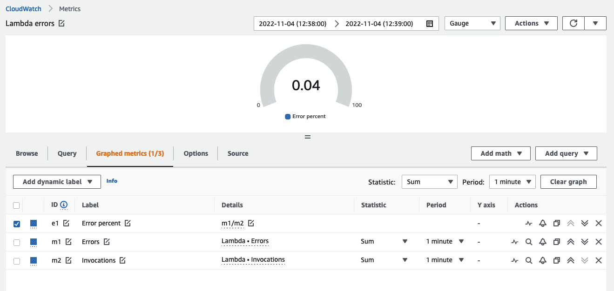
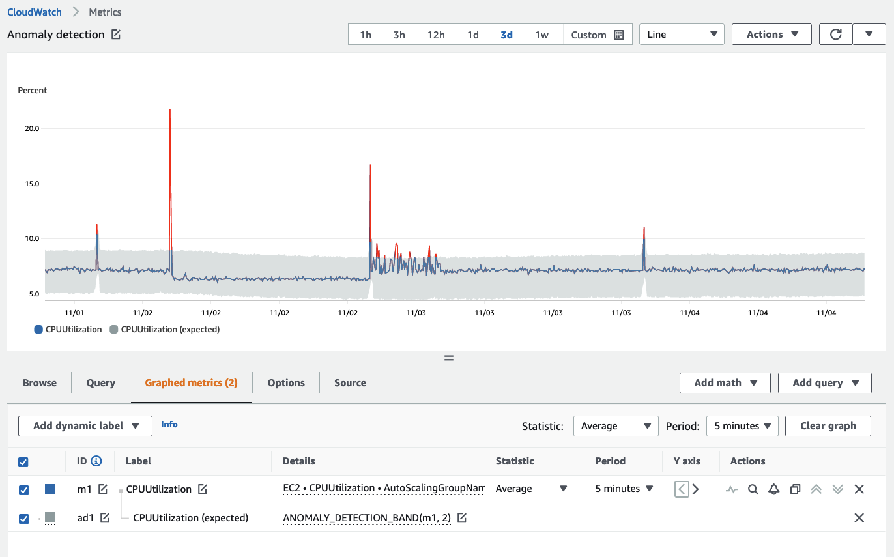
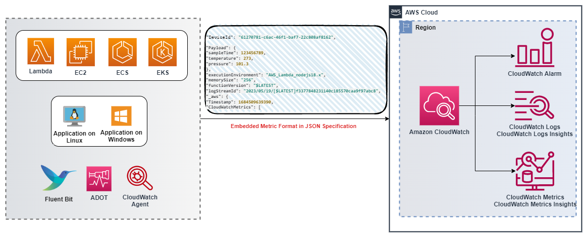
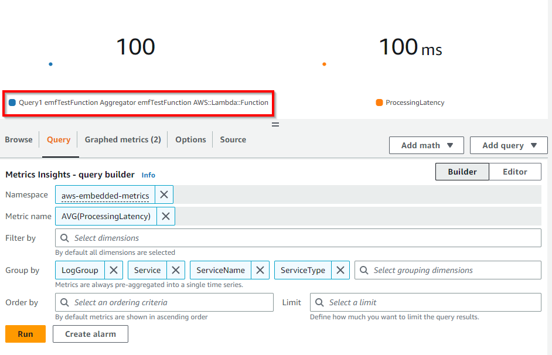

import RelatedEvents from '@site/src/components/RelatedEvents';

# CloudWatch メトリクスと EMF

## Related Events

<RelatedEvents topics={["cloudwatch", "metrics"]} />

## 概要

メトリクスは、システムパフォーマンス、リソース使用率、ビジネス成果を追跡する数値の時系列データです。CloudWatch は、AWS サービス（ベンデッドメトリクス）およびアプリケーション（カスタムメトリクス）からメトリクスを収集、保存、可視化します。メトリクス戦略の設計方法 — ディメンションの賢い選択、カーディナリティの管理、適切な出力方法の選択 — を理解することは、効果的なオブザーバビリティの基盤です。

このガイドでは、メトリクス設計の原則、ディメンションとカーディナリティの役割、高解像度メトリクス、および構造化ログからカスタムメトリクスを出力するためのコスト効果の高いアプローチとしての CloudWatch Embedded Metric Format（EMF）について説明します。

## 使用するタイミング

- カスタムメトリクス戦略を設計中で、ディメンションとカーディナリティのトレードオフを理解する必要がある場合
- `PutMetricData` API コールのコストや複雑さなしにカスタムメトリクスを出力したい場合
- レイテンシに敏感なワークロードのために高解像度（1 秒）メトリクスが必要な場合
- 特定のシグナルに対してベンデッドメトリクス、カスタムメトリクス、EMF のどれを使用するか評価している場合
- メトリクスと詳細なログデータを単一の計装パスに統合したい場合

## ガイダンス

### KPI を把握して測定する

メトリクスで最も重要なことは、*適切なもの*を測定することです。まず高レベルのビジネス目標を明確にし、次にそれらに影響を与える運用メトリクスまで逆算してください。

:::warning
ビジネス KPI の唯一の完全なソースはありません。出力目標を知るには、アプリケーションを十分に理解する必要があります。
:::

例えば、EC サイトアプリケーションでは 1 時間あたりの注文数を追跡するかもしれません。逆算すると、注文が発生するには、ユーザーが商品を検索し、カートに追加し、配送詳細を入力し、支払いを完了する必要があります。各ワークフローには、トップレベルの KPI に寄与する測定可能なレイテンシ、スループット、エラー率があります。

:::info
KPI を特定したら、ワークロード内でそれらに影響を与えるメトリクスを逆算で確認してください。ビジネスメトリクスと運用メトリクスを一緒に保存し、相関させられるようにしてください。
:::

### ベンデッドメトリクスとカスタムメトリクス

**ベンデッドメトリクス**は、AWS サービスによって追加料金なしで自動的に出力されます — EC2 の CPU 使用率、RDS の接続数、S3 のリクエスト数など[多数](https://docs.aws.amazon.com/AmazonCloudWatch/latest/monitoring/aws-services-cloudwatch-metrics.html)。これらはインフラストラクチャの健全性をカバーしますが、アプリケーションレベルやビジネスレベルのシグナルをキャプチャすることはほとんどありません。

**カスタムメトリクス**がそのギャップを埋めます。以下の方法で出力します：

- `PutMetricData` API（または SDK ラッパー）
- CloudWatch Agent（メモリやディスクなどのシステムメトリクス用）
- Embedded Metric Format（メトリクスを自動的に抽出する構造化ログ）

ベンデッドメトリクスが KPI やアプリケーション固有のパフォーマンス指標をカバーしない場合にカスタムメトリクスを選択してください。

### ディメンションとカーディナリティ

[ディメンション](https://docs.aws.amazon.com/AmazonCloudWatch/latest/monitoring/cloudwatch_concepts.html#Dimension)は、メトリクスを一意に識別する名前と値のペアです。例えば、`InstanceId` は EC2 の CPU メトリクスのディメンションです。メトリクス名とディメンションの一意の組み合わせごとに、個別の時系列が作成されます。

**カーディナリティ**は、一意の時系列の総数です。ディメンションに多くの可能な値（ユーザー ID、リクエスト ID、制限のないタグ）がある場合、高カーディナリティが発生します。CloudWatch はメトリクスあたり最大 30 のディメンションをサポートしていますが、各一意の組み合わせにはストレージとクエリのコストが発生します。

ディメンションを意図的に設計してください：

| すべきこと | すべきでないこと |
|-----------|----------------|
| 境界のある値（リージョン、サービス名、ステータスコード）を使用する | 境界のない値（ユーザー ID、リクエスト ID、タイムスタンプ）を使用する |
| 可能な場合は集約する（リクエストレベルではなくサービスレベル） | マルチテナントシステムで顧客ごとにディメンションを作成する |
| クエリパターンに合わせてディメンションを計画する | 「念のため」ディメンションを追加する |

:::info
デバッグのために高カーディナリティコンテキストが必要な場合は、EMF メトリクスと一緒にログフィールドに入れてください。CloudWatch Logs Insights で詳細をクエリしてください — すべての属性をディメンションにしないでください。
:::

### 高解像度メトリクス

標準の CloudWatch メトリクスは 60 秒の解像度です。[高解像度メトリクス](https://docs.aws.amazon.com/AmazonCloudWatch/latest/monitoring/publishingMetrics.html#high-resolution-metrics)は 1 秒の粒度をサポートし、以下に有用です：

- 60 秒の平均がスパイクを隠してしまうレイテンシに敏感なアプリケーション。
- より速いシグナルが必要なオートスケーリングの決定。
- 短命な操作（Lambda コールドスタート、キュードレイン時間）。

高解像度メトリクスはコストが高くなります。分以下の可視性が運用上の意思決定を変える場合にのみ選択的に使用してください。

### メトリクス数式によるクエリ

[メトリクス数式](https://docs.aws.amazon.com/AmazonCloudWatch/latest/monitoring/using-metric-math.html)を使用すると、式で複数のメトリクスを組み合わせることができます。一般的なパターン：

- **エラー率**：`Errors / Requests * 100`
- **条件付きアラーム**：`IF(latency > threshold, 1, 0)` でアラーム用のブール型シグナルを作成
- **トップ N 検索**：`SORT(SEARCH('{AWS/EC2,InstanceId} MetricName="CPUUtilization"', 'Average', 300), MAX, DESC, 10)`



:::info
メトリクス数式を使用して、別々のデータソースから値を導出し、生のインフラストラクチャメトリクスではなく、計算された KPI に基づいてアラームをトリガーしてください。
:::

### 異常検出

CloudWatch の[異常検出](https://docs.aws.amazon.com/AmazonCloudWatch/latest/monitoring/CloudWatch_Anomaly_Detection.html)は、時間単位、日単位、週単位のパターンを考慮して、2 週間のトレーニング期間で*正常*がどのようなものかを学習します。



主な考慮事項：

- モデルは作成時点から前方にのみトレーニングします — 過去のデータを遡って分析しません。
- *正常*が何かは知っていますが、*良好*が何かは知りません。一貫して不健全なメトリクスは不健全なベースラインを持ちます。
- 既知の異常期間（夜間、週末、メンテナンスウィンドウ）をトレーニングから除外してください。

:::info
手動でしきい値を定義することが実用的でないメトリクスに異常検出を使用してください — 特に数百のメトリクスを持つマイクロサービスアーキテクチャで有用です。
:::

### Embedded Metric Format（EMF）

[Embedded Metric Format](https://docs.aws.amazon.com/AmazonCloudWatch/latest/monitoring/CloudWatch_Embedded_Metric_Format.html) を使用すると、構造化 JSON ログエントリ内にメトリクス定義を埋め込むことができます。CloudWatch Logs がメトリクスを自動的に抽出します — `PutMetricData` コール、別の計装パスは不要です。



#### EMF を使用する場合

- メトリクスエージェントの維持が実用的でない Lambda 関数、コンテナ、その他のエフェメラルコンピューティングからカスタムメトリクスが必要な場合。
- 抽出されたメトリクスと一緒に、ログでクエリ可能な高カーディナリティコンテキスト（デバイス ID、リクエスト ID、アカウント ID）が必要な場合。
- 既に構造化ログを出力しており、追加の API コールや `PutMetricData` の課金なしにメトリクスが欲しい場合。
- メトリクスの異常と、それに寄与した特定のログイベントを相関させる必要がある場合。

#### EMF の仕組み

名前空間、ディメンション、メトリクス定義を指定する `_aws` ブロックを含む JSON ログエントリを出力します：

```json
{
  "_aws": {
    "Timestamp": 1574109732004,
    "CloudWatchMetrics": [
      {
        "Namespace": "MyApplication",
        "Dimensions": [["Service", "Environment"]],
        "Metrics": [
          { "Name": "ProcessingLatency", "Unit": "Milliseconds" }
        ]
      }
    ]
  },
  "Service": "OrderProcessor",
  "Environment": "Production",
  "RequestId": "abc-123",
  "ProcessingLatency": 47
}
```

CloudWatch は `ProcessingLatency` をディメンション `Service` と `Environment` を持つメトリクスとして抽出します。`RequestId` やその他のフィールドを含むログエントリ全体は、CloudWatch Logs Insights でクエリ可能なまま残ります。

#### EMF ログの生成

- **クライアントライブラリ** — [Node.js](https://github.com/awslabs/aws-embedded-metrics-node)、[Python](https://github.com/awslabs/aws-embedded-metrics-python)、[Java](https://github.com/awslabs/aws-embedded-metrics-java)、[C#](https://github.com/awslabs/aws-embedded-metrics-dotnet) で利用可能です。
- **ADOT コレクター** — [AWS EMF エクスポーター](https://aws-otel.github.io/docs/getting-started/cloudwatch-metrics#cloudwatch-emf-exporter-awsemf)は OpenTelemetry メトリクスを EMF フォーマットに変換します。
- **手動 JSON** — [EMF 仕様](https://docs.aws.amazon.com/AmazonCloudWatch/latest/monitoring/CloudWatch_Embedded_Metric_Format_Specification.html)に準拠したログを構築し、CloudWatch Agent、Fluent Bit、または `PutLogEvents` API 経由で送信します。

#### 高解像度 EMF

EMF はオプションの `StorageResolution` パラメーター（値 `1` または `60`）をサポートし、構造化ログから 1 秒の粒度で高解像度メトリクスを抽出します。

#### EMF メトリクスの表示とアラーム設定

抽出されたメトリクスは、指定した名前空間の下で CloudWatch メトリクスコンソールに表示されます。他のメトリクスと同様にアラームを作成できます。EMF メトリクスの生成はログ公開フローに依存するため、アラーム評価期間内にデータポイントが作成されるよう、ログが迅速に公開されるようにしてください。



### PutMetricData コールのバッチ処理

`PutMetricData` を直接使用する場合（EMF ではなく）、データをバッチ処理してください：

- API は `Values` と `Counts` メソッドを使用して、単一のリクエストでメトリクスあたり最大 150 の値をサポートします。
- バッチ処理により、コスト（API コールの削減）とスロットリングのリスクの両方が削減されます。

:::info
`PutMetricData` を使用する場合は、常にデータポイントを単一の PUT 操作にバッチ処理してください。大量のメトリクスの場合は、代わりに EMF を検討してください — `PutMetricData` を使用せず、課金もされません。
:::

## 関連リソース

- [CloudWatch ダッシュボード](../cloudwatch-dashboards/) — メトリクスの効果的な可視化
- [アラームとアラート](../cloudwatch-alarms-alerting/) — メトリクスおよび導出値に対するアラームの作成
- [Rust カスタムメトリクス](../rust-custom-metrics/) — Rust アプリケーションからのカスタムメトリクスの出力
- [CloudWatch メトリクスのドキュメント](https://docs.aws.amazon.com/AmazonCloudWatch/latest/monitoring/working_with_metrics.html)
- [EMF 仕様](https://docs.aws.amazon.com/AmazonCloudWatch/latest/monitoring/CloudWatch_Embedded_Metric_Format_Specification.html)
