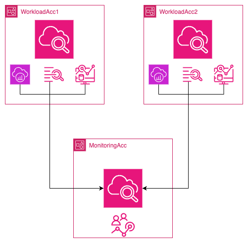
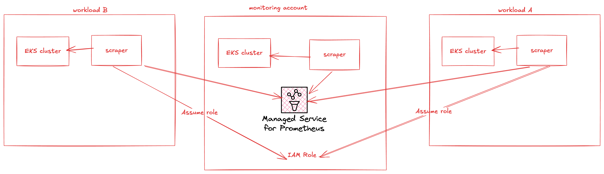
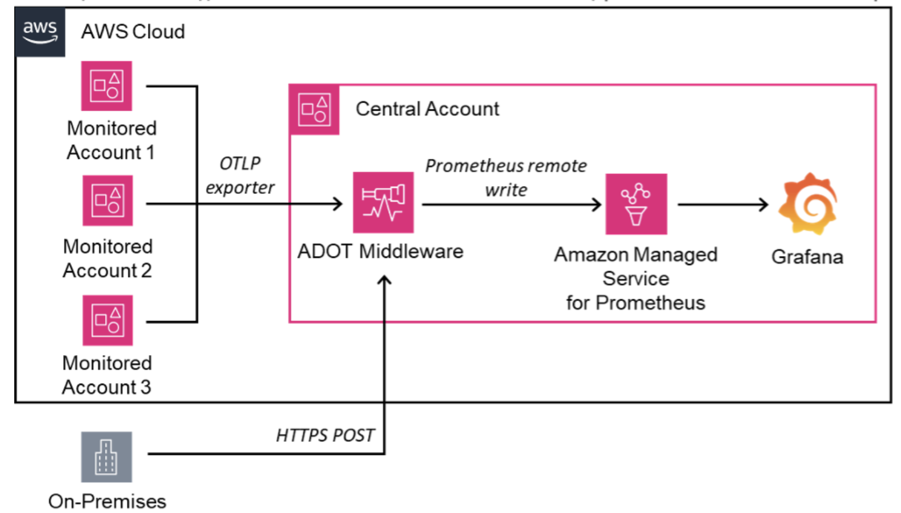

import RelatedEvents from '@site/src/components/RelatedEvents';

# クロスアカウントオブザーバビリティ

## Related Events

<RelatedEvents topics={["cloudwatch", "metrics"]} />

## 概要

複数の AWS アカウントにまたがるワークロードを運用する組織では、データを複製したり、複雑なクロスアカウント IAM 設定を手動で管理したりすることなく、メトリクス、ログ、トレースの統合ビューが必要です。このソリューションでは、2 つの補完的なパスを説明します：

1. **CloudWatch クロスアカウントオブザーバビリティ** — モニタリング/ソースアカウントのトポロジーを使用して、CloudWatch メトリクス、ログ、および X-Ray トレースをデータ転送コストなしで共有するネイティブ AWS 機能です。
2. **AMP クロスアカウントスクレイピング** — Amazon Managed Service for Prometheus のマネージドコレクターを使用して、ソースアカウントの EKS クラスターをスクレイピングし、ターゲットアカウントの中央 AMP ワークスペースにメトリクスを書き込みます。

両方のアプローチは共存できます：CloudWatch はネイティブ AWS サービスメトリクスとログを処理し、AMP は Kubernetes 環境からの Prometheus 互換ワークロードメトリクスを処理します。

## 前提条件

- 少なくとも 2 つの AWS アカウント（1 つのモニタリング/ターゲット、1 つ以上のソースアカウント）
- OAM シンクおよびリンクを作成するための IAM 権限（[必要な権限](https://docs.aws.amazon.com/AmazonCloudWatch/latest/monitoring/CloudWatch-Unified-Cross-Account-Setup.html#CloudWatch-Unified-Cross-Account-Setup-permissions)）
- AMP パスの場合：マネージドスクレイパー ENI がアクセス可能な VPC サブネットを持つソースアカウントの EKS クラスター
- AMP パスの場合：ターゲットアカウントの AMP ワークスペース
- オプション：CloudFormation StackSets による自動デプロイのための AWS Organizations

## アーキテクチャ

### CloudWatch クロスアカウントオブザーバビリティ



モニタリングアカウントが**シンク**を作成し、ソースアカウントがそこにリンクします。ソースアカウントはメトリクス、ログ、およびトレースを共有します。データはソースアカウントに保存されたままで、モニタリングアカウントが複製なしで読み取ります（トレースを除き、トレースはソースへの追加コストなしでモニタリングアカウントにコピーされます）。

### オープンソースパス：AMP クロスアカウントスクレイピング



各ソースアカウントのマネージドコレクターが EKS クラスターから Prometheus メトリクスをスクレイピングし、クロスアカウントロールを引き受けて中央 AMP ワークスペースにリモートライトします。データはパブリックインターネットを経由しません（VPC エンドポイントを使用）。

### 集中型 ADOT コレクションパターン



非 EKS ワークロード向けの代替パターン：ソースアカウントが OTLP 経由で集中型 ADOT コレクターにメトリクスをエクスポートし、AMP に書き込みます。オンプレミスシステムは HTTPS 経由で接続します。

## デプロイ

### パス 1：CloudWatch クロスアカウントオブザーバビリティ

#### モニタリングアカウントの設定

1. モニタリングアカウントの CloudWatch コンソールで、**設定 → モニタリングアカウント設定 → 設定**に移動します。

2. 共有するテレメトリタイプ（メトリクス、ログ、トレース）を選択します。ServiceLens/X-Ray の場合、3 つすべてが必要です。

3. ソースアカウント ID を入力します（または AWS Organization を選択）。**設定**をクリックします。

4. 設定詳細セクションから**モニタリングアカウントシンク ARN** をコピーします。

#### ソースアカウントのリンク

5. 各ソースアカウントの CloudWatch コンソールで、**設定 → ソースアカウント設定 → 設定**に移動します。

6. 共有するデータタイプを選択し、モニタリングアカウントシンク ARN を貼り付けて確認します。

7. リンクが緑色の「リンク済み」ステータスで表示されることを確認します。

#### 代替方法：AWS Organizations デプロイ

大規模なロールアウトの場合、すべてのメンバーアカウントに CloudFormation StackSet をデプロイします：

```json
{
  "Version": "2012-10-17",
  "Statement": [
    {
      "Effect": "Allow",
      "Principal": "*",
      "Action": ["oam:CreateLink", "oam:UpdateLink"],
      "Resource": "*",
      "Condition": {
        "ForAllValues:StringEquals": {
          "oam:ResourceTypes": [
            "AWS::Logs::LogGroup",
            "AWS::CloudWatch::Metric",
            "AWS::XRay::Trace"
          ]
        },
        "ForAnyValue:StringEquals": {
          "aws:PrincipalOrgID": "${OrganizationId}"
        }
      }
    }
  ]
}
```

### パス 2：AMP クロスアカウントスクレイピング

#### ロールの作成

1. **ソースアカウント**で、`scraper.aps.amazonaws.com` を許可する信頼ポリシーと、ターゲットアカウントロールの引き受け権限を持つロール（`Source`）を作成します：

```json
{
  "Version": "2012-10-17",
  "Statement": [
    {
      "Effect": "Allow",
      "Principal": { "Service": "scraper.aps.amazonaws.com" },
      "Action": "sts:AssumeRole",
      "Condition": {
        "ArnEquals": { "aws:SourceArn": "$SCRAPER_ARN" },
        "StringEquals": { "AWS:SourceAccount": "$SOURCE_ACCOUNT_ID" }
      }
    }
  ]
}
```

2. **ターゲットアカウント**で、`AmazonPrometheusRemoteWriteAccess` とソースロールを許可する信頼ポリシーを持つロール（`Target`）を作成します：

```json
{
  "Effect": "Allow",
  "Principal": { "AWS": "arn:aws:iam::$SOURCE_ACCOUNT_ID:role/Source" },
  "Action": "sts:AssumeRole",
  "Condition": {
    "StringEquals": { "sts:ExternalId": "$SCRAPER_ARN" }
  }
}
```

#### スクレイパーの作成

3. ソースアカウントでマネージドスクレイパーを作成します：

```bash
aws amp create-scraper \
  --source eksConfiguration="{clusterArn='arn:aws:eks:$REGION:$SOURCE_ACCOUNT_ID:cluster/$CLUSTER',subnetIds=[$SUBNETS]}" \
  --scrape-configuration configurationBlob=<base64-scrape-config> \
  --destination ampConfiguration="{workspaceArn='arn:aws:aps:$REGION:$TARGET_ACCOUNT_ID:workspace/$WORKSPACE_ID'}" \
  --role-configuration '{"sourceRoleArn":"arn:aws:iam::$SOURCE_ACCOUNT_ID:role/Source","targetRoleArn":"arn:aws:iam::$TARGET_ACCOUNT_ID:role/Target"}'
```

4. スクレイパーが `ACTIVE` ステータスに達するまで待ちます（約 20 分）：

```bash
aws amp list-scrapers --query "scrapers[?status.statusCode=='ACTIVE']"
```

5. 手順 1～2 の信頼ポリシーを実際のスクレイパー ARN で更新します。

## 検証

### CloudWatch パス

1. モニタリングアカウントの CloudWatch コンソールで、**設定 → モニタリングアカウントの管理**に移動し、ソースアカウントが「リンク済み」として表示されることを確認します。
2. **すべてのメトリクス**に移動し、`:aws.AccountId=` フィルターを使用してソースアカウントのメトリクスが表示されることを確認します。
3. **Logs Insights** で、ソースアカウントのロググループを選択してクエリを実行し、クロスアカウントログアクセスを確認します。
4. **X-Ray traces → Trace map** で、ソースアカウントのノードがアカウントラベル付きで表示されることを確認します。

### AMP パス

1. ターゲット AMP ワークスペースに対してインスタントクエリを実行し、メトリクスが流れていることを確認します：

```bash
awscurl --service aps --region $REGION \
  "${AMP_ENDPOINT}api/v1/query?query=up"
```

2. Amazon Managed Grafana で、ターゲット AMP ワークスペースを Prometheus データソースとして追加し、ソースアカウントからのクラスター固有のメトリクスをクエリします。

## トラブルシューティング

| 症状 | 考えられる原因 | 修正方法 |
|---------|-------------|-----|
| ソースアカウントが「リンクされていない」ステータスを表示する | シンクポリシーにソースアカウント ID または組織 ID が含まれていない | モニタリングアカウントのシンクポリシーを更新してソースアカウントを許可します |
| ソースのメトリクスがモニタリングアカウントで表示されない | 名前空間フィルタリングが設定されている：特定の名前空間が除外されている | モニタリングアカウントの設定を編集してすべての名前空間を含めるか、欠落している名前空間を追加します |
| AMP スクレイパーが CREATING 状態のまま停止している | EKS サブネットのセキュリティグループがスクレイパー ENI から VPC エンドポイントへの送信をブロックしている | スクレイパーセキュリティグループから APS VPC エンドポイントへの送信 HTTPS（ポート 443）を許可します |
| クロスアカウントアラームの作成に失敗する | アラームが SEARCH 式を使用している（サポートされていない）、またはクロスリージョンメトリクスを参照している | 単一タイムシリーズの Metrics Insights SQL クエリを使用します。アラームとメトリクスが同じリージョンにあることを確認します |
| ターゲットワークスペースからの AMP クエリが空を返す | 信頼ポリシーが作成後の実際のスクレイパー ARN で更新されていない | `aws amp list-scrapers` からのスクレイパー ARN でソースとターゲットの両方のロール信頼ポリシーを更新します |

## 関連ソリューション

- [EKS インフラストラクチャ](../eks-infrastructure/)
- [CloudWatch Logs セキュリティ](../cloudwatch-logs-security/)
