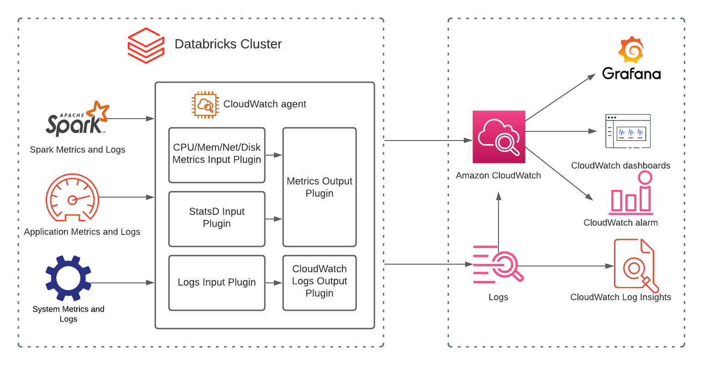
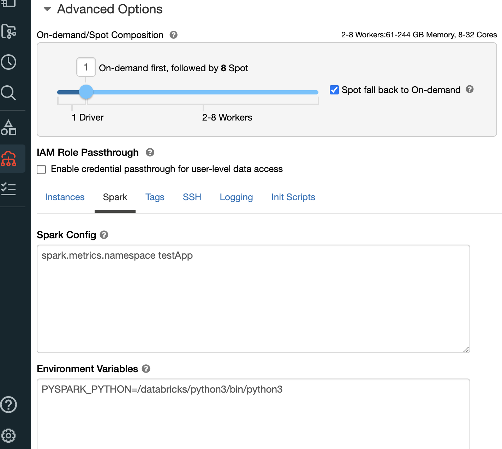

# Databricks モニタリング

## 概要

Databricks は、データ分析および AI/ML ワークロードを管理するためのプラットフォームです。[Databricks on AWS](https://aws.amazon.com/solutions/partners/databricks/) を実行している場合、運用チームは AWS ネイティブのオブザーバビリティサービスを使用して、クラスターのパフォーマンス、ワークロードのエラー、およびリソース使用率を追跡する統合モニタリングソリューションの恩恵を受けることができます。

このエントリでは、Databricks クラスターを Amazon CloudWatch と統合して、集中型のログ収集とメトリクス収集を行う方法を説明します。Databricks の init スクリプトはクラスターの起動時にコレクターをインストールし、各ノードで手動介入なしに構造化ログとカスタムメトリクスの出力を可能にします。

詳細な手順については、[How to Monitor Databricks with Amazon CloudWatch](https://aws.amazon.com/blogs/mt/how-to-monitor-databricks-with-amazon-cloudwatch/) を参照してください。

## 前提条件

- CloudWatch 権限を持つ AWS アカウント
- AWS にデプロイされた Databricks ワークスペース
- `cloudwatch:PutMetricData` および `logs:PutLogEvents` 権限を持つ IAM インスタンスプロファイル
- init スクリプトが有効な Databricks クラスター
- クラスターの Spark 設定で設定されたメトリクス名前空間（`testApp` をクラスター参照に置き換えてください）

## アーキテクチャ


*Databricks クラスターは init スクリプトでインストールされたコレクターを介して CloudWatch にメトリクスとログを出力します*

このアーキテクチャでは、Databricks の init スクリプトを使用して、起動時に各クラスターノードに CloudWatch エージェントをインストールします。Spark はドライバーとワーカーからネイティブの Prometheus 形式メトリクスを公開します。CloudWatch エージェントは、これらをシステムレベルのメトリクス（CPU、メモリ、ディスク、ネットワーク）とともに収集し、CloudWatch メトリクスと CloudWatch Logs に転送します。


*メトリクス名前空間の Spark 設定*

## デプロイ

1. 以下の権限を持つ IAM インスタンスプロファイルを作成します：

```json
{
  "Effect": "Allow",
  "Action": [
    "cloudwatch:PutMetricData",
    "logs:CreateLogGroup",
    "logs:CreateLogStream",
    "logs:PutLogEvents"
  ],
  "Resource": "*"
}
```

2. インスタンスプロファイルを Databricks クラスター設定にアタッチします。

3. Databricks クラスターの Spark 設定でメトリクス名前空間を設定します：

```
spark.metrics.namespace <your-cluster-name>
```

4. CloudWatch エージェントをインストールおよび設定するクラスタースコープの init スクリプトを作成します：

```bash
#!/bin/bash
# Install CloudWatch agent
sudo yum install -y amazon-cloudwatch-agent

# Write agent config
cat <<EOF > /opt/aws/amazon-cloudwatch-agent/etc/amazon-cloudwatch-agent.json
{
  "logs": {
    "logs_collected": {
      "files": {
        "collect_list": [
          {
            "file_path": "/databricks/driver/logs/stdout",
            "log_group_name": "/databricks/driver/stdout",
            "log_stream_name": "{instance_id}"
          },
          {
            "file_path": "/databricks/driver/logs/stderr",
            "log_group_name": "/databricks/driver/stderr",
            "log_stream_name": "{instance_id}"
          }
        ]
      }
    }
  },
  "metrics": {
    "namespace": "Databricks",
    "metrics_collected": {
      "cpu": { "measurement": ["usage_active"] },
      "mem": { "measurement": ["used_percent"] },
      "disk": { "measurement": ["used_percent"] }
    }
  }
}
EOF

# Start agent
sudo /opt/aws/amazon-cloudwatch-agent/bin/amazon-cloudwatch-agent-ctl \
  -a fetch-config -m ec2 -s \
  -c file:/opt/aws/amazon-cloudwatch-agent/etc/amazon-cloudwatch-agent.json
```

5. init スクリプトを DBFS またはクラウドストレージの場所にアップロードし、クラスター設定で参照します。

6. クラスターを再起動して init スクリプトを適用します。

## 検証

1. クラスター起動後、ノード上で CloudWatch エージェントが実行されていることを確認します：

```bash
sudo /opt/aws/amazon-cloudwatch-agent/bin/amazon-cloudwatch-agent-ctl -a status
```

2. CloudWatch コンソールで、**メトリクス → すべてのメトリクス → Databricks** に移動し、クラスターのメトリクスが表示されることを確認します。

3. **CloudWatch → ロググループ**に移動し、`/databricks/driver/stdout` および `/databricks/driver/stderr` ロググループに最新のエントリが含まれていることを確認します。

4. サンプルの Spark ジョブを実行し、**CloudWatch Logs Insights** を使用してドライバーログをクエリします：

```
fields @timestamp, @message
| filter @logStream like /i-/
| sort @timestamp desc
| limit 20
```

## トラブルシューティング

| 症状 | 考えられる原因 | 修正方法 |
|---------|-------------|-----|
| クラスター起動後に CloudWatch にメトリクスが表示されない | init スクリプトの実行に失敗したか、IAM インスタンスプロファイルが欠落している | DBFS の `/databricks/init_scripts/<cluster-id>/` で init スクリプトのログを確認し、インスタンスプロファイルのアタッチを検証します |
| ロググループが作成されない | CloudWatch エージェントが実行されていないか、`logs:CreateLogGroup` 権限が欠落している | ノードに SSH で接続してエージェントのステータスを確認します。IAM ポリシーに Logs 権限が含まれていることを確認します |
| メトリクスが間違った名前空間に表示される | Spark メトリクス名前空間が設定されていない | クラスターの Spark 設定に `spark.metrics.namespace` を追加してクラスターを再起動します |
| 大規模クラスターで init スクリプトがタイムアウトする | スクリプトが低速な接続で大きなパッケージをダウンロードしている | CloudWatch エージェントをカスタム AMI にプリベイクするか、キャッシュ用のワークスペースレベルの init スクリプトを使用します |

## 関連ソリューション

- [ビッグデータおよび Spark オブザーバビリティ](../big-data-observability/)
- [RDS および Aurora モニタリング](../rds-aurora-monitoring/)
