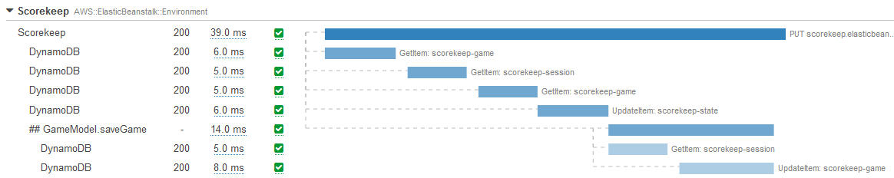
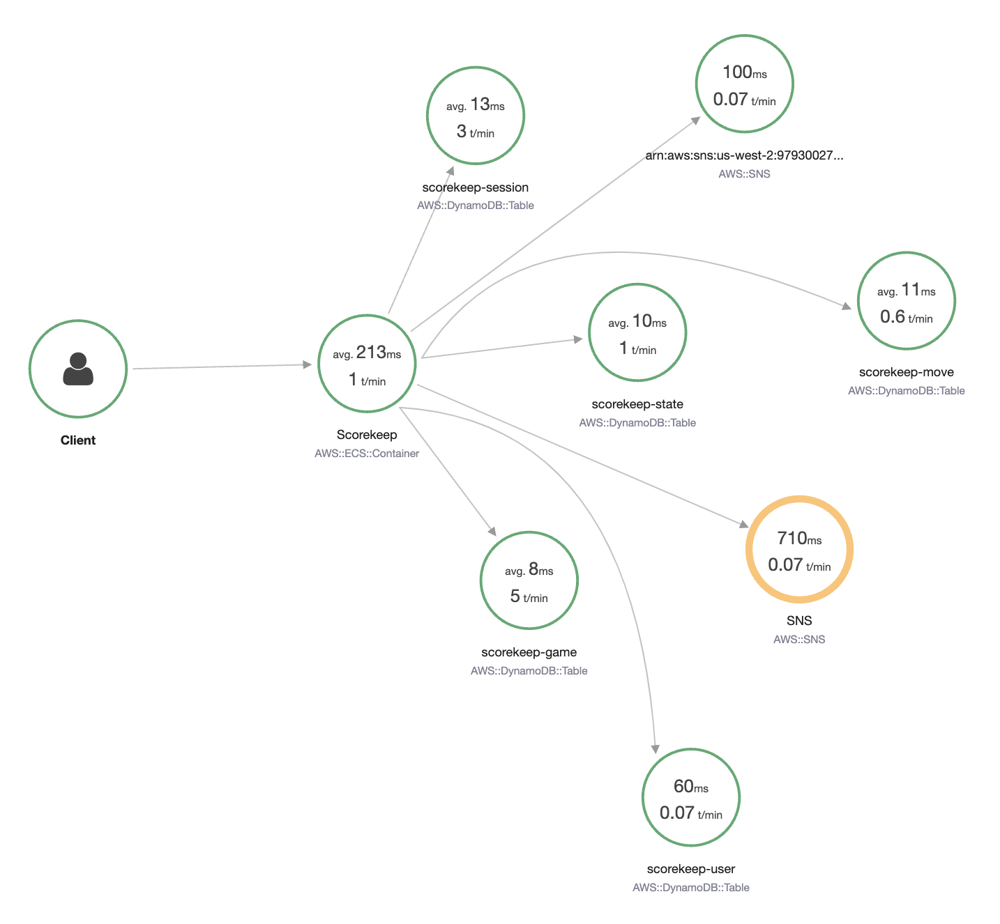

import RelatedEvents from '@site/src/components/RelatedEvents';

# 分散トレーシング

## 概要

分散トレーシングは、マイクロサービスアーキテクチャにおいて複数のサービスを横断するリクエストのエンドツーエンドの可視性を提供します。ログやメトリクスとは異なり、トレースはサービス間の因果関係（応答レイテンシ、サービス障害、リクエストパラメータ、およびリクエストパス全体のメタデータ）を捕捉します。

AWS は、トレース収集のための 2 つの主要なツールセットを提供しています：[AWS X-Ray](https://docs.aws.amazon.com/xray/latest/devguide/aws-xray.html)（SDK およびデーモン付き）と [AWS Distro for OpenTelemetry（ADOT）](https://aws-otel.github.io/) です。このガイドでは、トレースで得られるもの、サンプリングの効果的な設定方法、デーモンデプロイのベストプラクティス、アノテーションによるトレースの強化、およびワークロードに応じた X-Ray SDK と ADOT の選択方法について説明します。

## 使用するタイミング

- マイクロサービスを構築または運用しており、クロスサービスリクエストフローの可視性が必要な場合
- 複数のサービス境界にまたがるレイテンシや障害の診断が必要な場合
- エンドツーエンドのトランザクションのパフォーマンスプロファイルを把握したい場合
- 計装に X-Ray SDK と OpenTelemetry（ADOT）のどちらを選択するか決定する場合
- オブザーバビリティとコストのバランスを取るためにサンプリングルールを設定する必要がある場合

## ガイダンス

### トレースで得られるもの

トレースは、リクエストが異なるコンポーネントを通過する際の全体的な旅を表します。各トレースは*スパン*（X-Ray の用語では*セグメント*）に分解され、リクエストパスの各ステップ（タイミング、ステータスコード、メタデータを含む）を記録します。

一般的な計装アプローチでは、システムに入る各リクエストに一意のトレース識別子を割り当て、異なるコンポーネントを通過する際にその ID を引き継ぎ、途中でメタデータを追加します。

トレースの一般的なユースケース：

- **パフォーマンスプロファイリング** — レイテンシに最も影響するサービスまたはオペレーションの特定
- **本番環境の問題のデバッグ** — サービスチェーンのどこで障害が発生しているかの特定
- **根本原因分析** — サービス境界を越えたカスケード障害の理解
- **SLA コンプライアンス** — ターゲットに対するエンドツーエンドのトランザクション時間の測定

あるサービスから別のサービスへのすべての接続を計装して、中央コレクターにトレースを出力する必要があります。このアプローチにより、ワークロードの不透明な側面を可視化できます。自動計装エージェントまたはライブラリを使用すると、アプリケーションの計装を大幅に自動化できます。

### サンプリング戦略

サンプリングルールは、どのリクエストがトレースされるかを決定します。目標は、管理不能なボリュームやコストを発生させることなく、問題の診断とパフォーマンスの理解に十分なデータを収集することです。

**X-Ray のデフォルト動作**：X-Ray SDK は毎秒最初のリクエストと、追加リクエストの 5% を記録します。

主要なサンプリングの考慮事項：

- **条件ごとにサンプルレートを設定する** — サービス名、サービスタイプ、HTTP メソッド、URL パス、リソース ARN、またはホストごとにレートを個別に設定できます。たとえば、ランディングページのトラフィックの 1% をサンプリングし、決済ページのリクエストの 10% をサンプリングします。
- **必ずリザーバーサイズを設定する** — リザーバーは、毎秒キャプチャされるリクエストの最大数を決定します。これにより、悪意のある攻撃、予期しない課金、および設定エラーから保護されます。
- **100% のサンプルレートを避ける** — トレースはフォレンジック監査を目的としていません。UDP ベースのエミッターを使用する場合、時折トレースが失われることが予想されます。100% のレートは完全性について誤った期待を生む可能性があります。
- **段階的にトレースを追加する** — 重要なパスから始めて、ワークロードのデータボリュームを理解しながらカバレッジを拡大します。

サンプリングルールは、AWS コンソール、ローカル設定ファイル、またはその両方で設定できます。可能な限り X-Ray コンソール、API、または CloudFormation を使用してください。これにより、再デプロイなしでサンプリング動作をランタイムに変更できます。

### X-Ray デーモンの設定

X-Ray デーモンは、X-Ray データプレーンへのテレメトリ送信の負荷を軽減します。ソースアプリケーションが実行されているホストで過度のリソースを消費すべきではありません。

ベストプラクティス：

- **デーモンを別に実行する** — ベストプラクティスは、X-Ray デーモンを別のインスタンスまたはコンテナで実行し、関心の分離を強制してソースシステムの負担を軽減することです。
- **サイドカーパターンを使用する** — コンテナオーケストレーション（例：Kubernetes）では、デーモンをアプリケーション Pod のサイドカーコンテナとして運用します。
- **コロケーションの場合はリソースを制約する** — デーモンを同じインスタンスで実行する必要がある場合、`TotalBufferSizeMB` を設定して X-Ray が許容量を超えるシステムメモリを消費しないようにします。
- **ハイブリッド環境ではエンドポイントを設定する** — Direct Connect または VPN を使用するオンプレミスまたは他のクラウド環境では、`Endpoint` を [VPC エンドポイント](https://docs.aws.amazon.com/vpc/latest/privatelink/concepts.html)に合わせて調整します。

デーモンには安全なデフォルト設定があり、ほとんどの場合、追加設定なしで EC2、ECS、EKS、または Fargate 環境で動作できます。

### アノテーションとメタデータ

アノテーションは、トレースにアタッチされたインデックス付きのキーバリューペアで、強力なフィルタリングとグループ化を可能にします。自動計装では自動的に追加されないため、コードに追加する必要があります。

アノテーションが重要な理由：

- **トレースを論理的にグループ化する** — 顧客 ID、注文 ID、またはテナントでトレースにラベルを付けて、即座に検索を絞り込みます
- **X-Ray Insights を生成する** — アノテーションに基づくメトリクスを作成します
- **アラームを構築する** — アノテーション付きトレースデータに基づいて異常検出と自動修復を設定します
- **迅速なフィルタリングを可能にする** — ワークロード全体で特定のエンティティのすべてのトレースを検索します

アノテーションを使用して、環境内のデータフローを理解し、アノテーション付きトレースのパフォーマンスと結果に基づいてアラームを作成します。

メタデータは控えめに使用してください。トレースはログではありません。トレースデータは、高いサンプルレートであっても、フォレンジックや監査を目的としていません。

### トレーシングエージェントの選択

AWS は、トレース収集のための 2 つのツールセットをサポートしており、相互に排他的ではありません：

| 基準 | AWS Distro for OpenTelemetry（ADOT） | X-Ray SDK |
|----------|--------------------------------------|-----------|
| **ベンダーの柔軟性** | コードを再計装することなく、複数のバックエンド（X-Ray、Zipkin、Jaeger など）にトレースを送信 | 緊密に統合されたシングルベンダーソリューション |
| **設定変更の範囲** | バックエンドを切り替える際にコレクターの設定のみ変更。アプリケーションコードは影響なし | 設定とコードが X-Ray に結合 |
| **ライブラリ計装** | 各言語の大規模なコミュニティメンテナンスライブラリ | AWS メンテナンスの計装 |
| **集中型サンプリングルール** | X-Ray バックエンド経由でサポート | コンソールベースの設定を含むネイティブサポート（Node.js、Python、Ruby、.NET の複数ホストにわたる） |
| **業界標準** | OpenTelemetry（OTEL）はオブザーバビリティシグナリングの現在の業界標準 | OTEL に先行、成熟し安定している |

**ADOT を推奨する場合：**

- コードを再計装せずに複数のトレーシングバックエンドにトレースを送信する機能が必要な場合
- 多数のコミュニティメンテナンスのライブラリ計装のサポートが必要な場合
- 将来ソリューションを変更する場合の技術的負債を軽減するベンダーニュートラルなアプローチが必要な場合

**X-Ray SDK を推奨する場合：**

- 最小限の設定で緊密に統合されたシングルベンダーソリューションが必要な場合
- X-Ray コンソールからサンプリングルールを設定し、複数のホストにわたって自動的に使用する機能を含む、X-Ray 集中型サンプリングルールとの統合が必要な場合

両方のアプローチは、X-Ray へのエンドツーエンドのトレーシングを提供します。選択は、ベンダーの柔軟性（ADOT）を重視するか、緊密な統合のシンプルさ（X-Ray SDK）を重視するかによります。同じ環境で混在させることもできます。異なるサービスで異なるエージェントを必要に応じて使用できます。

### すべての統合ポイントを計装する

すべての機能が 1 か所にある場合、ソースコードを通じたフローのトレースは簡単です。疎結合された分散コンポーネントを持つマイクロサービスアーキテクチャでは、相互接続された各リクエストのログを調べるために多数のシステムにログインすることは非現実的です。

あるサービスから別のサービスへのすべての接続を計装してください。応答時間とインタラクションのステータスコードを記録することによってのみ、全体的なリクエストパターンとワークロードの正常性に寄与する要因を確認できます。

## 関連リソース

- [EKS Application Signals](../eks-application-signals/) — EKS ワークロードの自動アプリケーションパフォーマンスモニタリング
- [ADOT at Scale](../adot-at-scale/) — 大規模環境での OpenTelemetry コレクションのスケーリング
- [.NET アプリケーションモニタリング](../dotnet-application-monitoring/) — .NET アプリケーションのエンドツーエンドオブザーバビリティ
- [AWS ドキュメント：X-Ray デベロッパーガイド](https://docs.aws.amazon.com/xray/latest/devguide/aws-xray.html)
- [AWS ドキュメント：AWS Distro for OpenTelemetry](https://aws-otel.github.io/)

## 関連イベント

<RelatedEvents topics={["apm"]} />
