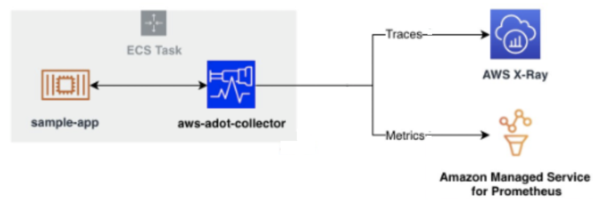
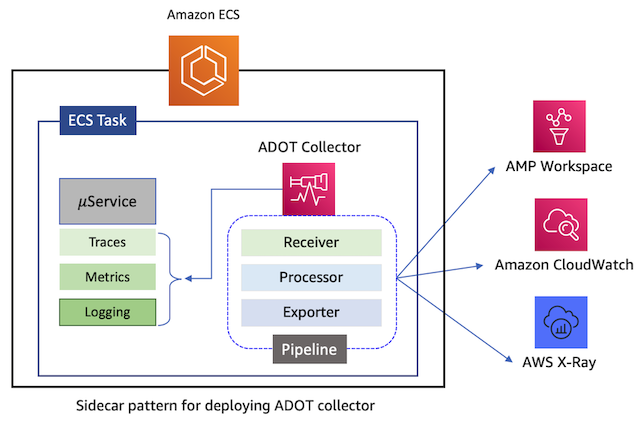
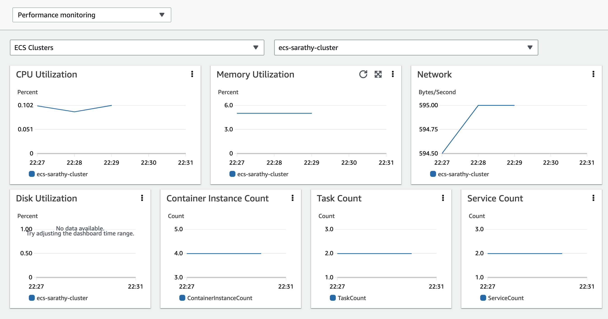
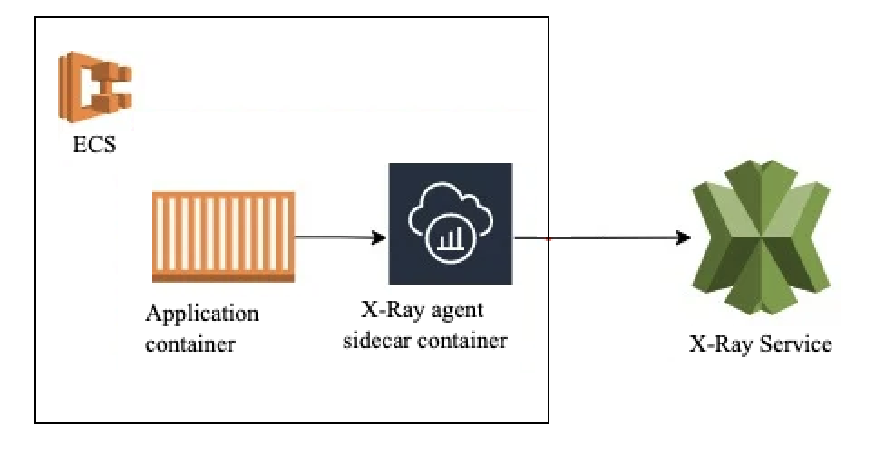

# ECS モニタリング

## 概要

CloudWatch Container Insights を使用したシステムメトリクスと、ADOT（AWS Distro for OpenTelemetry）を使用したアプリケーションレベルのメトリクスおよび分散トレースで Amazon ECS ワークロードをモニタリングします。このソリューションは、ECS on EC2 と ECS on Fargate の両方をサポートしています。

Container Insights は、サイドカー不要で、クラスター、サービス、およびタスクレベルのメトリクス（CPU、メモリ、ネットワーク、ディスク）を自動ダッシュボード付きで提供します。より深いオブザーバビリティを実現するには、ADOT Collector をサイドカーとしてデプロイして、タスクレベルのリソースメトリクス、Prometheus アプリケーションメトリクス、および X-Ray トレースを収集し、Amazon Managed Service for Prometheus（AMP）および Amazon Managed Grafana（AMG）にルーティングします。

このエントリでは、**高速パス**（Container Insights、5 分）と**アドバンスドパス**（ADOT → AMP/AMG/X-Ray）の 2 つのパスを説明します。完全なリファレンス：[ECS 用 Container Insights](https://docs.aws.amazon.com/AmazonECS/latest/developerguide/cloudwatch-container-insights.html)。

## 前提条件

- Amazon ECS クラスター（EC2 または Fargate 起動タイプ）
- 適切な権限で設定された AWS CLI v2
- `CloudWatchAgentServerPolicy` を持つ IAM タスク実行ロール（Container Insights 用）
- （ADOT パスの場合）`AWSXRayDaemonWriteAccess` および `AmazonPrometheusRemoteWriteAccess` を持つ IAM タスクロール
- （ADOT パスの場合）AMP ワークスペースおよび AMG ワークスペース
- ECS エージェント v1.39.0 以降（EC2）または Fargate プラットフォーム v1.4.0 以降

## アーキテクチャ

```
┌──────────────────────────────────────────────────────────────┐
│                        ECS Cluster                           │
│                                                              │
│  ┌────────────────────────────────────────────┐              │
│  │            ECS Task                        │              │
│  │  ┌──────────────┐  ┌───────────────────┐  │              │
│  │  │ Application  │  │ ADOT Collector    │  │              │
│  │  │ Container    │──│ (sidecar)         │  │              │
│  │  │ (X-Ray SDK / │  │                   │  │              │
│  │  │  Prometheus) │  └─────┬─────┬───────┘  │              │
│  │  └──────────────┘        │     │           │              │
│  └──────────────────────────┼─────┼───────────┘              │
│                             │     │                          │
│  ECS Agent ─── Container Insights metrics ──┐                │
│                             │     │         │                │
└─────────────────────────────┼─────┼─────────┼────────────────┘
                              │     │         │
                 ┌────────────┘     │         └──────────┐
                 ▼                  ▼                     ▼
      ┌────────────────┐  ┌─────────────────┐  ┌─────────────────┐
      │  AWS X-Ray     │  │  Amazon Managed │  │  CloudWatch     │
      │  Traces &      │  │  Prometheus     │  │  Metrics & Logs │
      │  Service Map   │  │  (AMP)          │  │  Dashboards     │
      └────────────────┘  └────────┬────────┘  └─────────────────┘
                                   │
                                   ▼
                          ┌─────────────────┐
                          │ Amazon Managed  │
                          │ Grafana (AMG)   │
                          └─────────────────┘
```





## デプロイ

### 高速パス：Container Insights（5 分）

#### オプション A：アカウントレベルで有効にする

```bash
aws ecs put-account-setting --name "containerInsights" --value "enabled"
```

#### オプション B：特定のクラスターで有効にする

```bash
aws ecs update-cluster-settings \
  --cluster $CLUSTER_NAME \
  --settings name=containerInsights,value=enabled
```

これだけです。ECS エージェントが自動的に収集を処理します。メトリクスは CloudWatch の `ECS/ContainerInsights` 名前空間に表示されます。

### アドバンスドパス：AMP および X-Ray 用の ADOT Collector

#### ステップ 1：ADOT サイドカータスク定義を作成する

既存のタスク定義に ADOT Collector コンテナを追加します：

```json
{
  "name": "aws-otel-collector",
  "image": "public.ecr.aws/aws-observability/aws-otel-collector:latest",
  "cpu": 512,
  "memory": 1024,
  "command": [
    "--config=/etc/ecs/container-insights/otel-task-metrics-config.yaml"
  ],
  "portMappings": [
    { "containerPort": 2000, "protocol": "udp" },
    { "containerPort": 4317, "protocol": "tcp" }
  ],
  "essential": true
}
```

カスタムパイプライン（例：Prometheus スクレイピング + AMP へのリモートライト）の場合は、設定を SSM Parameter Store に保存し、`AOT_CONFIG_CONTENT` 環境変数で参照します。

#### ステップ 2：IAM ロールを設定する

以下のポリシーを ECS タスクロールにアタッチします：

- `AWSXRayDaemonWriteAccess`（トレーシング用）
- `AmazonPrometheusRemoteWriteAccess`（AMP 用）
- `CloudWatchAgentServerPolicy`（EMF メトリクス用）

#### ステップ 3：タスクをデプロイする

```bash
aws ecs register-task-definition --cli-input-json file://task-def.json
aws ecs update-service --cluster $CLUSTER_NAME --service $SERVICE_NAME \
  --task-definition $TASK_DEF_NAME
```

#### ステップ 4：Prometheus スクレイピングを設定する（オプション）

`/metrics` で公開されるアプリケーションメトリクスの場合、ECS サービスディスカバリ付きの CloudWatch エージェントを使用します。エージェント設定の `task_definition_list` でターゲットパターンを定義します：

```json
{
  "ecs_service_discovery": {
    "sd_frequency": "1m",
    "sd_result_file": "/tmp/cwagent_ecs_auto_sd.yaml",
    "task_definition_list": [
      {
        "sd_job_name": "my-app",
        "sd_metrics_ports": "9090",
        "sd_task_definition_arn_pattern": ".*:task-definition/MyApp:[0-9]+",
        "sd_metrics_path": "/metrics"
      }
    ]
  }
}
```

## 検証

1. **Container Insights（高速パス）：**
   CloudWatch → Container Insights → パフォーマンスモニタリングに移動します。ECS クラスターを選択し、クラスター/サービス/タスクのメトリクスを確認します。

   

2. **ADOT Collector の正常性を確認：**
   ```bash
   aws ecs describe-tasks --cluster $CLUSTER_NAME --tasks $TASK_ARN \
     --query 'tasks[0].containers[?name==`aws-otel-collector`].lastStatus'
   ```

3. **X-Ray トレースを確認：**
   CloudWatch → X-Ray traces → サービスマップを開きます。ECS サービスがリクエストフローとともに表示されることを確認します。

   

4. **AMP メトリクスをクエリ：**
   ```bash
   awscurl --service aps --region $REGION \
     "https://aps-workspaces.$REGION.amazonaws.com/workspaces/$WS_ID/api/v1/query?query=up"
   ```

## トラブルシューティング

| 症状 | 考えられる原因 | 修正方法 |
|---------|-------------|-----|
| Container Insights メトリクスが表示されない | クラスターで Container Insights が有効になっていない | `aws ecs update-cluster-settings --cluster $CLUSTER --settings name=containerInsights,value=enabled` を実行します |
| ADOT サイドカーが即座に終了する | IAM 権限の欠落または無効な設定 | コレクターコンテナの CloudWatch Logs を確認し、タスクロールのポリシーを検証します |
| 部分的なメトリクス（ネットワーク/ディスクが欠落） | ECS エージェントが古すぎる | ECS エージェント v1.39.0 以降（EC2）または Fargate プラットフォーム v1.4.0 以降にアップグレードします |
| Prometheus メトリクスが表示されない | サービスディスカバリの設定が正しくない | `sd_task_definition_arn_pattern` の正規表現がタスク定義 ARN に一致することを確認します |
| X-Ray トレースが欠落している | アプリケーションが計装されていない | アプリケーションに X-Ray SDK を追加するか、ポート 4317 で OTLP レシーバーを設定します |

## 関連ソリューション

- [EKS インフラストラクチャモニタリング](../eks-infrastructure/) — EKS ワークロード向けの同等パス
- [Lambda モニタリング](../lambda-monitoring/) — ECS サービスから呼び出されるサーバーレス関数のモニタリング
