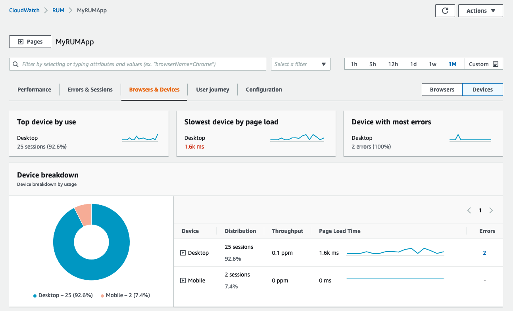
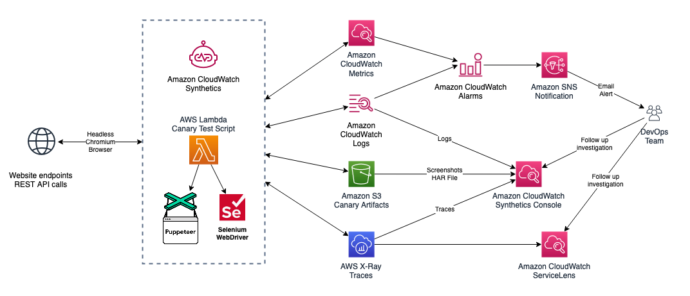
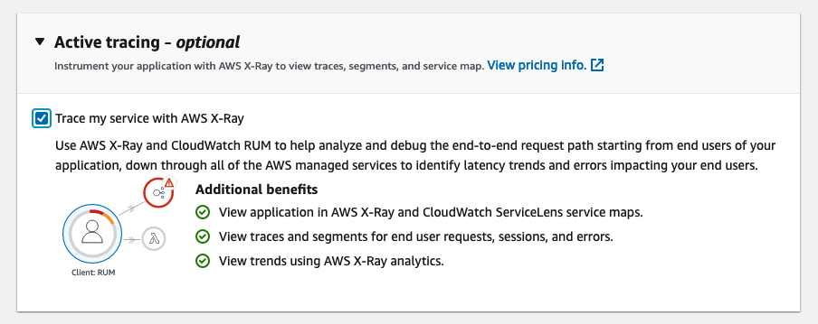
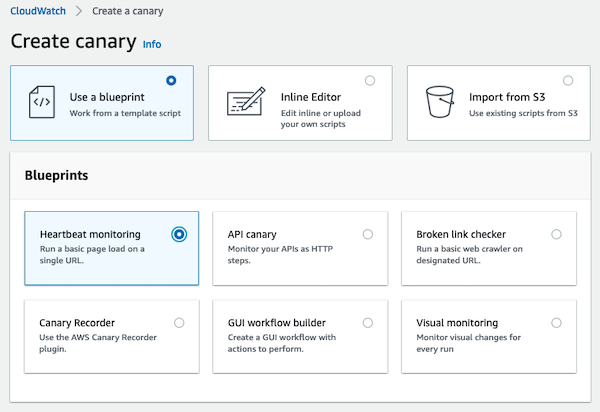
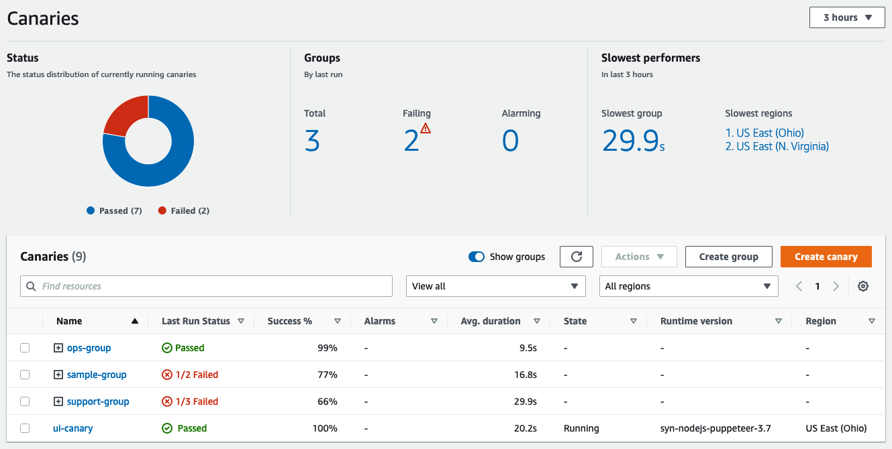
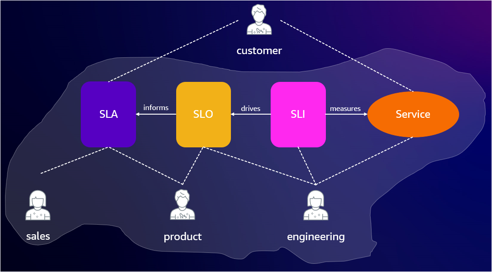
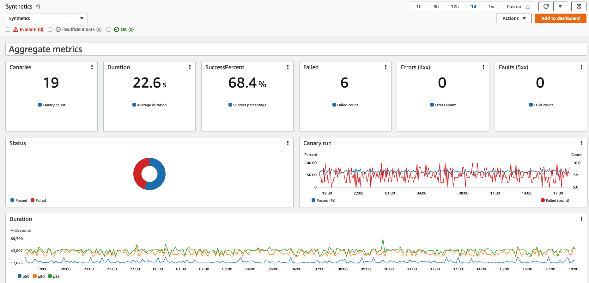

import RelatedEvents from '@site/src/components/RelatedEvents';

# フロントエンドと SLO モニタリング

## 関連イベント

<RelatedEvents topics={["apm", "cloudwatch"]} />

## 概要

フロントエンドと SLO モニタリングは、3 つの補完的な機能を組み合わせたものです：リアルユーザーモニタリングのための **CloudWatch RUM**、プロアクティブな合成テストのための **CloudWatch Synthetics**、およびビジネス目標に対するサービス信頼性を測定するための **Application Signals SLO** です。

これらを組み合わせることで、実際のユーザーエクスペリエンスの可視化、ユーザーに影響が及ぶ前の問題の早期検出、および合意されたサービスレベル目標に対する可用性とレイテンシの客観的な追跡が可能になります。

## 前提条件

- CloudWatch が有効になっている AWS アカウント
- RUM および Synthetics モニタリング用の Web アプリケーション（パブリックまたはプライベート）
- Amazon Cognito ID プール（または RUM に作成を許可）
- SLO 用に CloudWatch Application Signals で計装されたアプリケーション（EKS、ECS、EC2 でサポート）
- CloudWatch、X-Ray、Synthetics、および Cognito の IAM 権限

## アーキテクチャ

CloudWatch RUM は、実際のユーザーブラウザからクライアント側のテレメトリを収集し、CloudWatch に転送します。Synthetics Canary は、AWS マネージドインフラストラクチャからスケジュールに従って実行され、エンドポイントをプロアクティブにテストします。Application Signals は、SLO の SLI として機能するレイテンシと可用性のメトリクスを収集します。

RUM でアクティブトレーシングが有効になっている場合、HTTP リクエストにトレースヘッダーが追加され、フロントエンドのエクスペリエンスと X-Ray のバックエンドトレースが接続されます。

## デプロイ

### CloudWatch RUM

1. CloudWatch コンソールを開き、**Application monitoring > RUM** に移動します。

2. アプリケーションモニターを作成します。認証方法を選択します — RUM に新しい Cognito ID プールの作成を許可する方法が最も簡単です。

3. 生成された JavaScript コードスニペットをコピーし、アプリケーションの `<head>` 要素内の他の `<script>` タグの前に挿入します。

   :::warning
   RUM が完全なパフォーマンスデータを取得するために、Web クライアントは `<head>` 要素のできるだけ早い位置に配置する必要があります。
   :::

4. スニペット設定で `addXRayTraceIdHeader: true` を設定してアクティブトレーシングを有効にし、X-Ray とのエンドツーエンドのトレース相関を取得します。

   

5. ディメンション（BrowserName、CountryCode、DeviceType、PageId）を使用して拡張メトリクスを設定し、CloudWatch Metrics で詳細なビューを取得します。

### CloudWatch Synthetics

1. CloudWatch コンソールを開き、**Application monitoring > Synthetics Canaries** に移動します。

2. [ブループリント](https://docs.aws.amazon.com/AmazonCloudWatch/latest/monitoring/CloudWatch_Synthetics_Canaries_Blueprints.html)（Heartbeat、API、Broken Link Checker、GUI Workflow、または Visual）を使用して Canary を作成します。

   

3. スケジュール（例：5 分ごと）を設定し、プライベートエンドポイントをモニタリングする場合は VPC 設定を構成します。

4. ログイン資格情報などのシークレットを AWS Secrets Manager に保存し、Canary スクリプトから実行時に取得します。

5. Canary を[グループ](https://docs.aws.amazon.com/AmazonCloudWatch/latest/monitoring/CloudWatch_Synthetics_Groups.html)に整理して、メトリクスの集約と障害の分離を容易にします。

   

### Application Signals SLO

1. ワークロード（EKS、ECS、または EC2）で [Application Signals](https://docs.aws.amazon.com/AmazonCloudWatch/latest/monitoring/CloudWatch-Application-Monitoring-Sections.html) を有効にします。

2. CloudWatch コンソールで **Application Signals > Service Level Objectives** に移動します。

3. Application Signals で検出されたサービスとオペレーションを選択して SLO を作成します。SLI メトリクスとしてレイテンシまたは可用性を選択します。

4. ターゲットを設定します（例：30 日間のローリングウィンドウで 99.9% の可用性）。Application Signals はエラーバジェットを追跡し、バジェットがリスクにさらされているときにアラートを送信します。

## 検証

1. **RUM**：RUM ダッシュボードを開きます。ページロードイベント、パフォーマンスデータ、およびユーザーセッションが表示されることを確認します。アクティブトレーシングが有効な場合、トレース ID が X-Ray にリンクされていることを確認します。

2. **Synthetics**：Synthetics コンソールで Canary の実行結果を確認します。成功率を確認し、GUI ワークフロー Canary のスクリーンショットを表示します。

   

3. **SLO**：SLO ダッシュボードを開きます。エラーバジェットが追跡されていること、および SLI メトリクスにサービスオペレーションからのデータが入力されていることを確認します。

## トラブルシューティング

| 症状 | 考えられる原因 | 修正方法 |
|---------|-------------|-----|
| RUM データが表示されない | コードスニペットが `<head>` の十分早い位置に挿入されていないか、Cognito プールの設定が誤っている | スニペットの配置を確認し、Cognito ID プールの権限を確認します |
| Canary がネットワークタイムアウトで失敗する | VPC 設定が欠落しているか、セキュリティグループがエグレスをブロックしている | Canary を正しい VPC/サブネットにアタッチし、セキュリティグループで HTTPS エグレスを許可します |
| SLO にデータが表示されない | Application Signals エージェントが実行されていないか、サービスが計装されていない | ADOT または CloudWatch エージェントがデプロイされていることを確認し、Application Signals サービスマップを確認します |
| RUM が広告ブロッカーによりブロックされる | Web クライアントが CloudWatch ドメインからロードされている | RUM Web クライアントを独自の CDN またはオリジンドメインでセルフホストします |
| Canary は成功するが RUM はエラーを表示する | Canary が実際のユーザーとは異なるパスまたはリージョンをテストしている | 同じユーザージャーニーをカバーする Canary を追加し、地理的ルーティングを確認します |

## 関連ソリューション

- [EKS Application Signals](../eks-application-signals/)
- [.NET アプリケーションモニタリング](../dotnet-application-monitoring/)
