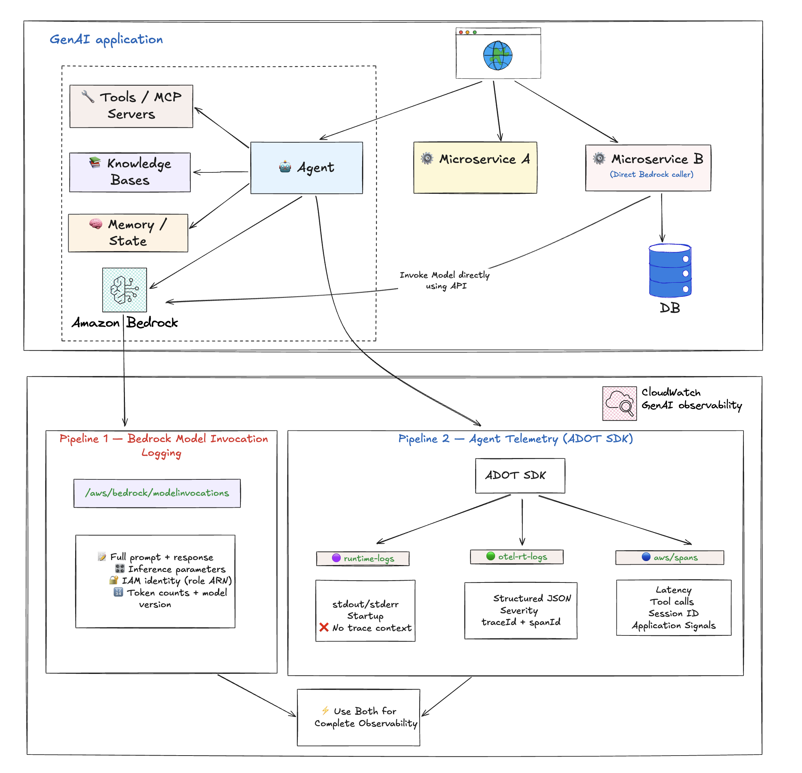
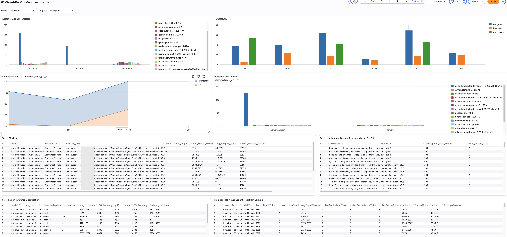
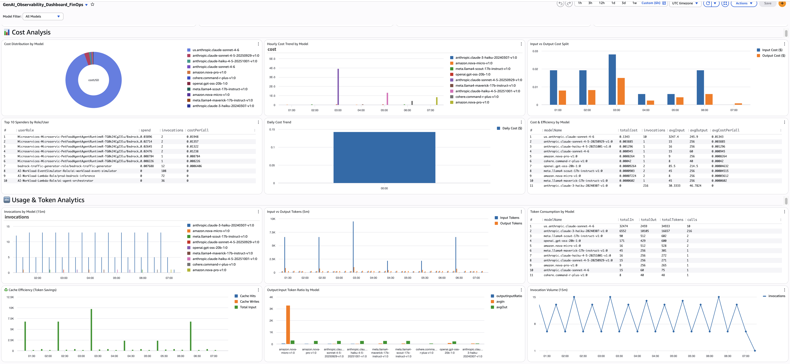

import RelatedEvents from '@site/src/components/RelatedEvents';

# 生成 AI ワークロードのオブザーバビリティ

## 関連イベント

<RelatedEvents topics={["genai", "ai-ml"]} />


## 概要

AWS 上の生成 AI ワークロード（Amazon Bedrock、SageMaker、セルフホストモデル）には、独自のオブザーバビリティ上の課題があります：非決定的な応答、トークンベースの料金設定、可変レイテンシ、および Bedrock、S3、Lambda、KMS にまたがる API コールを数秒以内にチェーンするマルチサービスエージェントオーケストレーションです。適切なモニタリングがないと、チームは追跡されないトークン使用量によるコスト超過、サイレントなエージェント障害、およびコンプライアンスのギャップに直面します。

このソリューションでは、2 つの補完的なテレメトリパイプラインを有効にします。**パイプライン 1（Bedrock モデル呼び出しログ）**は、すべての Bedrock コールの生のリクエスト/レスポンスコンテンツ、推論パラメータ、トークン数、および呼び出し元の IAM ID をキャプチャします — コスト配分、コンプライアンス監査、およびプロンプトデバッグに不可欠です。**パイプライン 2（ADOT 経由のエージェントテレメトリ）**は、エージェントオーケストレーションフロー、ツール実行、およびモデルコール全体にわたる OpenTelemetry ベースの分散トレースを提供します — レイテンシ分析、エラードリルダウン、および Application Signals ダッシュボードに不可欠です。

これらのパイプラインを組み合わせることで、DevOps ダッシュボード（完了率、コンポーネントレイテンシ、エージェントエラーレート）、FinOps ダッシュボード（モデル/チーム/ロール別のコスト、キャッシュの機会）、および完全なエンドツーエンドのリクエストトレーシングが実現します。AgentCore でホストされたエージェントの場合、テレメトリは自動的に流れます。AgentCore 以外のデプロイメント（EKS、ECS、セルフホスト）の場合は、ADOT 自動計装エージェントをアタッチします。

## 前提条件

- Amazon Bedrock モデルアクセスが有効になっている AWS アカウント
- IAM 権限：`bedrock:*`、`logs:*`、`cloudwatch:*`、`iam:PassRole`
- CloudWatch Transaction Search が有効（[ドキュメント](https://docs.aws.amazon.com/AmazonCloudWatch/latest/monitoring/Enable-TransactionSearch.html)）
- AgentCore 以外でのエージェントテレメトリの場合：コンピューティング（EKS、ECS、または EC2）用の ADOT 自動計装エージェント
- ダッシュボード用：Amazon Managed Grafana ワークスペース（オプション、FinOps/DevOps ペルソナダッシュボード用）
- AWS CLI v2 がインストールおよび設定済み

## アーキテクチャ



```
┌──────────────────────────────────────────────────────────────────────┐
│                          AWS Account                                  │
│                                                                      │
│  ┌────────────────┐     ┌────────────────┐     ┌─────────────────┐  │
│  │  Application   │     │  AI Agent      │     │  Direct Bedrock │  │
│  │  (EKS/ECS/EC2)│     │  (AgentCore)   │     │  API Calls      │  │
│  │  + ADOT Agent  │     │  (ADOT built-in│     │                 │  │
│  └───────┬────────┘     └───────┬────────┘     └───────┬─────────┘  │
│          │                      │                       │            │
│          │  OTel Traces         │  OTel Traces          │            │
│          ▼                      ▼                       │            │
│  ┌──────────────────────────────────────┐               │            │
│  │          CloudWatch (aws/spans)       │               │            │
│  │  - Agent orchestration traces         │               │            │
│  │  - Tool execution spans               │               │            │
│  │  - Model call latency/tokens          │               │            │
│  └──────────────────┬───────────────────┘               │            │
│                     │                                    │            │
│                     │              ┌─────────────────────▼──────────┐ │
│                     │              │  Bedrock Model Invocation Logs │ │
│                     │              │  - Full request/response body  │ │
│                     │              │  - Inference params            │ │
│                     │              │  - IAM caller identity         │ │
│                     │              │  - Token counts                │ │
│                     │              └─────────────────────┬──────────┘ │
│                     │                                    │            │
│                     └────────────────┬───────────────────┘            │
│                                      ▼                                │
│                          ┌───────────────────────┐                   │
│                          │      CloudWatch       │                   │
│                          │  - Application Signals│                   │
│                          │  - Logs Insights      │                   │
│                          │  - Dashboards         │                   │
│                          └───────────┬───────────┘                   │
│                                      │                                │
└──────────────────────────────────────┼────────────────────────────────┘
                                       ▼
                           ┌───────────────────────┐
                           │  Amazon Managed       │
                           │  Grafana (AMG)        │
                           │  - DevOps Dashboard   │
                           │  - FinOps Dashboard   │
                           └───────────────────────┘
```

## デプロイ

### ステップ 1：CloudWatch Transaction Search を有効にする

CloudWatch コンソール → 設定 → トレース → Transaction Search を有効にします。これにより、生成 AI 向けの Application Signals と分散トレース機能がアンロックされます。

### ステップ 2：Bedrock モデル呼び出しログを有効にする

```bash
# Create log group for invocation logs
aws logs create-log-group --log-group-name bedrock-model-invocation-logging

# Enable via the Bedrock console:
# Bedrock → Settings → Model invocation logging → Enable
# Select: Text, Image (as needed)
# Destination: CloudWatch Logs → bedrock-model-invocation-logging
```

CLI での有効化については、[CloudWatch Logs の送信先の設定](https://docs.aws.amazon.com/bedrock/latest/userguide/model-invocation-logging.html#setup-cloudwatch-logs-destination)を参照してください。

### ステップ 3：エージェントテレメトリを有効にする

**AgentCore でホストされたエージェント：**アクションは不要です — ADOT SDK がランタイムに組み込まれており、テレメトリは自動的に流れます。

**AgentCore 以外のエージェント（EKS/ECS/セルフホスト）：**ADOT 自動計装エージェントをアタッチします。[サードパーティのオブザーバビリティの設定](https://docs.aws.amazon.com/bedrock-agentcore/latest/devguide/observability-configure.html#observability-configure-3p)および[ステップバイステップチュートリアル](https://aws.github.io/bedrock-agentcore-starter-toolkit/user-guide/observability/quickstart.html#enabling-observability-for-non-agentcore-hosted-agents)を参照してください。

### ステップ 4：データ保護を設定する（推奨）

```bash
# Apply PII redaction to model invocation logs
# CloudWatch console → Logs → Log groups → bedrock-model-invocation-logging
# → Create data protection policy → select relevant data identifiers
```

[マスキングによる機密ログデータの保護](https://docs.aws.amazon.com/AmazonCloudWatch/latest/logs/cloudwatch-logs-data-protection-policies.html)を参照してください。

### ステップ 5：カスタムダッシュボードを作成する

`bedrock-model-invocation-logging` および `aws/spans` ロググループに対して CloudWatch Logs Insights クエリを使用します。主要なクエリ：

**モデル別のトークン使用量（FinOps）：**
```sql
fields @timestamp, modelId,
  coalesce(output.outputBodyJson.usage.inputTokens, input.inputTokenCount) as inputTokens,
  coalesce(output.outputBodyJson.usage.outputTokens, output.outputTokenCount) as outputTokens
| filter schemaType = "ModelInvocationLog"
| stats sum(inputTokens) as totalInput, sum(outputTokens) as totalOutput by modelId
| sort totalInput desc
```

**エージェントエラーレート（DevOps）：**
```sql
fields traceId, status.code as statusCode
| filter ispresent(attributes.session.id)
| stats count_distinct(traceId) as total_traces,
        sum(statusCode = "ERROR") as error_spans
  by bin(@timestamp, 1h)
| sort @timestamp desc
```

17 のペルソナベースダッシュボードクエリ（DevOps および FinOps）の完全なセットは、このセクションに統合される予定です。`_catalog/DISPOSITIONS.md` を参照してください。

## 検証





1. **モデル呼び出しログ：**Bedrock モデルを呼び出してから、以下のクエリを実行します：
   ```bash
   aws logs filter-log-events \
     --log-group-name bedrock-model-invocation-logging \
     --filter-pattern '{ $.schemaType = "ModelInvocationLog" }' \
     --limit 3
   ```

2. **エージェントテレメトリ（トレース）：**エージェントセッションを実行した後、スパンを確認します：
   ```bash
   aws logs filter-log-events \
     --log-group-name aws/spans \
     --filter-pattern '{ $.name = "chat *" }' \
     --limit 3
   ```

3. **Application Signals：**CloudWatch → Application Signals → サービスを開きます。エージェントサービスが自動生成されたレイテンシおよびエラーレートメトリクスとともに表示されるはずです。

4. **組み込み Bedrock ダッシュボード：**CloudWatch → ダッシュボードを開き、呼び出し数、レイテンシ、およびトークン数を表示する自動 Bedrock ダッシュボードを確認します。

## トラブルシューティング

| 症状 | 考えられる原因 | 修正方法 |
|---------|-------------|-----|
| `bedrock-model-invocation-logging` にログがない | モデル呼び出しログが有効になっていないか、IAM ロールに `logs:PutLogEvents` がない | Bedrock → 設定 → モデル呼び出しログを再確認します。サービスロールがターゲットロググループに対して `logs:CreateLogStream` と `logs:PutLogEvents` を持っていることを確認します |
| AgentCore 以外のエージェントで `aws/spans` にトレースがない | ADOT 自動計装エージェントがアタッチされていない | [AgentCore 以外のクイックスタート](https://aws.github.io/bedrock-agentcore-starter-toolkit/user-guide/observability/quickstart.html#enabling-observability-for-non-agentcore-hosted-agents)に従ってエージェントをアタッチします。ADOT コレクター Pod/サイドカーが実行中であることを確認します |
| Application Signals にサービスが表示されない | Transaction Search が有効になっていない | CloudWatch の設定 → トレースで Transaction Search を有効にします。データが入力されるまで 5〜10 分待ちます |
| コストクエリが $0 を返す | トークンフィールドが見つからない（モデル固有の JSON パス） | 複数のフィールドパス（`usage.inputTokens`、`usage.input_tokens`、`usage.prompt_tokens`）にわたって `coalesce()` を使用します。生ログを確認してモデルの正しいフィールド名を特定します |
| エージェントトレースにエラーが表示されるがモデルメトリクスは正常 | ツール層の障害（KB 取得、ガードレール、Lambda） | `aws/spans` で `filter status.code = "ERROR"` を使用してドリルダウンし、`name` でグループ化して障害が発生しているツール/コンポーネントを特定します |

## 関連ソリューション

- [コーディングエージェントのオブザーバビリティ](../coding-agents-observability/) — Claude Code、Codex、および Copilot 開発者フリート向けの OTel ベースのテレメトリ
