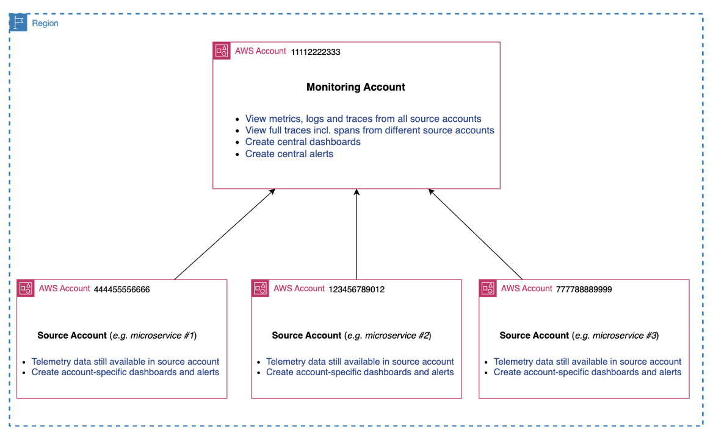
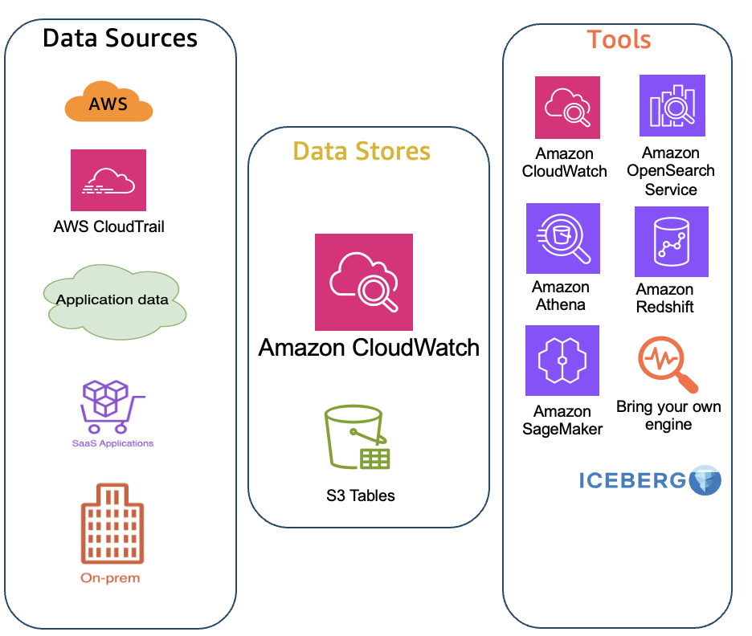
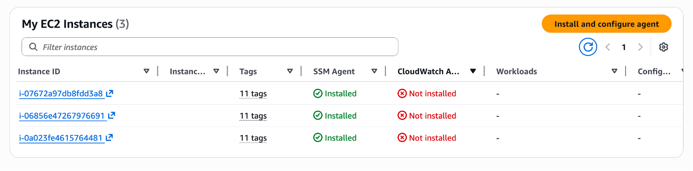

import RelatedEvents from '@site/src/components/RelatedEvents';

# オブザーバビリティの開始方法

## Related Events

<RelatedEvents topics={["cloudwatch"]} />

## 概要

このガイドでは、AWS CloudWatch オブザーバビリティをゼロから始めるチーム向けに、順序立てたオンボーディングパスを提供します。モニタリングアカウントとソースアカウントの設定、統合データストアの構成、エージェントとコレクターのデプロイ、およびダッシュボードとアラートの構築という 4 つのフェーズを順に説明します。

各フェーズは前のフェーズの上に構築されます。ソースガイドは簡潔（各 500 ワード未満）であるため、このエントリでは高レベルのパスを提供し、必要に応じて詳細な設定手順へのリンクを示します。

## 使用するタイミング

- 1 つまたは複数の AWS アカウントで初めてオブザーバビリティを設定する場合
- アドホックな設定ではなく、従うべき構造化されたシーケンスが必要な場合
- 複数のアカウントとリージョンにまたがる一元的な可視性が必要な場合
- CloudWatch クロスアカウントオブザーバビリティと統合データストアのどちらを使用するか（または両方）を評価している場合

## ガイダンス

### フェーズ 1 — モニタリングアカウントとソースアカウントの設定

テレメトリデータを一元的に表示するモニタリングアカウントを指名します。次に、[CloudWatch クロスアカウントオブザーバビリティ](https://docs.aws.amazon.com/AmazonCloudWatch/latest/monitoring/CloudWatch-Unified-Cross-Account.html)を使用して、どのソースアカウントがデータを共有するかを定義します。

このフェーズでの主要な決定事項：

- **単一 vs. 複数のモニタリングアカウント** — 各モニタリングアカウントは最大 100,000 のソースアカウントをサポートします。運用上の境界が必要な場合（例：本番環境と非本番環境の可視性の分離）にのみ、複数のモニタリングアカウントを使用します。
- **テレメトリの範囲** — 共有するシグナルを選択します：ログ、メトリクス、トレース、および Application Signals。メトリクスとログのフィルターを適用して粒度を調整することもできます。
- **リージョンごとの設定** — クロスアカウントオブザーバビリティはリージョンごとに設定されます。リージョン戦略を早期に計画してください。

:::info
クロスアカウントオブザーバビリティでは、ログとメトリクスはソースアカウントからコピーされません — 一元的に表示します。トレースデータはモニタリングアカウントにコピーされます（最初のコピーは追加費用なし）。
:::

**まとめ：**モニタリングアカウントを指名 → ソースアカウントを設定 → テレメトリフィルターを微調整 → クロスアカウントクエリが機能することを確認します。

### フェーズ 2 — 統合データストアの設定

CloudWatch 統合データストアは、ログを単一のアカウントとリージョンに一元化（コピー）し、クエリと分析を行います。コンプライアンスと分析の要件に応じて、クロスアカウントオブザーバビリティと併用するか、代替として使用します。

設定手順：

1. **ルートアカウント** — 信頼されたアクセスを有効にし、一元化されたデータストアのデリゲートアカウントを特定します。
2. **一元化アカウント** — ソースアカウント、ソースリージョン、ロググループフィルター、およびオプションのバックアップリージョンを指定する一元化ルールを作成します。

主要なメリット：データサイロの排除、ETL パイプラインの削減、データの重複なしで Athena、QuickSight、SageMaker、および OpenSearch での分析を可能にします。

詳細な設定については、[CloudWatch 統合データストアのドキュメント](https://docs.aws.amazon.com/AmazonCloudWatch/latest/logs/CloudWatchLogs-Unified-Logs.html)を参照してください。

### フェーズ 3 — エージェントとコレクターの設定

アカウント構造が整ったら、エージェントをデプロイしてワークロードから CloudWatch にテレメトリを送信します。

| コンピューティングプラットフォーム | 推奨アプローチ | 代替手段 |
|---|---|---|
| **Amazon EKS** | CloudWatch Observability EKS アドオン（DaemonSet）— Container Insights、Fluent Bit、Application Signals をインストール | AWS エクスポーター付き OTEL Collector |
| **Amazon ECS** | Container Insights + awslogs ドライバー + Application Signals を有効化 | サイドカーとしての OTEL Collector |
| **Amazon EC2** | ワークロード検出、Systems Manager、または手動インストールによる CloudWatch エージェント | OTLP エクスポーター付き OTEL Collector |

すべてのプラットフォームで、AWS ネイティブの計装（CloudWatch エージェント）またはベンダーニュートラルな計装（OpenTelemetry）のいずれかを選択できます。どちらもメトリクス、ログ、およびトレースを CloudWatch に配信します。

詳細なエージェント設定ガイダンスについては、[CloudWatch エージェント設定](../cloudwatch-agent-configuration/)カタログエントリを参照してください。

### フェーズ 4 — ダッシュボードとアラート

テレメトリが流れ始めたら、可視性と検出を構築します：

- **キュレーションされたダッシュボード** — CloudWatch は多くのサービス（Lambda、EC2、API Gateway）に対して自動ダッシュボードを提供します。Application Signals を使用している場合は、APM のアプリケーションマップを確認してください。
- **カスタムダッシュボード** — [運用可視性のためのダッシュボード構築](https://aws.amazon.com/builders-library/building-dashboards-for-operational-visibility/)のガイダンスに従って、ビジネス固有のダッシュボードを設計します。
- **CloudWatch Alarms** — 一元的な可視性のためにモニタリングアカウントでアラームを作成します。AWS が推奨する設定については、[アラームの推奨事項](https://docs.aws.amazon.com/AmazonCloudWatch/latest/monitoring/Best_Practice_Recommended_Alarms_AWS_Services.html)を使用してください。
- **サービスレベル目標** — 関連するアラームとともに SLO を定義し、主要なパフォーマンス指標を追跡します。

## 関連リソース

- [CloudWatch エージェント設定](../cloudwatch-agent-configuration/) — 詳細なエージェントのセットアップとチューニング
- [CloudWatch ダッシュボード](../cloudwatch-dashboards/) — ダッシュボードの設計パターンとベストプラクティス
- [クロスアカウントオブザーバビリティ](../cross-account-observability/) — マルチアカウントアーキテクチャの詳細
- [Amazon CloudWatch 開始方法ドキュメント](https://docs.aws.amazon.com/AmazonCloudWatch/latest/monitoring/GettingStarted.html)
