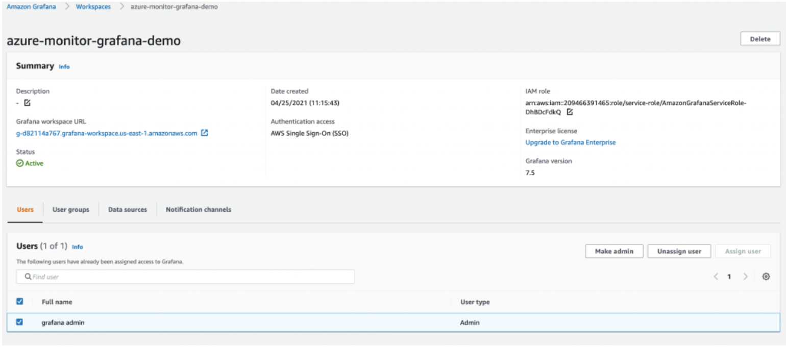
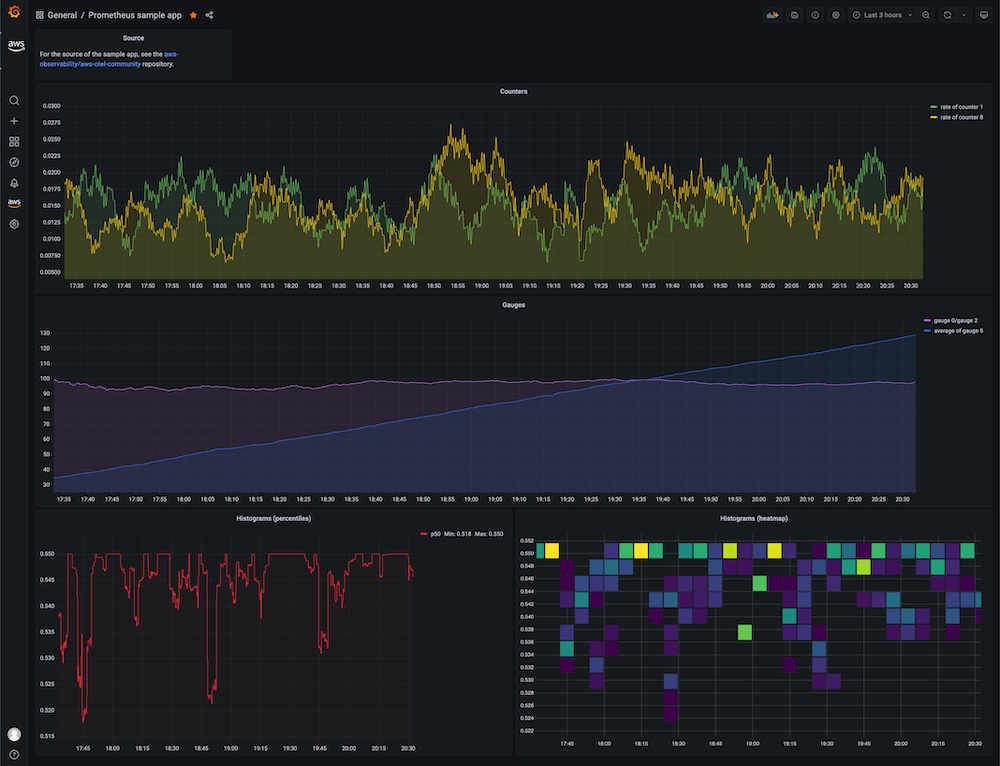

# ハイブリッドおよびマルチクラウドモニタリング

## 概要

AWS とオンプレミス（または他のクラウド）環境にまたがるワークロードのモニタリングには、統一された収集と可視化の戦略が必要です。CloudWatch エージェントは非 AWS ホスト上で実行され、メトリクスとログを CloudWatch に転送します。すでに Prometheus を使用している環境では、Amazon Managed Service for Prometheus（AMP）がネットワーク到達可能な任意のエクスポーターからの remote-write を受け付けます。Amazon Managed Grafana（AMG）は、ワークロードの実行場所に関係なく、両方のバックエンドを単一のダッシュボードに統合します。

このエントリでは、非 AWS ホストへの CloudWatch エージェントのインストール、Prometheus でスクレイプされたメトリクスの AMP remote write の設定、および AMG を統合可視化レイヤーとして使用するパターンを説明します。完全なインストールリファレンスについては、[オンプレミスサーバーへの CloudWatch エージェントのインストール](https://docs.aws.amazon.com/AmazonCloudWatch/latest/monitoring/Install-CloudWatch-Agent-on-Premise.html)を参照してください。

## 前提条件

- CloudWatch、AMP、および AMG の IAM 権限を持つ AWS アカウント
- AWS エンドポイントへのネットワーク接続（HTTPS 443）を持つオンプレミスまたは非 AWS ホスト
- オンプレミスエージェント認証用のプログラムアクセス（アクセスキー）を持つ IAM ユーザー
- ターゲット OS 用に[ダウンロード](https://docs.aws.amazon.com/AmazonCloudWatch/latest/monitoring/download-cloudwatch-agent-commandline.html)済みの CloudWatch エージェント
- （オプション）AMP remote-write 用の既存の Prometheus サーバー
- （オプション）SSO が設定された Amazon Managed Grafana ワークスペース

## アーキテクチャ

ハイブリッドモニタリングのシグナルフローでは、各ホスト上の CloudWatch エージェントがメトリクスとログを CloudWatch に送信します。Prometheus エクスポーターは AMP に remote-write します。AMG は両方のバックエンドをクエリします。


*複数の環境にまたがるデータソースに接続する AMG ワークスペース*

```
┌─────────────────────┐       ┌──────────────────────┐
│  On-premises hosts  │       │   AWS workloads      │
│  (CW Agent)         │       │   (CW Agent / ADOT)  │
└────────┬────────────┘       └──────────┬───────────┘
         │ HTTPS                          │
         ▼                                ▼
┌─────────────────────────────────────────────────────┐
│              Amazon CloudWatch                       │
│         (Metrics + Logs)                            │
└────────────────────────┬────────────────────────────┘
                         │
         ┌───────────────┼───────────────┐
         ▼                               ▼
┌─────────────────┐             ┌─────────────────┐
│  Prometheus     │ remote-write│  Amazon Managed │
│  (on-prem)      │────────────▶│  Prometheus     │
└─────────────────┘             └────────┬────────┘
                                         │
                                         ▼
                              ┌─────────────────────┐
                              │  Amazon Managed     │
                              │  Grafana (AMG)      │
                              └─────────────────────┘
```

## デプロイ

### 非 AWS ホストへの CloudWatch エージェントのインストール

1. OS 用の CloudWatch エージェントパッケージをダウンロードします：

```bash
# Amazon Linux / RHEL
sudo yum install amazon-cloudwatch-agent

# Debian / Ubuntu
wget https://s3.amazonaws.com/amazoncloudwatch-agent/ubuntu/amd64/latest/amazon-cloudwatch-agent.deb
sudo dpkg -i amazon-cloudwatch-agent.deb
```

2. `CloudWatchAgentServerPolicy` を持つ IAM ユーザーを作成し、アクセスキーを生成します。

3. ホスト上で AWS 認証情報を設定します：

```bash
sudo aws configure --profile AmazonCloudWatchAgent
# Enter the access key, secret key, and region
```

4. エージェント設定ウィザードを実行するか、設定ファイルを提供します：

```bash
sudo /opt/aws/amazon-cloudwatch-agent/bin/amazon-cloudwatch-agent-config-wizard
```

5. エージェントを起動します：

```bash
sudo /opt/aws/amazon-cloudwatch-agent/bin/amazon-cloudwatch-agent-ctl \
  -a fetch-config \
  -m onPremise \
  -s \
  -c file:/opt/aws/amazon-cloudwatch-agent/etc/amazon-cloudwatch-agent.json
```

### AMP remote write の設定（オプション）

6. Prometheus サーバー設定に remote-write エンドポイントを追加します：

```yaml
remote_write:
  - url: https://aps-workspaces.<region>.amazonaws.com/workspaces/<workspace-id>/api/v1/remote_write
    sigv4:
      region: <region>
    queue_config:
      max_samples_per_send: 1000
      max_shards: 200
      capacity: 2500
```

7. ホストまたはインスタンスプロファイルに `aps:RemoteWrite` 権限があることを確認します。

### AMG データソースの設定

8. AMG ワークスペースで、**Amazon CloudWatch** と **Amazon Managed Service for Prometheus** をデータソースとして追加します。

9. 統合ビューを提供するために、両方のソースをクエリするダッシュボードを作成またはインポートします。

## 検証

1. オンプレミスホストで、エージェントが実行されていることを確認します：

```bash
sudo /opt/aws/amazon-cloudwatch-agent/bin/amazon-cloudwatch-agent-ctl -a status
```

2. CloudWatch コンソールで、**メトリクス → すべてのメトリクス** に移動し、オンプレミスホストからのカスタム名前空間が表示されることを確認します。

3. AMP の場合、`awscurl` を使用してワークスペースをクエリします：

```bash
awscurl --service aps --region <region> \
  "https://aps-workspaces.<region>.amazonaws.com/workspaces/<workspace-id>/api/v1/query?query=up"
```

4. AMG で、ダッシュボードを開き、CloudWatch と AMP の両方のソースからのデータでパネルが入力されることを確認します。


*AMP データソースからのメトリクスを表示する AMG ダッシュボード*

## トラブルシューティング

| 症状 | 考えられる原因 | 修正方法 |
|---------|-------------|-----|
| オンプレミスホストでエージェントステータスが `stopped` と表示される | 無効な認証情報または期限切れのアクセスキー | IAM アクセスキーを再生成し、`aws configure --profile AmazonCloudWatchAgent` で再設定します |
| メトリクス名前空間が CloudWatch に表示されない | エージェント設定に `metrics_collected` セクションがないか、リージョンが正しくない | `/opt/aws/amazon-cloudwatch-agent/etc/amazon-cloudwatch-agent.json` を確認し、リージョンがコンソールのビューと一致していることを確認します |
| AMP remote write が 403 を返す | `aps:RemoteWrite` IAM 権限の欠落または不正な SigV4 署名 | 署名に使用する IAM エンティティに `AmazonPrometheusRemoteWriteAccess` ポリシーをアタッチします |
| AMG ダッシュボードパネルに「データなし」と表示される | データソースが設定されていないか、IAM ロールに読み取り権限がない | AMG ワークスペースの IAM ロールに `aps:QueryMetrics` と `cloudwatch:GetMetricData` の権限があることを確認します |

## 関連ソリューション

- [EC2 NGINX モニタリング](../ec2-nginx/)
- [Amazon Managed Grafana セットアップ](../managed-grafana-setup/)
