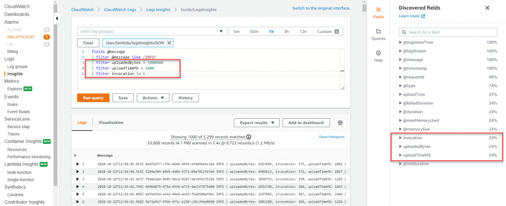
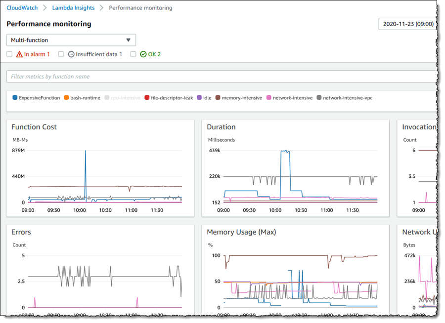
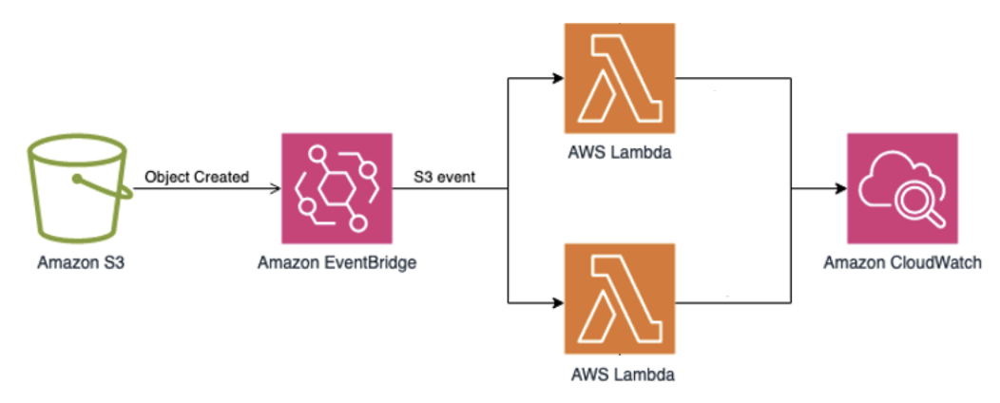

# Lambda モニタリング

## 概要

CloudWatch ネイティブ統合、X-Ray 分散トレーシング、および Lambda Insights を使用して AWS Lambda 関数をモニタリングし、パフォーマンスの可視性を強化します。このソリューションは外部エージェントを必要としません — AWS の組み込み機能を活用します。

主要なオブザーバビリティ機能：
- 呼び出しメトリクス（実行時間、エラー、スロットル、同時実行数）
- ダウンストリームコールの可視性のための X-Ray トレース
- メモリ、CPU、およびネットワークメトリクスのための Lambda Insights
- Embedded Metric Format（EMF）による構造化ログ
- 呼び出しごとのコスト追跡

:::caution 更新が必要

このエントリは Lambda Insights とネイティブの CloudWatch メトリクスを先頭にしています。現在の推奨事項より前のものであり、以下をカバーしていません：

- サービスレベルのレイテンシ、エラーレート、および依存関係マッピングを提供する **CloudWatch Application Signals for Lambda**
- OTLP エクスポート用の **AWS マネージド OpenTelemetry Lambda レイヤー**
- トレースレベルの分析のための **Transaction Search**

以下の手順は引き続き動作し、Lambda Insights はメモリとコールドスタート分析に引き続き有用です。新しい関数については、開始点として
[Application Signals](https://docs.aws.amazon.com/AmazonCloudWatch/latest/monitoring/CloudWatch-Application-Signals.html)
を推奨します。

:::

## 前提条件

- デプロイ済みの AWS Lambda 関数
- `AWSXRayDaemonWriteAccess` を持つ IAM 実行ロール（トレーシング用）
- `CloudWatchLambdaInsightsExecutionRolePolicy` を持つ IAM 実行ロール（Lambda Insights 用 — ログストリームの作成と `PutLogEvents` の呼び出し権限を付与）
- お使いのリージョン用の Lambda Insights レイヤー ARN（アカウント `580247275435`、レイヤー名 `LambdaInsightsExtension`）
- CloudWatch Logs が有効（デフォルト）
- **ランタイム要件：**Python 3.9 以降、Node.js 18 以降、または Java 11 以降（Powertools および ADOT レイヤーの互換性のため）
- **Lambda Powertools**（オプションだが推奨）：Python 用 `aws-lambda-powertools` v2 以降、TypeScript/Node.js 用 `@aws-lambda-powertools/logger` / `@aws-lambda-powertools/metrics` / `@aws-lambda-powertools/tracer`、Java 用 `software.amazon.lambda:powertools-tracing` / `powertools-logging` / `powertools-metrics`
- **ADOT Lambda レイヤー**（オプション、OTel ベースのコレクション用）：ARN 形式 `arn:aws:lambda:<region>:901920570463:layer:aws-otel-<runtime>-<arch>-ver-<version>:1` — ランタイム、リージョン、アーキテクチャに一致するレイヤーを [ADOT Lambda レイヤーのドキュメント](https://aws-otel.github.io/docs/getting-started/lambda)から選択します

## アーキテクチャ


```
┌───────────────────────────────────────────────────┐
│                Lambda Function                     │
│                                                   │
│  ┌────────────────┐  ┌──────────────────────────┐│
│  │ Function Code  │  │ Lambda Insights Extension ││
│  │ + X-Ray SDK    │  │ (Lambda Layer)            ││
│  └───────┬────────┘  └────────────┬─────────────┘│
└──────────┼─────────────────────────┼──────────────┘
           │                         │
     ┌─────▼─────┐            ┌─────▼──────┐
     │  X-Ray    │            │ CloudWatch │
     │  Traces   │            │ Metrics +  │
     │           │            │ Logs       │
     └───────────┘            └────────────┘
```

Lambda オブザーバビリティは、並行パスを通じて 4 つのシグナルタイプを収集します：

- **トレース：**Lambda 実行環境に組み込まれた X-Ray デーモンがトレースセグメントをキャプチャし、X-Ray に送信します。X-Ray SDK（または Powertools `Tracer`）は、DynamoDB、S3、SQS、または外部 HTTP エンドポイントへのダウンストリームコール用のカスタムサブセグメントを追加します。
- **構造化ログ：**Lambda は `stdout` を CloudWatch Logs に書き込みます。Lambda Powertools `Logger` は、CloudWatch Logs Insights が自動的にインデックスする相関 ID、コールドスタートフラグ、およびコンテキストメタデータを含む JSON 構造化ログを出力します。
- **メトリクス（提供済み + カスタム）：**Lambda は、`AWS/Lambda` 名前空間の下に提供済みメトリクス（呼び出し数、実行時間、エラー、スロットル、同時実行数）を CloudWatch に公開します。カスタムビジネスメトリクスには、Embedded Metric Format（EMF）が構造化ログエントリとしてメトリクスデータを出力します — CloudWatch は `PutMetricData` API コールなしで非同期的にそれらを抽出します。
- **システムレベルメトリクス：**Lambda Insights 拡張機能は、EMF を介して CPU 時間、メモリ使用率、ディスク/ネットワーク I/O、およびコールドスタート診断を収集します。これらは `LambdaInsights` 名前空間の下に表示されます。

**代替手段 — ADOT Lambda レイヤー：**X-Ray SDK の代わりに、AWS Distro for OpenTelemetry（ADOT）Lambda レイヤーをアタッチできます。OTel SDK とトリミングされた ADOT コレクターをバンドルし、関数を自動計装して、トレースを X-Ray（デフォルト）に、オプションでメトリクスを Amazon Managed Service for Prometheus やその他の OTLP バックエンドにエクスポートします。これにより、コールドスタートレイテンシが増加する代わりに（トラブルシューティングを参照）、ベンダーニュートラルな計装が得られます。

## デプロイ

### ステップ 1：X-Ray トレーシングを有効にする

```bash
aws lambda update-function-configuration \
  --function-name my-function \
  --tracing-config Mode=Active
```

### ステップ 2：Lambda Insights レイヤーを追加する

```bash
aws lambda update-function-configuration \
  --function-name my-function \
  --layers "arn:aws:lambda:us-west-2:580247275435:layer:LambdaInsightsExtension:52"
```

### ステップ 3：IAM 権限を追加する

```json
{
  "Version": "2012-10-17",
  "Statement": [
    {
      "Effect": "Allow",
      "Action": [
        "xray:PutTraceSegments",
        "xray:PutTelemetryRecords"
      ],
      "Resource": "*"
    }
  ]
}
```

また、Lambda Insights がそのロググループに書き込めるように、関数の実行ロールにマネージドポリシー `CloudWatchLambdaInsightsExecutionRolePolicy` をアタッチします。

### ステップ 4：Powertools で構造化ログを追加する

Lambda Powertools は、組み込みの相関 ID 抽出付き JSON 構造化ログを出力する `Logger` を提供します。ランタイム用のライブラリをインストールし、ハンドラーをデコレートします：

```python
from aws_lambda_powertools import Logger, Metrics, Tracer

logger = Logger()
metrics = Metrics(namespace="MyApp")
tracer = Tracer()

@logger.inject_lambda_context(correlation_id_path="requestContext.requestId")
@metrics.log_metrics
@tracer.capture_lambda_handler
def handler(event, context):
    logger.info("Processing order", extra={"order_id": event.get("order_id")})
    metrics.add_metric(name="OrderProcessed", unit="Count", value=1)
    # your logic here
```

`@logger.inject_lambda_context` デコレーターは、すべてのログ行に Lambda リクエスト ID、関数名、メモリサイズ、およびコールドスタートフラグを自動的に追加します。`correlation_id_path` パラメータは、エンドツーエンドのリクエストトレーシングのためにイベントから相関 ID を抽出します。構造化 JSON ログは CloudWatch Logs Insights によってインデックスされ、以下のようなクエリが可能になります：

```
filter @message like /ERROR/
| fields correlation_id, order_id, @timestamp
| sort @timestamp desc
```

### ステップ 5：Embedded Metric Format（EMF）でカスタムメトリクスを出力する

ステップ 4 の `@metrics.log_metrics` デコレーターは内部で EMF を使用しています — Powertools は [EMF 仕様](https://docs.aws.amazon.com/AmazonCloudWatch/latest/monitoring/CloudWatch_Embedded_Metric_Format_Specification.html)に準拠した JSON ログエントリを書き込み、CloudWatch は同期 API コールなしでメトリクスを抽出します。これは `PutMetricData` を呼び出すよりもパフォーマンスが高く、コストも低くなります。

ディメンション、名前空間、または高解像度（1 秒）メトリクスをより細かく制御するには、低レベルの EMF クライアントライブラリ（[Node.js](https://github.com/awslabs/aws-embedded-metrics-node)、[Python](https://github.com/awslabs/aws-embedded-metrics-python)、[Java](https://github.com/awslabs/aws-embedded-metrics-java)、または [C#](https://github.com/awslabs/aws-embedded-metrics-dotnet) 用の `aws-embedded-metrics`）を使用します。

### ステップ 6（代替）：OTel ベースのコレクション用 ADOT Lambda レイヤー

ベンダーニュートラルな OpenTelemetry 計装を使用する場合は、X-Ray SDK の代わりに（または併用して）ADOT Lambda レイヤーをアタッチします：

1. [ADOT Lambda レイヤーのドキュメント](https://aws-otel.github.io/docs/getting-started/lambda)からランタイムとアーキテクチャ用のレイヤー ARN を選択します。例えば、x86_64 上の Java の場合：
   ```
   arn:aws:lambda:us-east-1:901920570463:layer:aws-otel-java-agent-x86_64-ver-1-28-1:1
   ```

2. レイヤーがハンドラーを計装するようにラッパー環境変数を設定します：
   ```bash
   aws lambda update-function-configuration \
     --function-name my-function \
     --environment "Variables={AWS_LAMBDA_EXEC_WRAPPER=/opt/otel-handler}"
   ```
   Java と Node.js には `/opt/otel-handler` を、Python には `/opt/otel-instrument` を使用します。

3. デフォルトでは、レイヤーはトレースを X-Ray にエクスポートします。メトリクスを Amazon Managed Service for Prometheus やその他のバックエンドに送信するには、関数のルートディレクトリにカスタム `collector.yaml` を追加し、`OPENTELEMETRY_COLLECTOR_CONFIG_FILE=/var/task/collector.yaml` を設定します。エクスポーターオプションについては、[ADOT コレクター設定のドキュメント](https://aws-otel.github.io/docs/getting-started/lambda)を参照してください。

4. コールドスタートのオーバーヘッドを削減するには、不要な計装を無効にします：
   ```bash
   OTEL_INSTRUMENTATION_COMMON_DEFAULT_ENABLED=false
   OTEL_INSTRUMENTATION_AWS_LAMBDA_ENABLED=true
   OTEL_INSTRUMENTATION_AWS_SDK_ENABLED=true
   ```

### ステップ 7：CloudWatch Logs の保持期間を設定する

デフォルトでは、CloudWatch Logs は Lambda ログデータを無期限に保持します。環境に合わせた保持ポリシーを設定します：

```yaml
# CloudFormation / SAM example
Resources:
  MyFunctionLogGroup:
    Type: AWS::Logs::LogGroup
    Properties:
      LogGroupName: !Sub "/aws/lambda/${MyFunction}"
      RetentionInDays: 14
```

## 検証








1. **関数を呼び出す：**
   ```bash
   aws lambda invoke --function-name my-function output.json
   ```

2. **CloudWatch メトリクスを確認する：**CloudWatch > メトリクス > AWS/Lambda に移動します。

3. **X-Ray トレースを確認する：**CloudWatch > X-Ray トレース > トレースマップに移動します。

4. **Lambda Insights を確認する：**CloudWatch > Insights > Lambda Insights に移動します。

## トラブルシューティング

| 症状 | 考えられる原因 | 修正方法 |
|---------|-------------|-----|
| X-Ray にトレースがない | トレーシングが Active に設定されていない | 関数の設定を確認します：`aws lambda get-function-configuration` を実行し、`TracingConfig.Mode` が `Active` であることを確認します |
| Lambda Insights にデータがない | レイヤーがアタッチされていないか、IAM ポリシーが間違っている | `LambdaInsightsExtension` レイヤー ARN がリージョンと一致していることを確認し、`CloudWatchLambdaInsightsExecutionRolePolicy` が実行ロールにアタッチされていることを確認します |
| 実行時間が長く報告される | コールドスタート | プロビジョニングされた同時実行数または SnapStart（Java 11 以降）を有効にします |
| カスタムメトリクスがない | EMF フォーマットエラー | CloudWatch Logs で JSON 構造を検証します — `AWS/Logs` 名前空間の `EMFValidationErrors` と `EMFParsingErrors` メトリクスでフォーマットの問題を確認します |
| ADOT レイヤーがコールドスタートに 5〜15 秒追加する | Java エージェントがデフォルトでサポートされるすべてのライブラリを計装する | `OTEL_INSTRUMENTATION_COMMON_DEFAULT_ENABLED=false` を設定し、必要な計装のみを選択的に有効にします |
| ADOT レイヤーが関数を計装しない | OTel レイヤーバージョンがランタイムと非互換 | ADOT レイヤー ARN がランタイムバージョンとアーキテクチャ（x86_64 vs arm64）に一致していることを確認します。最新の互換バージョンについては [ADOT Lambda リリース](https://aws-otel.github.io/docs/getting-started/lambda)を確認します |
| CloudWatch Logs のコストが予想外に高い | ログ保持期間が無期限に設定（デフォルト） | 各 Lambda ロググループに `RetentionInDays` を設定します — 非本番環境では 7〜30 日、本番環境では 90 日が一般的です。古いログを S3 にアーカイブする場合は CloudWatch Logs サブスクリプションフィルターを使用します |

## 関連ソリューション

- [EKS Application Signals](../eks-application-signals/) — Lambda を含むコンピューティングタイプ全体での Application Signals
- [大規模 ADOT](../adot-at-scale/) — マルチ関数デプロイメント用の ADOT コレクターアーキテクチャ
- [Rust カスタムメトリクス](../rust-custom-metrics/) — Rust による Lambda 上のカスタムメトリクス
- [.NET アプリケーションモニタリング](../dotnet-application-monitoring/) — .NET Lambda モニタリングパターン
