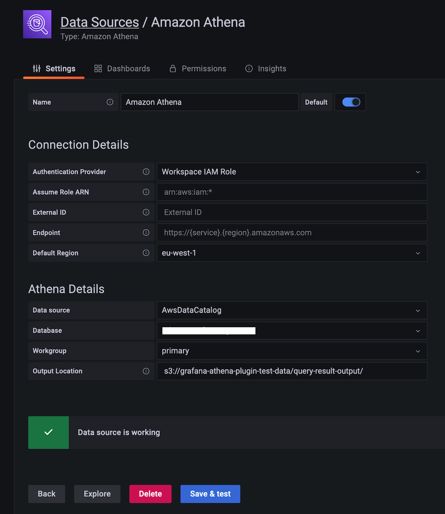
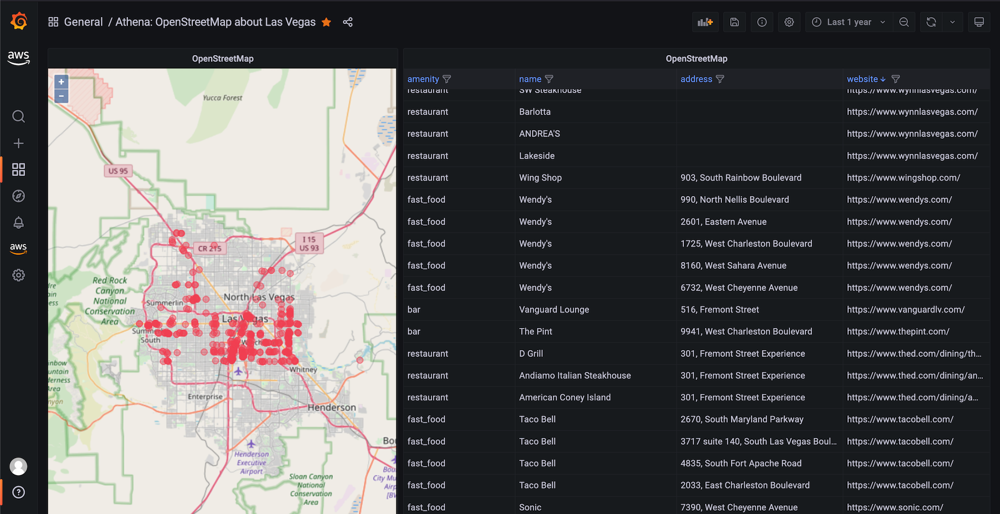
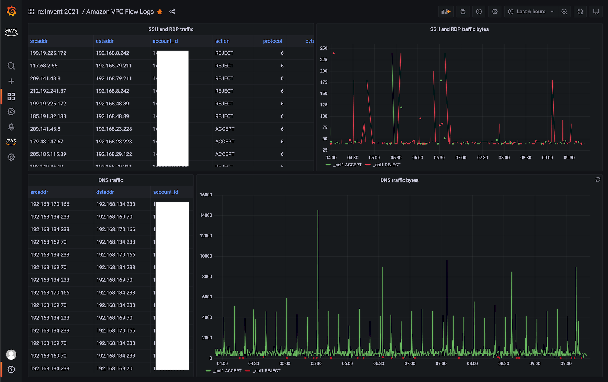
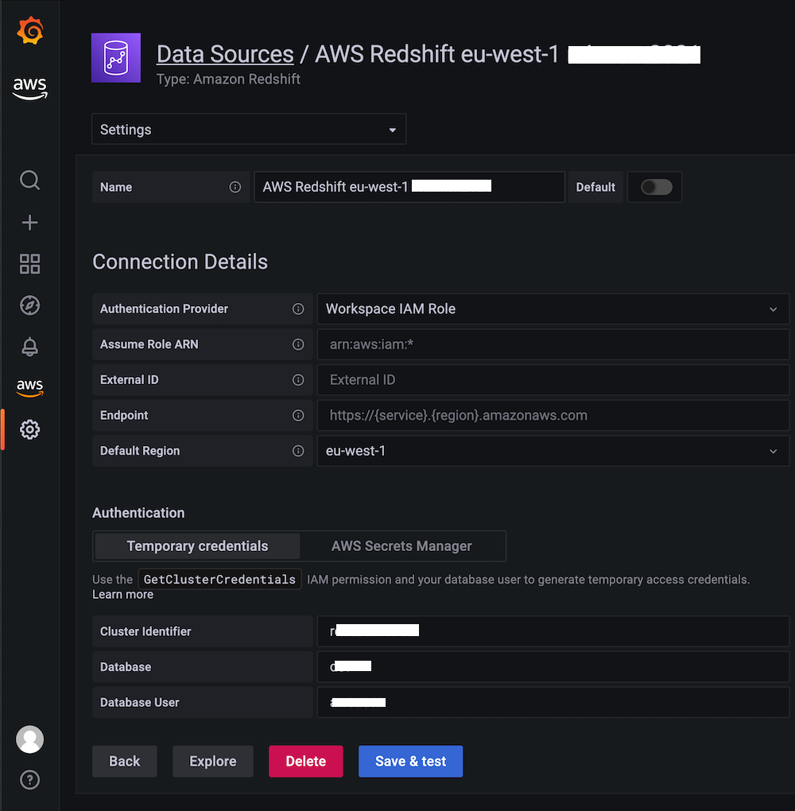
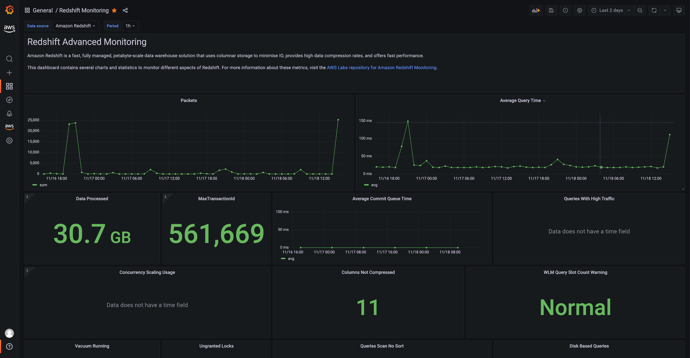
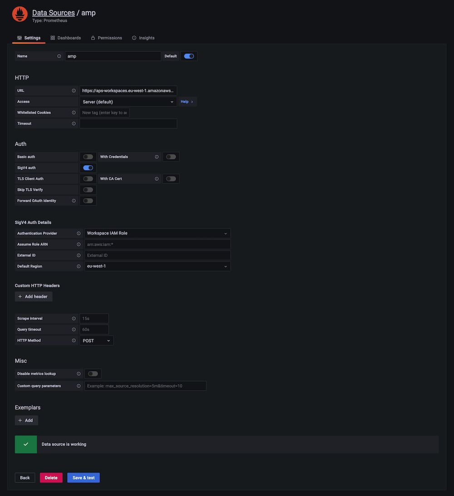

# Amazon Managed Grafana セットアップ

## 概要

[Amazon Managed Grafana](https://aws.amazon.com/grafana/)（AMG）は、Grafana のフルマネージドサービスであり、基盤となるインフラストラクチャを管理することなく、複数のソースからの運用データを可視化および分析できます。このソリューションでは、AMG の開始に関する 5 つの一般的な設定タスクを説明します：

- **Athena データソース** — SQL を使用して S3 ベースのデータセット（地理データ、VPC フローログ）をクエリし、Geomap で可視化
- **Redshift データソース** — Amazon Redshift クラスターに接続してウェアハウス分析およびモニタリングダッシュボード
- **Google Workspace SAML 認証** — Google を SAML 2.0 ID プロバイダーとして使用して SSO を設定
- **Terraform 自動化** — Grafana Terraform プロバイダーを使用してデータソースとダッシュボードの作成を自動化
- **サブネット空き IP モニタリング** — VPC メトリクスを CloudWatch に公開し、Grafana で可視化する CDK スタックの例

Amazon Managed Grafana の完全なユーザーガイドについては、[公式ドキュメント](https://docs.aws.amazon.com/grafana/latest/userguide/what-is-Amazon-Managed-Service-Grafana.html)を参照してください。

## 前提条件

- AMG ワークスペースを作成する権限を持つ AWS アカウント
- AWS CLI がインストールおよび設定済み
- Amazon Managed Grafana ワークスペース（[はじめに](https://aws.amazon.com/blogs/mt/amazon-managed-grafana-getting-started/)を参照）
- Athena の場合：Amazon Athena へのアクセスとクエリ結果用の S3 バケット（プレフィックス `grafana-athena-query-results-`）
- Redshift の場合：`GrafanaDataSource: true` でタグ付けされた Redshift クラスター
- SAML の場合：スーパー管理者アクセスを持つ有料の Google Workspace アカウント
- Terraform の場合：Terraform CLI >= 1.0 がローカルにインストール済み
- サブネットモニタリングの場合：TypeScript 対応の AWS CDK、Node.js がインストール済み

## アーキテクチャ

```
┌─────────────────────────────────────────────────────────────────────────┐
│                        Data Sources & Identity                           │
│                                                                         │
│  ┌──────────┐  ┌──────────┐  ┌───────────────┐  ┌─────────────────┐   │
│  │  Athena  │  │ Redshift │  │  CloudWatch   │  │ Google Workspace│   │
│  │  (S3)    │  │          │  │  Metrics      │  │ (SAML IdP)     │   │
│  └─────┬────┘  └─────┬────┘  └───────┬───────┘  └────────┬────────┘   │
│        │              │               │                    │            │
└────────┼──────────────┼───────────────┼────────────────────┼────────────┘
         │              │               │                    │
         ▼              ▼               ▼                    ▼
┌─────────────────────────────────────────────────────────────────────────┐
│                   Amazon Managed Grafana Workspace                       │
│                                                                         │
│  ┌────────────────┐  ┌────────────────┐  ┌─────────────────────────┐   │
│  │  Dashboards    │  │  Data Sources  │  │   SAML Authentication   │   │
│  │  (managed via  │  │  (managed via  │  │   (assertion mapping)   │   │
│  │   Terraform)   │  │   Terraform)   │  │                         │   │
│  └────────────────┘  └────────────────┘  └─────────────────────────┘   │
└─────────────────────────────────────────────────────────────────────────┘
```

## デプロイ

### Athena データソースプラグイン

Athena プラグインは Amazon Managed Grafana にプリインストールされています。Athena を介して S3 内のデータに対して SQL クエリを実行し、任意の Grafana パネルタイプで結果を可視化できます。

**データソースを設定する：**

1. AMG コンソールで、Athena のサービスマネージド IAM ロールを有効にします
2. Athena ワークグループにキー `GrafanaDataSource`、値 `true` でタグ付けします
3. Grafana で、**Configuration → Data Sources → Add data source** に移動します
4. 「Athena」を検索して選択します
5. リージョン、データベース、およびワークグループを選択します
6. 出力場所を `grafana-athena-query-results-` で始まる S3 バケットに設定します
7. **Save & test** をクリックします


*ワークスペース IAM ロール認証で設定された Athena データソース*

:::warning
サービスマネージド IAM ポリシーは、`grafana-athena-query-results-` で始まるクエリ結果バケットへのアクセスのみを付与します。基盤となるデータソースの S3 バケットには、`s3:Get*` と `s3:List*` の権限を手動で追加します。
:::

**例：Geomap を使用した地理データ**

Athena で OpenStreetMap データをクエリして、マップ上に位置をプロットします：

```sql
SELECT
  tags['amenity'] AS amenity,
  tags['name'] AS name,
  lat, lon
FROM planet
WHERE type = 'node'
  AND tags['amenity'] IN ('bar', 'pub', 'fast_food', 'restaurant')
  AND lon BETWEEN -115.5 AND -114.5
  AND lat BETWEEN 36.1 AND 36.3
LIMIT 500;
```


*Athena からクエリされたフードアメニティの Geomap 可視化*

**例：VPC フローログ分析**

SSH および RDP トラフィックパターンを検出します：

```sql
SELECT
  from_unixtime(start), sum(bytes), action
FROM vpclogs
WHERE srcport IN (22, 3389) OR dstport IN (22, 3389)
GROUP BY start, action
ORDER BY start ASC;
```


*許可および拒否された SSH/RDP バイトの時系列ビュー*

### Redshift データソースプラグイン

Redshift プラグインは、AMG を Amazon Redshift クラスターに接続してデータウェアハウスの可視化を行います。

**前提条件：**

- Redshift クラスターに `GrafanaDataSource: true` でタグ付け
- `redshift_data_api_user` という名前のデータベースユーザーを作成（一時的な認証情報用）、または Secrets Manager シークレットに `RedshiftQueryOwner: true` でタグ付け

**データソースを設定する：**

1. AMG で、Redshift のサービスマネージド IAM ロールを有効にします
2. **Configuration → Data Sources → Add data source** に移動します
3. 「Redshift」を検索し、クラスター識別子、データベース、およびデータベースユーザーを入力します
4. **Save & test** をクリックします


*ワークスペース IAM ロールで接続された Redshift データソース*

クラスターパフォーマンスを即座に可視化するために、組み込みの Redshift モニタリングダッシュボードをインポートします：


*プリビルト Redshift Advanced Monitoring ダッシュボード*

### Google Workspace SAML 認証

Google Workspace を AMG の SAML 2.0 ID プロバイダーとして設定します。

**ステップ 1：SAML で AMG ワークスペースを作成する**

ワークスペースの作成時に、認証方法として **Security Assertion Markup Language（SAML）** を選択します。

**ステップ 2：Google Workspace でカスタム SAML アプリを作成する**

1. スーパー管理者権限で Google Workspace 管理コンソールにログインします
2. **アプリ → Web アプリとモバイルアプリ → アプリを追加 → カスタム SAML アプリを追加** に移動します
3. アプリに名前を付けます（例：「Amazon Managed Grafana」）
4. **メタデータをダウンロード** をクリックして IdP メタデータ XML ファイルを保存します
5. サービスプロバイダーの詳細で：
   - **ACS URL**：AMG コンソールの SAML 設定からコピーします
   - **エンティティ ID**：AMG コンソールからコピーします
   - **Name ID 形式**：EMAIL
   - **Name ID**：基本情報 → プライマリメール
6. 属性マッピングで、`Department` を Google ディレクトリ属性にマッピングします

**ステップ 3：メタデータを AMG にアップロードする**

1. AMG コンソールで、**アップロードまたはコピー/ペースト** をクリックし、メタデータ XML をアップロードします
2. **アサーションマッピング** で：
   - **アサーション属性ロール**：`Department`
   - **管理者ロールの値**：`monitoring`（または選択した部門の値）
3. **SAML 設定を保存** をクリックします

設定された部門の値が割り当てられたユーザーは、Grafana で管理者権限を受け取ります。

### Terraform 自動化

[Grafana Terraform プロバイダー](https://registry.terraform.io/providers/grafana/grafana/latest/docs)を使用して、AMG の設定（データソース、ダッシュボード、フォルダー）を自動化します。

**ステップ 1：API キーを作成する**

Grafana で、**Configuration → API keys** に移動し、`Admin` ロールでキーを作成します（最大 30 日間有効）。

**ステップ 2：Terraform マニフェストを作成する**

`main.tf` を作成します：

```hcl
terraform {
  required_providers {
    grafana = {
      source  = "grafana/grafana"
      version = ">= 1.13.3"
    }
  }
}

provider "grafana" {
  url  = "https://g-XXXXXXXXXX.grafana-workspace.us-east-1.amazonaws.com"
  auth = "YOUR_API_KEY"
}

resource "grafana_data_source" "prometheus" {
  type       = "prometheus"
  name       = "amp"
  is_default = true
  url        = "https://aps-workspaces.us-east-1.amazonaws.com/workspaces/ws-XXXXXXXXX/"

  json_data {
    http_method     = "POST"
    sigv4_auth      = true
    sigv4_auth_type = "workspace-iam-role"
    sigv4_region    = "us-east-1"
  }
}

resource "grafana_folder" "team" {
  title = "devops"
}

resource "grafana_dashboard" "example" {
  folder      = grafana_folder.team.id
  config_json = file("dashboard.json")
}
```

**ステップ 3：適用する**

```bash
terraform init
terraform plan
terraform apply
```


*Terraform でプロビジョニングされた Prometheus（AMP）データソース*

:::note
Terraform の状態はデフォルトでローカルに管理されます。チームコラボレーションには、S3 などの[リモートバックエンド](https://www.terraform.io/docs/language/state/remote.html)を設定してください。
:::

### サブネット空き IP モニタリング

VPC サブネット全体の利用可能な IP をモニタリングし、メトリクスを CloudWatch に公開し、アラームを作成する CDK スタックをデプロイします。

**ステップ 1：クローンとインストール**

```bash
cd sandbox/grafana_subnet_ip_monitoring
npm install
```

**ステップ 2：設定する**

`lib/vpc_monitoring_stack.ts` を編集して以下を設定します：

```typescript
const subnet_monitoring_stack = new SubnetMonitoringStack(this, 'SubnetIpMonitoringStack', {
  env: {
    account: process.env.CDK_DEFAULT_ACCOUNT,
    region: process.env.CDK_DEFAULT_REGION
  },
  subnetIds: [
    'subnet-03e46f16d7dc01c0a',
    'subnet-0713ae10e4a8da850'
  ],
  ipThreshold: 50,
  alarmEmail: 'team@example.com',
  monitoringFrequencyMinutes: 5,
  evaluationPeriods: 2
});
```

**ステップ 3：デプロイする**

```bash
cdk bootstrap
cdk deploy --all
```

スタックは以下を作成します：
- EC2 API を呼び出してサブネットの IP 可用性を収集する Lambda 関数
- サブネットごとの空き IP 数の CloudWatch カスタムメトリクス
- 空き IP がしきい値を下回った場合にトリガーする CloudWatch アラーム
- アラーム通知用の SNS トピック

AMG ワークスペースに CloudWatch データソースを追加して、サブネットメトリクスを可視化します。

**クリーンアップ：**

```bash
cdk destroy
```

## 検証

1. **Athena データソース：**Grafana で Athena データソースを開き、**Save & test** をクリックします — 「Data source is working」と表示されることを確認します
2. **Redshift データソース：**Redshift データソースで **Save & test** をクリックします — 接続に成功することを確認します
3. **SAML 認証：**Grafana からログアウトし、再度ログインします — Google サインインページへのリダイレクトと正常な復帰を確認します
4. **Terraform プロビジョニング：**`terraform plan` を実行します — 状態とワークスペース設定の間にドリフトがないことを確認します
5. **サブネットモニタリング：**CloudWatch で、**メトリクス → カスタム名前空間** に移動し、サブネット IP メトリクスが表示されることを確認します

## トラブルシューティング

| 症状 | 考えられる原因 | 修正方法 |
|---------|-------------|-----|
| Athena クエリが「Access Denied」を返す | S3 バケットのプレフィックスが `grafana-athena-query-results-` でないか、ソースデータバケットに `s3:Get*`/`s3:List*` 権限がない | 結果バケットの名前を変更するか、ワークスペースロールに IAM 権限を手動で追加します |
| Redshift「Unable to connect」エラー | データベースユーザー `redshift_data_api_user` が存在しないか、クラスターに `GrafanaDataSource: true` のタグがない | データベースユーザーを作成し、クラスタータグを確認します |
| SAML ログインが「Invalid assertion」で失敗する | Google Workspace と AMG の間で ACS URL またはエンティティ ID が不一致 | Google SAML アプリ設定の値と AMG コンソールの SAML 設定を比較します。正確に一致する必要があります |
| Terraform apply が 401 Unauthorized を返す | API キーが期限切れ（AMG での最大有効期間は 30 日） | Grafana で新しい API キーを生成し、プロバイダーの `auth` 値を更新します |
| サブネットモニタリング Lambda がデータを返さない | Lambda に `ec2:DescribeSubnets` 権限がないか、サブネット ID が間違っている | Lambda 実行ロールに EC2 読み取り権限が含まれていることを確認し、サブネット ID がターゲットリージョンに存在することを確認します |

## 関連ソリューション

- [EKS インフラストラクチャモニタリング](../eks-infrastructure/)
- [オブザーバビリティコスト管理](../observability-cost-management/)
