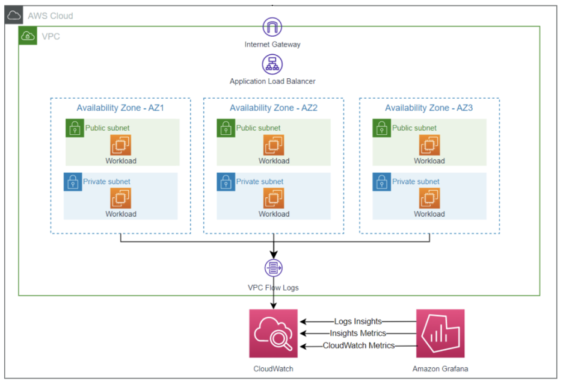
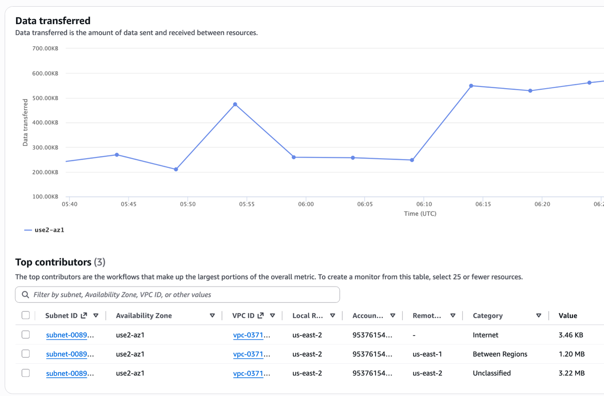
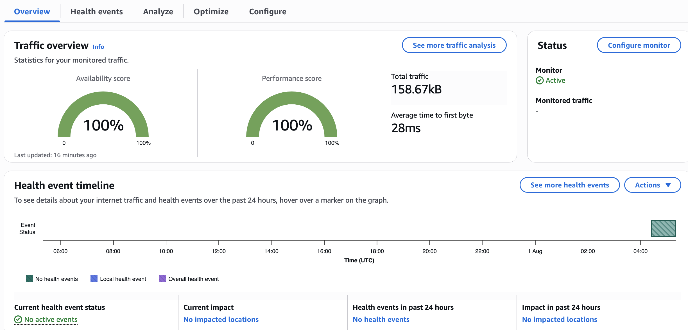
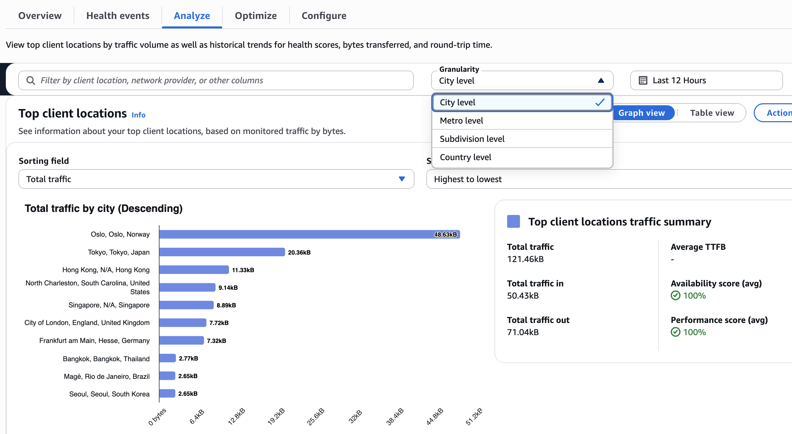
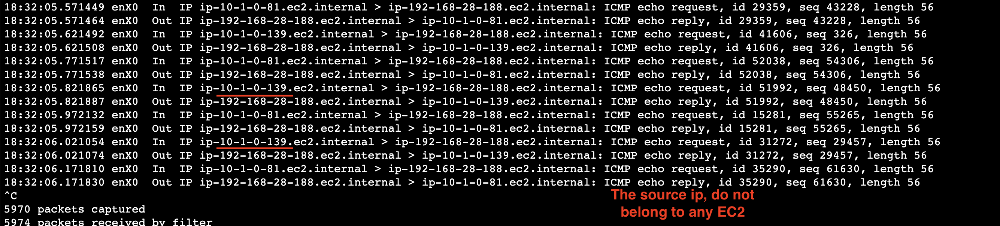

# ネットワークオブザーバビリティ

## 概要

AWS は、VPC、ハイブリッド接続、エンドユーザーパス全体のトラフィックパターン、パフォーマンス劣化、インターネットパスの正常性を可視化するためのレイヤー化されたネットワークオブザーバビリティツールセットを提供しています。このエントリでは、4 つの主要な機能とそれぞれの使用タイミングについて説明します。

**VPC Flow Logs** は、VPC を通過するトラフィックのメタデータ（送信元/宛先 IP、ポート、プロトコル、バイト数、アクション）をキャプチャします。セキュリティ分析、コンプライアンス監査、トラフィックパターンの発見の基盤となります。Flow Logs は CloudWatch Logs、S3、または Kinesis Data Firehose に発行されます。

**Network Flow Monitor** は、EC2/EKS インスタンスに軽量な eBPF エージェントをデプロイし、実際のワークロードトラフィックから TCP パフォーマンス（RTT、パケットロス、再送信）を受動的に測定します。Network Health Indicator（NHI）は、サポートケースを開くことなく、AWS インフラストラクチャまたはお客様自身のワークロードのどちらが劣化の原因であるかを示します。

**Internet Monitor** は、リソースのトラフィックプロファイル（VPC、CloudFront、NLB）を AWS のグローバル接続測定値にオーバーレイし、都市、ISP、地理ごとのインターネットパスの劣化を表示します。エージェントやコード変更は不要です。

**Network Synthetic Monitor** は、VPC サブネットから Direct Connect または Site-to-Site VPN 経由で到達可能なオンプレミスの宛先にアクティブな ICMP/TCP プローブを送信し、ハイブリッド接続の継続的な RTT およびパケットロスメトリクスを提供します。

## 前提条件

- VPC リソースがデプロイされた AWS アカウント
- IAM 権限：`ec2:CreateFlowLogs`、`logs:CreateLogGroup`、`cloudwatch:*`、`networkmonitor:*`
- Network Flow Monitor の場合：Amazon Linux 2/2023 または Ubuntu 20.04+ を実行する EC2 または EKS インスタンス（eBPF エージェント要件）
- Network Synthetic Monitor の場合：Direct Connect または Site-to-Site VPN 経由でオンプレミスの宛先に接続できる VPC サブネット
- AWS CLI v2 がインストールおよび設定されていること

## アーキテクチャ



```
┌────────────────────────────────────────────────────────────────────────┐
│                          AWS Region                                     │
│                                                                        │
│  ┌──────────┐    ┌──────────┐    ┌──────────┐    ┌──────────────────┐ │
│  │  EC2/EKS │    │  EC2/EKS │    │   VPC    │    │  Direct Connect  │ │
│  │(eBPF Agt)│    │(eBPF Agt)│    │ ENIs     │    │  / VPN Endpoint  │ │
│  └────┬─────┘    └────┬─────┘    └────┬─────┘    └────────┬─────────┘ │
│       │                │               │                    │          │
│       ▼                ▼               ▼                    ▼          │
│  ┌─────────────┐  ┌─────────────┐  ┌─────────────┐  ┌─────────────┐  │
│  │ Network Flow│  │  Internet   │  │  VPC Flow   │  │  Synthetic  │  │
│  │   Monitor   │  │   Monitor   │  │    Logs     │  │   Monitor   │  │
│  └──────┬──────┘  └──────┬──────┘  └──────┬──────┘  └──────┬──────┘  │
│         │                 │                │                 │          │
│         └─────────────────┴────────────────┴─────────────────┘          │
│                                    │                                    │
│                                    ▼                                    │
│                         ┌───────────────────┐                          │
│                         │    CloudWatch      │                          │
│                         │ (Metrics + Logs)   │                          │
│                         └───────────────────┘                          │
└────────────────────────────────────────────────────────────────────────┘
                                    │
              ┌─────────────────────┼──────────────────────┐
              ▼                     ▼                       ▼
     ┌──────────────┐    ┌──────────────────┐    ┌──────────────────┐
     │  Dashboards  │    │  Alarms / Events │    │  S3 (archival)   │
     └──────────────┘    └──────────────────┘    └──────────────────┘
```

## デプロイ

### ステップ 1：VPC Flow Logs を有効化する

```bash
# Create a CloudWatch Logs log group
aws logs create-log-group --log-group-name /aws/vpc/flow-logs

# Create a flow log for a VPC (all traffic, default format)
aws ec2 create-flow-logs \
  --resource-type VPC \
  --resource-ids vpc-0123456789abcdef0 \
  --traffic-type ALL \
  --log-destination-type cloud-watch-logs \
  --log-group-name /aws/vpc/flow-logs \
  --deliver-logs-permission-arn arn:aws:iam::ACCOUNT_ID:role/flowlogsRole
```

カスタムフィールド（推奨）については、[VPC Flow Logs — カスタムフォーマット](https://docs.aws.amazon.com/vpc/latest/userguide/flow-logs.html#flow-logs-fields)を参照してください。

### ステップ 2：Network Flow Monitor エージェントをインストールする

AWS Systems Manager（推奨）を使用してインストールします：

```bash
aws ssm send-command \
  --document-name "AWS-ConfigureAWSPackage" \
  --targets "Key=instanceids,Values=i-0123456789abcdef0" \
  --parameters '{"action":["Install"],"name":["AmazonCloudWatchNetworkFlowMonitorAgent"]}'
```

Workload Insights データが表示されるまで約 10 分待ち、コンソールでローカルリソースとリモートリソースのスコープを設定するモニターを作成します。

### ステップ 3：Internet Monitor を作成する

```bash
aws internetmonitor create-monitor \
  --monitor-name my-app-monitor \
  --resources "arn:aws:ec2:us-east-1:ACCOUNT_ID:vpc/vpc-0123456789abcdef0" \
  --max-city-networks-to-monitor 500
```

### ステップ 4：Network Synthetic Monitor を作成する（ハイブリッドのみ）

```bash
aws networkmonitor create-monitor --monitor-name hybrid-latency

aws networkmonitor create-probe \
  --monitor-name hybrid-latency \
  --probe '{"sourceArn":"arn:aws:ec2:us-east-1:ACCOUNT_ID:subnet/subnet-abc123","destination":"10.0.1.1","protocol":"ICMP","packetSize":56}'
```

## 検証









1. **VPC Flow Logs：** 5〜10 分後にロググループをクエリします：
   ```bash
   aws logs filter-log-events \
     --log-group-name /aws/vpc/flow-logs \
     --limit 5
   ```

2. **Network Flow Monitor：** CloudWatch コンソール → ネットワークモニタリング → Flow Monitor を開きます。Workload Insights の **Data Transferred** と **Retransmissions** にデータが表示されていることを確認します。

3. **Internet Monitor：** CloudWatch → Internet Monitor → お使いのモニターを開きます。概要タブに Performance Score と Availability Score が表示されていることを確認します。

4. **Synthetic Monitor：** CloudWatch メトリクスの `AWS/NetworkMonitor` 名前空間で `PacketLoss` と `RoundTripTime` メトリクスを確認します：
   ```bash
   aws cloudwatch get-metric-statistics \
     --namespace AWS/NetworkMonitor \
     --metric-name RoundTripTime \
     --dimensions Name=MonitorName,Value=hybrid-latency \
     --start-time $(date -u -v-1H +%Y-%m-%dT%H:%M:%S) \
     --end-time $(date -u +%Y-%m-%dT%H:%M:%S) \
     --period 300 --statistics Average
   ```

## トラブルシューティング

| 症状 | 考えられる原因 | 修正方法 |
|---------|-------------|-----|
| 15 分後もフローログレコードがない | IAM ロールに `logs:CreateLogStream` / `logs:PutLogEvents` がない | フローログ配信ロールの信頼ポリシーが `vpc-flow-logs.amazonaws.com` を許可していることを確認する |
| Network Flow Monitor にデータが表示されない | エージェントがインストールされていないか、インスタンスプロファイルがない | エージェントが実行中であることを確認する（`systemctl status amazon-cloudwatch-network-flow-monitor-agent`）。インスタンスロールに `cloudwatch:PutMetricData` があることを確認する |
| Internet Monitor に 0 の都市ネットワークが表示される | リソースにインターネット向けトラフィックがない | VPC/CloudFront リソースがパブリックトラフィックを処理していることを確認する。内部専用の VPC は都市ネットワークデータを生成しません |
| Synthetic Monitor プローブが失敗する | セキュリティグループが宛先への ICMP/TCP をブロックしている | サブネットの SG にプローブのプロトコル/ポートから宛先 IP へのアウトバウンドルールを追加する |
| NHI が 0 のままだがアプリが遅い | 劣化はワークロードにあり、AWS ネットワークにはない | NHI は AWS インフラストラクチャの問題のみをフラグします。アプリケーション層または DNS レイテンシーを調査する |

## 関連ソリューション

- [EC2 モニタリング](../ec2-nginx/) — EC2 インスタンスの OS およびアプリケーションレベルのメトリクス
- [EKS インフラストラクチャ](../eks-infrastructure/) — Kubernetes クラスターおよびポッドレベルのモニタリング