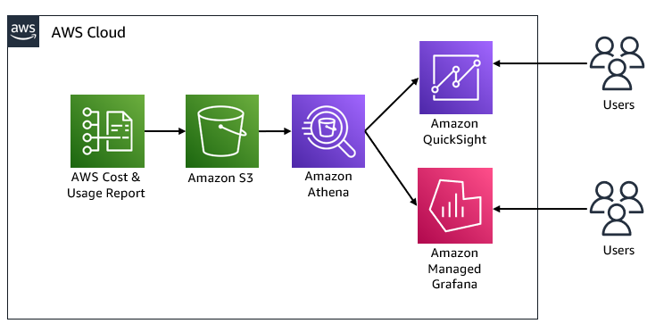
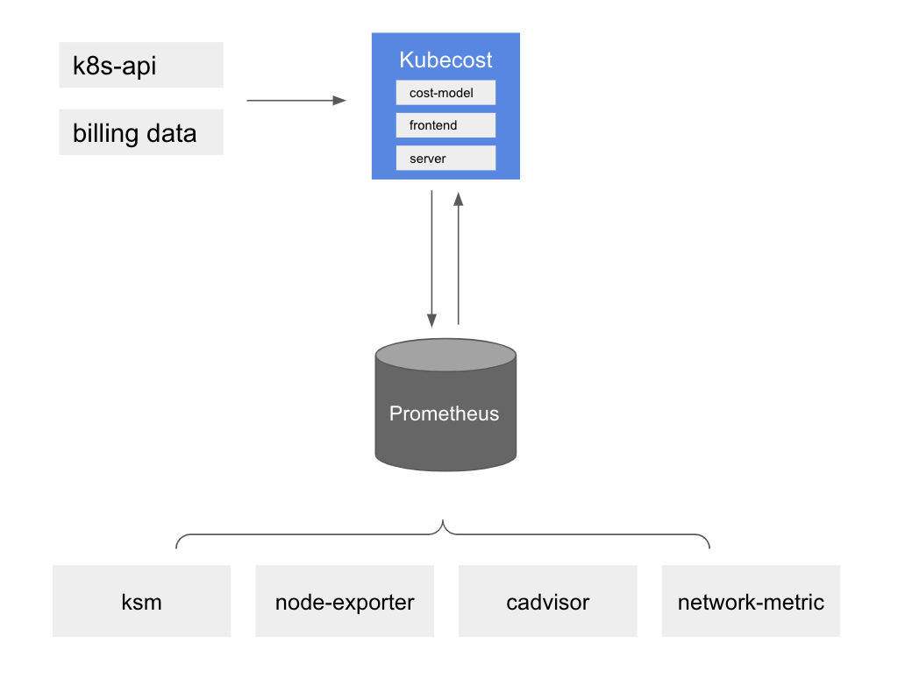
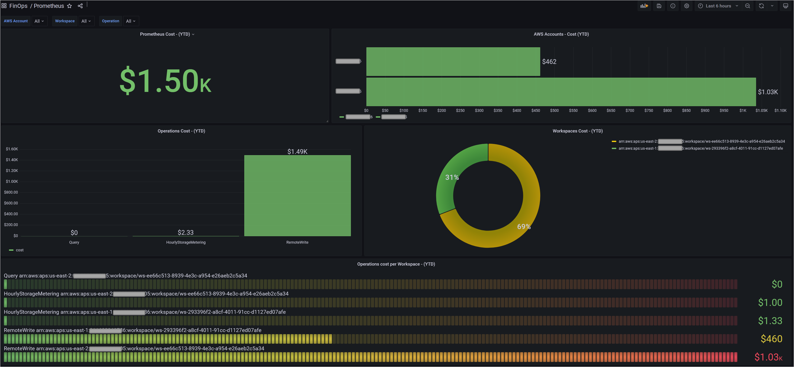
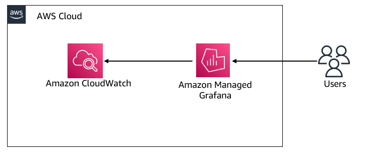
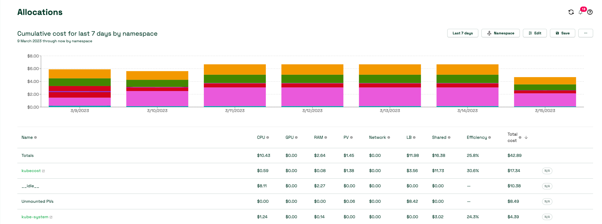
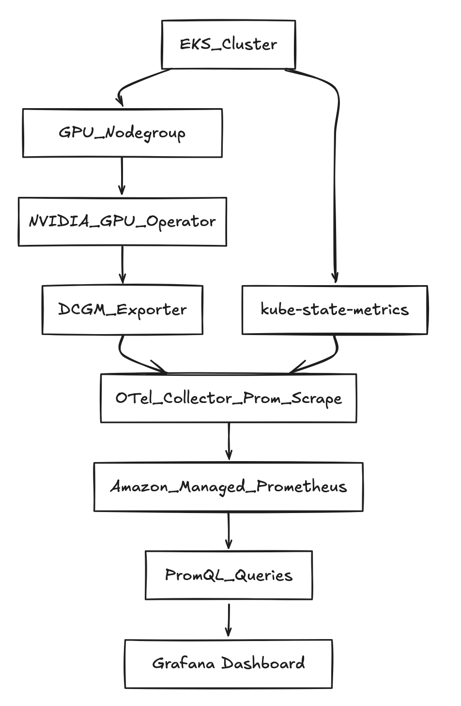
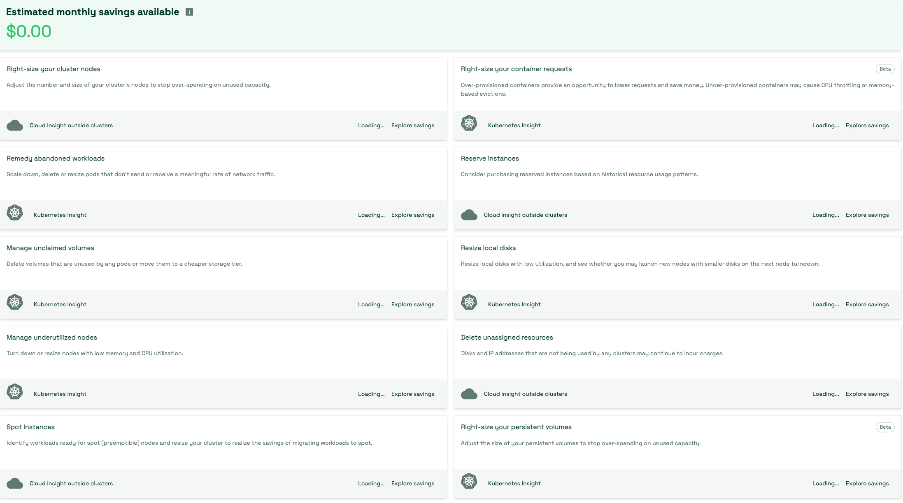

import RelatedEvents from '@site/src/components/RelatedEvents';

# オブザーバビリティコスト管理

## 関連イベント

<RelatedEvents topics={["cloudwatch", "metrics"]} />

## 概要

オブザーバビリティスタックが拡大するにつれて、オブザーバビリティプロダクト自体のコストを監視することが重要になります。このソリューションは、Amazon CloudWatch、Amazon Managed Service for Prometheus（AMP）、Amazon Managed Grafana（AMG）、および AWS X-Ray 全体の支出を追跡するためのガイダンスを統合します。また、通常最大のオブザーバビリティ費用項目である CloudWatch のコスト削減と、EKS 上の GPU ワークロードを含む Kubernetes コスト配分のための Kubecost の使用についても説明します。

このアプローチは、AWS Cost and Usage Reports（CUR）をデータ基盤として使用し、サービスごとの Athena ビューと QuickSight または Grafana のダッシュボードで可視化します。Kubernetes 環境では、Kubecost がスケーラブルなメトリクスストレージとして AMP を使用したポッドレベルのコスト配分を提供します。

## 前提条件

- [Cost and Usage Report（CUR）](https://docs.aws.amazon.com/cur/latest/userguide/what-is-cur.html)が有効化され、S3 に配信されている AWS Organizations
- CUR CloudFormation テンプレートがデプロイされた Amazon Athena の設定
- Amazon Managed Grafana ワークスペース（Grafana ベースのダッシュボード用）または Amazon QuickSight（QuickSight ダッシュボード用）
- Kubecost の場合：Helm がインストールされた Amazon EKS クラスター
- GPU コスト配分の場合：NVIDIA GPU Operator と MIG 対応インスタンス（例：p4d.24xlarge）を備えた EKS クラスター
- Athena、S3（CUR バケット）、CloudWatch、およびオプションで AMP リモートライト/クエリの IAM 権限

## アーキテクチャ



アーキテクチャは、CUR データを S3 から Athena ビュー（オブザーバビリティサービスごとに 1 つ）を通じてダッシュボードに流します。Kubernetes コスト配分では、Kubecost が Prometheus 経由でクラスターメトリクスをスクレイプし、配分データを AMP に書き込みます。



## デプロイ

### CloudWatch コストの可視化

1. CUR が S3 に配信されており、[Athena 統合 CloudFormation テンプレート](https://docs.aws.amazon.com/cur/latest/userguide/use-athena-cf.html)がデプロイされていることを確認します。

2. CloudWatch コスト用の Athena ビューを作成します：

```sql
CREATE OR REPLACE VIEW "cloudwatch_cost" AS
SELECT
  line_item_usage_type,
  line_item_resource_id,
  line_item_operation,
  line_item_usage_account_id,
  month,
  year,
  sum(line_item_usage_amount) "Usage",
  sum(line_item_unblended_cost) cost
FROM database.tablename
WHERE line_item_product_code = 'AmazonCloudWatch'
GROUP BY 1, 2, 3, 4, 5, 6
```

3. この Athena ビューをデータソースとして QuickSight または Grafana ダッシュボードを構築します。`line_item_operation` でフィルタリングして、GetMetricData、PutLogEvents、MetricStorage、およびその他のオペレーションのコストを確認します。

### Amazon Managed Service for Prometheus コストの可視化

1. Athena ビューを作成します：

```sql
CREATE OR REPLACE VIEW "prometheus_cost" AS
SELECT
  line_item_usage_type,
  line_item_resource_id,
  line_item_operation,
  line_item_usage_account_id,
  month,
  year,
  sum(line_item_usage_amount) "Usage",
  sum(line_item_unblended_cost) cost
FROM database.tablename
WHERE line_item_product_code = 'AmazonPrometheus'
GROUP BY 1, 2, 3, 4, 5, 6
```

2. Athena をデータソースとして Grafana で可視化します。ワークスペースごとの RemoteWrite、Query、HourlyStorageMetering などのオペレーションを確認します。



3. リアルタイムの取り込みレートモニタリングには、CloudWatch の AMP 提供メトリクス（`AWS/Prometheus` 名前空間）を Grafana の CloudWatch データソースとして使用します：



### Amazon Managed Grafana コストの可視化

Athena ビューを作成します：

```sql
CREATE OR REPLACE VIEW "grafana_cost" AS
SELECT
  line_item_usage_type,
  line_item_resource_id,
  line_item_operation,
  line_item_usage_account_id,
  month,
  year,
  sum(line_item_usage_amount) "Usage",
  sum(line_item_unblended_cost) cost
FROM database.tablename
WHERE line_item_product_code = 'AmazonGrafana'
GROUP BY 1, 2, 3, 4, 5, 6
```

### AWS X-Ray コストの可視化

Athena ビューを作成します：

```sql
CREATE OR REPLACE VIEW "xray_cost" AS
SELECT
  line_item_usage_type,
  line_item_resource_id,
  line_item_usage_account_id,
  month,
  year,
  sum(line_item_usage_amount) "Usage",
  sum(line_item_net_unblended_cost) cost
FROM database.tablename
WHERE line_item_product_code = 'AWSXRay'
GROUP BY 1, 2, 3, 4, 5
```

### CloudWatch コストの削減

以下の高インパクトな最適化を適用します：

1. **すべてのロググループにログ保持を設定する** — デフォルトの「無期限保持」はストレージコストをサイレントに増加させます。適切に 30/90/365 日を設定します。
2. **CloudWatch Logs Intelligent Tiering を有効化する** — アクセスパターンに基づいて Standard → Infrequent Access → Archive Instant Access ティア間でデータを自動的に移動します。
3. **サードパーティのメトリクスポーリングを低減する** — 1 分間隔から 5 分間隔に変更して `GetMetricData` コストを約 80% 削減します。
4. **VPC Flow Logs と CloudTrail を S3 に移動する** — CloudWatch Logs への取り込みが不要な場合。
5. **高カーディナリティのカスタムメトリクスを整理する** — メトリクス数を増加させるリクエストごとまたはポッドごとのディメンションを監査します。
6. **アラームを統合する** — リソースごとの個別アラームの代わりに、コンポジットアラームと Metrics Insights SQL アラームを使用します。

### EKS コスト配分のための Kubecost

1. Kubecost 用の IAM サービスアカウントを作成します：

```bash
eksctl create iamserviceaccount \
  --name kubecost-cost-analyzer \
  --namespace kubecost \
  --cluster <CLUSTER_NAME> --region <REGION> \
  --attach-policy-arn arn:aws:iam::aws:policy/AmazonPrometheusQueryAccess \
  --attach-policy-arn arn:aws:iam::aws:policy/AmazonPrometheusRemoteWriteAccess \
  --override-existing-serviceaccounts --approve
```

2. AMP 統合で Kubecost をインストールします：

```bash
helm upgrade -i kubecost \
  oci://public.ecr.aws/kubecost/cost-analyzer --version <VERSION> \
  --namespace kubecost --create-namespace \
  -f https://tinyurl.com/kubecost-amazon-eks \
  -f https://tinyurl.com/kubecost-amp \
  --set global.amp.prometheusServerEndpoint=${QUERYURL} \
  --set global.amp.remoteWriteService=${REMOTEWRITEURL}
```

3. ポートフォワードまたは ALB 経由で Kubecost UI にアクセスし、名前空間、ラベル、またはサービスごとのコスト配分を表示します。



### EKS GPU コスト配分

MIG スライスを使用する GPU ワークロードの場合、DCGM メトリクスと kube-state-metrics を AMP にデプロイし、配分と無駄をクエリします：

```promql
# Allocated $/hr per namespace (example: $12/GPU-hour, 7 MIG slices)
sum by (namespace) (
  kube_pod_container_resource_requests{resource=~"nvidia.*(gpu|mig).*",unit="integer"}
) * (12/7)
```



## 検証

1. **CUR ダッシュボード**：QuickSight または Grafana で、各サービスのコストデータが入力されていることを確認します。既知のアカウント ID でフィルタリングし、金額が Billing Console と一致することを確認します。
2. **CloudWatch コスト削減**：保持ポリシーの適用後、`AWS/Logs` 名前空間の `IncomingBytes` とストレージメトリクスを確認してボリュームの減少を確認します。
3. **Kubecost**：Kubecost UI → Cost Allocation を開き、名前空間にゼロでないコストと効率スコアが表示されていることを確認します。



## トラブルシューティング

| 症状 | 考えられる原因 | 修正方法 |
|---------|-------------|-----|
| Athena ビューがゼロ行を返す | CUR がまだ配信されていない（初回配信まで最大 24 時間の遅延）、またはクエリのデータベース/テーブル名が間違っている | 最初の CUR 配信を待つ。Athena コンソールでテーブル名を確認する |
| Grafana で AMP コストに「データなし」と表示される | Athena データソースが設定されていないか、IAM 権限がない | Grafana ワークスペースのロールに Athena と CUR S3 バケットへのアクセスを付与する |
| Kubecost がすべての名前空間で $0 を表示する | IRSA が設定されていないか、AMP リモートライト URL が正しくない | サービスアカウントのアノテーションと AMP エンドポイントを確認する。`kubecost-cost-analyzer` Pod のログを確認する |
| 保持変更後も CloudWatch コストが減少しない | 保持は将来のストレージにのみ影響する。既存のデータは保持期間にわたって期限切れになる | 保持ウィンドウが経過するまで待つ。即時の節約には取り込み削減に焦点を当てる |

## 関連ソリューション

- [EKS インフラストラクチャ](../eks-infrastructure/)
- [RDS Aurora モニタリング](../rds-aurora-monitoring/)