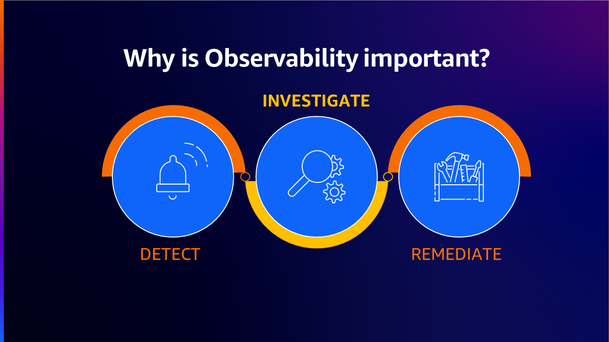
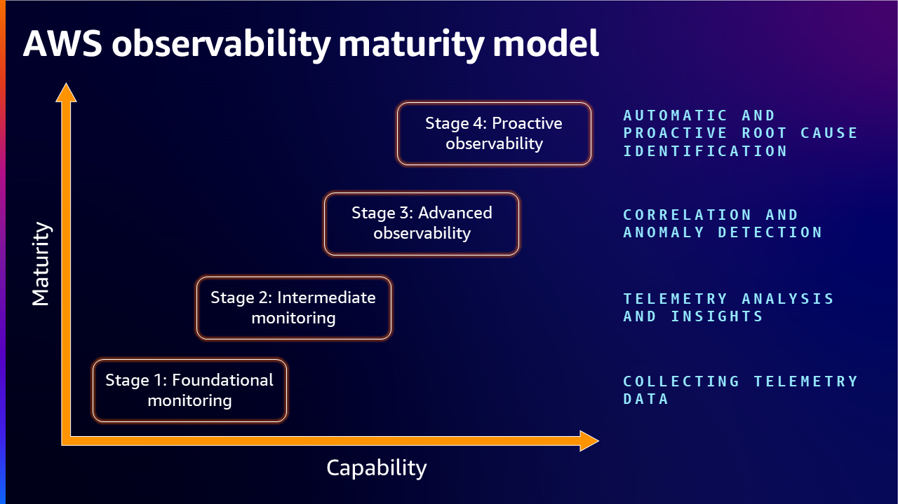
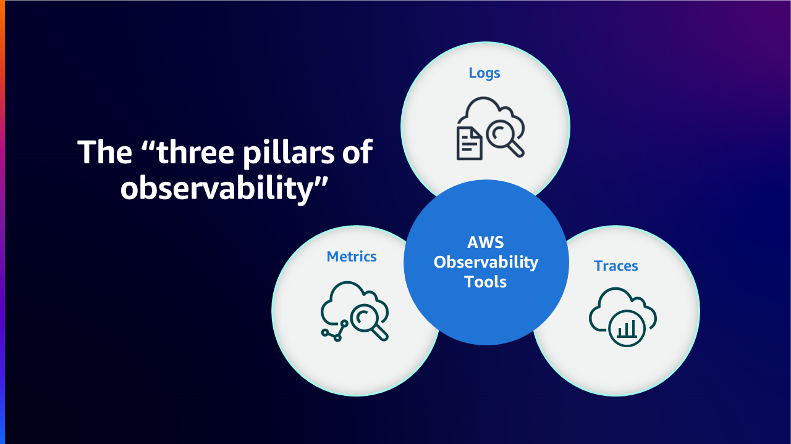
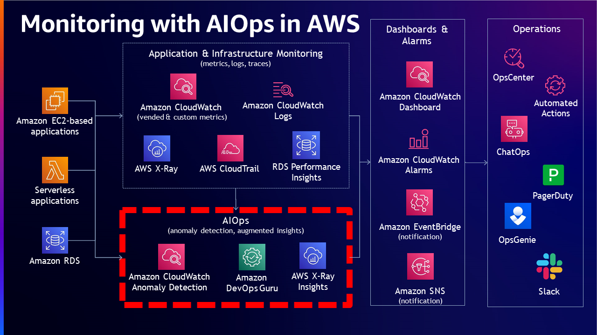
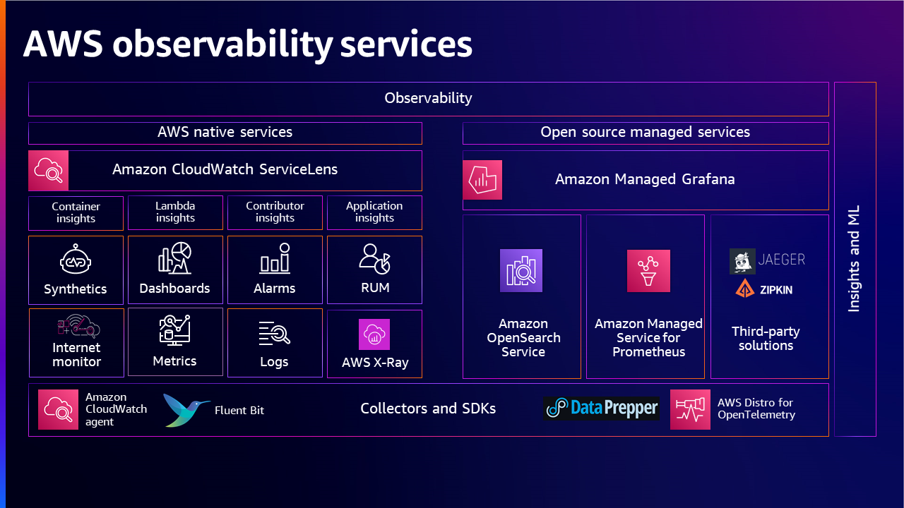
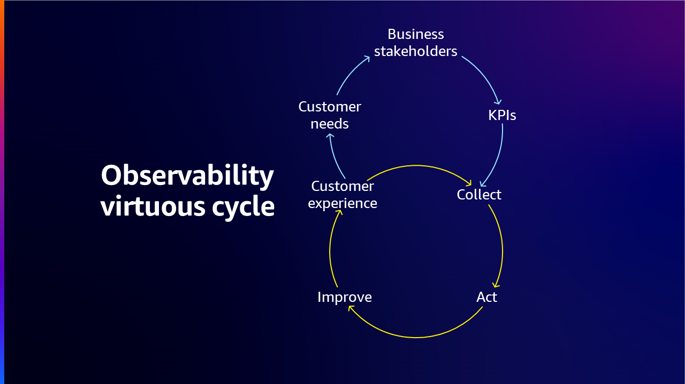

# オブザーバビリティ成熟度モデル

## 概要

AWS オブザーバビリティ成熟度モデルは、組織が現在のオブザーバビリティ機能を評価し、改善すべき領域を特定し、最適なオブザーバビリティを達成するためにツールとプロセスに戦略的に投資するためのフレームワークを提供します。このモデルは、基盤的なモニタリングからプロアクティブな AI 駆動のオブザーバビリティまで、4 つの成熟度ステージを概説します。

クラウドコンピューティング、マイクロサービス、エフェメラルおよび分散システムの時代において、オブザーバビリティはデジタルサービスの信頼性とパフォーマンスを確保するための重要な要素となっています。モニタリングとオブザーバビリティの違いは、モニタリングはシステムが*動作しているかどうか*を示すのに対し、オブザーバビリティはシステムが*なぜ動作していないか*を示すことです。モニタリングは通常リアクティブですが、オブザーバビリティの目標は KPI をプロアクティブに改善することです。

## 使用するタイミング

- 構造化されたフレームワークに対して組織の現在のオブザーバビリティ機能を評価する必要がある場合
- オブザーバビリティ投資のビジネスケースを構築し、現在のギャップを明確にする必要がある場合
- リアクティブなモニタリングからプロアクティブなオブザーバビリティへの進行ロードマップを定義したい場合
- チームが断片化されたツールを使用しており、統一のビジョンが必要な場合
- オペレーショナルエクセレンスに焦点を当てた AWS Well-Architected レビューを準備している場合
- 複数のチームまたはビジネスユニット間でオブザーバビリティの成熟度をベンチマークしたい場合

## ガイダンス

### 成熟度モデルのステージ

オブザーバビリティ成熟度モデルは、4 つの段階的なステージを定義します。組織は、異なるチームやシステム間で複数のステージの特徴を同時に示す場合があります。

### ステージ 1：基盤モニタリング — テレメトリデータの収集

このステージでは、基本的なモニタリングが最低限として採用されますが、多くの場合サイロ化されています。システムやワークロードの全体をモニタリングするために何が必要かの定義された戦略はありません。異なるチーム（アプリケーションオーナー、NOC、CloudOps、DevOps）がモニタリングニーズに異なるツールを使用し、システム間のデバッグや最適化にはほとんど価値を提供しません。

**主な特徴：**

- チーム間でワークロードをモニタリングするための異なるソリューション
- チームは、パートナーシップがないか限定的な中で、同じデータを異なる方法で収集する
- あるチームから取得したデータが異なるフォーマットである可能性があり、再利用を妨げる
- 統一されたオブザーバビリティ戦略がない

**進行のためのアクション：**

- 重要なワークロードを特定する計画を作成する
- オブザーバビリティの統一ソリューションを目指す
- どのメトリクスとログが必須であるかを定義する
- 必須の[テレメトリ](https://docs.aws.amazon.com/wellarchitected/latest/operational-excellence-pillar/implement-observability.html)をキャプチャするようにワークロードを設計する
- メトリクス、ログ、トレースの収集を通じてワークロードを計装する

### ステージ 2：中間モニタリング — テレメトリ分析とインサイト

このステージの組織は、さまざまな環境（オンプレミスおよびクラウド）からより明確なシグナル収集を行っています。メトリクス、ログ、トレースを収集するメカニズムを考案し、可視化を作成し、アラート戦略を定義し、明確に定義された基準に基づいて問題を優先順位付けできます。

**主な特徴：**

- チームは分析とトラブルシューティングに必要なアクションを呼び出すワークフローを持っている
- 問題を優先順位付けする能力を持つアラート戦略が定義されている
- 可視化とダッシュボードが整備されている
- トラブルシューティングに履歴的な知識が使用されている

**このステージでの一般的な課題：**

- MTTR が一貫していないか、時間の経過とともに有意に改善されない
- 問題のデバッグに予想以上の認知的負荷がかかる
- データ過多が運用を圧倒する
- ほとんどの企業がこのステージで停滞し、次にどこに進むべきか認識していない

**進行のためのアクション：**

1. 定期的な間隔でアーキテクチャ設計をレビューし、影響とダウンタイムを削減するポリシーをデプロイする
2. アクション可能な KPI を定義し、発見事項に有益なコンテキストを追加し、重大度/緊急度でカテゴリ化し、適切なチームにルーティングすることでアラート疲労を防止する
3. アラートを定期的に分析し、一般的な繰り返しアラートの修復を自動化する
4. 異なるエンティティを相関させ、システム部分間の依存関係を理解するのに役立つナレッジグラフを開発する

### ステージ 3：高度なオブザーバビリティ — 相関と異常検出

このステージの組織は、トラブルシューティングに多くの時間を費やすことなく、根本原因を明確に理解できます。問題が発生した場合、アラートは関連するチームに十分なコンテキスト情報を提供します。モニタリングチームはアラートを見て、メトリクス、ログ、トレースの相関を通じて直ちに根本原因を特定できます。

**主な特徴：**

- 相関シグナルによる 360° の状況把握
- 非常に小さい MTTR
- Service Level Objectives（SLO）がグリーンで、許容可能なエラーバジェット消費率
- 通常のパターンに一致しない外れ値を監視する異常検出器
- ほぼリアルタイムのアラートメカニズム

**進行のためのアクション：**

- 繰り返し発生する問題を理解し、ナレッジベースを作成する
- シナリオに対してモデル化し、将来の問題を予測する
- データストレージと使用のための新しいツール、スキル、テクニックを特定する
- Artificial Intelligence for IT Operations（AIOps）を活用して、シグナルの自動相関、根本原因の特定、解決計画の作成を行う

### ステージ 4：プロアクティブオブザーバビリティ — 自動的かつプロアクティブな根本原因特定

このステージでは、オブザーバビリティデータが問題発生*後*ではなく、問題発生*前*にリアルタイムで使用されます。十分にトレーニングされたモデルがプロアクティブに問題を特定し、解決がより容易に達成されます。モニタリングシステムは自動的にインサイトを提供し、解決オプションを提示します。

**主な特徴：**

- トレーニングされたモデルを使用した予測的な問題特定
- 関連情報のみを含む自動的な動的ダッシュボード
- プロアクティブなモニタリングを加速する生成 AI 機能
- データドリブンなインサイトがエンジニアリングにフィードバックされる継続的な改善

### 自己評価の質問

現在の成熟度レベルを測るために、以下の質問を使用してください：

| 領域 | 評価の質問 |
|------|---------------------|
| **ログ** | ログをどのように収集していますか？どのように使用していますか？どのようにアクセスしていますか？保持ポリシーは何ですか？ML/AI 機能を使用していますか？ |
| **メトリクス** | どのタイプのメトリクスを収集していますか？どのように使用・アクセスしていますか？ |
| **トレース** | トレースをどのように収集していますか？どのように使用していますか？ |
| **ダッシュボードとアラート** | アラームをどのように使用していますか？ダッシュボードをどのように使用していますか？ |
| **組織** | エンタープライズオブザーバビリティ戦略がありますか？SLO をどのように使用していますか？ |

### オブザーバビリティ戦略の構築

組織が現在のステージを特定したら、3 つの主要な側面に対処して戦略を構築します：

1. **何を収集する必要があるか** — ビジネス目標に合致したオブザーバビリティ目標を定義し、レイテンシー、エラー率、リソース使用率、トランザクション量などの主要メトリクス（KPI）を特定する
2. **どのシステムとワークロードを監視する必要があるか** — 目標との整合性、既存システムとの統合、コスト最適化、スケーラビリティに基づいてツールを選択する
3. **どのように対応し修復するか** — 対応と解決のためのメカニズムを定義する

組織はまた、オブザーバビリティを重視する文化を育成する必要があります — チームメンバーのトレーニング、プロアクティブなモニタリングの奨励、継続的改善のマインドセットの構築です。

### AWS Well-Architected と Cloud Adoption Framework

組織は [AWS Well-Architected](https://aws.amazon.com/architecture/well-architected/) と [Cloud Adoption Framework](https://docs.aws.amazon.com/whitepapers/latest/aws-caf-operations-perspective/observability.html) を活用してオブザーバビリティ機能を強化できます。Well-Architected の柱（オペレーショナルエクセレンス、セキュリティ、信頼性、パフォーマンス効率、コスト最適化、サステナビリティ）はホリスティックなアプローチを提供し、Cloud Adoption Framework はビジネス、人材、ガバナンス、プラットフォームに焦点を当てた構造化されたガイダンスを提供します。

[AWS Well-Architected Tool](https://aws.amazon.com/well-architected-tool/) を使用して、ベストプラクティスに対するワークロードの文書化と測定を行い、改善のための推奨事項を支援します。

## 関連リソース

- [オブザーバビリティ戦略](../observability-strategy/) — オブザーバビリティをビジネス成果に結び付けるリーダー向けの戦略的フレーミング
- [オブザーバビリティ導入ガイド](../observability-adoption-guide/) — 成長中の組織のための段階的導入フレームワーク
- [効果的なオブザーバビリティ戦略の構築](https://youtu.be/7PQv9eYCJW8?si=gsn0qPyIMhrxU6sy) — AWS re:Invent 2023
- [オブザーバビリティ戦略の策定方法](https://aws.amazon.com/blogs/mt/how-to-develop-an-observability-strategy/)