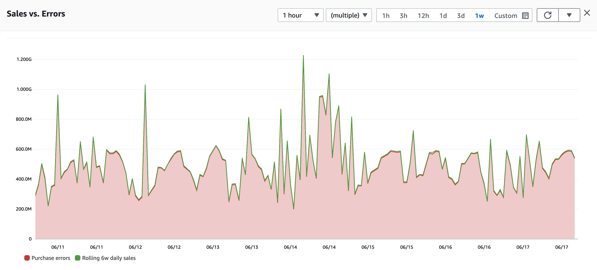
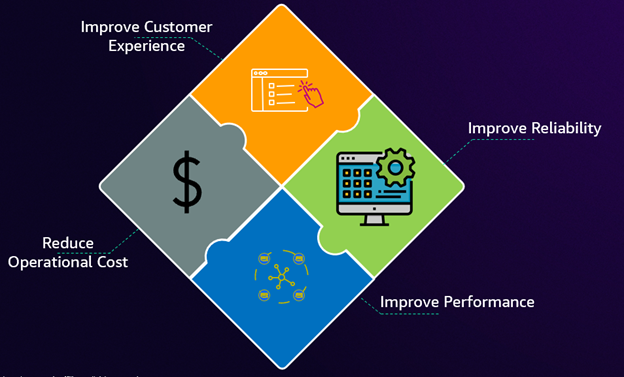
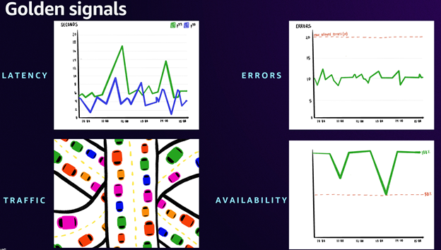
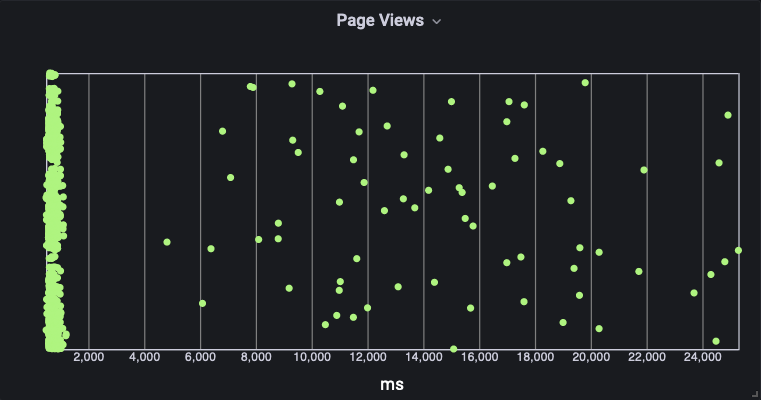
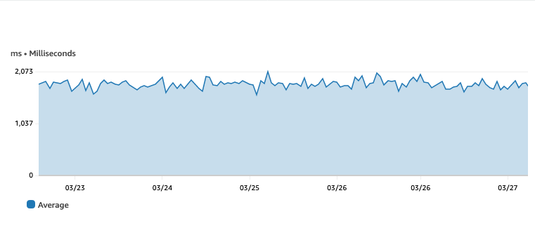
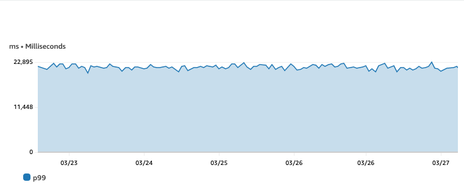
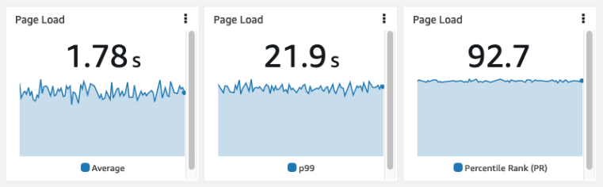

# オブザーバビリティ戦略

## 概要

このガイドは、ビジネス成果を直接サポートするオブザーバビリティ戦略の構築に関する、IT リーダーおよびエンジニアリングマネージャー向けの戦略的ガイダンスを提供します。テレメトリシグナルを商業 KPI に結び付ける方法、オブザーバビリティ投資を ROI の観点からフレーミングする方法、ステークホルダーにとって重要なメトリクスの選択方法、平均値ではなくパーセンタイルを使用したサービス信頼性の測定方法について説明します。

今日のデジタルファーストの経済では、ビジネスパフォーマンスと技術運用の境界は消失しています。デジタルサービスは収益ストリームに直接影響し、顧客は前例のない信頼性を期待し、競争優位性は技術的なレジリエンスにかかっています。この収束により、IT リーダーは効果的なオブザーバビリティ戦略を通じて、オペレーショナルエクセレンスと具体的なビジネス価値の創造の両方を実証することが求められています。

「測定できなければ、管理できない」という古くからのマネジメント原則は真理です。オブザーバビリティ戦略は、組織のコアビジネス目標と優先事項と密接に結合し、生成されたインサイトが主要パフォーマンス指標（KPI）の改善を直接サポートすることを確保する必要があります。

## 使用するタイミング

- 組織のオブザーバビリティ戦略を定義または改善している場合
- エグゼクティブステークホルダーにオブザーバビリティ投資を正当化する必要がある場合
- 技術テレメトリをビジネス成果とカスタマーエクスペリエンスに合わせたい場合
- サービス信頼性測定のための KPI と SLO を選択している場合
- ROI とコスト削減の観点からオブザーバビリティの価値を伝える必要がある場合
- リアクティブなモニタリングからプロアクティブなアウトカム駆動のオブザーバビリティに移行している場合

## ガイダンス

### 重要なものを監視する

オブザーバビリティで最も重要な考慮事項は、サーバー、ネットワーク、アプリケーション、顧客ではなく、*ビジネス*、プロジェクト、またはユーザーにとって重要なことです。

成功基準から始めてください。例えば、e コマースアプリケーションを運用している場合、成功の指標は 1 時間あたりの購入数かもしれません。決済プロセッサはトランザクション処理時間を監視し、SaaS プラットフォームはユーザーエンゲージメントとリテンションを測定するでしょう。

:::tip
成功メトリクスは人それぞれ異なります。アプリケーションに関わらず、アドバイスは同じです：*良い状態*とは何かを知り、それを測定してください。
:::

重要なトップレベル KPI を特定したら、次のタスクはそれらを追跡・測定する自動化された方法を持つことです — 重要なのは、ワークロードの運用を監視するのと同じシステムで行うことです。e コマースワークロードの場合、これは以下を意味する場合があります：

- 売上データを[時系列](https://en.wikipedia.org/wiki/Time_series)に発行する
- ユーザー登録を同じシステムで追跡する
- 顧客が Web ページに滞在する時間を測定し、このデータを時系列にプッシュする

すべての主要メトリクスは時系列として維持する必要があり、他のオブザーバビリティシグナル（メトリクス、ログ、トレース）と相関させることができます。

### テレメトリをビジネス成果に結び付ける

IT のすべては組織のミッションに合わせる必要があります。すべてのプロジェクト、デプロイメント、セキュリティ対策、最適化はビジネス成果に向けて機能する必要があります。ITIL が述べるように：「すべての変更はビジネス価値を提供する必要があります。」

オブザーバビリティは以下を通じてビジネス価値を提供します：

- より良い可用性と信頼性
- アプリケーションヘルスとパフォーマンスの理解
- 問題のプロアクティブな検出
- 顧客満足度の向上
- 市場投入時間の短縮
- 運用コストの削減
- 自動化

これらはすべて、顧客に直接的に、または組織に間接的にビジネス価値を提供します。オブザーバビリティについて考える際、すべてはアプリケーションがビジネス価値を提供しているかどうかに帰着します。

**顧客ニーズからの逆算で考えてください。** 顧客が何を気にしているかをすべて知ることは期待できません。組織のステークホルダーと話してください — これは重要なものを測定していることを確認するために不可欠です。例えば、調査によると、訪問者の 43% がすぐに検索ボックスに移動し、検索は非検索者と比較して 2〜3 倍コンバージョンしやすいとされています。検索品質のモニタリングは、コンバージョンに直接的で測定可能な影響を持ちます。

追加のメリットとして、顧客やステークホルダーにとって重要なメトリクスを収集することで、手動レポートの必要性を排除するほぼリアルタイムのダッシュボードが可能になります。エグゼクティブは「ランディングページの読み込みにどれくらい時間がかかっているか？」や「Web サイトの運用にどれくらいコストがかかっているか？」などの情報をセルフサービスで取得できるようにすべきです。

### リーダー向け KPI フレーミング

オブザーバビリティを具体的なビジネス成果に変換するには、3 つの重要な領域に焦点を当てます：

**カスタマーエクスペリエンスの測定** — Service Level Objectives（SLO）を主要な測定フレームワークとして実装します。SLO は、単なるシステムメトリクスではなく、重要なエンドユーザージャーニーに基づくサービス可用性の合意されたターゲットを提供します。主要な用語：

- **SLI**（Service Level Indicator）：サービスレベルの何らかの側面の定量的な測定値
- **SLO**（Service Level Objective）：SLI によって測定されるサービスレベルのターゲット値または範囲
- **SLA**（Service Level Agreement）：約束されたサービスレベルを概説する顧客との合意

[Amazon CloudWatch Application Signals](https://docs.aws.amazon.com/AmazonCloudWatch/latest/monitoring/CloudWatch-Application-Monitoring-Sections.html) を使用すると、AWS でネイティブに SLO を作成・監視できます。詳しくは、[効果的な SLO によるアプリケーション信頼性の向上](https://aws.amazon.com/blogs/mt/improve-application-reliability-with-effective-slos)を参照してください。

**アプリケーションパフォーマンスと信頼性の向上** — 重要なアプリケーションのゴールデンシグナルを監視します：可用性、レイテンシー、エラー、トラフィック。SLO と組み合わせることで、高い信頼性を維持しながら運用コストを最適化するための強力なフレームワークが作成されます。

**コストの最適化** — 多くの組織は、すべてをモニタリングする罠（「FOMO」症候群）に陥り、インサイトよりもノイズを多く生成する複雑でリソース集約的なシステムにつながります。重要なのは、ビジネスサービスの成功と直接相関する KPI を特定することです。オブザーバビリティ戦略は、Root Cause Analysis（RCA）を明確に加速し、Mean Time to Restore（MTTR）を短縮し、コアメトリクスへのフォーカスを維持しながら運用コストを削減する必要があります。

### 定量化可能な成果とビジネスインパクト

適切に実装されたオブザーバビリティ戦略は、定量化可能な財務的リターンと定性的なメリットの両方を提供します：

**コスト削減** — MTTR の短縮と予防措置による運用改善は、即時のコスト削減を生み出します。顧客リテンションのわずかな改善でも、顧客生涯価値の観点から見ると、大幅な収益保護につながります。

**運用効率** — リソースの最適化により、インフラストラクチャ支出で 40% 以上のコスト削減が得られることが多いです。定型タスクの自動化により手動作業が排除され、節約額は手動時間の削減に労働コストを乗じて計算されます。

**文化的変革** — 自動化されたアラート相関とコンテキストに基づくトラブルシューティングが即時の効率向上を推進します。セルフサービス機能が独立した問題解決を可能にし、包括的な可視性がプロアクティブなリスク管理を可能にします。

### SLA にパーセンタイルが平均より優れている理由

平均値は、パフォーマンスやユーザーエクスペリエンスに大きく影響する外れ値や変動などの重要な情報を隠す可能性があります。パーセンタイルはこれらの隠れた詳細を明らかにし、データ分布のより良い理解を提供します。

[Amazon CloudWatch](https://aws.amazon.com/cloudwatch/) では、パーセンタイルを使用してレスポンスタイム、レイテンシー、エラー率を監視できます。パーセンタイルにアラームを設定することで、特定のパーセンタイル値がしきい値を超えた場合にアラートを受け取り、より多くの顧客に影響が及ぶ前にアクションを取ることができます。

[CloudWatch でパーセンタイル](https://docs.aws.amazon.com/AmazonCloudWatch/latest/monitoring/cloudwatch_concepts.html#Percentiles)を使用するには、メトリクスを選択し、**統計**を **p99**（または必要なパーセンタイル）に設定します。パーセンタイルグラフを表示し、[CloudWatch ダッシュボード](https://docs.aws.amazon.com/AmazonCloudWatch/latest/monitoring/CloudWatch_Dashboards.html)に追加し、アラームを設定できます。

次の例を考えてみましょう：ページ読み込み時間のヒストグラムは、平均を使用すると隠れてしまう明確な外れ値を示しています。

同じデータを平均値で表示すると、ページの読み込みに 2 秒未満かかることを示しますが、ほとんどのページは実際には 1 秒未満で読み込まれ、大きな外れ値があります：

p99 を使用すると真実が明らかになります — ページ読み込みの 99 パーセントは 23 秒未満で完了しており、本当のパフォーマンス問題があることを示しています：

平均をパーセンタイルランク（PR）と比較するために統計 **PR(:2000)** を使用すると、ページ読み込みの 92.7% が 2000ms のターゲット内で完了していることがわかります：

パーセンタイルを使用することで、平均値では隠れてしまう外れ値を特定し、問題を早期に検出し、カスタマーエクスペリエンスを改善できます。

### 何を観察するか

顧客にとって重要なことがわかったら、主要パフォーマンス指標（KPI）を特定します。これらは、ビジネス成果がリスクにさらされているかどうかを示すハイレベルメトリクスです。ビジネス成果に影響を与えるものから、ビジネス成果に影響を与える可能性のあるものへと逆算して考えます。

顧客に影響を与える問題は、ハイレベルのビジネスメトリクスを測定する際に容易に特定できます。これらのメトリクスは**何が**起きているかを示します。他のメトリクス、トレーシング、ログは**なぜ**を示し、修正や改善のために何ができるかにつながります。

### すべてのティアからテレメトリを収集する

アプリケーションは孤立して存在しません。ネットワークインフラストラクチャ、クラウドプロバイダー、ISP、SaaS パートナー、その他のコンポーネントとの相互作用はすべて成果に影響を与える可能性があります。ワークロード全体のホリスティックなビューが必要です。

**統合に焦点を当てる** — あるコンポーネントまたはサービスが別のものを呼び出すたびに、以下を測定します：

1. リクエストとレスポンスの所要時間
2. レスポンスのステータス

すべての収集シグナルに、リクエストチェーン全体の単一の一意の識別子を含めます。

**エンドユーザーエクスペリエンスを忘れない** — ワークロードがエンドユーザーと直接対話する場合（Web サイト、モバイルアプリ）、[Real User Monitoring](https://docs.aws.amazon.com/AmazonCloudWatch/latest/monitoring/CloudWatch-RUM.html) はユーザーへの配信だけでなく、ユーザーがアプリケーションを実際にどのように体験しているかを監視します。

### 初日からオブザーバビリティを含める

セキュリティと同様に、オブザーバビリティは後付けであるべきではありません。計画の早い段階でオブザーバビリティを取り入れることで、アプリケーションの不透明な部分を減らせます。適切なロギング、メトリクス、トレースの収集により、アプリケーション開発の迅速化、良好なプラクティスの育成、迅速な問題解決の基盤が構築されます。

## 関連リソース

- [オブザーバビリティ成熟度モデル](../observability-maturity-model/) — 現在のステージを評価し、改善を特定する
- [オブザーバビリティ導入ガイド](../observability-adoption-guide/) — 回避すべきアンチパターンを含む段階的導入フレームワーク
- [フロントエンド SLO モニタリング](../frontend-slo-monitoring/) — フロントエンドパフォーマンスの SLO を実装する
- [AWS CAF オペレーションパースペクティブ：オブザーバビリティ](https://docs.aws.amazon.com/whitepapers/latest/aws-caf-operations-perspective/observability.html)