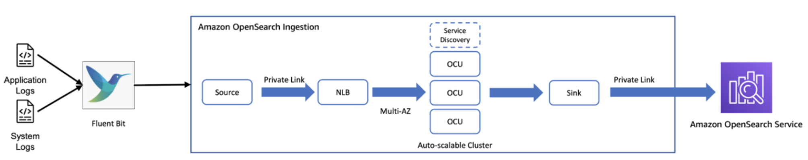

# Amazon OpenSearch Service モニタリング

## 概要

Amazon OpenSearch Service は、クラスターおよびノードメトリクスを `AWS/ES` 名前空間で自動的に CloudWatch に発行します。ノードごとの JVM、インデキシングレート、検索レイテンシー、シャードレベルの詳細を含むより深い Prometheus 互換のモニタリングには、**AWS Managed Collector** が VPC アクセスドメインをスクレイプし、メトリクスを Amazon Managed Service for Prometheus（AMP）または CloudWatch の PromQL ストアにエクスポートできます。

この組み合わせにより、自己管理型の Prometheus インフラストラクチャを実行することなく、ネイティブの CloudWatch アラームパスと Grafana ダッシュボードによる完全な PromQL クエリ機能の両方が得られます。

OpenSearch はログ分析バックエンドとしても機能します（Fluent Bit または Logstash 経由で ECS、EKS、EC2 からログを取り込む）が、このエントリではロギングの宛先として使用するのではなく、OpenSearch *サービス*のヘルスのモニタリングに焦点を当てています。

完全なリファレンス資料については、[Amazon OpenSearch Service のモニタリング](https://docs.aws.amazon.com/opensearch-service/latest/developerguide/monitoring.html)を参照してください。

## 前提条件

- **VPC アクセス**の Amazon OpenSearch Service ドメイン（パブリックアクセスドメインはマネージドコレクターでサポートされていません）
- 異なるアベイラビリティゾーンにある少なくとも 2 つのサブネット（ドメインと同じ VPC）
- コレクターが HTTPS（ポート 443）でドメインエンドポイントに到達できるセキュリティグループ
- IAM 権限：`aps:CreateScraper`、`es:DescribeDomain`、`es:ESHttpGet`
- （オプション）PromQL ベースのクエリ用の AMP ワークスペース
- （オプション）AMP または CloudWatch データソースが設定された AMG ワークスペース

## アーキテクチャ



```
┌──────────────────────────────────────────────────────────────┐
│              OpenSearch Domain (VPC access)                   │
│                                                              │
│  ┌────────────┐  ┌────────────┐  ┌────────────┐             │
│  │  Data Node │  │  Data Node │  │  Data Node │             │
│  │  (metrics) │  │  (metrics) │  │  (metrics) │             │
│  └─────┬──────┘  └─────┬──────┘  └─────┬──────┘             │
│        └────────────────┼────────────────┘                   │
│                         │ :443 HTTPS                         │
└─────────────────────────┼────────────────────────────────────┘
                          │ Pull (private VPC)
                          ▼
             ┌──────────────────────────┐
             │  AWS Managed Collector   │
             │  (fully managed)         │
             └────────────┬─────────────┘
                          │
             ┌────────────┼────────────┐
             ▼                         ▼
┌──────────────────────┐  ┌──────────────────────┐
│ Amazon Managed       │  │ Amazon CloudWatch    │
│ Prometheus (AMP)     │  │ (PromQL store)       │
└──────────┬───────────┘  └──────────────────────┘
           │
           ▼
┌──────────────────────┐
│ Amazon Managed       │
│ Grafana (AMG)        │
└──────────────────────┘
```

## デプロイ

### ステップ 1：ドメインのセキュリティグループを設定する

コレクターのセキュリティグループからの HTTPS を許可するインバウンドルールを追加します：

| プロトコル | ポート | ソース | 目的 |
|----------|------|--------|---------|
| TCP | 443 | Scraper SG | メトリクス収集エンドポイント |

### ステップ 2：スクレイプ設定を作成する

`opensearch-config.yaml` を作成します：

```yaml
global:
  external_labels:
    domain_name: my-opensearch-domain

scrape_configs:
  - job_name: opensearch-exporter
    scrape_interval: 60s
```

マネージドコレクターはドメインエンドポイントを自動的に解決します — ターゲットを手動で指定する必要はありません。

### ステップ 3：マネージドコレクタースクレイパーを作成する

```bash
aws amp create-scraper \
  --alias "opensearch-metrics-scraper" \
  --source '{
    "vpcConfiguration": {
      "subnetIds": ["subnet-abc123", "subnet-def456"],
      "securityGroupIds": ["sg-0123456789abcdef0"]
    }
  }' \
  --exporters '[
    {
      "openSearchConfiguration": {
        "domainArn": "arn:aws:es:us-west-2:123456789012:domain/my-opensearch-domain"
      }
    }
  ]' \
  --scrape-configuration configurationBlob=$(base64 -w 0 opensearch-config.yaml) \
  --destination '{
    "ampConfiguration": {
      "workspaceArn": "arn:aws:aps:us-west-2:123456789012:workspace/ws-abc123"
    }
  }'
```

メトリクスを CloudWatch PromQL ストアに送信するには、`ampConfiguration` を `cloudWatchConfiguration`（データセット ARN を使用）に置き換えてください。

### ステップ 4：ネイティブメトリクスに CloudWatch アラームを設定する

```bash
aws cloudwatch put-metric-alarm \
  --alarm-name "OpenSearch-ClusterRed" \
  --namespace AWS/ES \
  --metric-name "ClusterStatus.red" \
  --dimensions Name=DomainName,Value=my-opensearch-domain Name=ClientId,Value=123456789012 \
  --statistic Maximum \
  --period 60 \
  --threshold 1 \
  --comparison-operator GreaterThanOrEqualToThreshold \
  --evaluation-periods 1 \
  --alarm-actions arn:aws:sns:us-west-2:123456789012:ops-alerts
```

## 検証

1. **スクレイパーのステータスを確認します：**
   ```bash
   aws amp describe-scraper --scraper-id s-1234abcd-5678-90ef
   ```
   `ACTIVE` ステータスになるまで待ちます。

2. **クラスターヘルスをクエリします**（CloudWatch Query Studio または AMP）：
   ```promql
   opensearch_cluster_health_status
   ```

3. **ノードレベルの JVM ヒープをクエリします：**
   ```promql
   opensearch_jvm_mem_heap_used_in_bytes / opensearch_jvm_mem_heap_max_in_bytes * 100
   ```

4. **提供済みダッシュボードを確認します：** CloudWatch → ダッシュボード → テンプレート → **OpenSearch OTel**。

### 監視すべき主要メトリクス

| メトリクス | 意味 | アラートしきい値 |
|--------|---------|-----------------|
| `ClusterStatus.red`（CW） | 少なくとも 1 つのプライマリシャードが未割り当て | = 1 |
| `FreeStorageSpace`（CW） | ノードごとの利用可能なディスク | 合計の 20% 未満 |
| `JVMMemoryPressure`（CW） | JVM ヒープ使用率 | > 80% |
| `opensearch_indices_search_query_time_in_millis`（Prom） | 検索レイテンシー | 上昇傾向 |
| `opensearch_cluster_health_number_of_nodes`（Prom） | ノード数 | 期待値より少ない |

## トラブルシューティング

| 症状 | 考えられる原因 | 修正方法 |
|---------|-------------|-----|
| スクレイパーが `CREATING` のまま停止する | セキュリティグループがコレクターからドメインへの HTTPS をブロックしている | スクレイパー SG からドメイン SG へのポート 443 のインバウンドルールを追加する |
| Prometheus メトリクスがないが CW メトリクスは正常に動作する | ドメインがパブリックアクセスを使用している（サポートされていない） | ドメインを VPC アクセスに移行するか、ネイティブ CW メトリクスのみに依存する |
| `ClusterStatus.red` アラームが発報する | プライマリシャードが未割り当て（ノード障害、ディスクフル） | `FreeStorageSpace` を確認する。インスタンス数またはストレージを増加する。[レッドクラスターのトラブルシューティング](https://docs.aws.amazon.com/opensearch-service/latest/developerguide/handling-errors.html#handling-errors-red-cluster-status)を参照する |
| JVM メモリプレッシャーが 90% 超 | フィールドデータまたはアグリゲーションキャッシュのプレッシャー | フィールドデータの使用を削減する。インスタンスサイズを増加する。[サーキットブレーカー](https://docs.aws.amazon.com/opensearch-service/latest/developerguide/handling-errors.html#handling-errors-jvm_out_of_memory_error)を有効化する |
| インデキシングレイテンシーが増加している | バルクキューがフルまたはマージプレッシャー | `ThreadpoolWriteQueue` を確認する。バルクリクエストサイズを削減する。データノードを追加する |

## 関連ソリューション

- [RDS & Aurora モニタリング](../rds-aurora-monitoring/) — OpenSearch 分析と並行して構造化データを保存するデータベースの監視
- [Amazon MSK モニタリング](../msk-monitoring/) — OpenSearch にデータをストリーミングする Kafka クラスターの監視