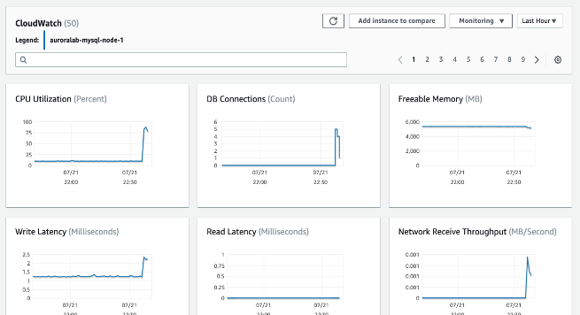
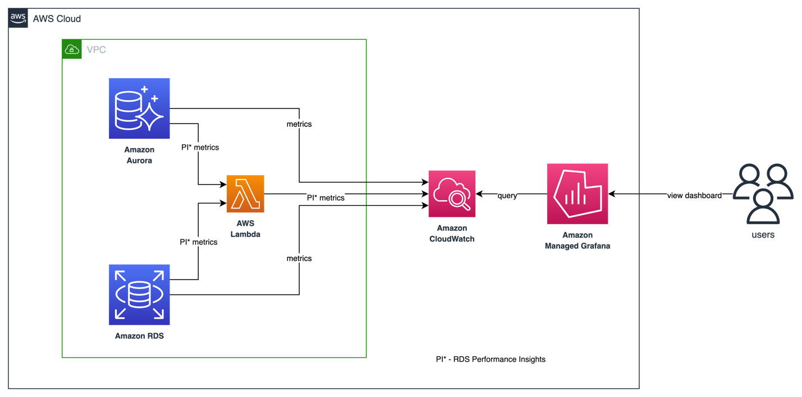
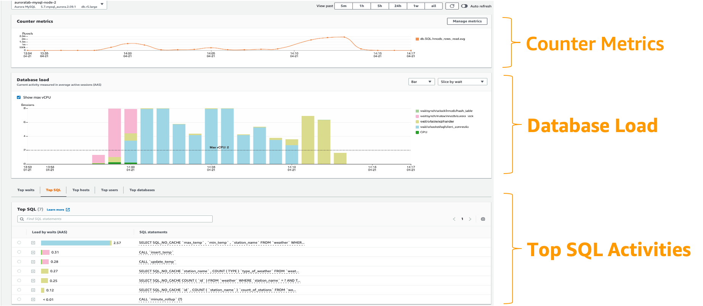
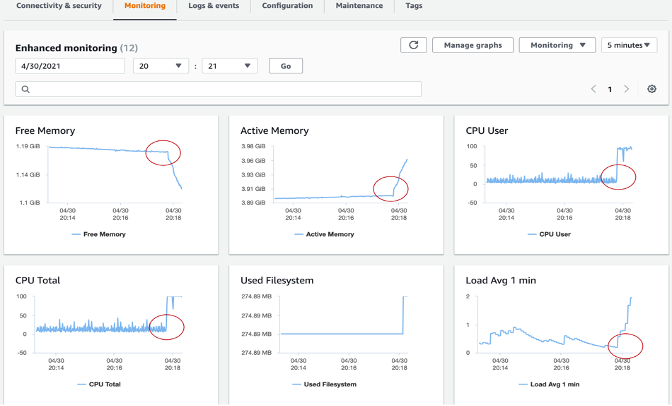

import RelatedEvents from '@site/src/components/RelatedEvents';

# RDS & Aurora モニタリング

## 関連イベント

<RelatedEvents topics={["databases"]} />


## 概要

Amazon RDS と Aurora は、デフォルトで 1 分間隔のメトリクスを `AWS/RDS` 名前空間で CloudWatch に公開します。Performance Insights、Database Insights、Enhanced Monitoring、およびデータベースログエクスポートと組み合わせることで、エージェントをインストールすることなくデータベースの健全性を完全に可視化できます。

このエントリでは、4 つの補完的なレイヤーをカバーします：高レベルの KPI とアラーム用の **CloudWatch メトリクス**、DB ロードの分析とクエリレベルの診断用の **Performance Insights**、ロックと実行プランの分析を含むフリート全体のモニタリング用の **Database Insights**、およびデータベースホスト上の OS レベルのプロセス可視性用の **Enhanced Monitoring** です。

まず、ピーク時とオフピーク時の両方でベースラインパフォーマンスを確立してください。2 週間のウィンドウで平均値、最大値、最小値を取得します — これがアラートの基準となります。

完全なリファレンス資料については、[Amazon RDS のモニタリング](https://docs.aws.amazon.com/AmazonRDS/latest/UserGuide/CHAP_Monitoring.html)および [CloudWatch Database Insights](https://docs.aws.amazon.com/AmazonCloudWatch/latest/monitoring/Database-Insights.html) を参照してください。

## 前提条件

- Amazon RDS または Aurora DB インスタンス（サポートされている任意のエンジン）
- IAM 権限：`rds:Describe*`、`cloudwatch:GetMetricData`、`cloudwatch:PutMetricAlarm`、`pi:GetResourceMetrics`、`logs:*`
- Enhanced Monitoring 用：`monitoring-rds-enhanced-role` IAM ロール（または `AmazonRDSEnhancedMonitoringRole` マネージドポリシー）
- Database Insights Advanced 用：15 ヶ月間保持の Performance Insights が有効であること
- ログ分析用：CloudWatch Logs へのデータベースログエクスポートが有効であること

## アーキテクチャ

```
┌──────────────────────────────────────────────────────────────┐
│                 Amazon RDS / Aurora                           │
│                                                              │
│  ┌──────────────┐  ┌────────────────┐  ┌─────────────────┐  │
│  │ DB Engine    │  │ Enhanced Mon.  │  │ Performance     │  │
│  │ Metrics      │  │ Agent (OS)     │  │ Insights Agent  │  │
│  └──────┬───────┘  └───────┬────────┘  └───────┬─────────┘  │
└─────────┼──────────────────┼────────────────────┼────────────┘
          │                  │                    │
          ▼                  ▼                    ▼
┌──────────────────────────────────────────────────────────────┐
│                    Amazon CloudWatch                          │
│                                                              │
│  ┌──────────────┐  ┌────────────────┐  ┌─────────────────┐  │
│  │ AWS/RDS      │  │ RDSOSMetrics   │  │ Database        │  │
│  │ Namespace    │  │ Log Group      │  │ Insights        │  │
│  └──────────────┘  └────────────────┘  └─────────────────┘  │
│                                                              │
│  ┌──────────────────────────────────────────────────────┐    │
│  │ Alarms → SNS → PagerDuty / Slack / Email            │    │
│  └──────────────────────────────────────────────────────┘    │
└──────────────────────────────────────────────────────────────┘
```

## デプロイ

### ステップ 1：Enhanced Monitoring を有効にする

```bash
aws rds modify-db-instance \
  --db-instance-identifier my-database \
  --monitoring-interval 60 \
  --monitoring-role-arn arn:aws:iam::123456789012:role/rds-monitoring-role \
  --apply-immediately
```

粒度オプション：1、5、10、15、30、または 60 秒です。

### ステップ 2：Performance Insights を有効にする

```bash
aws rds modify-db-instance \
  --db-instance-identifier my-database \
  --enable-performance-insights \
  --performance-insights-retention-period 731 \
  --apply-immediately
```

### ステップ 3：CloudWatch Logs へのログエクスポートを有効にする

```bash
aws rds modify-db-instance \
  --db-instance-identifier my-database \
  --cloudwatch-logs-export-configuration '{
    "EnableLogTypes": ["postgresql", "upgrade"]
  }' \
  --apply-immediately
```

MySQL の場合：`["audit", "error", "general", "slowquery"]` を使用してください。

### ステップ 4：主要メトリクスに CloudWatch アラームを作成する

```bash
aws cloudwatch put-metric-alarm \
  --alarm-name "RDS-HighCPU-my-database" \
  --namespace AWS/RDS \
  --metric-name CPUUtilization \
  --dimensions Name=DBInstanceIdentifier,Value=my-database \
  --statistic Average \
  --period 300 \
  --threshold 80 \
  --comparison-operator GreaterThanThreshold \
  --evaluation-periods 3 \
  --alarm-actions arn:aws:sns:us-east-1:123456789012:db-alerts
```

アラームを設定すべき主要メトリクス：

| メトリクス | しきい値ガイダンス |
|--------|-------------------|
| `CPUUtilization` | 80% 超が持続する場合 |
| `FreeableMemory` | インスタンスメモリの 25% 未満 |
| `FreeStorageSpace` | 割り当てストレージの 15% 未満 |
| `DatabaseConnections` | `max_connections` の 80% 超 |
| `ReadLatency` / `WriteLatency` | 20ms 超が持続する場合 |

### ステップ 5：Database Insights Advanced を有効にする（オプション）

CloudWatch → Database Insights でコンソールに移動し、クラスターを選択して Advanced モードを有効にします。これにより、フリートヘルスビュー、ロック分析、および 15 ヶ月間の保持が有効になります。

## 検証









1. **CloudWatch メトリクス：** `AWS/RDS` 名前空間でデータを確認します：
   ```bash
   aws cloudwatch get-metric-statistics \
     --namespace AWS/RDS \
     --metric-name CPUUtilization \
     --dimensions Name=DBInstanceIdentifier,Value=my-database \
     --start-time $(date -u -v-1H +%Y-%m-%dT%H:%M:%S) \
     --end-time $(date -u +%Y-%m-%dT%H:%M:%S) \
     --period 300 --statistics Average
   ```

2. **Enhanced Monitoring：** CloudWatch Logs で `RDSOSMetrics` ロググループを確認します。

3. **Performance Insights：** RDS コンソール → インスタンスを選択 → Performance Insights タブを開き → DB Load チャートにデータが表示されることを確認します。

4. **Database Insights：** CloudWatch コンソール → Insights → Database Insights を開き → フリートビューにインスタンスが表示されることを確認します。

## トラブルシューティング

| 症状 | 考えられる原因 | 修正方法 |
|---------|-------------|-----|
| Enhanced Monitoring データがない | IAM ロールが関連付けられていないか、信頼ポリシーが間違っている | モニタリングロールが `monitoring.rds.amazonaws.com` を信頼し、`AmazonRDSEnhancedMonitoringRole` ポリシーを持っていることを確認してください |
| Performance Insights に「Not enabled」と表示される | インスタンスで機能が有効化されていない | `--enable-performance-insights` を指定して `modify-db-instance` を実行してください |
| CloudWatch にログが表示されない | ログエクスポートが構成されていないか、エンジンログが無効 | `--cloudwatch-logs-export-configuration` でログエクスポートを有効にし、エンジンパラメータ（例：PostgreSQL の `log_min_duration_statement`）を設定してください |
| DB Load メトリクスが見つからない | Standard モードでは 7 日間のみ保持 | 15 ヶ月間保持のために Advanced モードを有効にし、インスタンスが Performance Insights をサポートしていることを確認してください |
| アラームが INSUFFICIENT_DATA のまま | メトリクスがまだ公開されていないか、ディメンションが間違っている | `DBInstanceIdentifier` ディメンションが正確に一致することを確認し、インスタンス作成後 5 分間待ってください |

## 関連ソリューション

- [Amazon OpenSearch Service モニタリング](../opensearch-monitoring/) — Prometheus と CloudWatch による OpenSearch ドメインのモニタリング
- [Amazon MSK モニタリング](../msk-monitoring/) — データベースに接続されたデータパイプラインに関連する Kafka クラスターのモニタリング
