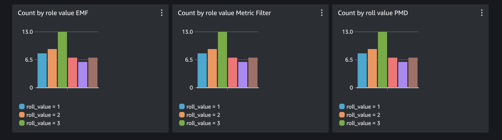

import RelatedEvents from '@site/src/components/RelatedEvents';

# Rust カスタムメトリクス

## 関連イベント

<RelatedEvents topics={["metrics"]} />

## 概要

AWS SDK for Rust を使用して、Rust アプリケーションからカスタム CloudWatch メトリクスを公開します。このソリューションでは、3 つのアプローチを紹介します：直接的な `PutMetricData` API 呼び出し、メトリクスフィルターを使用した `PutLogEvents`、および CloudWatch Embedded Metric Format（EMF）を使用した `PutLogEvents` です。各アプローチには、カーディナリティ、セットアップの複雑さ、およびコストに関する異なるトレードオフがあります。

## 前提条件

- Rust ツールチェーンがインストールされていること：
  ```
  curl --proto '=https' --tlsv1.2 -sSf https://sh.rustup.rs | sh
  ```
- 認証情報が設定された AWS CLI（`aws configure`）
- `cloudwatch:PutMetricData` および `logs:PutLogEvents` の IAM 権限
- CloudWatch ロググループとログストリーム：
  ```
  aws logs create-log-group --log-group-name rust_custom
  aws logs create-log-stream --log-group-name rust_custom --log-stream-name diceroll_log_stream
  ```

## アーキテクチャ

```
┌──────────────────┐     PutMetricData      ┌──────────────────┐
│  Rust Application│────────────────────────▶│ CloudWatch       │
│                  │     PutLogEvents (EMF)  │ Metrics          │
│                  │────────────────────────▶│                  │
│                  │     PutLogEvents        │ CloudWatch Logs  │
│                  │────────────────────────▶│ + Metric Filter  │
└──────────────────┘                         └──────────────────┘
```

## デプロイ

### PutMetricData

最も直接的なアプローチ — 時系列値を CloudWatch Metrics に直接書き込みます。

```rust
async fn put_metric_data(roll_value: i32) -> Result<(), cloudwatch::Error> {
    //Create a reusable aws config that we can pass to our clients
    let config = aws_config::load_defaults(BehaviorVersion::v2023_11_09()).await;

    //Create a cloudwatch client
    let client = cloudwatch::Client::new(&config);

    //Use fluent builders to build the required input for pmd call, starting with dimensions.
    let dimensions = Dimension::builder()
        .name("roll_value_pmd_dimension")
        .value(roll_value.to_string())
        .build();

    let put_metric_data_input = MetricDatum::builder()
        .metric_name("roll_value_pmd")
        .dimensions(dimensions)
        .value(f64::from(roll_value))
        .build();

    let response = client
        .put_metric_data()
        .namespace("rust_custom_metrics")
        .metric_data(put_metric_data_input)
        .send()
        .await?;
    println!("Metric Submitted: {:?}", response);
    Ok(())
}
```

### PutLogEvent とメトリクスフィルター

CloudWatch Logs に値を書き込み、メトリクスフィルターを使用してメトリクスを抽出します。

```rust
//Make a simple struct for the log message. We could also just create a json string manually.
#[derive(Serialize)]
struct DicerollValue {
    welcome_message: String,
    roll_value: i32,
}
```

```rust
//Create a reusable aws config that we can pass to our clients
let config = aws_config::load_defaults(BehaviorVersion::v2023_11_09()).await;

//Create a cloudwatch logs client
let client = cloudwatchlogs::Client::new(&config);

//Let's get the time in ms from unix epoch, this is required for CWlogs
let time_now = SystemTime::now()
    .duration_since(UNIX_EPOCH)
    .unwrap()
    .as_millis() as i64;

let log_json = json!(DicerollValue {
    welcome_message: String::from("Hello from rust!"),
    roll_value
});

let log_event = InputLogEvent::builder()
    .timestamp(time_now)
    .message(log_json.to_string())
    .build();

let response = client
    .put_log_events()
    .log_group_name("rust_custom")
    .log_stream_name("diceroll_log_stream")
    .log_events(log_event.unwrap())
    .send()
    .await?;

println!("Log event submitted: {:?}", response);
Ok(())
```

ログイベントを送信した後、CloudWatch コンソールで `rust_custom` ロググループにメトリクスフィルターを作成します：
- フィルターパターン：`{$.roll_value = *}`
- メトリクス値：`$.roll_value`

### PutLogEvent と Embedded Metric Format

ログイベントにメトリクス定義を直接埋め込みます — CloudWatch がメトリクスフィルターなしで自動的にメトリクスを抽出します。

```rust
//Create a reusable aws config that we can pass to our clients
let config = aws_config::load_defaults(BehaviorVersion::v2023_11_09()).await;

//Create a cloudwatch logs client
let client = cloudwatchlogs::Client::new(&config);

//get the time in unix epoch ms
let time_now = SystemTime::now()
    .duration_since(UNIX_EPOCH)
    .unwrap()
    .as_millis() as i64;

//Create a json string in embedded metric format with our diceroll value.
let json_emf = json!(
    {
        "_aws": {
        "Timestamp": time_now,
        "CloudWatchMetrics": [
            {
            "Namespace": "rust_custom_metrics",
            "Dimensions": [["roll_value_emf_dimension"]],
            "Metrics": [
                {
                "Name": "roll_value_emf"
                }
            ]
            }
        ]
        },
        "roll_value_emf_dimension": roll_value.to_string(),
        "roll_value_emf": roll_value
    }
);

let log_event = InputLogEvent::builder()
    .timestamp(time_now)
    .message(json_emf.to_string())
    .build();

let response = client
    .put_log_events()
    .log_group_name("rust_custom")
    .log_stream_name("diceroll_log_stream_emf")
    .log_events(log_event.unwrap())
    .send()
    .await?;

println!("EMF Log event submitted: {:?}", response);
Ok(())
```

### アプリケーションの実行

ビルドして実行し、テストデータを生成します：

```
cargo build
for run in {1..50}; do ./target/debug/custom-metrics; sleep 2; done
```

Metric Insights でメトリクスをクエリします：

```
SELECT COUNT(roll_value_emf) FROM rust_custom_metrics GROUP BY roll_value_emf_dimension
```



## 検証

1. CloudWatch コンソールを開き、**メトリクス > すべてのメトリクス**に移動します。
2. `rust_custom_metrics` 名前空間を見つけます。
3. メトリクス `roll_value_pmd`、`roll_value_emf`、およびメトリクスフィルターで抽出されたメトリクスがすべてデータポイントを公開していることを確認します。
4. 上記の Metric Insights クエリでダッシュボードを作成し、GroupBy チャートがロール値ごとのカウントを表示することを確認します。

## トラブルシューティング

| 症状 | 考えられる原因 | 修正方法 |
|---------|-------------|-----|
| `DispatchFailure` または認証情報エラー | AWS 認証情報が設定されていないか期限切れ | `aws configure` を実行するか、一時的な認証情報を更新してください |
| 名前空間にメトリクスが表示されない | 名前空間文字列が間違っているか、IAM ポリシーに `cloudwatch:PutMetricData` がない | 名前空間がコードと一致することを確認し、IAM ポリシーをチェックしてください |
| EMF メトリクスがログから抽出されない | `_aws` JSON ブロックの形式が正しくないか、ロググループが間違っている | [EMF 仕様](https://docs.aws.amazon.com/AmazonCloudWatch/latest/monitoring/CloudWatch_Embedded_Metric_Format_Specification.html)に対して JSON を検証し、ロググループが存在することを確認してください |
| メトリクスフィルターがメトリクスを生成しない | フィルターパターンの不一致 | CloudWatch Logs コンソールのフィルターテスターでパターンをテストしてください |

## クリーンアップ

完了したらロググループを削除します：

```
aws logs delete-log-group --log-group-name rust_custom
```

## 関連ソリューション

- [.NET アプリケーションモニタリング](../dotnet-application-monitoring/)
- [Lambda モニタリング](../lambda-monitoring/)
