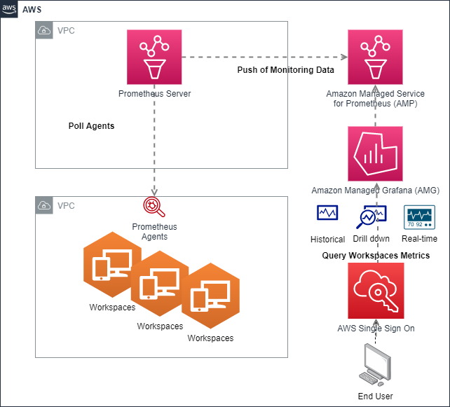

import RelatedEvents from '@site/src/components/RelatedEvents';

# Amazon WorkSpaces モニタリング

## 関連イベント

<RelatedEvents topics={["metrics"]} />

## 概要

各 WorkSpace インスタンスにデプロイされた Prometheus エージェント、スクレイピングと Amazon Managed Service for Prometheus（AMP）へのリモートライト用の EC2 上の Prometheus サーバー、および可視化用の Amazon Managed Grafana（AMG）を使用して、Amazon WorkSpaces 仮想デスクトップをモニタリングします。

これにより、サービスデスクスタッフは推測なしに WorkSpaces の CPU、メモリ、ネットワーク、およびディスクの問題を迅速に特定し、イベント後の分析のために過去のデータを調査できます。[Amazon WorkSpaces](https://docs.aws.amazon.com/workspaces/latest/adminguide/amazon-workspaces.html) を仮想 Desktop-as-a-Service（DaaS）ソリューションとして採用する組織は、Day 2 の運用モニタリングが必要です。クラウドベースのマネージドオープンソーススタック — 耐久性のあるメトリクスストレージ（150 日間保持）用の AMP とダッシュボード用の AMG — は、IT チームに必要なオブザーバビリティを提供しながら、自己管理型モニタリングインフラストラクチャのオーバーヘッドを排除します。

主な組織的メリット：

- **トリアージの高速化** — サービスデスクスタッフは、ユーザーに症状を説明してもらう代わりに、AMG ダッシュボードを使用して特定の WorkSpace の問題にドリルダウンできます。
- **イベント後の調査** — AMP はメトリクスを 150 日間保持し、インシデント発生後の根本原因分析を可能にします。
- **エージェントの自動ロールアウト** — Active Directory グループポリシーオブジェクト（GPO）が `windows_exporter` をすべての新しい WorkSpace に自動的にデプロイし、モニタリングされないインスタンスがないことを保証します。

## 前提条件

- Amazon WorkSpaces 環境がデプロイされ、アクセス可能であること
- Amazon Managed Service for Prometheus ワークスペース
- AMP をデータソースとして設定した Amazon Managed Grafana ワークスペース
- WorkSpaces へのネットワーク接続を持つ Prometheus サーバー用の EC2 インスタンス
- エージェントの自動デプロイ用の Active Directory グループポリシーオブジェクト（GPO）アクセス
- Prometheus EC2 VPC と WorkSpaces VPC 間の VPC ピアリングまたは接続
- Prometheus サーバーから各 WorkSpace へのポート **9182** のインバウンド TCP を許可するセキュリティグループ
- `AmazonPrometheusRemoteWriteAccess` マネージドポリシーを持つ、Prometheus EC2 インスタンスにアタッチされた IAM ロール

## アーキテクチャ



この図はエンドツーエンドのシグナルフローを示しています：

1. **windows_exporter エージェント**がすべての Amazon WorkSpace 上で動作し、TCP ポート 9182 でシステムメトリクス（CPU、メモリ、ディスク、ネットワーク）を公開します。
2. **EC2 上の Prometheus サーバー**が設定可能な間隔（デフォルト 15 秒）で各エージェントをスクレイプします。WorkSpaces は DHCP アドレスを使用するため、スクレイプターゲットリストは定期的に更新されます — 例えば、Active Directory DNS ゾーン転送を実行し、Prometheus ターゲットファイルを書き換える cron ジョブを使用します。
3. Prometheus は SigV4 認証を使用して、スクレイプされたメトリクスを **AMP ワークスペース**エンドポイントに**リモートライト**します。EC2 インスタンスは `AmazonPrometheusRemoteWriteAccess` ポリシーを持つ IAM インスタンスプロファイルを使用します。AMP が 150 日間の耐久性のあるストレージを提供するため、EC2 インスタンス上のローカル保持は 4 時間に設定されています。
4. **Amazon Managed Grafana** は Prometheus 互換のデータソースとして AMP をクエリし、サービスデスクスタッフ向けのダッシュボードをレンダリングします — すべての WorkSpace のリアルタイムおよび過去のビューを提供します。

VPC ピアリングが Prometheus VPC を WorkSpaces VPC に接続し、WorkSpaces 側の専用セキュリティグループが Prometheus サーバーのプライベート IP からのポート 9182 のインバウンドトラフィックを許可します。

## デプロイ

1. **AMP ワークスペースを作成します：**
   ```bash
   aws amp create-workspace --alias workspaces-monitoring
   ```
   出力から `workspaceId` をメモしてください — リモートライト URL に必要です。

2. **各 WorkSpace に `windows_exporter` をデプロイします。**
   [windows_exporter リリースページ](https://github.com/prometheus-community/windows_exporter/releases)から MSI をダウンロードし、Active Directory GPO 経由でデプロイして、すべての新しい WorkSpace がエージェントを自動的に受け取るようにします。デフォルトのインストールではポート 9182 でメトリクスが公開されます。個々の WorkSpace に手動でインストールすることもできます：
   ```powershell
   msiexec /i windows_exporter-<version>-amd64.msi LISTEN_PORT=9182
   ```
   エージェントが実行されていることを確認します：
   ```powershell
   # On the WorkSpace
   Invoke-WebRequest -Uri http://localhost:9182/metrics -UseBasicParsing | Select-Object -First 5
   ```

3. **EC2 に Prometheus サーバーをデプロイします。** Amazon Linux 2 インスタンスに Prometheus をインストールし、systemd サービスとして設定します。スクレイプとリモートライトの設定で `/etc/prometheus/prometheus.yml` を作成します：

   ```yaml
   global:
     scrape_interval: 15s
     evaluation_interval: 15s

   scrape_configs:
     - job_name: "workspaces"
       static_configs:
         - targets:
             - "10.0.0.10:9182"
             - "10.0.0.11:9182"
             # Add all WorkSpace IPs; automate with DNS zone transfer script

   remote_write:
     - url: "https://aps-workspaces.<region>.amazonaws.com/workspaces/<workspace-id>/api/v1/remote_write"
       sigv4:
         region: "<region>"
       queue_config:
         max_samples_per_send: 1000
         max_shards: 200
         capacity: 2500
   ```

   `<region>` と `<workspace-id>` を AMP ワークスペースの値に置き換えてください。EC2 インスタンスには `AmazonPrometheusRemoteWriteAccess` を持つ IAM インスタンスプロファイルが必要です — SigV4 署名は自動的に認証情報を取得します。

   DHCP 割り当ての WorkSpace IP を持つ環境の場合、Active Directory DNS ゾーン転送を実行して `static_configs` ターゲットを書き換え、Prometheus をリロード（`systemctl reload prometheus` または `kill -HUP`）する cron ジョブを設定してください。

4. **AMG が AMP ワークスペースをデータソースとして使用するように設定します。** AMG ワークスペースで、AMP クエリエンドポイントを使用して Prometheus データソースを追加します：
   ```
   https://aps-workspaces.<region>.amazonaws.com/workspaces/<workspace-id>
   ```
   SigV4 認証を有効にします。CPU、メモリ、ネットワーク、およびディスクメトリクスのダッシュボードをインポートまたは構築します。

## 検証

1. **Prometheus ターゲットを確認します。** `http://<prometheus-ec2-ip>:9090/targets` で Prometheus サーバー UI を開き、WorkSpaces エンドポイントがステータス **UP** と表示されることを確認します。

2. **AMG を通じて AMP をクエリします。** Amazon Managed Grafana で、AMP データソースを使用して Explore ビューを開き、以下の PromQL クエリを実行します：

   ```promql
   # Confirm targets are reporting
   up{job="workspaces"}

   # CPU usage per WorkSpace (rate of CPU time in seconds)
   rate(windows_cpu_time_total{mode="idle"}[5m])

   # Available disk space on the C: drive
   windows_logical_disk_free_bytes{volume="C:"}

   # Memory in use
   windows_os_physical_memory_free_bytes

   # List all monitored WorkSpace hostnames
   group by (hostname) (windows_cs_hostname)
   ```

3. **ダッシュボードパネルを確認します。** ダッシュボードパネルにデータが表示されることを確認します。デプロイが成功した場合、以下が表示されます：
   - すべての WorkSpaces が Prometheus で UP ターゲットとして表示される。
   - ゼロ以外の CPU、メモリ、およびディスクメトリクスが AMG パネルに流入している。
   - 複数のスクレイプ間隔後（通常 1〜2 分以内）に過去のデータがクエリ可能である。

## トラブルシューティング

| 症状 | 考えられる原因 | 修正方法 |
|---------|-------------|-----|
| Prometheus ターゲットが DOWN と表示される | エージェントがインストールされていないか、ファイアウォールがスクレイプポートをブロックしている | WorkSpace で `windows_exporter` が実行されていることを確認し（`Get-Service windows_exporter`）、セキュリティグループが Prometheus サーバー IP からのインバウンド TCP 9182 を許可していることをチェックしてください |
| AMG ダッシュボードにデータがない | AMP データソースの設定が間違っているか、IAM 権限がない | AMG データソース URL と SigV4 認証を確認し、AMG ワークスペースの IAM ロールに `aps:QueryMetrics` 権限があることをチェックしてください |
| Prometheus ログにリモートライトエラー | AMP エンドポイントが正しくないか、EC2 に IAM ロールがない | リモートライト URL が AMP ワークスペースと一致することを確認し、`AmazonPrometheusRemoteWriteAccess` を持つ IAM インスタンスプロファイルをアタッチしてください |
| ターゲットで WorkSpaces が古いか見つからない | DHCP アドレスが変更され、ターゲットリストが古い | DNS ゾーン転送スクリプトを再実行するか、`prometheus.yml` の `static_configs` を更新して Prometheus をリロードしてください |
| `windows_exporter` メトリクスページが空または 404 を返す | エクスポーターサービスがクラッシュしたか、コレクターが無効 | サービスを再起動し（`Restart-Service windows_exporter`）、Windows イベントログでエクスポーターエラーをチェックしてください |

## 関連ソリューション

- [ハイブリッド環境モニタリング](../hybrid-monitoring/) — オンプレミスおよびハイブリッドワークロード向けの EC2 + AMP + AMG + Prometheus 共有パターン
- [Amazon Managed Grafana セットアップ](../managed-grafana-setup/) — AMG の設定、データソース管理、ダッシュボードのベストプラクティス
- [オブザーバビリティコスト管理](../observability-cost-management/) — 大規模な AMP と AMG のコスト管理戦略
